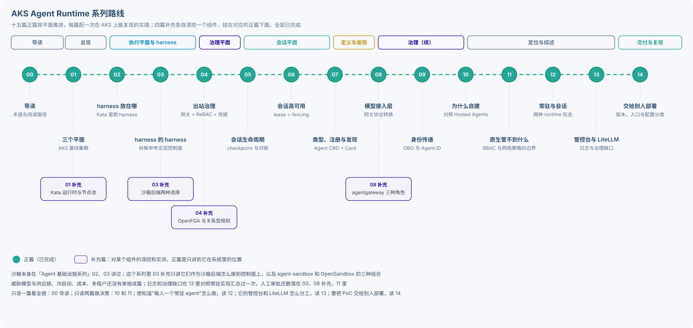
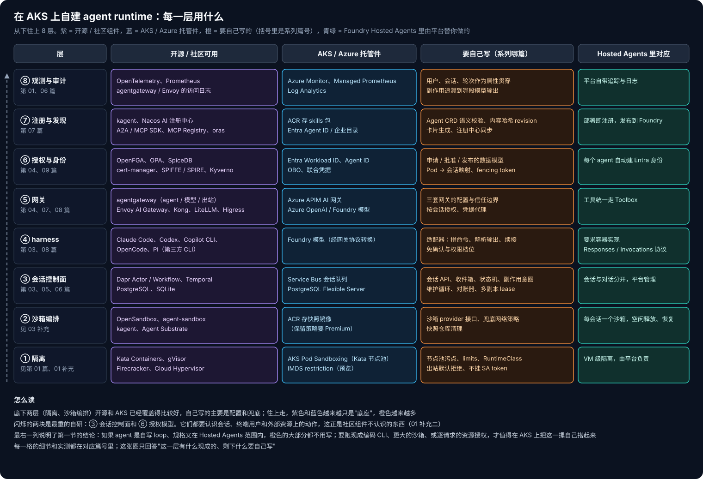

# AKS Agent Runtime 系列 00：导读

这个系列以 Kubernetes、特别是 AKS 为基座，把 agent runtime 一个平面一个平面地搭出来，每篇配一次在 AKS 或本机上能复现的实践。正篇十五篇（00 到 14），另有四篇补充，各自深挖一个组件。

## 一、全景：每一层用什么

整个系列讨论的东西，按层次摊开是下面这张图。底下两层（隔离、沙箱编排）开源项目和 AKS 已经覆盖得比较好；越往上，现成的组件越只是底座，要自己写的越多。最重的两块是会话控制面和授权模型。

这张图在[系列 10](AKS-Agent-Runtime系列10：为什么在AKS上自建.md) 里逐层展开；每一层在 Kubernetes 原生、agent-sandbox、OpenSandbox 和社区组件里各覆盖到哪，见[系列 11](AKS-Agent-Runtime系列11：Kubernetes原生机制管不到什么.md)。

## 二、贯穿全系列的几个说法

| 说法 | 指的是什么 | 在哪篇展开 |
|---|---|---|
| 三个平面 | 执行（沙箱）、会话（控制面）、治理（网关与授权），外加横切的定义与发现 | 01 |
| 执行平面里的三层 | 隔离层（Kata）、编排层（沙箱何时建、给谁、何时删）、访问层（生命周期 API 和沙箱里执行命令的接口） | 03 补充 |
| harness | 编码 CLI 这一类自带 loop 的 agent 引擎：Claude Code、Codex、Copilot CLI、OpenCode、Pi | 02、03 |
| 控制面，或"harness 的 harness" | 沙箱外驱动 harness 的平台代码：会话 API、收件箱、状态机、执行器、适配器 | 03 |
| 参考实现 | 一套把编码 CLI 做成可共享、可治理应用的实现，系列里大部分实测都基于它 | 03 起 |
| 安全沙箱实现 | 另一套实现：把 OpenSandbox 包在一个多租户 API 后面，加上归属、逐沙箱网络策略和工作负载身份；不认识 harness，可以作为参考实现的沙箱后端 | 03 |
| 常驻实现 | 第三套实现：每人一个常驻的 agent 实例，StatefulSet 单副本加 Kata，状态和私有记忆都在 HOME 盘上 | 12 |
| Runtime 管控台 | 常驻实现的 Portal：只把操作写成 CRD；模型相关的规则由 operator 单向投影到 LiteLLM，LiteLLM 负责执行和记账 | 13 |
| 常驻实例 / 会话调度 | 两种 runtime 形态：状态跟着人走、Pod 和盘长期都在；或状态跟着会话走、沙箱按会话领取和回收 | 12 |
| 应用定义与运行时类 | 用户调用的"那个 agent"是一份应用定义；运行时类由平台发布，定好镜像或预热池并钉死 harness | 07 |
| Ephemeral / Durable | 两种会话：一个沙箱用到底靠 TTL 兜底；或每轮 checkpoint、空闲暂停、保留期到才删 | 05 |
| 申请、批准、发布 | 一个动作能不能做，是应用申请、资源 owner 批准、平台发布三者的交集 | 04、04 补充 |
| 三种网关 | agent 网关（注册发现与调用转发）、模型网关（LLM proxy）、出站网关（访问外部资源） | 07、08 补充 |
| lease 与 fencing token | 多副本时决定"谁能写结果"，挡住卡住又醒来的旧主 | 06 |

## 三、按角色读

按自己关心的问题选一条路径，从左往右读。所有路径都从本篇开始：

- **平台架构师**（要搭一个能跑编码 agent 的平台）：[01 三个平面](AKS-Agent-Runtime系列01：Sandbox之外的三个平面.md) → [02 harness 放哪](AKS-Agent-Runtime系列02：Harness放在沙箱内还是沙箱外.md) → [03 控制面](AKS-Agent-Runtime系列03：控制面怎么驱动编码Harness.md) → [03 补充 沙箱后端](AKS-Agent-Runtime系列03补充：沙箱后端agent-sandbox与OpenSandbox.md) → [05 会话生命周期](AKS-Agent-Runtime系列05：会话生命周期与回收.md) → [07 注册与发现](AKS-Agent-Runtime系列07：Agent的类型、注册与发现.md) → [10 为什么自建](AKS-Agent-Runtime系列10：为什么在AKS上自建.md)
- **安全与合规**（沙箱里能碰到什么、以谁的名义）：[01 补充 Kata 墙](AKS-Agent-Runtime系列01补充：Kata运行时与节点池.md) → [02 什么留在外面](AKS-Agent-Runtime系列02：Harness放在沙箱内还是沙箱外.md) → [04 出站授权](AKS-Agent-Runtime系列04：出站治理与逐请求授权.md) → [04 补充 OpenFGA](AKS-Agent-Runtime系列04补充：OpenFGA与关系型授权.md) → [09 以谁的身份](AKS-Agent-Runtime系列09：Agent以谁的身份行事.md) → [11 原生管不到](AKS-Agent-Runtime系列11：Kubernetes原生机制管不到什么.md)
- **SRE / 运维**（挂了怎么办、谁来回收、容量怎么算）：[01 补充 容量按 VM](AKS-Agent-Runtime系列01补充：Kata运行时与节点池.md) → [03 补充 暂停恢复](AKS-Agent-Runtime系列03补充：沙箱后端agent-sandbox与OpenSandbox.md) → [05 回收与对账](AKS-Agent-Runtime系列05：会话生命周期与回收.md) → [06 多副本](AKS-Agent-Runtime系列06：会话管理与高可用.md) → [08 补充 网关部署](AKS-Agent-Runtime系列08补充：agentgateway的定位与三种角色.md)
- **选型决策**（要不要在 AKS 上自建、选哪些组件）：[01 三个平面](AKS-Agent-Runtime系列01：Sandbox之外的三个平面.md) → [10 对照 Hosted](AKS-Agent-Runtime系列10：为什么在AKS上自建.md) → [11 边界在哪](AKS-Agent-Runtime系列11：Kubernetes原生机制管不到什么.md) → [03 补充 沙箱后端选型](AKS-Agent-Runtime系列03补充：沙箱后端agent-sandbox与OpenSandbox.md) → [08 补充 网关选型](AKS-Agent-Runtime系列08补充：agentgateway的定位与三种角色.md)

时间少的话，每条路径只读前三站就能拿到主要结论。补充篇是对某个组件的深挖和实测，正篇读完、想知道"这块到底怎么做"时再读。每篇都能单独读，引用前文时会给出链接。

## 四、每篇一句话

**正篇**

- [01：Sandbox 之外的三个平面](AKS-Agent-Runtime系列01：Sandbox之外的三个平面.md)——沙箱只是 agent runtime 的一段，会话和治理才是 AKS 没有提供的部分。
- [02：Harness 放在沙箱内还是沙箱外](AKS-Agent-Runtime系列02：Harness放在沙箱内还是沙箱外.md)——编码 harness 整个关进 Kata 沙箱、免确认运行，凭据和授权留在外面。
- [03：控制面怎么驱动编码 Harness](AKS-Agent-Runtime系列03：控制面怎么驱动编码Harness.md)——一轮对话的八步、五种 CLI 的适配器、只开一个口的控制通道，以及沙箱后端的两种接法。
- [04：出站治理与逐请求授权](AKS-Agent-Runtime系列04：出站治理与逐请求授权.md)——网关只认和 Pod 绑定的证书，授权通过后才注入凭据，撤销约 1.2 秒生效。
- [05：会话生命周期与回收](AKS-Agent-Runtime系列05：会话生命周期与回收.md)——checkpoint 是把 rootfs 打成镜像，回收要有从外往里的对账器兜底。
- [06：会话管理与高可用](AKS-Agent-Runtime系列06：会话管理与高可用.md)——队列决定谁收消息，lease 加 fencing token 决定谁能写结果。
- [07：Agent 的类型、注册与发现](AKS-Agent-Runtime系列07：Agent的类型、注册与发现.md)——按"loop 归谁"分三类，一个 CRD 加不可变 revision，能被发现不等于能被调用。
- [08：模型接入层](AKS-Agent-Runtime系列08：模型接入层.md)——网关把 Anthropic Messages 转成 Azure OpenAI 的 Responses，Claude Code 也能用 GPT 模型。
- [09：Agent 以谁的身份行事](AKS-Agent-Runtime系列09：Agent以谁的身份行事.md)——OBO 把用户和代办应用同时写进令牌，Entra Agent ID 给每个 agent 独立身份。
- [10：为什么在 AKS 上自建](AKS-Agent-Runtime系列10：为什么在AKS上自建.md)——对照 Foundry Hosted Agents，自建只在三类场景下值得，并列出每一层用什么。
- [11：Kubernetes 原生机制管不到什么](AKS-Agent-Runtime系列11：Kubernetes原生机制管不到什么.md)——RBAC 和 NetworkPolicy 只能守底线，会话、终端用户、资源动作、模型和不可信的决策要另外补。
- [12：常驻实例与会话调度](AKS-Agent-Runtime系列12：常驻实例与会话调度.md)——每人一个常驻 agent 不用做快照、记忆天然有地方放，但算力按人常驻、出站默认放行；两种形态最后会走到常驻入口加会话执行池。
- [13：Runtime 管控台与 LiteLLM 的分工](AKS-Agent-Runtime系列13：Runtime管控台与LiteLLM的分工.md)——配置以 CRD 为准、单向投影到 LiteLLM；Agent UI、Terminal、Desktop 三个入口各管一层；LiteLLM 的 Agents 是 A2A 注册表，不是常驻实现的 Agent；五类日志串不起来，出站授权、审批、配额和追溯两边都没有。
- [14：让 PoC 能交给别人部署](AKS-Agent-Runtime系列14：让PoC能交给别人部署.md)——线上会悄悄回到 chart 里的旧版本；入口网关三道处理加 agent 前的网络策略，三种报错各对应一道；平台登记要从集群现查；配置分三类，交接前做三项检查。

**补充**

- [01 补充：Kata 运行时与节点池](AKS-Agent-Runtime系列01补充：Kata运行时与节点池.md)——Kata 替换的是 shim 和 runc，Kata Pod 上不了普通节点，容量按 limit 加 overhead 算。
- [03 补充：沙箱后端 agent-sandbox 与 OpenSandbox](AKS-Agent-Runtime系列03补充：沙箱后端agent-sandbox与OpenSandbox.md)——两者在编排层同类，OpenSandbox 多一层访问层，还能叠在 agent-sandbox 上，一共三种用法。
- [04 补充：OpenFGA 与关系型授权](AKS-Agent-Runtime系列04补充：OpenFGA与关系型授权.md)——三方交集怎么建模；打开 Check 缓存后撤销要等满一个 TTL。
- [08 补充：agentgateway 的定位与三种角色](AKS-Agent-Runtime系列08补充：agentgateway的定位与三种角色.md)——一个数据面、三套部署，以及它和 Kong、APIM、Higress、LiteLLM 的区别。

## 相关阅读

- [Agent 基础设施系列 02：Kubernetes 上的 Agent 沙箱](../../Notes/AI/agent/agent-runtime/Agent基础设施系列02：Kubernetes上的Agent沙箱.md)——沙箱相关项目的概况
- [Agent 基础设施系列 03：kagent 与 Agent Substrate](../../Notes/AI/agent/agent-runtime/Agent基础设施系列03：kagent与Agent-Substrate.md)
