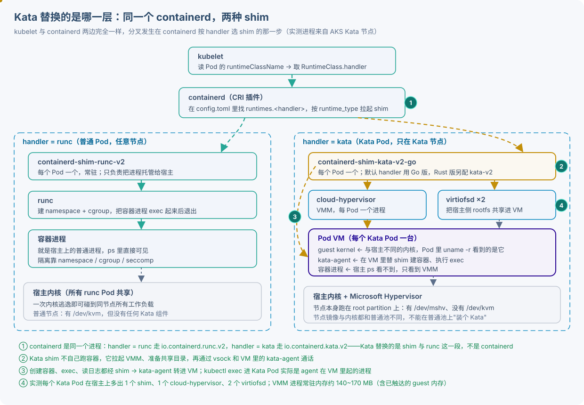
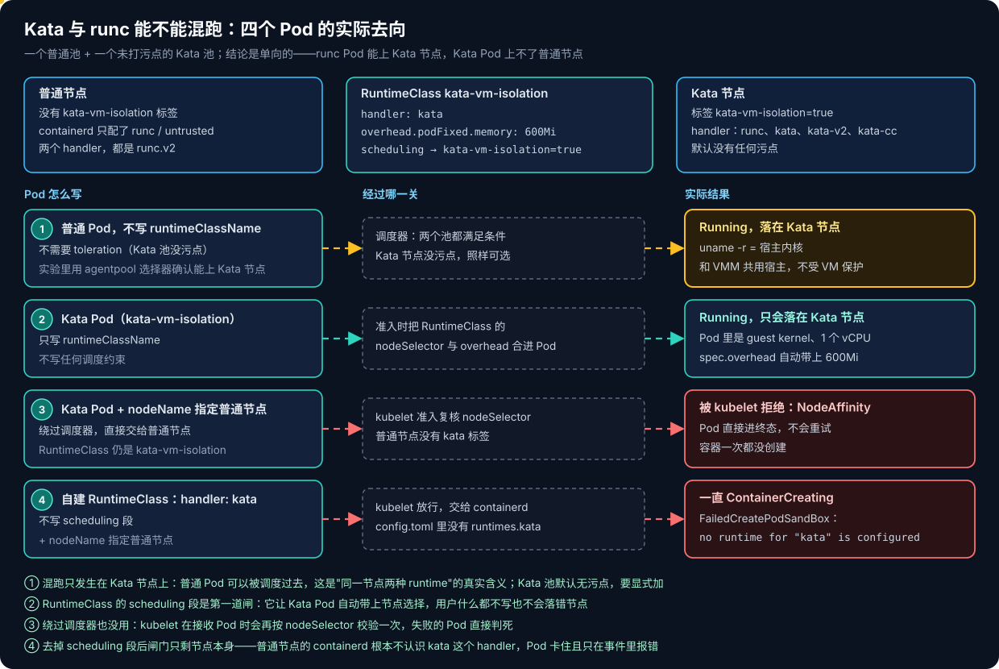
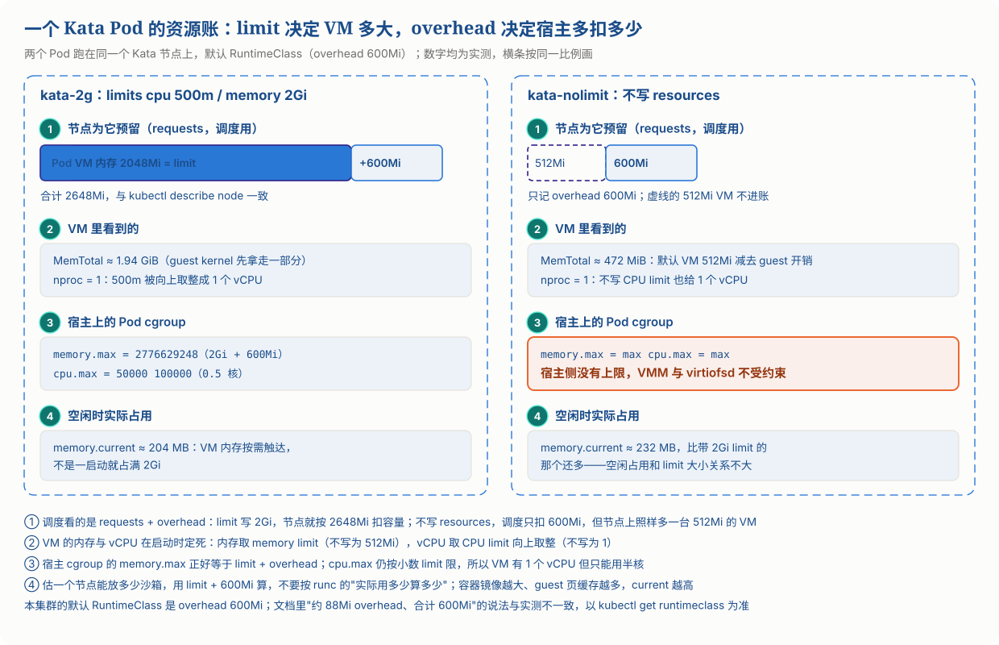

# AKS Agent Runtime 系列 01 补充：Kata 运行时与节点池

[系列 01](AKS-Agent-Runtime系列01：Sandbox之外的三个平面.md) 的实践里，Kata 只占了建池命令里的一行 `--workload-runtime KataVmIsolation`，后面所有沙箱 Pod 都靠一行 `runtimeClassName: kata-vm-isolation` 跑进 VM。这两行背后有几件事我当时没细看：Kata 节点池和普通节点池到底差在哪，Kata 是不是"把 runc 换掉"，节点上多装了什么，两种 runtime 能不能放在同一个池、同一个节点上。

这次我单独建了一个最小集群：一个普通系统池、一个 Kata 池，Kata 池故意不打污点，然后进节点看进程和配置、放几个 Pod 看它们落在哪、量 cgroup。测完资源组就删了。

## 一、Kata 替换的是哪一层

先说结论：**kubelet 和 containerd 都没换，换的是 containerd 下面那一段。**

kubelet 从 Pod 的 `runtimeClassName` 找到 RuntimeClass，取出里面的 `handler`，交给 containerd。containerd 在自己的配置里按 handler 名找对应的 runtime 段，再按 `runtime_type` 拉起 shim。普通 Pod 的 handler 是 `runc`，拉起 `containerd-shim-runc-v2`，再由 runc 建 namespace 和 cgroup，容器进程就是宿主上的普通进程。Kata Pod 的 handler 是 `kata`，拉起的是 `containerd-shim-kata-v2`，它不自己跑容器，而是起一个 VMM、准备共享目录，再通过 vsock 让 VM 里的 kata-agent 去建容器。



Kata 节点上 containerd 的配置里能直接看到这一点（只摘了 runtime 相关的几段）：

```toml
[plugins."io.containerd.grpc.v1.cri".containerd.runtimes.runc]
  runtime_type = "io.containerd.runc.v2"
[plugins."io.containerd.grpc.v1.cri".containerd.runtimes.kata]
  runtime_type = "io.containerd.kata.v2"
  privileged_without_host_devices = true
  [plugins."io.containerd.grpc.v1.cri".containerd.runtimes.kata.options]
    ConfigPath = "/usr/share/defaults/kata-containers/configuration.toml"
[plugins."io.containerd.grpc.v1.cri".containerd.runtimes.kata-v2]
  runtime_type = "io.containerd.kata.v2"
  pod_annotations = ["io.katacontainers.snapshot-name"]
  [plugins."io.containerd.grpc.v1.cri".containerd.runtimes.kata-v2.options]
    ConfigPath = "/usr/share/defaults/kata-containers/configuration-clh-azure-runtime-rs-v2.toml"
[plugins."io.containerd.grpc.v1.cri".containerd.runtimes.kata-cc]
  runtime_type = "io.containerd.kata-cc.v2"
```

`kata` 指向的 `configuration.toml` 里，hypervisor 是 `/usr/bin/cloud-hypervisor`，共享文件系统是 `virtio-fs`，守护进程是 `/usr/libexec/virtiofsd`，`default_vcpus` 和 `default_memory` 都是 0，也就是完全按 Pod 的 limit 来定 VM 规格。

在节点上放两个 Kata Pod 再看进程树，每个 Kata Pod 在宿主上多出四个进程：

- 一个 `containerd-shim-kata-v2-go`，常驻内存约 53 MB；
- 一个 `cloud-hypervisor`，就是这台 Pod VM 本身，常驻约 140~170 MB，这里面包括已经被 guest 触达的内存页；
- 两个 `virtiofsd`（一父一子），合计十几 MB，把宿主上这个 Pod 的共享目录挂进 VM。

容器进程本身在宿主的 `ps` 里看不到，宿主只看得到 VMM。`kubectl exec` 进 Kata Pod，实际是 shim 把请求转给 VM 里的 kata-agent，由 agent 在 VM 里起进程。

有一个细节和我预想的不一样：节点上同时装了 Go 版和 Rust 版两个 shim，但默认的 `kata` handler 走的是 Go 版。Rust 版挂在另一个 handler `kata-v2` 上，配置里还多了一个快照名注解；`kata-cc` 是机密容器用的。这两个 handler 集群里都没有对应的 RuntimeClass，`kubectl get runtimeclass` 只有 `kata-vm-isolation` 和 `runc` 两个。自己写 RuntimeClass 指到它们上面能不能用、受不受支持，我没有验证，也不建议在生产上这么做。

## 二、Kata 节点池多了什么

既然换的只是 shim，一个直觉是：在普通节点上装上 Kata 的 shim 和 VMM，不就能跑 Kata Pod 了？在 AKS 上不是这样。把两种节点放在一起对比：

| | 普通节点 | Kata 节点 |
|---|---|---|
| 节点镜像 | 普通 Azure Linux 镜像 | 单独的 Kata 节点镜像（名字里带 `katagen2`） |
| 宿主内核 | 普通 Azure Linux 内核 | 带 `mshv` 后缀的内核 |
| 虚拟化设备 | 有 `/dev/kvm`，没有 `/dev/mshv` | 有 `/dev/mshv`，没有 `/dev/kvm` |
| shim | 只有 `containerd-shim-runc-v2` | runc + Kata（Go 版、Rust 版） |
| VMM 与文件共享 | 无 | `cloud-hypervisor`、`virtiofsd` |
| containerd handler | `runc`、`untrusted`（都是 runc） | `runc`、`untrusted`、`kata`、`kata-v2`、`kata-cc` |
| 节点标签 | 无 Kata 标签 | `kubernetes.azure.com/kata-vm-isolation=true` |
| 污点 | 无 | 无（要自己加） |

最关键的是虚拟化设备那一行。Kata 节点上有 `/dev/mshv`、没有 `/dev/kvm`，说明这台节点 VM 本身是作为 Microsoft Hypervisor 的 root partition 跑起来的，Pod VM 由 cloud-hypervisor 通过 mshv 创建。普通节点虽然有 `/dev/kvm`（嵌套虚拟化），但用的是另一套内核和节点镜像，上面什么 Kata 组件都没有。

所以 **Kata 节点池不是"普通池 + 一个运行时插件"，而是另一种节点镜像**。这也是为什么在 AKS 上只能新建一个带 `--workload-runtime KataVmIsolation` 的池，不能在现有的普通池上"开启" Kata。官方文档列的硬性条件（只支持 Azure Linux、第二代且支持嵌套虚拟化的 VM 规格、不支持 Arm64、不能和 FIPS 或 Trusted Launch 同时开）也都是落在节点镜像这一层的。

还有一个小发现：`kata-vm-isolation` 这个 RuntimeClass 在集群创建时就有了，比我加 Kata 池还早。也就是说集群里能查到这个 RuntimeClass，不代表有节点能跑它。

## 三、两种 runtime 能不能混在一起

能，但只是单向的。我在 Kata 池不打污点的情况下放了四个 Pod：



关键在 RuntimeClass 本身。集群里实际的定义是这样的：

```yaml
apiVersion: node.k8s.io/v1
kind: RuntimeClass
metadata:
  name: kata-vm-isolation
handler: kata
overhead:
  podFixed:
    memory: 600Mi
scheduling:
  nodeSelector:
    kubernetes.azure.com/kata-vm-isolation: "true"
```

注意 `handler` 是 `kata`，不是 `kata-vm-isolation`。RuntimeClass 的名字和 containerd 里的 handler 名是两回事，自己写 RuntimeClass 时要填 `kata`。

`scheduling` 段会在准入时被合进 Pod：用了这个 RuntimeClass 的 Pod 自动带上 `kata-vm-isolation=true` 的节点选择，只会被调度到 Kata 节点。我又试了两种"硬塞"的做法：

- **用 `nodeName` 直接指定一个普通节点**，绕过调度器。kubelet 接收 Pod 时会再按 nodeSelector 检查一次，直接以 `NodeAffinity` 拒绝，Pod 进入终态，容器一次都没创建。
- **自己建一个只写 `handler: kata`、不带 `scheduling` 段的 RuntimeClass**，再用 `nodeName` 指到普通节点。这次 kubelet 放行了，但 containerd 报 `no runtime for "kata" is configured`，Pod 一直停在 ContainerCreating，错误只出现在事件里。

反过来，一个什么都没写的普通 Pod 完全可以落到 Kata 节点上：调度器看两个池都满足条件，Kata 节点没有污点，照样可选。它在 Kata 节点上用 runc 运行，`uname -r` 看到的是宿主内核。

所以"同一个节点能不能同时跑两种 runtime"的准确答案是：**Kata 节点上可以，runc Pod 和 Kata Pod 混跑；普通节点上不行，它根本不认识 kata 这个 handler。** 官方文档说"可以混合部署标准 Pod 和 Kata Pod"，指的就是前一种情况。

> [!WARNING]
> 混跑在 Kata 节点上的 runc Pod 不受 VM 保护，而且它和这个节点上所有 Pod VM 的 VMM 进程共用同一个宿主内核。对多租户沙箱来说，一个被攻破的普通 Pod 碰到的正是承载别人沙箱的那台宿主。所以沙箱节点池一定要打污点（系列 01 里的 `--node-taints sandbox=true:NoSchedule`），只让带 toleration 的沙箱 Pod 上去。

## 四、资源怎么算

Kata 在资源上和 runc 的差别，系列 01 和 [Agent 基础设施系列 02](../../Notes/AI/agent/agent-runtime/Agent基础设施系列02：Kubernetes上的Agent沙箱.md) 都提过"内存按 limit 固定、CPU 向上取整"。这次我把账从调度一直对到宿主 cgroup：



几个数对上了：

- **调度扣的是 limit + overhead。** 写了 2Gi limit 的 Pod，`kubectl describe node` 里的 requests 是 2648Mi，正好是 2048Mi 加 600Mi。不写 resources 的 Pod，requests 只有 overhead 的 600Mi，但节点上照样起了一台 512Mi 的 VM。
- **VM 规格在启动时定死。** 2Gi 的 Pod 里 `MemTotal` 约 1.94 GiB，不写 limit 的约 472 MiB，差的那部分被 guest kernel 拿走了。CPU limit 写 500m，VM 里 `nproc` 是 1；不写 CPU limit 也是 1。
- **宿主 cgroup 的 `memory.max` 正好是 limit + overhead**：2776629248 字节，就是 2Gi 加 600Mi。`cpu.max` 仍然按 500m 限成半核，所以 VM 有 1 个 vCPU，但只能用一半。
- **不写 resources 的 Kata Pod，宿主 cgroup 没有上限**，`memory.max` 和 `cpu.max` 都是 `max`，VMM 和 virtiofsd 的宿主侧开销不受任何约束。

overhead 这个数和文档对不上。文档说默认 RuntimeClass 加大约 88Mi 的宿主组件开销，和默认的 512Mi VM 合起来是 600Mi 的 cgroup 上限；我这个集群里 RuntimeClass 自己的 overhead 就是 600Mi，cgroup 上限是 limit 再加 600Mi。可能是不同时期的默认值，估容量时以 `kubectl get runtimeclass` 看到的为准。

按这个算法，一台 D8s_v5（32 GiB）的 Kata 节点，如果每个沙箱给 2Gi，扣掉系统预留后大约放得下十个，而不是按 runc"实际用多少算多少"估出来的几十个。空闲时两个 Pod 的 `memory.current` 只有 200 多 MB，说明 VM 内存是按需触达的；但调度不看实际用量，节点容量按 limit + overhead 扣掉就是扣掉了。

启动时间我也顺手对比了一下：同一个 Kata 节点、镜像已缓存的小容器，Kata Pod 从创建到 Ready 三次在 2.2~2.4 秒，runc Pod 在 2.0~4.1 秒，看不出差别。真正拉开冷启动的是大镜像拉取和 harness 本身的启动，这在[系列 02](AKS-Agent-Runtime系列02：Harness放在沙箱内还是沙箱外.md) 里量过。

## 五、放回 agent runtime 里看

这次拆下来，我对系列 01 的那几行配置多了几条具体的理解：

1. **Kata 是执行平面的一个原语，不是 agent runtime。** 它只回答"这个 Pod 跑在哪种墙后面"，什么时候建沙箱、给哪个会话用、什么时候暂停和回收，全在它上面那几层。系列 01 里"十步只有三步在沙箱里"，Kata 只管这三步里的隔离。
2. **用 RuntimeClass 而不是 nodeSelector 来选 Kata。** 只写 `runtimeClassName` 就够了，`scheduling` 段会替你把 Pod 送到 Kata 节点；反过来，只写 nodeSelector 把 Pod 送到 Kata 节点、却忘了 runtimeClassName，它就是一个跑在沙箱节点上的普通 runc Pod，什么隔离都没有。沙箱 Pod 的模板里两样都要有：runtimeClassName 决定隔离，toleration 决定能上污点池。
3. **沙箱节点池一定要打污点。** AKS 不会替你打，而混跑在上面的普通 Pod 和所有沙箱共享宿主。
4. **沙箱 Pod 一定要写 limits。** 不写，VM 是 512Mi 的默认值，调度只扣 600Mi，宿主侧 cgroup 还没有上限；写了，VM 规格、调度容量、宿主上限三者才对得上。
5. **容量规划按 VM 粒度算。** 每个沙箱占 limit + overhead，小数 CPU 也占一整个 vCPU；预热池里每多一个空闲沙箱，就多扣一份这样的容量。

## 相关阅读

- [AKS Agent Runtime 系列 01：Sandbox 之外的三个平面](AKS-Agent-Runtime系列01：Sandbox之外的三个平面.md)——基线集群、沙箱 Pod 的四条底线、Kata 池污点
- [AKS Agent Runtime 系列 02：Harness 放在沙箱内还是沙箱外](AKS-Agent-Runtime系列02：Harness放在沙箱内还是沙箱外.md)——在 Kata 沙箱里跑编码 harness 的实测
- [Agent 基础设施系列 02：Kubernetes 上的 Agent 沙箱](../../Notes/AI/agent/agent-runtime/Agent基础设施系列02：Kubernetes上的Agent沙箱.md)——Kata、gVisor、microVM 的区别，agent-sandbox 与 OpenSandbox

## 参考资料

- [Pod sandboxing with Azure Kubernetes Service](https://learn.microsoft.com/en-us/azure/aks/use-pod-sandboxing)
- [Pod sandboxing considerations on Azure Kubernetes Service](https://learn.microsoft.com/en-us/azure/aks/considerations-pod-sandboxing)
- [Kubernetes Runtime Class](https://kubernetes.io/docs/concepts/containers/runtime-class/)
- [Kubernetes Pod Overhead](https://kubernetes.io/docs/concepts/scheduling-eviction/pod-overhead/)
- [Kata Containers architecture](https://github.com/kata-containers/kata-containers/tree/main/docs/design/architecture)
- [Cloud Hypervisor](https://www.cloudhypervisor.org)
