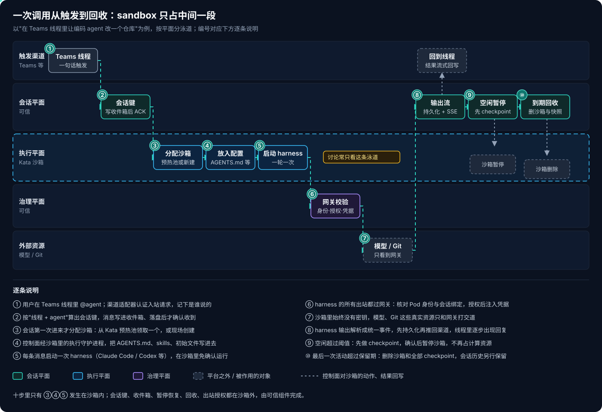
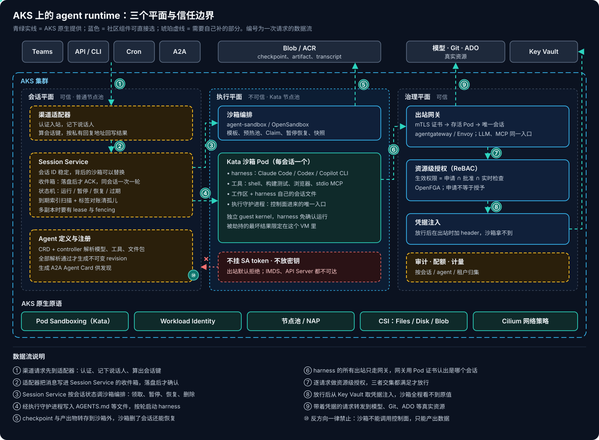
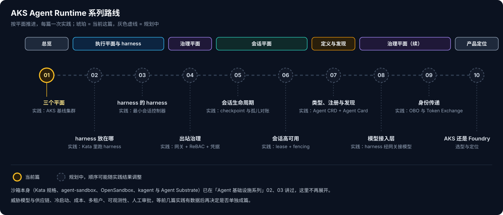

# AKS Agent Runtime 系列 01：Sandbox 之外的三个平面

最近在讨论把 AKS 当成 agent runtime，大家的注意力几乎都在 sandbox 上：Kata 还是 runc，隔离够不够强，出站怎么拦。这些问题当然要回答，但我把一个编码 agent 从"被叫起来"到"被回收"完整走了一遍，发现 sandbox 只是其中一段。harness 本身是一个会调用模型和工具的 loop，会话要跨好几轮甚至好几天，agent 需要被定义、注册、发现，每次访问外部资源都要逐请求授权，这些都不在沙箱里发生。

所以我打算写一个系列，以 Kubernetes、特别是 AKS 为基座，一个平面一个平面地把 agent runtime 搭出来，每篇配一次实践。沙箱本身——AKS 上 Kata 的规格、agent-sandbox、OpenSandbox、kagent 与 Agent Substrate——在 [Agent 基础设施系列 02](../../Notes/AI/agent/agent-runtime/Agent基础设施系列02：Kubernetes上的Agent沙箱.md) 和 [03](../../Notes/AI/agent/agent-runtime/Agent基础设施系列03：kagent与Agent-Substrate.md) 已经讲过，这里只在需要时引用，不再重复。

## 一、把一次调用从头走到尾

拿一个具体场景：用户在 Teams 线程里 @ 一个编码 agent，让它改一个仓库，过两天又回到同一个线程追问。按平面分泳道画出来是这样的：



十步里只有 ③④⑤——分配沙箱、放入配置、启动 harness——发生在沙箱里。走完这一遍，我对"agent 调用"的理解改了三处：

**调用的单位是会话，不是一次 API 请求。** 第一条消息创建会话，之后同一个线程里的每条消息都是这个会话里的一轮。会话 ID 是稳定的，背后的沙箱可以暂停、替换、从快照重建。两天后用户追问时，原来的 Pod 很可能已经不在了，但会话还在，harness 也能凭自己的原生会话文件接上之前的上下文。

**结果是流式持续产出的，不是一个返回值。** harness 每输出一段，都先在沙箱外持久化，再推给渠道。Teams、CLI 这些渠道订阅的是这个输出流，而不是阻塞等调用返回。这样沙箱中途挂掉，已经产出的内容也不会丢。

**回收要由会话层负责，不能只靠沙箱的 TTL。** 一个固定的 TTL 会在长任务跑到一半、或者 checkpoint 做到一半的时候把沙箱删掉。合理的做法是：空闲超过阈值就先 checkpoint 再暂停，最后一次活动超过保留期才真正删除。会话层自己也会宕机，所以还得有一套按标签和数据库对账的兜底清理，把没人认领的沙箱找出来删掉。

## 二、三个平面各管什么

把上面这些步骤归类，一个完整的 agent runtime 至少有三个平面：

- **执行平面**：隔离环境、文件、命令执行、快照。沙箱就在这一层。
- **会话平面**：会话身份、收件箱、状态机，以及 harness 的调用与续接、暂停、恢复、回收。
- **治理平面**：工作负载身份、出站网关、凭据注入、资源级授权、审计与配额。

另外还有一件横切的事：**agent 怎么定义、注册、被发现**。同一个 agent 要能被 Teams、CLI、定时任务和别的 agent 找到并调用，调用方不应该关心它背后跑的是 Claude Code 还是自己写的 loop。

放到 AKS 上，三个平面和信任边界是这样的：



图里的颜色就是我想说的重点：青绿色的部分 AKS 已经提供，蓝色的有成熟的社区组件可以直接选，琥珀色的部分要自己补。

| 平面    | AKS 原生提供                             | 社区组件可选                                    | 需要自己补                               |
| ----- | ------------------------------------ | ----------------------------------------- | ----------------------------------- |
| 执行    | Pod Sandboxing（Kata）、节点池与 NAP、CSI 存储 | agent-sandbox、OpenSandbox（预热池、Claim、暂停恢复） | 沙箱镜像里 harness 的适配与版本固定              |
| 会话    | 无                                    | Dapr、Durable Task 等可作为底座                  | 会话键、收件箱、状态机、checkpoint 编排、回收与对账、多副本 |
| 治理    | Workload Identity、Cilium 网络策略        | agentgateway / Envoy、OpenFGA              | 把 Pod 身份映射到会话、申请与审批流程、审计归集          |
| 定义与发现 | CRD 与 controller 机制                  | kagent 的 Agent CRD、A2A Agent Card         | 统一的 Agent 定义、不可变 revision、发现与调用授权分离 |

会话平面那一行 AKS 一格都填不上，这是最值得注意的地方。

## 三、harness 本身也要当成不可信

讨论 harness 放在哪之前，有一个前提要先定下来：**在多租户平台上，harness 自己也应该被视为不可信。** harness 读的是模型输出、网页、仓库里的 README，这些都可能带着 prompt injection；一旦被劫持，harness 就成了攻击者。Claude Code、Codex、Copilot CLI 自带的"调用前确认"和进程级沙箱（bubblewrap、seatbelt、landlock）可以当第二层防护，但不能当租户之间的边界。

所以对编码类 harness，我更倾向于把整个 harness 连同工具、工作区一起放进 Kata 沙箱，让它在里面免确认运行。这时候真正要想清楚的，是**哪些东西必须留在沙箱外**：

1. 模型 API key、Git token、云凭据——沙箱里永远没有原始密钥；
2. 授权决策——这个会话能不能对某个资源做某个动作；
3. 模型路由、配额与计费；
4. checkpoint 与恢复的控制、保留期、审计日志、人工审批。

沙箱里的东西被劫持了也可以接受，因为最坏的结果被关在那个 VM 里；沙箱外的这四类，harness 无权改动。

编码类 harness 很难拆成"loop 在外、只把 bash 放进沙箱"，因为它的 Read、Edit、Grep 这些工具默认直接操作本地文件系统，拆开就得把每个文件工具都改成远程调用，那已经是在改造 harness，而不是部署 harness。反过来，自己写的 loop（LangGraph、ADK、Microsoft Agent Framework）就适合放在沙箱外，需要执行代码时再调沙箱的执行 API。两种拓扑各自的边界和坑（比如外部 harness 持有凭据导致的 confused deputy），放到下一篇展开。

## 四、AKS 缺的是哪一层

我对照着读了一个内部参考实现，它在 AKS 上把编码 harness 做成了可共享、可治理的应用。有几处设计让我印象很深，也直接说明了 AKS 之上还差什么：

- **只有平台控制面持有沙箱生命周期 API 的身份。** 把 harness 放进沙箱、启动、暂停、删除，都是平台代码做的，不是 agent 做的。它跑在沙箱外的普通 Deployment 里。
- **平台和 harness 之间只有一个接口。** 就是沙箱里的执行守护进程：执行命令、读写文件。沙箱往回只能产出数据，不能调用控制面，也拿不到 ServiceAccount token。
- **harness 内部的 subagent 不会派生新沙箱。** 需要另一个隔离环境时，只能通过一条受控的 agent 调 agent 的路径，由控制面代为分配，而且只允许一跳，子会话不继承父会话的权限。
- **生效权限是三者的交集。** agent 申请了什么、资源 owner 批准了什么、这一次请求实时检查是否通过，三者都满足才放行。申请不等于授予。
- **会话层是单实例。** 状态存在一个本地数据库里，没有多副本 lease。对内部工具够用，但面向客户、要跨多天、要高可用的场景，这一层必须重做。

这些都不是 Kubernetes 原语能直接给的。AKS 提供的是"把 harness 跑成一个隔离的 Pod"，而让它成为一个 runtime，关键在于**一个懂 harness 的控制器和会话层**。所以我觉得对产品更有意义的问题，不是"sandbox 够不够强"，而是：Azure 要不要在 AKS 之上提供这样一层 harness 与会话编排？自建，还是对齐 kagent、agent-sandbox、Agent Substrate 这些上游 API？这个问题留到系列最后一篇，和 Foundry Hosted Agents 放在一起回答。

## 五、系列怎么推进



顺序大致是先执行和 harness，再治理，然后是会话，最后是定义发现和定位。每篇都配一次在 AKS 上能复现的实践，后面的实践会复用前面搭好的环境：02 在这篇的基线集群上跑 harness，03 写一个最小的会话控制器去驱动它，04 给它的出站加上网关和授权。

## 六、实践 01：AKS 基线集群

这次实践不碰任何 agent，只把后面每篇都要用的集群搭好，并验证沙箱 Pod 的几条底线：跑在独立的 guest kernel 里、没有 ServiceAccount token、出站默认拒绝，而且 IMDS 和 API Server 都连不上。为了确认拦住流量的确实是策略，我在同一个集群里放了一个对照组：普通 runc Pod，不加任何网络策略，SA token 按默认挂载。

**1. 建集群和 Kata 节点池。** 系统池用 Cilium 数据面，后面的网络策略都靠它执行；同时打开 OIDC issuer 和 Workload Identity，留给治理平面的组件用。集群创建大约 6 分钟，加 Kata 池不到 2 分钟。

```bash
RG=rg-agent-runtime
CLUSTER=aks-agent-runtime
LOCATION=eastus2

az group create -n $RG -l $LOCATION

az aks create -g $RG -n $CLUSTER \
  --os-sku AzureLinux \
  --node-count 2 --node-vm-size Standard_D4s_v5 \
  --network-plugin azure --network-plugin-mode overlay \
  --network-dataplane cilium \
  --enable-oidc-issuer --enable-workload-identity \
  --generate-ssh-keys

az aks nodepool add -g $RG --cluster-name $CLUSTER \
  --name sandbox \
  --os-sku AzureLinux \
  --workload-runtime KataVmIsolation \
  --node-vm-size Standard_D8s_v5 --node-count 1 \
  --node-taints sandbox=true:NoSchedule

az aks get-credentials -g $RG -n $CLUSTER
kubectl get runtimeclass
```

`--node-taints` 这一行是踩坑后加的。AKS 会自动建好 `kata-vm-isolation` 这个 RuntimeClass，并带上 `kubernetes.azure.com/kata-vm-isolation: "true"` 的 nodeSelector，所以 Kata Pod 一定会落到 Kata 池。但反过来不成立：我第一次建池时没加污点，节点上的 taints 是空的，结果对照组那个普通 runc Pod 也被调度到了 Kata 节点上。

> [!WARNING]
> 不要指望 AKS 替你给 Kata 池打污点。我在 2026-11 新建的集群上看到的 Kata 节点没有任何污点，普通工作负载会和沙箱混跑在同一批节点上。建池时显式加 `--node-taints`，沙箱 Pod 加对应的 toleration；已有的池可以用 `az aks nodepool update --node-taints` 补上。补上之后再调度，对照组就回到了普通节点。

**2. 给沙箱单独一个 namespace，出站默认拒绝，只放行 DNS。** 后面加了出站网关，再单独放行到网关的流量。

```yaml
apiVersion: v1
kind: Namespace
metadata:
  name: sandboxes
---
apiVersion: networking.k8s.io/v1
kind: NetworkPolicy
metadata:
  name: default-deny-egress
  namespace: sandboxes
spec:
  podSelector: {}
  policyTypes: ["Egress"]
  egress:
    - to:
        - namespaceSelector:
            matchLabels:
              kubernetes.io/metadata.name: kube-system
          podSelector:
            matchLabels:
              k8s-app: kube-dns
      ports:
        - { port: 53, protocol: UDP }
        - { port: 53, protocol: TCP }
```

**3. 起一个探针 Pod。** 显式关掉 SA token 的自动挂载，并写上 limits——Kata 按 limit 给 VM 分内存，不写就是很小的默认值。

```yaml
apiVersion: v1
kind: Pod
metadata:
  name: probe
  namespace: sandboxes
spec:
  runtimeClassName: kata-vm-isolation
  automountServiceAccountToken: false
  tolerations:
    - { key: sandbox, operator: Equal, value: "true", effect: NoSchedule }
  containers:
    - name: probe
      image: curlimages/curl:8.10.1
      command: ["sleep", "infinity"]
      resources:
        limits: { cpu: "1", memory: 1Gi }
```

**4. 逐条检查。** 判断方式很简单：`curl` 能建立连接就算可达，哪怕 API Server 回的是 401。

```bash
P="kubectl exec -n sandboxes probe --"

# guest kernel：与节点的 kernelVersion 不同
$P uname -r
kubectl get node -l kubernetes.azure.com/agentpool=sandbox \
  -o jsonpath='{.items[0].status.nodeInfo.kernelVersion}'

# 没有 SA token：目录不存在
$P ls /var/run/secrets/kubernetes.io/serviceaccount

# IMDS、API Server、外网：都应超时
$P curl -s -m 5 -H Metadata:true \
  "http://169.254.169.254/metadata/instance?api-version=2021-02-01"
$P curl -sk -m 5 https://kubernetes.default.svc/version
$P curl -s -m 5 https://github.com
```

两个 Pod 跑同一套检查，结果正好相反：

| 检查项 | Kata + 默认拒绝出站 | 对照组：runc、无策略 |
|---|---|---|
| 内核 | guest kernel，与节点不同 | 与节点相同 |
| SA token | 目录不存在 | `ca.crt`、`namespace`、`token` 都在 |
| IMDS | 超时 | 可达，能取到节点身份的 token |
| API Server | 超时 | 可达，返回 401 |
| github.com | 超时 | 可达 |
| DNS 解析 | 正常 | 正常 |

对照组里最值得警惕的是 IMDS 那一行。我在对照组里请求了 IMDS 的 token 接口，直接拿到了一个 ARM 的 Bearer token，有效期 24 小时。对应的 `client_id` 正是这个集群的 kubelet 托管身份。

> [!CAUTION]
> 不加出站策略的 Pod 可以从 `169.254.169.254` 取到节点 kubelet 身份的 Azure token。新集群里这个身份还没有任何角色分配，所以暂时拿去也做不了什么；但生产集群里它通常至少有 ACR 的拉取权限，有时还会被顺手授予更多权限。harness 一旦被注入，这就是一条从沙箱直通 Azure 控制面的路。沙箱 namespace 的默认拒绝必须覆盖 IMDS，Workload Identity 也替代不了这一条。

最后顺手量了启动耗时：在镜像已经缓存的情况下，Kata Pod 从 apply 到 Ready 三次都是 3.3 秒左右，runc 是 3.1 秒左右。这只是一个很小的探针镜像、节点上只有一个沙箱的情况，真正的冷启动要算上大镜像拉取和 harness 本身的启动，放到下一篇用真实的编码 harness 镜像再量。

做完这一步，集群就有了一个"什么都出不去"的沙箱 namespace。下一篇在里面放一个真正的编码 harness，看看它被关起来以后还能做什么、需要从哪里开口子。

## 相关阅读

- [Agent 基础设施系列 01：三层划分与自建路线](../../Notes/AI/agent/agent-platform/Agent基础设施系列01：三层划分与自建路线.md)——Framework、Runtime、Platform 的划分，以及在 AKS 上自建的参考组合
- [Agent 基础设施系列 02：Kubernetes 上的 Agent 沙箱](../../Notes/AI/agent/agent-runtime/Agent基础设施系列02：Kubernetes上的Agent沙箱.md)——AKS Kata 的规格与限制、agent-sandbox、OpenSandbox
- [Agent 基础设施系列 03：kagent 与 Agent Substrate](../../Notes/AI/agent/agent-runtime/Agent基础设施系列03：kagent与Agent-Substrate.md)——把 agent 当作 CRD 和 actor 来管
- [Foundry Agent 三种形态对比与选型](../Foundary-Agent/Foundry-Agent三种形态对比与选型.md)——托管侧的对照

## 参考资料

- [Pod Sandboxing with Azure Kubernetes Service](https://learn.microsoft.com/en-us/azure/aks/use-pod-sandboxing)
- [Azure CNI Powered by Cilium](https://learn.microsoft.com/en-us/azure/aks/azure-cni-powered-by-cilium)
- [Use Microsoft Entra Workload ID with AKS](https://learn.microsoft.com/en-us/azure/aks/workload-identity-overview)
- [kubernetes-sigs/agent-sandbox](https://github.com/kubernetes-sigs/agent-sandbox)
- [Running Agents on Kubernetes with Agent Sandbox](https://kubernetes.io/blog/2026/03/20/running-agents-on-kubernetes-with-agent-sandbox)
- [agentgateway](https://agentgateway.dev)
- [OpenFGA](https://openfga.dev)
- [Hosted agents in Foundry Agent Service](https://learn.microsoft.com/en-us/azure/foundry/agents/concepts/hosted-agents)
