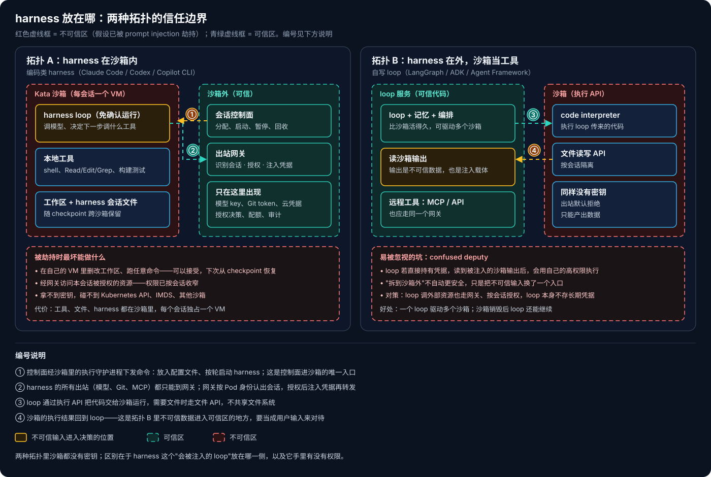
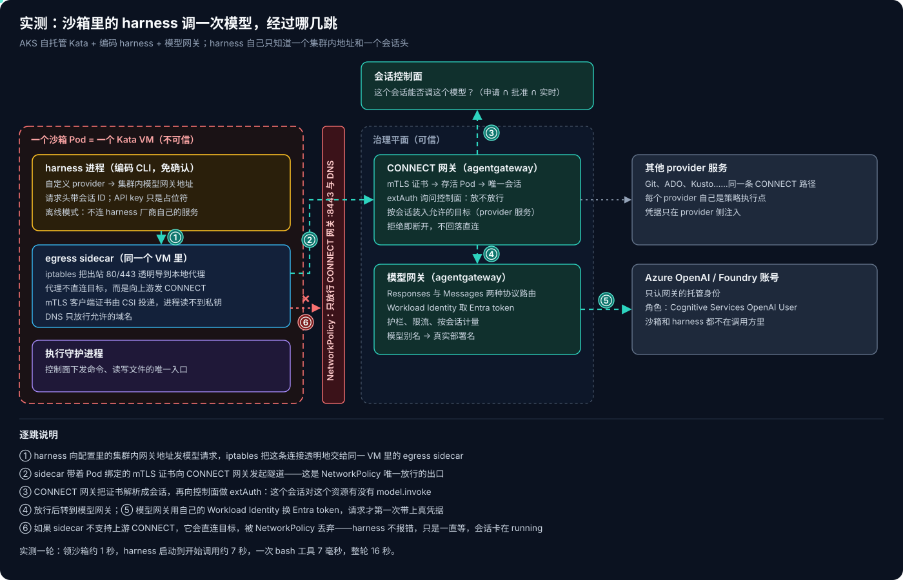
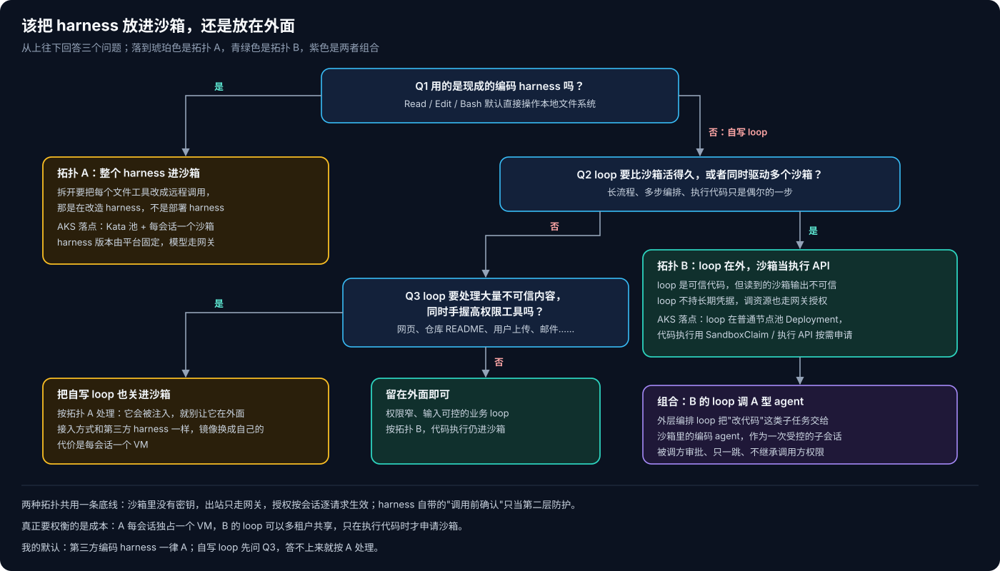

# AKS Agent Runtime 系列 02：Harness 放在沙箱内还是沙箱外

[第 01 篇](AKS-Agent-Runtime系列01：Sandbox之外的三个平面.md)把一次调用拆成十步之后，留下一个最先要定的问题：harness 这个 loop 放在哪。它决定了沙箱要装什么、凭据放哪里、授权在哪一层做，也决定了每个会话要花多少钱。

这篇先讲判断原则和两种拓扑，再讲我在 AKS 上把一个编码 harness 关进 Kata 沙箱跑起来时看到的真实链路。

## 一、先把 harness 当成不可信

讨论"什么在沙箱里执行"时，很容易按命令来分：`git clone` 放外面，`npm test` 放里面。我后来觉得这个思路分不清楚。关键不在于是哪条命令，而在于两点：这个动作的内容是不是由模型输出或不可信数据决定的，以及它能碰到什么。

按这个标准看，**harness 本身就该被当成不可信。** harness 读的是模型输出、网页、仓库里的 README、用户上传的文件，每一样都可能带着 prompt injection。一旦被劫持，harness 就成了攻击者，而且它手里正好有 shell 和文件工具。

Claude Code、Codex、Copilot CLI 都带"每次调用前确认"和进程级沙箱（bubblewrap、seatbelt、landlock）。在个人电脑上，这些是合理的防线；放到多租户平台上，它们只能当第二层防护，不能当租户之间的边界。原因很直接：确认要有人盯着点，而平台上的 agent 往往是被 Teams 消息或定时任务叫起来的，没人在旁边；进程级沙箱和宿主共享一个内核，挡不住内核漏洞。

## 二、两种拓扑

harness 放在哪，基本就是下面两种选择：

**拓扑 A：harness 在沙箱内。** harness 进程、它调用的工具、工作区都放在同一个 Kata VM 里，让 harness 免确认运行。凭据、授权决策、会话状态、审计都留在沙箱外。被劫持的最坏结果，是它在自己的 VM 里把工作区搞乱，或者在本会话被授权的范围内调用资源——前者可以从 checkpoint 恢复，后者的权限已经按会话收窄了。Claude Code、Codex 的云端模式，Foundry Hosted Agents 的"每会话一个沙箱"，走的都是这条路。

**拓扑 B：harness 在外，沙箱当工具。** loop 是自己写的可信代码（LangGraph、ADK、Microsoft Agent Framework），持有记忆和编排逻辑，需要执行代码时才调用沙箱的执行 API。它适合两种情况：一个 loop 要同时驱动多个沙箱；或者流程要比单个沙箱活得更久，沙箱销毁了 loop 还得接着往下走。

> [!WARNING]
> 拆到沙箱外并不自动更安全。拓扑 B 里，loop 要读沙箱返回的输出，而这份输出同样可能被注入。如果 loop 手里直接握着 Git token 或云凭据，它读完一段被污染的输出，就会用自己的高权限去执行——这就是 confused deputy。对策是让 loop 调外部资源也走同一个网关、受同一套按会话的授权，loop 本身不存长期凭据。

## 三、编码类 harness 为什么拆不开

既然 harness 不可信，一个直觉是：loop 放在外面，只把 bash 关进沙箱，岂不是两全其美？对自写的 loop 可以这样做，对 Claude Code 这类编码 harness 行不通。

编码 harness 的工具默认操作本地：Read、Edit、Grep 直接读写本机目录，Bash 在本机 shell 里执行，测试、构建都假设工作区就在脚下。要把 loop 拆出去，就得把每一个文件工具都改成远程调用，还要处理路径映射、文件监听、大文件传输。做到这一步，已经是在改造 harness，而不是部署 harness 了，每次 harness 升级还得重新适配一遍。

所以对编码类 harness，我的做法是整个放进沙箱。这时真正要想清楚的，变成了**哪些东西必须留在沙箱外**：

| 放在沙箱内（被劫持也能接受） | 必须在沙箱外（harness 无权改） |
|---|---|
| harness loop 进程 | 模型 API key、Git token、云凭据 |
| shell、构建测试、包安装、浏览器、本地 stdio MCP server | 授权决策：这个会话能不能对某资源做某动作 |
| Read / Edit / Grep 等文件工具与工作区 | 模型路由、配额、计费 |
| 运行时临时状态、harness 自己的会话文件 | checkpoint 与恢复的控制、保留期、审计日志、人工审批 |

## 四、两边都要用的东西，怎么共享

harness 在沙箱里，控制面和网关在沙箱外，两边总有要共享的东西。我把它们分成四类，处理方式完全不同。

**凭据：不共享。** 沙箱里永远没有原始密钥。harness 需要的 API key 只是一个占位符，真正的凭据在出站网关上注入：网关认出请求来自哪个会话，查授权通过之后，才加上 header 转发出去。沙箱既拿不到凭据本身，也拿不到"读取凭据"所用的身份。

**身份与授权：绑定到"活的 Pod + 会话"。** 沙箱的出站流量带着 Pod 绑定的 mTLS 证书，私钥由 CSI 投递，沙箱里的进程读不到。网关根据证书找到当前存活的 Pod，确认它只绑定了一个已准备好的会话，再检查这个会话对目标资源有没有对应动作的权限。任何一步不满足就拒绝。最终的生效权限是三者的交集：agent 申请了什么、资源 owner 批准了什么、这次请求实时检查是否通过。

**文件与工作区：单向、带版本的复制优先。** 按推荐程度排序：

1. 沙箱拥有工作区，外部通过执行守护进程的文件 API 读写，只有一份数据；
2. 进入沙箱时复制一份固定的快照，结束时把产出物收集出来；
3. 以 Git 为交换介质，读和写分别授权；
4. 共享 RWX 存储是最后的选择。如果真要用：每个会话单独一个子目录，输入挂只读，防范 symlink 和 TOCTOU，并且把沙箱写出来的内容一律当成不可信数据——它同样是 prompt injection 的载体。

**控制通道：只允许控制面调沙箱，不允许沙箱调回控制面。** 沙箱不自动挂载 ServiceAccount token，连不上 Kubernetes API。harness 内部的 subagent 也不会派生新沙箱，它们都是同一个 VM 里的进程。确实需要另一个隔离环境时，只能走一条受控的 agent 调 agent 路径，由控制面代为分配。

## 五、实测：在 Kata 沙箱里跑一个编码 harness

道理讲完，我在 AKS 上用一个参考实现把拓扑 A 实际跑了一遍：自托管 Kata（Cloud Hypervisor）节点池、预热沙箱池、编码 harness 用的是 Copilot CLI，模型走集群内网关接到 Azure OpenAI。下面是 harness 调一次模型实际经过的几跳：

几个让我印象深刻的地方：

**harness 拿到的配置少得可怜。** 进沙箱看 harness 进程的环境变量，它只知道一个集群内的模型网关地址、一个会话 ID 请求头和一个占位 API key，并且被设成了离线模式，不连 harness 厂商自己的服务。它不知道背后是哪个 Azure 账号、用的什么身份。

**控制面是唯一拉起 harness 的人。** 沙箱里的进程树很干净：执行守护进程、一个负责启停 harness 的守护脚本，以及这一轮的 harness 命令。harness 是控制面通过执行守护进程按轮启动的，一轮结束就退出；下一条消息来了，再带着同一个会话 ID 重新启动，接上 harness 自己的会话文件。

**沙箱暂停之后，harness 的记忆还在。** 我让会话空闲两分钟，等它做完 checkpoint、暂停，沙箱 Pod 消失之后，再往同一个会话发一句"凭记忆说出你上次报告的内核版本，不要运行命令"。恢复花了大约 10 秒，harness 答出了上一轮的结果。它的原生会话文件跟着快照跨沙箱保留了下来。

**数字。** 从预热池领一个沙箱大约 1 秒；从提交消息到 harness 第一次调用工具大约 7 秒，这里面包括 harness 进程启动和第一次模型调用；工具本身只用了 7 毫秒，整轮（一次 bash 加回答）16 秒。沙箱里看到的内核是 Kata 的 guest kernel，和节点内核版本不同。

### 一次"什么都没发生"的故障

第一次跑的时候，会话状态停在 running，五分钟没有任何输出，也没有任何报错。

查下来是出站 sidecar 的版本问题：网络策略只允许沙箱连 CONNECT 网关，sidecar 本应把 harness 的请求封进 CONNECT 隧道；我用的那个版本不支持上游代理，于是直接去连目标地址，被 NetworkPolicy 静默丢弃。harness 那边看到的只是一个一直不返回的 TCP 连接。

这个故障反过来说明了拓扑 A 的一个好性质：**配置错了，结果是"卡住"，而不是"泄露"。** 出站只有一条路，这条路不通，harness 就什么也做不成。代价是排查不直观——harness 不会告诉你它被墙了，要去看 sidecar 的日志和网络策略。我现在的习惯是先在沙箱里手动 `curl` 一次网关地址：超时说明是路径问题，返回 401 或 403 说明路径通了、是授权问题。

## 六、怎么选

我的默认做法：

- **第三方编码 harness 一律用拓扑 A。** 拆不开，也不值得拆。
- **自写 loop 先问一句：它要不要处理大量不可信内容，同时手里又握着高权限工具？** 是，就也关进沙箱，接入方式和第三方 harness 一样，只是镜像换成自己的；否，就放在外面，代码执行仍然进沙箱。
- **两者可以组合。** 外层编排 loop 用拓扑 B，把"改代码"这类子任务交给沙箱里的编码 agent，作为一次受控的子会话。由被调方审批，只允许一跳，子会话也不继承调用方的权限。

两种拓扑共用一条底线：沙箱里没有密钥，出站只走网关，授权按会话逐请求生效。真正需要权衡的是成本：拓扑 A 每个会话独占一个 VM；拓扑 B 的 loop 可以在多个租户之间共享，只在执行代码时才申请沙箱。

[下一篇](AKS-Agent-Runtime系列03：控制面怎么驱动编码Harness.md)讲沙箱外那个负责拉起、续接、暂停 harness 的控制面。我把它叫"harness 的 harness"，也是 AKS 本身完全没有提供的那一层。

## 相关阅读

- [AKS Agent Runtime 系列 01：Sandbox 之外的三个平面](AKS-Agent-Runtime系列01：Sandbox之外的三个平面.md)
- [Agent 基础设施系列 02：Kubernetes 上的 Agent 沙箱](../../Notes/AI/agent/agent-runtime/Agent基础设施系列02：Kubernetes上的Agent沙箱.md)——Kata 规格与限制、agent-sandbox、OpenSandbox
- [Agent 基础设施系列 04：Framework 层与三层串联](../../Notes/AI/agent/agent-framework/Agent基础设施系列04：Framework层与三层串联.md)——按 harness 归属给 agent 分类
- [Copilot Managed Runtime 系列 03：宿主沙箱与安全边界](../Copilot-Managed-Runtime/Copilot-Managed-Runtime系列03：宿主沙箱与安全边界.md)

## 参考资料

- [OWASP Top 10 for LLM Applications](https://owasp.org/www-project-top-10-for-large-language-model-applications/)
- [OpenSandbox](https://github.com/opensandbox-group/OpenSandbox)
- [agentgateway](https://agentgateway.dev)
- [Pod Sandboxing with Azure Kubernetes Service](https://learn.microsoft.com/en-us/azure/aks/use-pod-sandboxing)
- [Hosted agents in Foundry Agent Service](https://learn.microsoft.com/en-us/azure/foundry/agents/concepts/hosted-agents)
