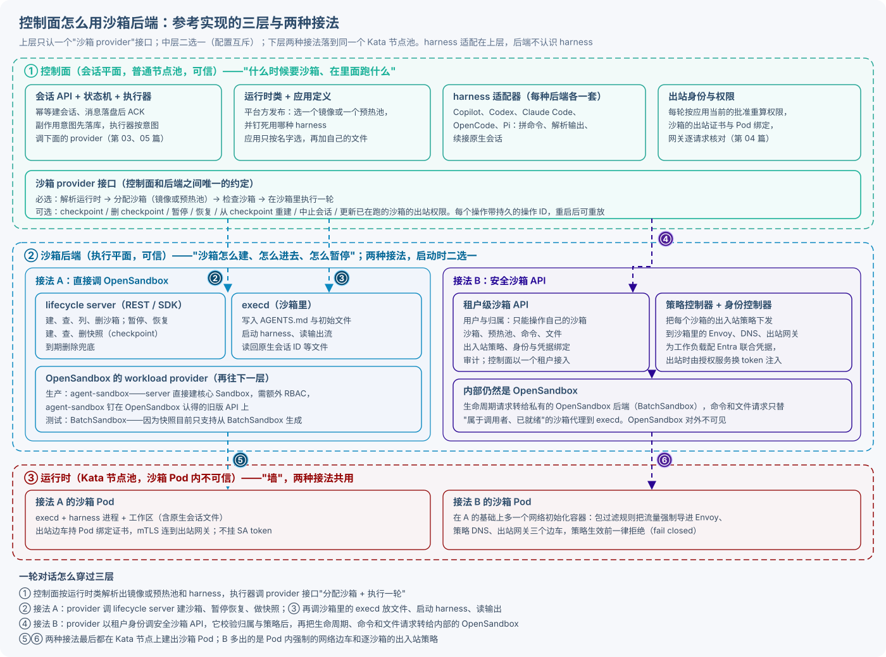
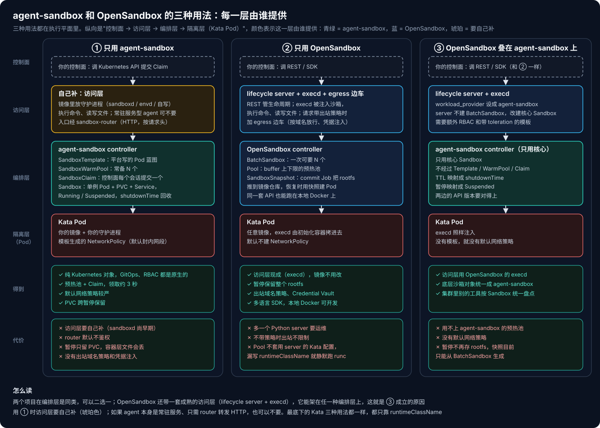
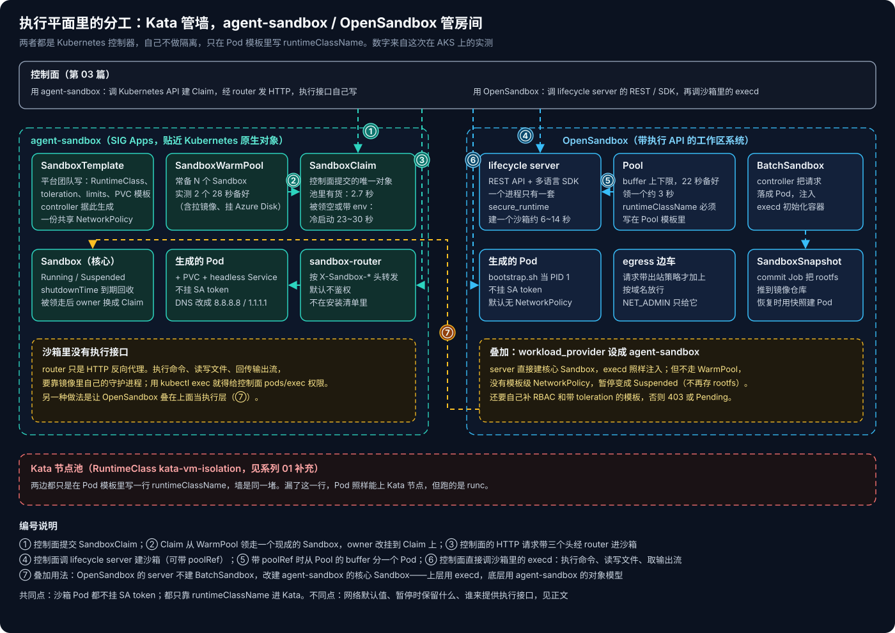

# AKS Agent Runtime 系列 03 补充：沙箱后端 agent-sandbox 与 OpenSandbox

[系列 03](AKS-Agent-Runtime系列03：控制面怎么驱动编码Harness.md) 讲控制面时，沙箱后端我只写了一句"不用自己写，用现成的"。参考实现用的是 OpenSandbox，另一个常被拿来对比的是 Kubernetes SIG Apps 的 agent-sandbox。三个平面里它们在哪、和[系列 01](AKS-Agent-Runtime系列01：Sandbox之外的三个平面.md) 实践里直接建的 Kata Pod 差在哪、控制面到底怎么用它们，前面都没讲清楚。

这次我单独建了一个最小集群：一个普通系统池，一个打了污点的 Kata 池。两个项目都装上，用同一个镜像逐项试，最后再把它们叠在一起用一次。测完资源组就删了。

## 一、它们在哪个平面、哪一层

两者都属于**执行平面**，而且在执行平面里处在中间一层：

- **下面是 Kata**：只管"Pod 里的容器跑在一个独立的 VM 里"（见 [01 补充](AKS-Agent-Runtime系列01补充：Kata运行时与节点池.md)）。它不认识会话、预热池，也不知道一个沙箱什么时候该删。
- **中间是 agent-sandbox / OpenSandbox**：管"Pod 什么时候建、给谁用、怎么进去、什么时候暂停和回收"。它们自己不做任何隔离，只是在生成的 Pod 模板里写上 Kata 的 `runtimeClassName`。
- **上面是控制面**（会话平面）：决定"这一轮要不要沙箱、用哪个、用完怎么办"，调用中间这一层的 API。

下面这张图是参考实现里三层之间的实际调用关系。控制面只通过一个沙箱 provider 接口要沙箱，后端可以直接是 OpenSandbox，也可以是包在 OpenSandbox 外面的一层安全沙箱 API；两种接法最后都落到同一个 Kata 节点池（细节见[系列 03](AKS-Agent-Runtime系列03：控制面怎么驱动编码Harness.md#沙箱后端的两种接法)）：



系列 01 的实践是直接建一个带 `runtimeClassName` 的 Pod，用来证明隔离成立。但如果控制面直接拿裸 Pod 当 agent 的执行环境，下面这些都得自己写：

- **没有预热**：每个会话都要现建 Pod，等调度、拉镜像、启动 VM；
- **进不去**：Kata 里 port-forward 不可用，Pod 里也没有执行命令、读写文件的接口；
- **没有生命周期**：空闲怎么暂停、暂停后状态存哪、到期谁来删，都没有现成机制。

这两个项目就是把这三件事做成了控制器和 API。区别在于交给控制面的东西不一样：

- **agent-sandbox 交出的是一套 Kubernetes 对象**。控制面提交一个 Claim，拿到一个隔离好的 Pod，再经 router 用 HTTP 访问它。Pod 里怎么执行命令，它自己的方案（`sandboxd`）还在早期，通常要另外补。
- **OpenSandbox 交出的是一个带执行 API 的工作区**。控制面调 REST 建沙箱，再直接调沙箱里的 `execd` 执行命令、读写文件。

## 二、两个开源项目分别是什么

**agent-sandbox** 是 Kubernetes SIG Apps 下的子项目，用 Go 写的一组 controller 和 CRD。它要解决的问题很窄：agent 的工作区是"单例、有状态、大部分时间空闲"的，用 Deployment、StatefulSet 硬凑并不顺手，于是专门做了一个工作负载原语，地位有点像 StatefulSet 之于数据库。它只管 Pod：

- **核心对象 `Sandbox`**：一个有稳定主机名、可选 PVC、可以在 `Running` 和 `Suspended` 之间切换、到期自动回收的单例 Pod。
- **三个扩展对象**：`SandboxTemplate`（平台写的蓝图）、`SandboxWarmPool`（预热池）、`SandboxClaim`（使用方的领取请求）。
- **sandbox-router**：一个按请求头转发 HTTP 的反向代理，外加 Go、Python 等客户端。

它只能跑在 Kubernetes 上。进沙箱执行命令这件事，它的 SDK 已经有 `commands.run`、`files` 这类接口，对接的是项目正在做的沙箱内守护进程 `sandboxd`（走 gRPC）；但 `sandboxd` 的镜像目前只发在 staging 仓库，处在早期阶段，这次我没有测。

**OpenSandbox** 由阿里巴巴开源，现在由一个独立组织维护。它的定位是"给 AI 应用用的通用沙箱平台"，覆盖范围比 agent-sandbox 大一圈：

- **lifecycle server**：用 Python 写的 REST 服务，配多语言 SDK，管建、查、删、暂停、恢复、快照。
- **Kubernetes controller**：`BatchSandbox`（一次可以要 N 个）、`Pool`（预热池）、`SandboxSnapshot`（rootfs 快照）。
- **execd**：注入到沙箱里的守护进程，负责执行命令、读写文件。
- **egress 边车**：按域名放行出站，可以在出站时注入凭据（Credential Vault）。

同一套 API 也能跑在本地 Docker 上，还有一个基于 Firecracker 的快速沙箱运行时。最关键的一点：**它的 server 下面接哪种编排层是可以配置的**（`workload_provider`），可以是它自己的 `BatchSandbox`，也可以是 agent-sandbox。

两者都在执行平面里。把执行平面再往下拆成三层，关系就清楚了：

1. **隔离层**：Kata，Pod 跑在独立的 VM 里。两者都只是在 Pod 模板里写 `runtimeClassName`。
2. **编排层**：沙箱什么时候建、给谁用、什么时候暂停和删除。agent-sandbox 的 Sandbox / WarmPool / Claim 和 OpenSandbox 的 BatchSandbox / Pool 都在这一层，**两者是同类，可以二选一**。
3. **访问层**：控制面怎么"进"沙箱，即生命周期 API，加上沙箱里执行命令、读写文件的接口。OpenSandbox 的 lifecycle server 和 `execd` 是这一层的成熟实现，**而且可以架在 agent-sandbox 的编排层上**；agent-sandbox 这一层还在早期（`sandboxd`）。

## 三、三种用法和对比

按"每一层由谁提供"来看，一共有三种组合：



1. **只用 agent-sandbox**：控制面调 Kubernetes API 提交 Claim，经 router 访问沙箱。执行命令、读写文件的接口要在沙箱镜像里自己写。这次第四节的实测就是这种用法。
2. **只用 OpenSandbox**：控制面调 REST 或 SDK，编排层是 OpenSandbox 自己的 `BatchSandbox` 和 `Pool`。参考实现的测试配置和前几篇的实测都是这种用法。
3. **OpenSandbox 叠在 agent-sandbox 上**：控制面的调用方式和第 2 种一样，但 server 下面建的是 agent-sandbox 的核心 `Sandbox`。参考实现的生产配置是这种用法，代价见第七节。

反过来的组合不存在：agent-sandbox 不提供可以接 OpenSandbox 编排层的访问层。

只用 agent-sandbox 能不能 work，取决于 agent 的形态：

- **agent 本身是一个常驻服务**（沙箱里监听一个端口）：编排层加 router 就够了，不需要访问层。官方的 AKS + Kata 示例就是这样，每个用户一个 FastAPI agent，router 按请求头把 HTTP 转到他自己的 Pod。
- **控制面要在沙箱里执行命令**（比如驱动编码 CLI）：要补访问层，有四种补法。① 项目自己的 `sandboxd` 加它的 SDK（早期阶段）；② 别家的守护进程，仓库示例里有把 E2B 的 `envd` 跑在 agent-sandbox 里的做法；③ 自己写一个，示例里最简单的是一个提供 `/execute` 的 FastAPI 服务；④ `kubectl exec`，但要给控制面 `pods/exec` 权限，不推荐。

| 维度 | agent-sandbox | OpenSandbox |
|---|---|---|
| 出身 | Kubernetes SIG Apps | 阿里巴巴开源，现由独立组织维护 |
| 本质 | 一组 Kubernetes controller 和 CRD | 沙箱平台：API server + controller + 沙箱内守护进程 |
| 控制面怎么调 | Kubernetes API（建 Claim）+ router 的 HTTP | REST 或多语言 SDK |
| 执行命令、读写文件 | SDK 有接口，沙箱内守护进程 `sandboxd` 尚在早期；也可换 `envd` 或自己写 | `execd` 由初始化容器注入，镜像不用改 |
| 预热池 | WarmPool；带 env 的 Claim 会冷启动 | Pool；`runtimeClassName` 必须写在 Pool 里 |
| 暂停恢复 | `Suspended`：删 Pod，留 PVC | 快照：rootfs 推到镜像仓库，恢复时用快照建 Pod |
| 默认网络 | 按模板生成策略：封内网段，入站只放行 router | 默认不建；请求带策略时加 egress 边车，按域名放行 |
| 凭据 | 不管 | Credential Vault，在出站时注入 |
| 运行环境 | 只有 Kubernetes | Kubernetes、本地 Docker、Firecracker |
| 和对方的关系 | 可以当 OpenSandbox 的编排层 | 可以把编排层换成 agent-sandbox |

## 四、agent-sandbox 怎么用

只看中间这一层，两个项目各自提供的对象和控制面的调用入口是这样的。上方灰框代表调用它们的控制面，编号是控制面发起的调用：




### 装上之后有什么

安装就是一份清单，装出一个 controller 和四个 CRD：核心的 `Sandbox`，加上三个扩展 `SandboxTemplate`、`SandboxWarmPool`、`SandboxClaim`。router 不在这份清单里，要单独部署；它的部署清单引用的镜像在公共仓库里找不到，我是从源码构建后推到 ACR 的。

分工是平台团队写模板和预热池，控制面只写 Claim：

1. **SandboxTemplate**（平台团队）：Pod 蓝图。Kata 的 `runtimeClassName`、Kata 池的 toleration、资源 limits、PVC 模板都写在这里。
2. **SandboxWarmPool**（平台团队）：引用模板，常备 N 个已经启动好的 Sandbox。
3. **SandboxClaim**（控制面）：每来一个会话提交一个，从预热池领走一个沙箱。
4. **sandbox-router**：控制面带三个请求头 `X-Sandbox-ID`、`X-Sandbox-Namespace`、`X-Sandbox-Port` 发 HTTP，router 转发到对应沙箱。

控制面真正要写的 YAML 只有 Claim，它引用的是预热池（`warmPoolRef`），不是模板：

```yaml
apiVersion: extensions.agents.x-k8s.io/v1beta1
kind: SandboxWarmPool
metadata: {name: kata-pool, namespace: asb}
spec:
  replicas: 2
  sandboxTemplateRef: {name: kata-tpl}
---
apiVersion: extensions.agents.x-k8s.io/v1beta1
kind: SandboxClaim
metadata: {name: session-abc, namespace: asb}
spec:
  warmPoolRef: {name: kata-pool}
  lifecycle: {shutdownTime: "2026-11-15T03:41:01Z", shutdownPolicy: Delete}
```

### 预热池与领取

两个沙箱的预热池 28 秒备好，这里面包括拉镜像和给每个沙箱挂一块 Azure Disk。之后提交 Claim：

- **池里有货**：2.6 到 2.7 秒。领到的就是池里那个 Pod，名字不变；领走后 Sandbox 的 owner 从 WarmPool 换成 Claim，池子随即补一个新的。
- **池子刚被领空**：Claim 不等补货，自己现建一个，用了 29.7 秒。
- **Claim 带了 env**：池里明明有现成的，也会冷启动，用了 23.4 秒。env 要在 Pod 创建前写进去，已经跑起来的预热 Pod 改不了，所以带 env 的 Claim 一律现建。

> [!TIP]
> 想吃到预热池的好处，Claim 就别带 env。每个会话不同的东西（AGENTS.md、会话 ID），在领到沙箱之后再放进去。预热池大小按"高峰时连续来几个会话"来定，被领空之后的那个请求要付整段冷启动。

回收有两种方式：删掉 Claim，对应的 Sandbox 和 PVC 一起删除；设了 `shutdownTime` 和 `shutdownPolicy: Delete`，到期后 4 秒内连同 Sandbox、PVC 一起清理。

### 生成的 Pod 和默认网络

controller 生成 Pod 时会自动做三件事：不挂 SA token；给每个沙箱建一个 headless Service；按模板生成一份共享的 NetworkPolicy，入站只放行 router，出站只放行公网、封掉内网段。

因为集群 DNS 也在内网段里，controller 顺手把 Pod 的 DNS 改成了公网 DNS，结果是沙箱解析不了任何集群内服务名。如果出站要走[第 04 篇](AKS-Agent-Runtime系列04：出站治理与逐请求授权.md)那种集群内网关，就要把模板的网络策略改成 `Unmanaged` 自己写。

### 要自己补的两块

- **router 的鉴权**：默认模式是 `allow-all`，任何命名空间里的 Pod 带上那三个头都能访问任意沙箱。换成 `tokenreview` 后只认证"是不是集群里的某个身份"，不检查它能不能访问指定的那个沙箱；我用一个无关 Pod 的 SA token 照样访问成功。要按沙箱授权得用 scoped-token 模式，或者让 router 只对控制面开放。
- **访问层**：router 只是 HTTP 反向代理。控制面要在沙箱里执行命令、读写文件，就得在镜像里放一个守护进程（`sandboxd`、`envd` 或自己写的，见第三节）。我这次实验用的是 `kubectl exec`，放到控制面里就要授予 `pods/exec`，范围太大。

## 五、OpenSandbox 怎么用

### 装上之后有什么

OpenSandbox 用一个 umbrella Helm chart 安装，装出三个 CRD（`BatchSandbox`、`Pool`、`SandboxSnapshot`）和两个 Deployment：controller 负责把 CRD 落成 Pod；lifecycle server 对外提供 REST API，各语言 SDK 调的都是它。chart 默认从一个区域镜像仓库拉镜像，在 Azure 上我改成了 Docker Hub 上的同名镜像。

在 server 的配置里指定 Kata：

```toml
[runtime]
type = "kubernetes"
execd_image = "docker.io/opensandbox/execd:<tag>"

[kubernetes]
namespace = "opensandbox"
workload_provider = "batchsandbox"

[secure_runtime]
type = "kata"
k8s_runtime_class = "kata-vm-isolation"
```

一个 server 进程只有一套 `secure_runtime`，API 请求选不了别的运行时。要同时提供 Kata 和 runc，就得部署两套 server。

### 控制面的调用方式

控制面用 SDK 建沙箱，之后在这个沙箱里执行命令、读写文件：

```python
sb = SandboxSync.create("python:3.12-slim", connection_config=cfg,
                        timeout=timedelta(minutes=30))
sb.files.write_files([WriteEntry(path="/workspace/AGENTS.md", data=agents_md, mode=644)])
r = sb.commands.run("uname -r")
```

不用预热池时，建一个沙箱要 6 到 14 秒（节点上已经有镜像缓存）。每条命令经 server 代理转发，大约 0.5 秒；写一个文件 0.3 秒。`timeout` 就是到期自动回收。

### execd 是怎么进去的

看生成的 Pod 就明白了：controller 给 Pod 加了一个初始化容器，把 `execd`、`bootstrap.sh` 等几个可执行文件拷进一个 emptyDir，挂到 `/opt/opensandbox`；主容器的启动命令被改成 `bootstrap.sh` 再接原来的 entrypoint。`bootstrap.sh` 成了 PID 1，先拉起 `execd`，再运行用户进程。

所以**沙箱镜像不用做任何改动**，随便一个 `python:3.12-slim` 就能用。这正是单用 agent-sandbox 时要补的访问层。生成的 Pod 同样不挂 SA token。

### Pool：runtimeClassName 要自己写

Pool 的用法和 agent-sandbox 的预热池类似：模板里写好 Pod，`capacitySpec` 设 buffer 和总量的上下限。我建了两个池，22 秒备好，建沙箱时带上 `extensions={"poolRef": "pool-kata"}`，大约 3 秒领到。

坑在 Kata：**从 Pool 领出来的沙箱不会套用 server 的 `secure_runtime`**，Pod 是提前建好的，server 改不了它。我故意建了一个不写 `runtimeClassName` 的池，领出来的沙箱跑在宿主内核上，也就是 runc。server 明明配了 Kata，整个过程没有任何报错。Pool 模板里的 toleration 写的是 `operator: Exists`，这些 runc Pod 还被调度到了 Kata 节点上，和真正的沙箱混跑。

```yaml
apiVersion: sandbox.opensandbox.io/v1alpha1
kind: Pool
spec:
  template:
    spec:
      runtimeClassName: kata-vm-isolation   # 漏了这一行就是 runc
  capacitySpec: {bufferMin: 2, bufferMax: 2, poolMin: 0, poolMax: 4}
```

> [!WARNING]
> 每个 Pool 都要显式写 `runtimeClassName`，上线前在领到的沙箱里跑一次 `uname -r`，和节点内核对比一下。另外，出站策略不能和 `poolRef` 一起用，池化沙箱的网络限制只能写进 Pool 模板。

### 出站：不带策略就不限制

agent-sandbox 默认生成一份网络策略；OpenSandbox 默认什么都不建，只有建沙箱时带了 `network_policy`，才会给 Pod 加一个 egress 边车，按域名放行，`NET_ADMIN` 只给边车、主容器拿不到。我设了 deny 加只放行 `pypi.org`，其他域名在 DNS 这一步就解析失败。

不带策略的沙箱出站完全不受限，连节点的元数据地址 `169.254.169.254` 都能访问。不能指望每个请求都记得带策略，沙箱命名空间要有一条兜底的 NetworkPolicy 封掉 `169.254.0.0/16`，或者在集群上开 AKS 的 IMDS restriction（预览）。

## 六、暂停与恢复：两者保留的东西不一样

两边我都做了同一个实验：在 `/workspace` 和 `/tmp` 各写一个文件，起一个后台进程，暂停，再恢复，然后检查。

| | agent-sandbox | OpenSandbox |
|---|---|---|
| 怎么暂停 | Sandbox 的 `operatingMode` 改成 `Suspended` | `pause`，controller 生成 `SandboxSnapshot` |
| 暂停时做了什么 | 删 Pod，PVC 留着 | 在源节点起 commit Job，把 rootfs 提交成镜像推到镜像仓库，再删 Pod |
| 暂停耗时 | 8 秒 | 7 到 11 秒 |
| 恢复耗时 | 11 秒（重新挂 Azure Disk） | 约 5 秒（只拉增量层） |
| PVC / 工作区里的文件 | 在 | 在 |
| `/tmp` 等容器层的文件 | 没了 | 在（整个 rootfs 都保存了） |
| 后台进程 | 没了，新的 VM | 没了，新的 VM |
| 网络身份 | Pod IP 变了，主机名和 Service 名不变 | Pod IP 变了，主机名不变 |

两种语义直接影响 harness 的续接。[第 05 篇](AKS-Agent-Runtime系列05：会话生命周期与回收.md)里 harness 暂停恢复后还记得上一轮，靠的是原生会话文件跟着 rootfs 快照一起走。换成 agent-sandbox，这些文件必须放在 PVC 挂载的目录里，比如把 harness 的会话目录指到 `/workspace` 下面，否则恢复后上下文就没了。

> [!WARNING]
> 恢复不一定有位置。第一次恢复 OpenSandbox 的沙箱时，Pod 一直 Pending：暂停腾出来的 CPU 被两边预热池补货的 Pod 占掉了，Kata 节点的 CPU 请求到了 96%。删掉别的池之后才恢复成功。预热池补货和暂停恢复抢的是同一份 Kata 容量，规划时要给恢复留出余量。

## 七、叠在一起用的细节

OpenSandbox 的 server 可以把 agent-sandbox 当底层：`workload_provider` 设成 `agent-sandbox`，server 就不建 `BatchSandbox`，改建 agent-sandbox 的核心 `Sandbox`。上层用 OpenSandbox 的 REST 和 `execd`，底层用 agent-sandbox 的对象模型。

我实际配了一遍，有两处要自己补：

1. **RBAC**：server 的 ServiceAccount 没有操作 `agents.x-k8s.io` 的权限，第一次建沙箱直接 403。chart 自带的 RBAC 只覆盖它自己的 CRD。
2. **模板**：这个 provider 默认没有 toleration，Pod 上不了打了污点的 Kata 节点，一直 Pending。要挂一个 `template_file`，在 `spec.podTemplate.spec` 里补上 toleration。

补完之后能用：冷启动 6 秒，Kata 内核，`execd` 照样注入。但它直接建的是核心 `Sandbox`，绕过了 agent-sandbox 的模板、预热池和 Claim，所以会丢掉三样东西：

- **预热池**：每个沙箱都是现建的；
- **模板生成的网络策略**：没有 SandboxTemplate，也就没有那份默认策略，出站和 OpenSandbox 不带策略时一样；
- **rootfs 快照**：暂停变成 `Suspended`，暂停 9 秒、恢复 5 秒，`/tmp` 下的文件没了。

所以叠加用法适合"集群里已经用 agent-sandbox 统一管沙箱，又想要 `execd` 这套执行 API"的情况。只是为了省事，不如直接二选一。

## 八、怎么选

可以先按三个问题走一遍：


展开说：

- **控制面驱动 harness、沙箱只是借来执行**：选 OpenSandbox。`execd`、Pool、rootfs 快照正好对上第 03 到 05 篇的需求，参考实现也是这么选的。要补的是：每个 Pool 显式写 `runtimeClassName`，沙箱命名空间加兜底网络策略，快照仓库的保留和清理策略。
- **agent 本身是常驻服务，只需要一个隔离好的 Pod**：选 agent-sandbox。对象模型贴近 Kubernetes，默认网络策略更严。要补的是：router 的鉴权、沙箱里的执行守护进程，以及把要跨暂停保留的文件放进 PVC。
- **集群里已经用 agent-sandbox 统一管沙箱，又想要 `execd` 这套执行 API**：用第三种，OpenSandbox 叠在 agent-sandbox 上。要接受的是：用不上 agent-sandbox 的预热池，没有模板生成的网络策略，暂停时不保存 rootfs。
- **两者都不替你做的**：会话、授权、凭据、审计。它们只管房间，会话平面和治理平面还是第 03、04 篇那些东西。

无论选哪个，上线前都值得在沙箱里跑一遍同样的检查：`uname -r` 确认在 VM 里，确认没有 SA token，确认集群 DNS、API server、元数据地址的连通情况和预期一致。默认值两边差得很远，而且都不会报错。

## 相关阅读

- [AKS Agent Runtime 系列 01：Sandbox 之外的三个平面](AKS-Agent-Runtime系列01：Sandbox之外的三个平面.md)——三个平面的划分、基线集群
- [AKS Agent Runtime 系列 01 补充：Kata 运行时与节点池](AKS-Agent-Runtime系列01补充：Kata运行时与节点池.md)——这两者下面那一层
- [AKS Agent Runtime 系列 03：控制面怎么驱动编码 Harness](AKS-Agent-Runtime系列03：控制面怎么驱动编码Harness.md)——这两者上面那一层
- [AKS Agent Runtime 系列 05：会话生命周期与回收](AKS-Agent-Runtime系列05：会话生命周期与回收.md)——OpenSandbox 快照在 Durable 会话里的实测
- [Agent 基础设施系列 02：Kubernetes 上的 Agent 沙箱](../../Notes/AI/agent/agent-runtime/Agent基础设施系列02：Kubernetes上的Agent沙箱.md)——两者的设计与 Credential Vault

## 参考资料

- [kubernetes-sigs/agent-sandbox](https://github.com/kubernetes-sigs/agent-sandbox)
- [Agent Sandbox Documentation](https://agent-sandbox.sigs.k8s.io/docs)
- [OpenSandbox](https://github.com/opensandbox-group/OpenSandbox)
- [Block pod access to the IMDS endpoint (preview)](https://learn.microsoft.com/en-us/azure/aks/imds-restriction)
- [Pod sandboxing with Azure Kubernetes Service](https://learn.microsoft.com/en-us/azure/aks/use-pod-sandboxing)
