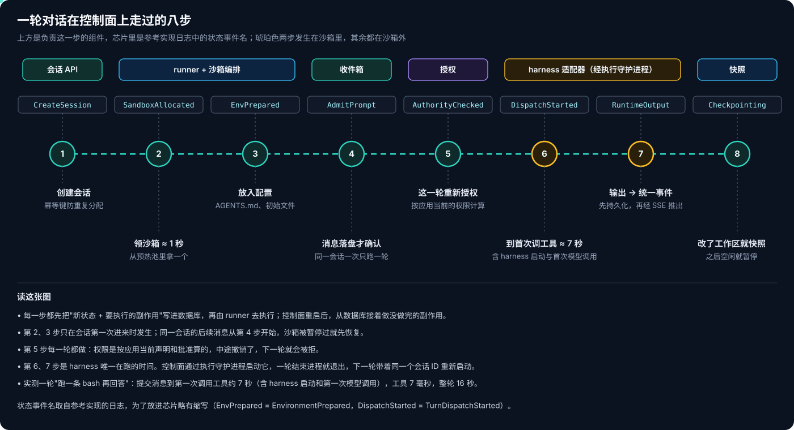
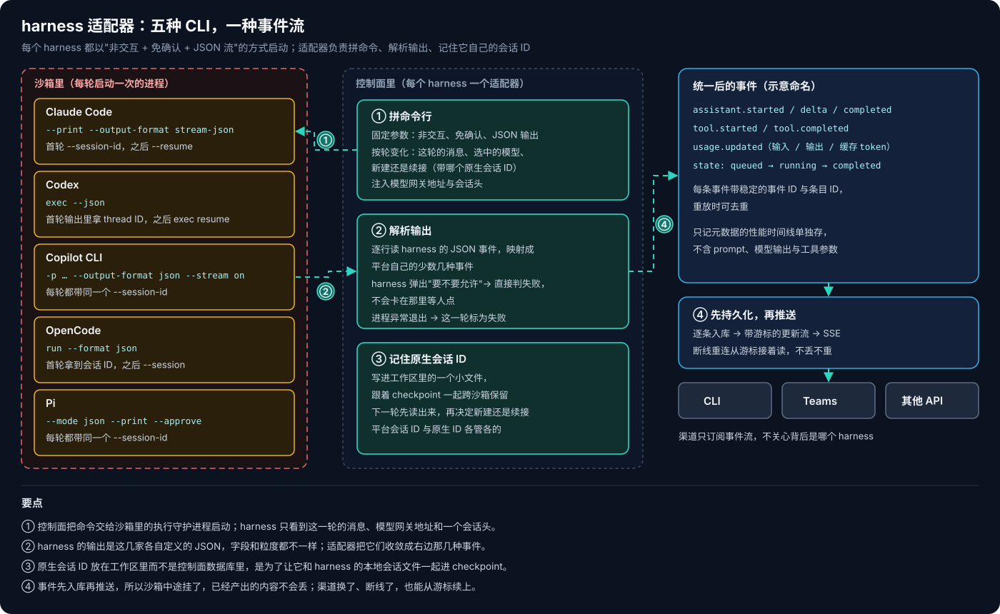
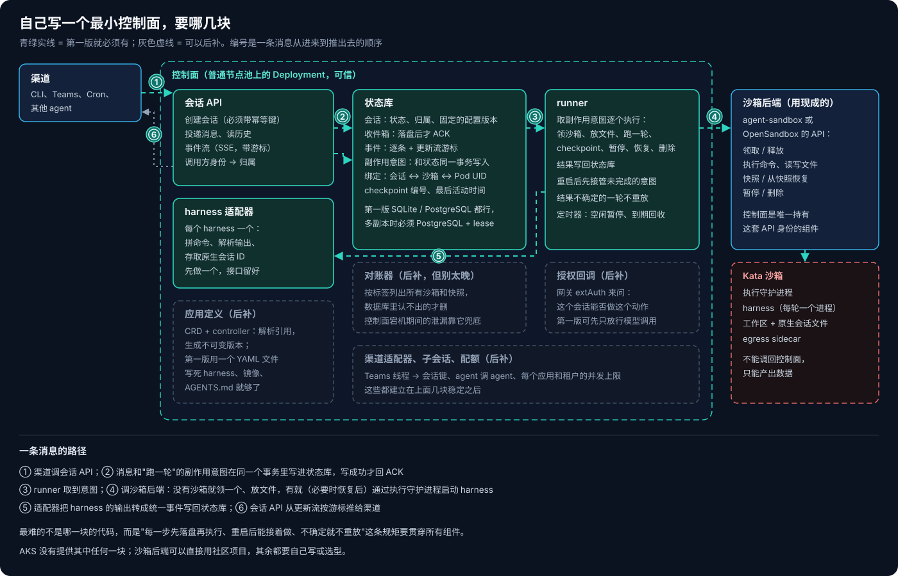

# AKS Agent Runtime 系列 03：控制面怎么驱动编码 Harness

[第 02 篇](AKS-Agent-Runtime系列02：Harness放在沙箱内还是沙箱外.md)的结论是：编码 harness 整个关进 Kata 沙箱、免确认运行，凭据和授权留在外面。接下来的问题是，谁来把 harness 放进沙箱？谁告诉它这一轮要做什么，又是谁把它的输出送回 Teams 或 CLI？

答案是沙箱外的一层平台控制面。它驱动 harness，就像 harness 驱动模型和工具一样，所以我习惯叫它"harness 的 harness"。这一层 AKS 完全没有提供，也是我觉得 agent runtime 里最值得花力气的部分。这篇我结合在 AKS 上跑通的参考实现，把它拆开来看。

## 一、谁把 harness 放进沙箱

不是 agent 自己，是**平台控制面**。它跑在沙箱外的普通节点池上，是一个普通的 Deployment，不在 Kata 里。整个系统里只有它持有调用沙箱生命周期 API 的身份：领沙箱、执行命令、读写文件、做快照、暂停、删除，都由它发起。

所以一个 agent 运行起来，其实是四层东西叠在一起：

| 层 | 是什么 | 归谁 | 跑在哪 |
|---|---|---|---|
| 编排 / 会话层 | 会话 API、状态机、harness 适配器 | 平台 | 沙箱外，可信 |
| harness | Claude Code / Codex / Copilot CLI 进程 | 第三方，版本由平台固定 | 沙箱内 |
| agent 逻辑 | AGENTS.md、skills、prompt，以及 harness 现场生成的代码 | 应用作者和模型 | 沙箱内 |
| 治理 | 出站网关、资源级授权、egress | 平台 | 沙箱外，可信 |

应用作者写的只是第三层：一份 AGENTS.md、几个 skill、权限申请。harness 用哪个、哪个版本、怎么启动、怎么续接，都是平台的事。

## 二、一轮对话的八步

我在参考实现里发起一个会话，让 agent 跑一条 `uname -r` 再回答。翻控制面的日志，能看到它一步一步记下的状态事件：

八步里有几处设计，我觉得是这一层的精髓：

**创建会话必须带幂等键。** 渠道重试、网络抖动都可能让"创建会话"的请求发两次。如果每次都分配一个沙箱，很快就会多出一堆没人认领的 VM。带上幂等键之后，重复请求拿到的是原来那个会话。

**消息落盘之后才确认。** 收件箱先把消息写进数据库，写成功才回 ACK。控制面这时候挂了，消息也不会丢；重启后从数据库里接着处理。同一个会话一次只跑一轮，后面的消息排队。

**每一轮都重新授权。** 权限不是在创建会话时拍一张快照就完事了，而是每一轮开始前，按应用当前的声明和资源 owner 当前的批准重新算一遍。中途撤销了某项权限，下一轮就会被拒。

**先记下要做什么，再去做。** 控制面每走一步，先把"新状态 + 接下来要执行的副作用"写进数据库，再由后台的 runner 去执行，比如领沙箱、启动 harness、做快照。runner 重启后，会先把上次没做完的副作用接着做完。这个模式在第 05 篇讲会话生命周期时会再展开。

时间上，领一个预热沙箱大约 1 秒。从提交消息到 harness 第一次调用工具大约 7 秒，里面包括 harness 进程启动和第一次模型调用。工具本身只用了 7 毫秒，整轮 16 秒。也就是说，真正在"干活"的时间很少，大头都花在沙箱和 harness 的准备上。这也是为什么预热池和 harness 启动优化是这一层绕不开的话题。

## 三、适配器：一套逻辑驱动五种 CLI

参考实现支持五种编码 harness，再加一种"自己的命令"。它们的命令行参数、输出格式、续接方式都不一样，控制面靠每个 harness 一个适配器来抹平这些差异：

适配器做三件事：拼命令行、解析输出、记住 harness 自己的会话 ID。五种 harness 的启动方式放在一起看，模式很清楚：

| harness | 非交互 + 免确认 | 输出 | 下一轮怎么接上 |
|---|---|---|---|
| Claude Code | `--print --dangerously-skip-permissions` | `stream-json` | 首轮 `--session-id`，之后 `--resume` |
| Codex | `exec --dangerously-bypass-approvals-and-sandbox` | `--json` | 首轮输出里拿 thread ID，之后 `exec resume` |
| Copilot CLI | `-p … --allow-all` | `json`，流式 | 每轮带同一个 `--session-id` |
| OpenCode | `run`，权限由配置放开 | `json` | 首轮拿到会话 ID，之后 `--session` |
| Pi | `--print --approve` | `json` | 每轮带同一个 `--session-id` |

几个值得注意的细节：

- **harness 一旦弹出"要不要允许"，这一轮直接判失败。** 沙箱里没有人能点确认，与其卡在那里，不如明确失败。这是"免确认运行"的另一面：平台必须保证 harness 不需要交互，做不到就当错误处理。
- **原生会话 ID 存在工作区里，不存在控制面的数据库里。** 它被写进工作区的一个小文件，和 harness 自己的本地会话文件放在一起，跟着 checkpoint 一起走。沙箱被暂停、换掉之后，新沙箱从快照恢复，下一轮先读出这个 ID，再决定是新建还是续接。[上一篇](AKS-Agent-Runtime系列02：Harness放在沙箱内还是沙箱外.md)里 agent 在暂停恢复后还记得上一轮的答案，靠的就是这个。
- **输出先入库再推送。** 解析出来的每条事件都带稳定的事件 ID，先逐条写库，再通过带游标的更新流用 SSE 推给渠道。渠道断线重连，从游标接着读就行。Teams、CLI 这些渠道只订阅事件流，完全不需要知道背后是哪个 harness。

### 适配 harness 不只是"装个二进制"

把 harness 装进镜像很容易，让它能用起来要多做不少事：

- **版本由平台固定。** 镜像里每个 harness 都钉在一个确定的版本上，升级是平台的一次发布，不是 harness 自己静默更新。harness 的自动更新也要关掉。
- **离线模式。** harness 不连自己厂商的服务（登录、遥测、策略下发都关掉），模型只走平台的网关。
- **模型协议对不上。** Copilot、Codex、OpenCode 都能说 OpenAI 的 Responses 协议，直接对接 Azure OpenAI 没问题。Claude Code 说的是 Anthropic 的 Messages 协议，不能直接映射过去。我在 PoC 里注意到，模型网关的路由同时匹配了 Responses 和 Messages 两种路径，说明协议转换可以放在网关这一层做。具体能不能通，放到第 08 篇讲模型接入层时实测。

## 四、为什么平台和 harness 之间只开一个口

控制面和沙箱之间唯一的接口，是沙箱里的执行守护进程：执行命令、读写文件。没有别的通道。

这么做是为了让方向只有一个：控制面可以调用沙箱，沙箱只能产出数据，不能调回控制面。沙箱里没有 ServiceAccount token，连不上 Kubernetes API，出站也只能走网关。harness 就算被劫持，也没有办法让控制面替它做事。

那 harness 想"再开一个沙箱"怎么办？分三种情况：

1. **harness 内部的 subagent 不产生新沙箱。** Claude Code 的 Task、Codex 的子任务、OpenCode 的多 agent，都是同一个 VM 里的进程，共享工作区和出站身份。
2. **harness 自己起不了沙箱。** 它没有生命周期 API 的身份，网络上也到不了那个 API。
3. **有一条受控的路：agent 调 agent。** 沙箱里调用另一个应用，会在目标应用下创建一个**子会话**，由控制面代为分配一个新的独立沙箱。

这条路的约束我觉得设计得很克制：

- 目标应用的 owner 要明确批准哪些源应用可以调用自己，精确到具体应用和动作；
- 每次请求都核对源沙箱的 Pod、会话和应用身份；
- 子会话归属于发起它的源会话，知道子会话 ID 不等于有权访问它；
- **只允许一跳**：被委托出来的子会话不能再去调别人；
- 子沙箱的权限只按目标应用自己的声明和批准计算，**不继承调用方的权限**，两边也不共享文件系统。

参考实现的设计文档也坦白列出了缺口：子会话没有配额和限流，幂等键只防重试、不防刷；撤销委托之后，已经打开的更新流最长还能持续几分钟；已经做完的事撤回不了。触发源一多（定时任务、Teams、agent 调 agent 叠在一起），沙箱数量失控是很现实的风险，这放到第 06 篇讲高可用和配额时再说。

## 五、自己写一个最小控制面，要哪几块

看完参考实现，我把"自己写一个"需要的部件列了出来：

第一版必须有的只有四块：

1. **会话 API**：创建会话（带幂等键）、投递消息、按游标推事件流。
2. **状态库**：会话、收件箱、事件、副作用意图，以及会话和沙箱的绑定关系。单副本时 SQLite 就够用，要多副本再换 PostgreSQL 并加上 lease。
3. **runner**：执行副作用意图，包括领沙箱、放文件、跑一轮、做快照、暂停、删除，重启后接着做没做完的。
4. **一个 harness 适配器**：先只支持一种 harness，接口留好。

沙箱后端不用自己写，agent-sandbox 或 OpenSandbox 已经提供了领取、执行、文件、快照这套 API。应用定义可以先用一个 YAML 写死 harness、镜像和 AGENTS.md。对账器、授权回调、渠道适配、子会话和配额，等前面几块稳定了再补。

难的不在哪一块的代码，而在一条贯穿所有组件的规矩：**每一步先落盘再执行，重启后能接着做，结果不确定就不盲目重放。** 最后这一条，参考实现分了两种情况：自定义命令类的运行时，结果不确定就不重放；编码 harness 则沿用 harness 自己的重放行为。我自己写的话，会默认先不重放，宁可让用户重发一次，也不让一个有副作用的操作执行两遍。

[下一篇](AKS-Agent-Runtime系列04：出站治理与逐请求授权.md)回到治理平面：沙箱里那条唯一的出站路，网关是怎么认出会话、怎么做逐请求授权、怎么注入凭据的。

## 相关阅读

- [AKS Agent Runtime 系列 01：Sandbox 之外的三个平面](AKS-Agent-Runtime系列01：Sandbox之外的三个平面.md)
- [AKS Agent Runtime 系列 02：Harness 放在沙箱内还是沙箱外](AKS-Agent-Runtime系列02：Harness放在沙箱内还是沙箱外.md)
- [Claude Code 系列 07：Harness 分层架构](../../Notes/AI/Claude-Code/Claude-Code系列07：Harness分层架构.md)
- [Agent Harness 五平台对比](../../Notes/AI/agent/Agent-Harness五平台对比.md)

## 参考资料

- [Claude Code CLI reference](https://docs.anthropic.com/en/docs/claude-code/cli-reference)
- [Codex CLI](https://github.com/openai/codex)
- [GitHub Copilot CLI](https://github.com/github/copilot-cli)
- [OpenCode](https://opencode.ai)
- [kubernetes-sigs/agent-sandbox](https://github.com/kubernetes-sigs/agent-sandbox)
- [OpenSandbox](https://github.com/opensandbox-group/OpenSandbox)
