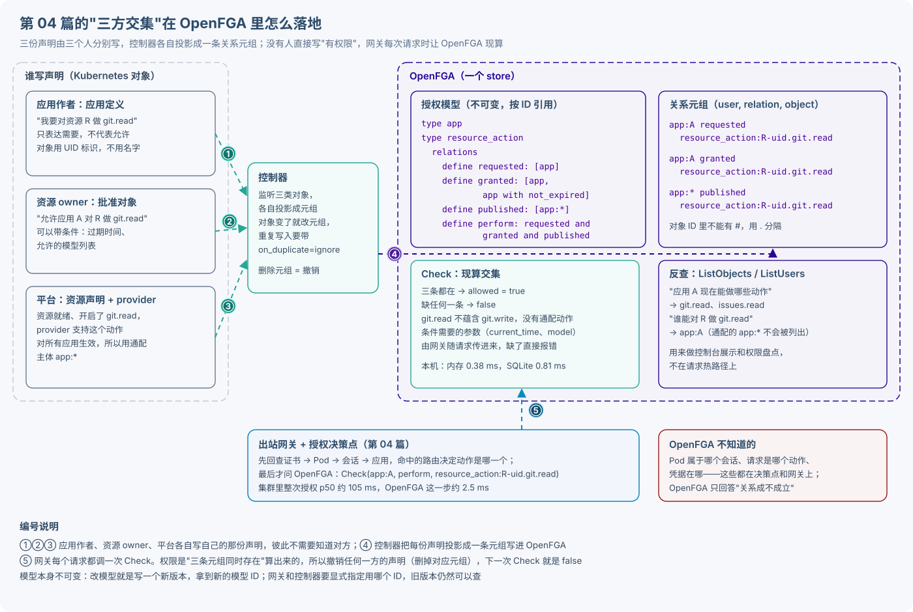
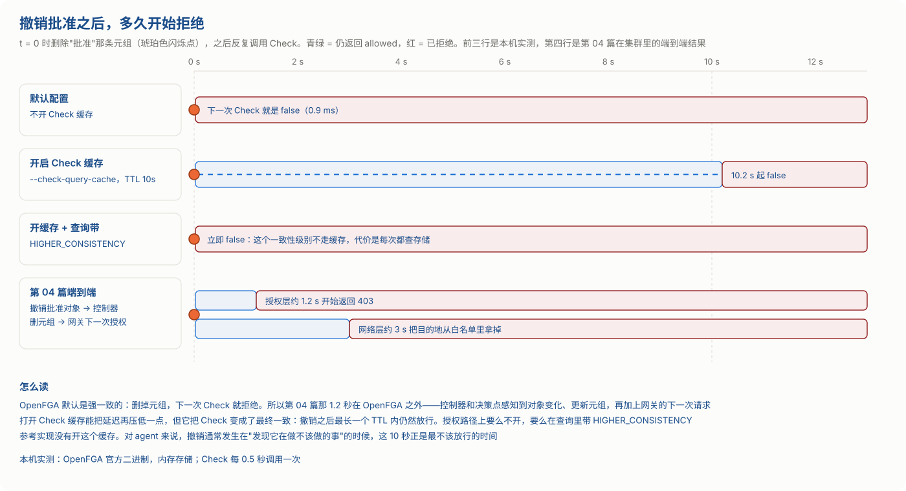

# AKS Agent Runtime 系列 04 补充：OpenFGA 与关系型授权

[第 04 篇](AKS-Agent-Runtime系列04：出站治理与逐请求授权.md)里，网关每个请求都要授权一次，最后一步问的是 OpenFGA：这个应用能不能对这个资源做这个动作。整次授权 p50 约 105 毫秒，OpenFGA 那一步只占 2.5 毫秒，但"申请、批准、发布三者取交集"这件事是它算的。这篇单独讲 OpenFGA：它是什么、模型怎么写、第 04 篇的模型怎么落地，以及几个在授权路径上必须知道的行为。

实验是在本机做的：OpenFGA 官方发布的 macOS 二进制，内存和 SQLite 两种存储都试了，直接调 HTTP API。

## 一、OpenFGA 是什么

OpenFGA 是一个关系型授权（ReBAC）服务，思路来自 Google 在 2019 年发表的 Zanzibar 论文，最早由 Auth0 发起，现在是 CNCF 的项目。它回答的问题永远是同一种形式：**某个主体和某个对象之间，某个关系成不成立。**

它有四个核心概念：

1. **Store**：一套独立的授权数据，模型和元组都属于某个 store。
2. **授权模型**：定义有哪些类型（type）、每个类型有哪些关系（relation），以及关系之间怎么推导，比如"并且""或者""从另一个对象继承"。模型写成一段 DSL，**写入后不可变**，每次修改都生成一个新的模型 ID。
3. **关系元组**：一条记录 `(user, relation, object)`，比如"`app:A` 是 `resource_action:R.git.read` 的 `granted`"。业务数据都以这种形式存进去。
4. **查询**：
   - `Check`：这条关系成不成立，返回 true 或 false。
   - `ListObjects`：这个主体对哪些对象有这个关系。
   - `ListUsers`：哪些主体对这个对象有这个关系。
   - `BatchCheck`：一次查多条。

在这四个概念之上还有两个扩展：**条件**（condition，用 CEL 写的表达式，元组可以带上条件，Check 时传入参数求值），和**上下文元组**（contextual tuples，Check 时临时带上几条元组参与计算，但不写入存储）。

存储支持内存、PostgreSQL、MySQL 和 SQLite。服务本身是无状态的，可以多副本，状态都在存储里。

## 二、和 RBAC、策略引擎的区别

| | Kubernetes RBAC | 策略引擎（如 OPA） | 关系型（OpenFGA） |
|---|---|---|---|
| 判断依据 | 主体绑定了哪些角色，角色对哪些资源有哪些动词 | 一段规则代码，对输入和外部数据求值 | 主体和对象之间的关系图，按模型推导 |
| 数据在哪 | Role、RoleBinding 对象 | 规则和数据要推送给引擎，或者随请求传入 | 元组存在 OpenFGA 自己的存储里 |
| 擅长 | 集群 API 的访问控制 | 复杂的条件、属性组合 | 归属、共享、继承、多方关系 |
| 反查"谁能做什么" | 要自己遍历 | 一般不支持 | 原生支持 ListObjects / ListUsers |

第 04 篇选 OpenFGA，原因在"三方交集"这个结构：**申请、批准、发布由三个人分别写，彼此不需要知道对方，权限是三者同时成立时算出来的。** 每一方只管自己那条元组，撤销任何一方都只是删掉一条元组。用 RBAC 写不出这种"跨来源的并且"；用 OPA 能写，但三份数据都要推给引擎，反查"这个应用现在能做哪些动作"也得自己实现。

## 三、第 04 篇的模型怎么落地



模型写成 DSL 是这样（第 04 篇里给的是压缩版，这里加上了下一节要用的条件）：

```text
model
  schema 1.1

type app

type resource_action
  relations
    define requested: [app]
    define granted: [app, app with not_expired, app with model_allowed]
    define published: [app:*]
    define perform: requested and granted and published

condition not_expired(current_time: timestamp, expires_at: timestamp) {
  current_time < expires_at
}

condition model_allowed(model: string, allowed_models: list<string>) {
  model in allowed_models
}
```

控制器把三份声明各自投影成一条元组：应用定义写 `requested`，资源 owner 的批准对象写 `granted`，平台的资源声明写 `published`。`published` 对所有应用生效，所以主体用通配 `app:*`。

我在本机按顺序加元组，逐项验证：

- **只有申请**：false；**申请 + 批准**：false；**三条都在**：true。另一个应用只有批准、没有申请，也是 false。
- **动作是不透明字符串**：给 `git.read` 写了全套元组，`git.write` 仍然是 false。模型里没有"read 蕴含 write"，也没有通配动作。
- **对象 ID 里不能有 `#`**：我一开始写 `resource_action:uid#git.read`，直接返回 400。`#` 在 OpenFGA 里是"对象#关系"的分隔符，换成 `.` 就好。
- **主体和对象用 UID，不用名字**：第 04 篇已经提过。这里的原因是 OpenFGA 只认字符串：删掉一个资源再建一个同名的，元组还在，新资源会悄悄继承旧的授权。用 Kubernetes UID 就不会。

## 四、放在授权路径上要知道的几个行为

### 撤销和缓存



默认配置下，删掉 `granted` 元组后，下一次 Check 就是 false，耗时 0.9 毫秒。OpenFGA 默认是强一致的，所以第 04 篇测到的"撤销约 1.2 秒生效"，时间花在 OpenFGA 之外：控制器和决策点感知到对象变化、更新元组，再加上网关的下一次请求。

OpenFGA 有一个 Check 查询缓存（`--check-query-cache-enabled`），能进一步降低延迟。我用 10 秒 TTL 开了一个实例，同样先撤销再每 0.5 秒查一次：**前 10.2 秒一直返回 true**，直到缓存过期才变成 false。官方文档里也写了，开了这个缓存，Check 和 ListObjects 就变成了最终一致的接口。在查询里带上 `consistency: HIGHER_CONSISTENCY`，会绕过缓存，撤销后立即返回 false。

> [!WARNING]
> 授权路径上不要随手打开 Check 缓存。真要开，撤销敏感的查询就带上 `HIGHER_CONSISTENCY`。对 agent 来说，撤销往往发生在"发现它在做不该做的事"的时候，缓存的那几秒正是最不该放行的时间。参考实现没有开这个缓存。

### 条件：过期时间和模型白名单

批准可以带条件。我在 `granted` 元组上挂了 `not_expired`，过期时间写在元组里，当前时间由 Check 传入：

- 传入 11:00，过期时间 12:00：true；
- 传入 13:00：false；
- **不传 `current_time`：返回 400 错误，而不是 false。**

最后一条很关键：网关和决策点必须把"OpenFGA 返回错误"当成拒绝处理，不能当成"没结果就放行"，也不能因为报错就跳过授权。

第二个条件 `model_allowed` 把允许的模型列表写进批准里，网关把请求体里的 `model` 传进来比对：`gpt-5.4-mini` 在列表里，返回 true；列表外的模型返回 false。这正好对应[第 08 篇](AKS-Agent-Runtime系列08：模型接入层.md)里"按请求体里的模型名授权"，而且是资源 owner 在批准时就能决定的事，不用改网关配置。

### 上下文元组：实时状态不落库

有些关系是实时的，不适合存进去，比如 provider 当前是否就绪。Check 可以临时带上几条元组参与计算：库里只有 `requested` 和 `granted` 时是 false；把 `published` 作为上下文元组传进去就是 true；下一次不传，又回到 false，说明它没有被写进存储。

代价是这类关系 OpenFGA 看不见：`ListObjects`、`ListUsers` 反查不到，变更记录里也没有。适合放"每次请求都能现场确定"的事实，不适合放需要审计的授权本身。

### 模型版本

模型写入后不可变，每改一次就多一个模型 ID，旧版本仍然可以查。我写了两个版本，v1 没有条件，v2 加了条件：

- 用 v1 的 ID 查一条普通关系：照常 true；
- 用 v1 的 ID 查一条带条件的批准：false，因为 v1 不认识这个条件，这条元组在 v1 下不算数；
- 用 v1 的 ID 写一条带条件的元组：400。

所以升级模型要按顺序来：**先写新模型，让读的一方（网关、决策点）切到新 ID，再开始写新形状的元组**。顺序反过来，旧的读方会把新元组当成不存在，表现为"批准了却不生效"。读写双方都应该显式指定模型 ID，而不是依赖"最新版本"。

### 重复写入和反查

同一条元组写第二次，返回 400（`cannot write a tuple which already exists`）。控制器重启后会把所有对象重新投影一遍，所以写入要带 `on_duplicate: ignore`，或者先读再写；带上之后返回 200。

反查是关系型授权的长处。`ListObjects(app:A, perform)` 直接给出这个应用现在能做的动作（`git.read`、`issues.read`）；`ListUsers` 给出谁能对某个资源做某个动作，返回的是 `app:A`，通配的 `app:*` 不会被列出来。控制台上"这个应用现在有哪些权限"、定期的权限盘点，都可以靠它，不用自己遍历三类对象去拼。

### 延迟

本机顺序调用的结果：

- **内存存储**：Check p50 0.38 毫秒、p99 0.76 毫秒；ListObjects p50 0.39 毫秒。
- **SQLite 存储**（单连接，WAL 模式）：Check p50 0.81 毫秒、p99 1.16 毫秒；ListObjects p50 0.78 毫秒。

第 04 篇在集群里测到的 2.5 毫秒，多出来的部分是网络往返和服务认证。整次授权 105 毫秒里，大头是身份核实那 62 毫秒，OpenFGA 不是瓶颈。

## 五、参考实现怎么部署它

参考实现里的 OpenFGA 是控制面的一个内部组件：

- **单副本，SQLite 存储**：数据库文件放在一个持久卷上，用 WAL 模式，连接数限制为 1。
- **服务认证用 OIDC**：调用方带 Kubernetes 投影出来的 ServiceAccount token，audience 是专门给 OpenFGA 的；允许的主体只有两个，即写元组的控制器和做授权判断的那一方。网关和沙箱都不能直接调 OpenFGA。
- **其余配置**：playground 和 metrics 关闭，日志用 JSON；没有开 Check 缓存；外加一条 NetworkPolicy 限制谁能连它。

单副本加 SQLite 和控制面本身的状态库是同一个限制（第 06 篇）：OpenFGA 挂掉，所有出站请求都会被拒绝。要上生产，存储要换成 PostgreSQL 或 MySQL，服务开多副本。OpenFGA 本身是无状态的，横向扩展不需要改模型。

## 六、它在 agent 平台里的位置

OpenFGA 只回答"关系成不成立"。放回第 04 篇那条出站路上，下面这些事都不是它做的：

- **请求属于哪个会话、是哪个动作**：决策点从证书回查 Pod、会话、应用，动作由网关命中的路由决定。OpenFGA 收到的已经是解析好的 `(app, perform, resource_action)`。
- **元组从哪来**：控制器从三类 Kubernetes 对象投影。审批流程（谁能建批准对象、批准要不要人点）在 Kubernetes RBAC 和控制面上，不在 OpenFGA。
- **凭据**：授权通过之后，网关再去凭据代理取。
- **代表哪个终端用户**：模型里的主体是应用，不是用户。如果要做"用户 U 通过应用 A 访问资源"，模型要加上用户类型和委托关系，令牌层面还要配合 OBO（[第 09 篇](AKS-Agent-Runtime系列09：Agent以谁的身份行事.md)）。

这几条边界，正好是 [系列 11](AKS-Agent-Runtime系列11：Kubernetes原生机制管不到什么.md)里"社区组件只认识关系和规则，不认识会话"的一个具体例子：OpenFGA 把"三方交集"算得又快又准，而把请求翻译成这道题，是决策点自己写的那 62 毫秒。

## 相关阅读

- [AKS Agent Runtime 系列 04：出站治理与逐请求授权](AKS-Agent-Runtime系列04：出站治理与逐请求授权.md)——OpenFGA 所在的那条出站路
- [AKS Agent Runtime 系列 11：Kubernetes 原生机制管不到什么](AKS-Agent-Runtime系列11：Kubernetes原生机制管不到什么.md)——RBAC 为什么表达不了三方交集
- [AKS Agent Runtime 系列 08：模型接入层](AKS-Agent-Runtime系列08：模型接入层.md)——按请求体模型名授权
- [AKS Agent Runtime 系列 09：Agent 以谁的身份行事](AKS-Agent-Runtime系列09：Agent以谁的身份行事.md)——终端用户与 OBO

## 参考资料

- [OpenFGA](https://openfga.dev)
- [OpenFGA: Modeling Guide](https://openfga.dev/docs/modeling)
- [OpenFGA: Conditions](https://openfga.dev/docs/modeling/conditions)
- [OpenFGA: Contextual and Time-Based Authorization](https://openfga.dev/docs/modeling/contextual-time-based-authorization)
- [Zanzibar: Google's Consistent, Global Authorization System](https://research.google/pubs/zanzibar-googles-consistent-global-authorization-system/)
- [openfga/openfga](https://github.com/openfga/openfga)
