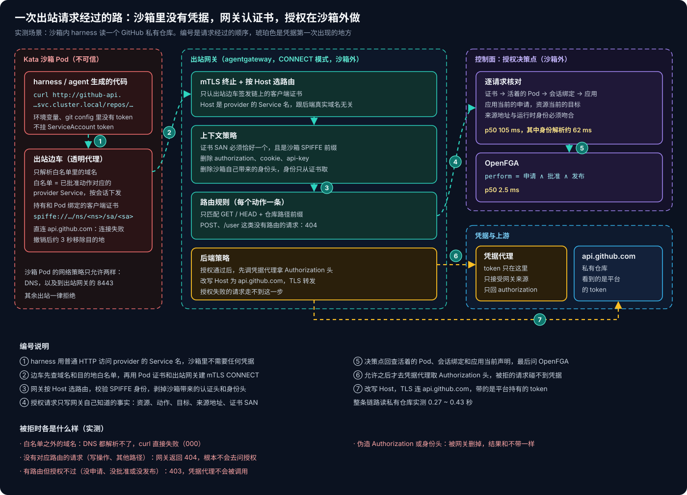
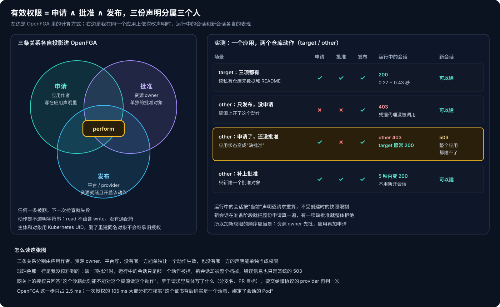
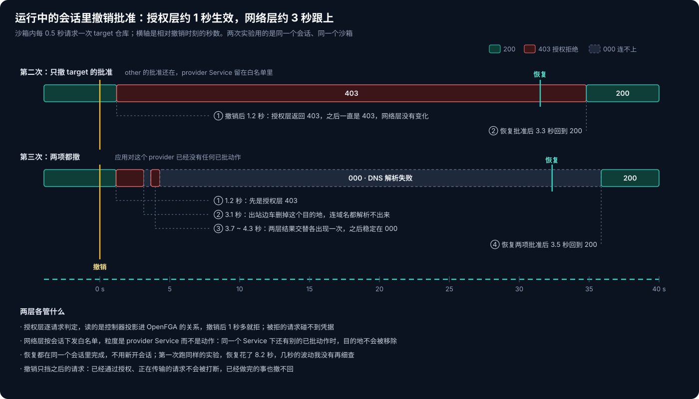

# AKS Agent Runtime 系列 04：出站治理与逐请求授权

[第 03 篇](AKS-Agent-Runtime系列03：控制面怎么驱动编码Harness.md)讲到，控制面和沙箱之间只开执行守护进程这一个口，而且方向是单向的。这篇讲沙箱往外的那条路。harness 在 Kata 沙箱里免确认运行，手里没有任何凭据。那它要读一个私有仓库、调一个内部 API 的时候，凭据从哪来？这一次请求该不该放行，又由谁来决定？

我在 AKS 上把这条路搭起来测了一遍。让沙箱里的 agent 去读我 GitHub 上的一个私有仓库，token 只放在沙箱外，由网关在授权通过之后注入。下面按一次请求的走向，把每一关拆开说。

## 一、一次出站请求经过的路



沙箱 Pod 的网络策略只放行两样东西：DNS，以及到出站网关的 8443 端口。agent 访问 provider 时用的是一个普通的集群内 HTTP 地址（provider 的 Service 名），Pod 里的出站边车会透明地接住这个请求，用 Pod 的客户端证书和出站网关建一条 mTLS CONNECT 隧道，再把请求送过去。网关按 Host 选路由，问一次授权，授权通过才去拿凭据，最后改写 Host、用 TLS 连到 `api.github.com`。

整条路上有四个可信组件：出站边车、出站网关、授权决策点、凭据代理。只有出站边车在沙箱 Pod 里，它是一个单独的容器，客户端证书也只挂给它。我在 agent 所在的容器里翻了一遍，找不到任何私钥或证书文件。

我在沙箱里依次发了八种请求：

| 请求 | 结果 | 说明 |
|---|---|---|
| 读 target 仓库（已申请、已批准） | 200，0.27 ~ 0.43 秒 | 私有仓库的 README 原文能读到 |
| 读 other 仓库（资源上开了，应用没申请） | 403 | 授权决策点日志里记为拒绝，凭据代理没被调用 |
| `GET /user`（没有对应路由） | 404 | 网关层直接挡掉，不会去问授权 |
| `POST` 创建 issue | 404 | 静态路由只匹配 GET / HEAD |
| 自带一个假的 `Authorization` 头 | 200 | 假 token 被剥掉，换成平台的 token |
| 伪造身份头，冒充另一个沙箱 | 200 | 头被剥掉，身份只从证书取，仍按本沙箱判定 |
| 直连 `https://api.github.com` | 连接失败 | 域名不在白名单里，解析都过不了 |
| 直连 `https://github.com` | 连接失败 | 同上 |

最后我又让 harness 自己走了一遍：叫它用 curl 读这个私有仓库的 README，再检查环境变量和 git 配置里有没有 GitHub token。它拿到了 README 里的标记行，并且回答说环境里找不到任何 token。

## 二、网关认的是证书，不是请求头

沙箱里跑的代码是不可信的，请求里的任何一个头都可能是它自己写的。所以身份只能从连接本身来：出站边车持有一张和 Pod 绑定的证书，SAN 是 `spiffe://<trust-domain>/ns/<namespace>/sa/<serviceaccount>` 这种形式。网关在 mTLS 握手时验证它，然后在每条路由上挂一条上下文策略：

```yaml
traffic:
  authorization:
    action: Allow
    policy:
      matchExpressions:
        - has(source.subjectAltNames) && source.subjectAltNames.size() == 1 &&
          source.subjectAltNames[0].startsWith("spiffe://<trust-domain>/ns/")
  headerModifiers:
    request:
      remove: [authorization, proxy-authorization, api-key, x-api-key, cookie,
               x-sandbox-identity, x-sandbox-runtime-identity]
  phase: PostRouting
```

前半段要求证书恰好一个 SAN，而且是沙箱的 SPIFFE 前缀。后半段把沙箱可能带来的认证头和身份头全部删掉。上面那两次伪造实验的结果都是 200，看上去像"没拦住"，其实正说明伪造的内容被删干净了：请求还是按本沙箱的真实身份判定，用的也还是平台的 token。

授权请求的内容由网关来写，沙箱没有机会参与。网关调授权决策点时，请求体里每个字段要么是路由上写死的常量，要么取自连接元数据：

```text
{"resourceRef":{"name":"github-api"}, "action":"github.target.read",
 "resourceTarget":"https://api.github.com",
 "sourceAddress": source.address, "runtimeIdentities":[source.subjectAltNames[0]]}
```

动作是哪一个，由请求命中了哪条路由决定，而不是由 agent 声称自己要做什么来决定。

证书只说明"连接来自某个 namespace 下某个 ServiceAccount 的 Pod"，决策点还要回查更多东西：这个 Pod 现在还活着吗？它是不是绑定在一个已经准备好的会话上？来源地址对得上吗？这个会话属于哪个应用，应用当前的声明里有没有申请这个动作？资源当前的目标和请求打到的目标一致吗？全部对上，最后才问 OpenFGA。我从决策点日志里统计了 561 次授权，p50 是 105 毫秒，OpenFGA 那一步只占 2.5 毫秒，大约 62 毫秒都花在核实沙箱身份上，也就是回查 Pod、ServiceAccount、会话和运行时状态。

## 三、有效权限是三份声明的交集



一个动作能不能做，要看三份分别由不同的人写的声明：

- **申请**：应用作者在应用声明里列出"我要对哪个资源做哪个动作"；
- **批准**：资源 owner 单独建一个批准对象，指明允许哪个应用做哪些动作；
- **发布**：平台侧的资源声明处于就绪状态，开启了这个动作，而且它的 provider 支持这个动作。

控制器把这三份声明各自投影成 OpenFGA 里的一条关系，权限是算出来的，没有人直接写"有权限"这条记录。模型压缩一下大概是这样：

```text
model
  schema 1.1
type app
type resource_action
  relations
    define requested: [app]
    define granted:   [app]
    define published: [app:*]
    define perform: requested and granted and published
```

`resource_action` 的对象是"某个资源的 UID + 一个确切的动作"。动作就是一个不透明的字符串，`git.read` 不蕴含 `git.write`，也没有通配符。主体和对象都用 Kubernetes UID 而不是名字，删掉一个对象再建一个同名的，不会继承旧的授权。

我在同一个应用上测了几种组合，有一个结果我事先没想到：**应用申请了一个还没被批准的动作时，已经在运行的会话照常工作，只是那一个动作被拒；但新会话整个建不了**，接口返回一个笼统的 503，只有看应用的状态才知道是"缺批准"。从现象看，会话准备阶段是把整份申请放在一起算的，有一项缺批准就整体失败。资源 owner 补上批准之后，运行中的会话 5 秒内就能用上这个新动作，不用重开；新会话也恢复正常。

这对操作顺序有直接影响：给应用加一个新权限时，应该先让资源 owner 批准，再在应用里加上申请。反过来做，在批准落地之前，这个应用的所有新会话都会失败。

## 四、凭据在最后一跳才出现

凭据代理是我自己写的一个小服务，十几行 Python。网关在后端策略里把它当成一个 extAuth 服务来调，它返回的 `authorization` 头会被加到发往上游的请求上：

```python
TOKEN = open("/var/run/broker/token").read().strip()

class H(http.server.BaseHTTPRequestHandler):
    def do_GET(self):
        self.send_response(200)
        self.send_header("authorization", "Bearer " + TOKEN)
        self.send_header("content-length", "0")
        self.end_headers()
```

```yaml
# 后端策略：路由层授权通过之后才会执行
policies:
  tls: {sni: api.github.com}
  extAuth:
    backendRef: {kind: Service, namespace: <ns>, name: egress-poc-broker, port: 8080}
    failureMode: FailClosed
    http:
      path: '"/credential"'
      allowedResponseHeaders: [authorization]
```

我在代理里把每次收到的请求都记了下来，看到三件事：

- **只有授权通过的请求才会调到它。** 读 other 仓库那次被拒了，代理日志里就没有对应的调用。
- **它收到的请求只有一个 `host` 头。** 沙箱带的假 `Authorization` 头没有传到它这里，请求内容也没有。代理只负责"给凭据"，看不到 agent 在做什么。
- **每个请求调一次，不做缓存。** 4 次放行的请求对应 4 次调用。

这里我做了一个 PoC 才会做的妥协：代理里放的是我自己 GitHub CLI 的 token，权限很大。网关的路由把它的用途限制在两个仓库的 GET 请求上，但 token 本身没有这个限制，测完我就把 Secret 删了。生产上我会换成 GitHub App 的 installation token：只授权给需要的仓库，一小时过期，由代理按资源去换取。凭据代理正好是做这件事的地方，它能拿到资源是哪个，就能按资源选用不同权限的凭据。

## 五、撤销多快生效



我在沙箱里每 0.5 秒请求一次 target 仓库，然后删掉它的批准对象，看什么时候开始拒绝，再把批准加回来，看什么时候恢复。

撤销是分两层生效的：

- **授权层**：撤销后 1.2 秒左右开始返回 403，两次实验都是这样。决策点每次都按当前的声明和关系重新判定，不用等会话重建。
- **网络层**：如果这个应用对该 provider 已经没有任何已批准的动作，大约 3 秒后，出站边车会把这个目的地从白名单里拿掉，之后连域名都解析不了。中间有不到一秒的时间，两种结果交替出现。如果同一个 provider 下还有别的动作是批准的，目的地就会一直留着，拒绝只发生在授权层。网络白名单的粒度是 provider 的 Service，不是动作。

恢复也在同一个会话里完成，3 到 4 秒回到 200。第一次跑的时候用了 8.2 秒，这几秒的波动我没有再细查。

撤销只挡之后的请求。已经通过授权、正在传输的请求不会被打断，做过的事也撤不回。这和第 03 篇提到的"委托撤销后，已经打开的更新流还会持续一会儿"是同一类问题：授权是在请求入口处判定的，不会去追着已经放行的操作。

## 六、静态路由能做什么、不能做什么

这次我用的是最简单的一种 provider：所有判断都在网关的路由配置里完成，不需要额外写服务。它也因此有几条硬限制：

- **只能做只读请求。** 参考实现在配置校验时就只允许 GET 和 HEAD，所以上面的 POST 直接 404。原计划是在出站时注入 Git token 跑 `git clone`，但 Git 的 smart-HTTP 协议里，取数据那一步本身就是一个 POST 请求，静态路由处理不了。
- **一个动作对应一条路径前缀，而且只能映射到一个资源。** 我想让两个仓库分开授权，就得定义两个动作。这对 REST API 够用，但表达不了"这个 PR 的目标分支必须是 main"这类规则。

写操作和 Git 协议要换一种做法：让一个懂协议的 provider 服务来当执行点。它解析请求，算出资源和动作，再调同一个授权决策点；然后用自己的本地策略再判一次（比如 PR 的源分支和目标分支），两边都通过才执行。凭据也由它自己持有。网关在这种模式下只负责粗粒度的路由和身份传递，授权逻辑仍然只在决策点一个地方。

还有一处是我在环境里自己补的。这套环境的沙箱出站走的是 CONNECT 网关，而参考实现的静态 provider 只在内部网关上生成路由，CONNECT 网关上没有它对应的路由。我照着模型网关的写法，在 CONNECT 网关上给每个动作补了一条按主机名匹配的路由，再挂上授权策略和上面那条上下文策略：

```yaml
apiVersion: gateway.networking.k8s.io/v1
kind: HTTPRoute
metadata: {name: github-api-connect-target}
spec:
  hostnames: [github-api.<gateway-ns>.svc.cluster.local]
  parentRefs: [{name: <connect-gateway>, sectionName: provider-services}]
  rules:
    - name: authorized
      matches:
        - {method: GET,  path: {type: PathPrefix, value: /repos/<owner>/egress-poc-target}}
        - {method: HEAD, path: {type: PathPrefix, value: /repos/<owner>/egress-poc-target}}
      filters: [{type: URLRewrite, urlRewrite: {hostname: api.github.com}}]
      backendRefs: [{group: agentgateway.dev, kind: AgentgatewayBackend, name: github-api-backend}]
```

授权策略挂在这条路由上，是一个 extAuth：`failureMode: FailClosed`，请求体就是第二节那段只由网关填写的 JSON。

最后说一下成本。每个请求都要授权一次，p50 约 105 毫秒。克隆一个仓库只有几次请求，影响不大；但 agent 要是连续调几百次 API，这个开销就会叠起来。如果要优化，我会先看身份解析那 62 毫秒，而不是 OpenFGA。

下一篇讲会话生命周期：Ephemeral 和 Durable 两种会话怎么做 checkpoint、暂停和恢复，控制器挂掉之后，残留的沙箱又怎么回收。

## 相关阅读

- [AKS Agent Runtime 系列 01：Sandbox 之外的三个平面](AKS-Agent-Runtime系列01：Sandbox之外的三个平面.md)
- [AKS Agent Runtime 系列 02：Harness 放在沙箱内还是沙箱外](AKS-Agent-Runtime系列02：Harness放在沙箱内还是沙箱外.md)
- [AKS Agent Runtime 系列 03：控制面怎么驱动编码 Harness](AKS-Agent-Runtime系列03：控制面怎么驱动编码Harness.md)
- [Agent 基础设施系列 02：Kubernetes 上的 Agent 沙箱](../../Notes/AI/agent/agent-runtime/Agent基础设施系列02：Kubernetes上的Agent沙箱.md)

## 参考资料

- [agentgateway](https://agentgateway.dev/)
- [OpenFGA: Modeling Guide](https://openfga.dev/docs/modeling)
- [SPIFFE ID](https://spiffe.io/docs/latest/spiffe-about/spiffe-concepts/)
- [Gateway API: HTTPRoute](https://gateway-api.sigs.k8s.io/api-types/httproute/)
- [GitHub: Generating an installation access token for a GitHub App](https://docs.github.com/en/apps/creating-github-apps/authenticating-with-a-github-app/generating-an-installation-access-token-for-a-github-app)
