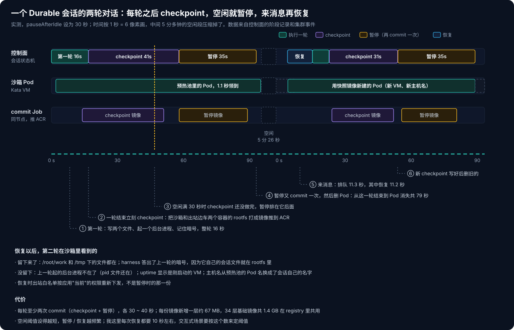
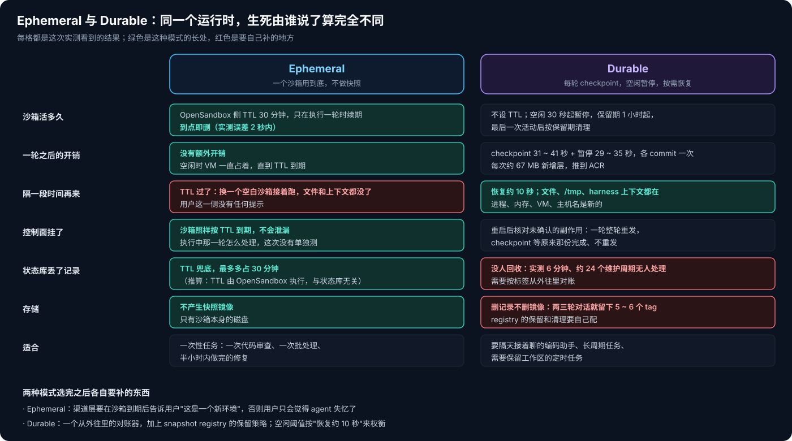
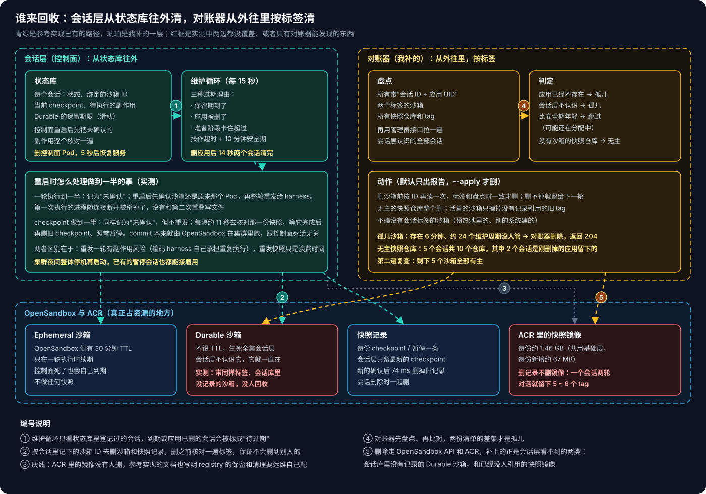

# AKS Agent Runtime 系列 05：会话生命周期与回收

[第 04 篇](AKS-Agent-Runtime系列04：出站治理与逐请求授权.md)讲的是一轮请求怎么出沙箱。这篇往后退一步，看一个会话从创建到被删掉的整个过程：沙箱什么时候建、什么时候拆，状态存在哪，控制面挂掉之后做到一半的事怎么办，以及最后谁来负责清理。

参考实现里会话有两种：

- **Ephemeral**：一个沙箱用到底，不做快照。沙箱在 OpenSandbox 那一侧带一个 30 分钟的 TTL，只有一轮正在执行、而且离过期不到 10 分钟时才会续期。
- **Durable**：每轮结束后做 checkpoint，空闲超过 `pauseAfterIdle` 就暂停，把 Pod 拆掉；来了新消息再恢复。会话在最后一次活动之后保留 `retention` 这么久，到期才清理。沙箱本身不设 TTL，什么时候删完全由会话层决定。

我在已有的环境里建了两个应用，一个 Durable（空闲 30 秒就暂停，这是允许的最小值），一个 Ephemeral，然后围绕它们做了几组实验。

## 一、checkpoint 和暂停到底存了什么

开始之前我以为 checkpoint 是把工作区打个包传到 Blob。实际看下来不是：OpenSandbox 会在沙箱所在的节点上起一个 commit Job，通过 containerd 把容器的 rootfs 提交成 OCI 镜像，推到 ACR。沙箱容器和出站边车容器各提交一份。暂停走的是同一套机制：先 commit，镜像推完以后删掉 Pod；恢复时用这份镜像新建一个 Pod。

所以保留下来的是**整个容器文件系统**，而不只是工作区；内存和进程状态则一概不保留。下面这次实测把这一点看得很清楚：



第一轮我让 agent 在 `/root/work` 和 `/tmp` 下各写一个文件，起一个 `sleep 3600` 的后台进程，再记住一个暗号。之后会话按策略暂停，Pod 被删掉。5 分多钟后我发第二轮：

- 两个文件都还在，`/tmp` 下的也在，因为保留的是整个 rootfs；
- harness 答出了暗号。它的原生会话文件就放在 rootfs 里，跟着快照一起走，这正是第 02 篇里"暂停恢复后还记得上一轮"的原因；
- 后台进程没了，记 PID 的文件还在；`uptime` 显示是刚启动的 VM，主机名也换了。

时间方面，控制面的阶段记录给的数比我自己掐表准：

| 阶段 | 耗时 | 说明 |
|---|---|---|
| 领预热沙箱 + 初始化 | 1.1 秒 + 0.1 秒 | 预热池里拿一个现成的 Pod |
| checkpoint | 31 ~ 41 秒 | 每轮结束后立刻做，4 次实测 |
| 暂停 | 29 ~ 35 秒 | 再 commit 一次，然后删 Pod |
| 恢复 | 9.5 ~ 11.2 秒 | 从暂停镜像新建 Pod，重新下发出站白名单 |

有两个细节值得注意：

**每轮结束后要 commit 两次。** 一轮结束先做 checkpoint，空闲时间到了再为暂停 commit 一次，内容几乎一样。我这里空闲阈值是 30 秒，到点时 checkpoint 还没做完，暂停只能排在它后面。从这一轮结束到 Pod 真正消失，一共 79 秒。阈值设得短，Pod 释放得快，但恢复也更频繁，每次恢复要 10 秒左右。交互式的场景要按这个数来定阈值。

**快照镜像不小。** 每份镜像在 ACR 里显示 1.46 GB，但其中 34 层是基础镜像，registry 里共用；真正新增的只有最后一层，约 67 MB。每多一次 checkpoint 或暂停，就多一个 tag。

恢复时还有一件事：出站白名单是按应用**当前**的权限重新下发的，不是暂停时的那一份。第 04 篇里撤销批准对运行中的会话 1 秒多就生效；对暂停的会话，恢复时下发的就已经是撤销之后的白名单。

## 二、Ephemeral 会话

Ephemeral 的过程简单得多。这一轮结束后既没有 checkpoint，也没有暂停，沙箱一直开着，直到 OpenSandbox 侧的 TTL 到期。我这次的沙箱创建时 TTL 是 30 分钟。

我让 agent 写了一个文件、记了一个暗号，然后不再理它。沙箱在 TTL 到点的那一刻被 OpenSandbox 删掉，中间没有续期，因为续期只发生在一轮执行的过程中。

到期之后我往同一个会话又发了一条消息。会话没有报错：控制面连旧沙箱失败，用 1.2 秒从预热池换了一个新沙箱，把这一轮发了过去。但这是一个全新的环境，文件没了，暗号也没了。用户这一侧没有收到任何"上下文已经丢失"的提示，只有 agent 在回答里说找不到那个文件。如果渠道层不额外做提示，用户很可能以为 agent 失忆了。



这种设计的好处是兜底：控制面就算整个没了，Ephemeral 沙箱也会自己到期，不会泄漏。代价是 30 分钟内不用就没了，适合一次性的任务，比如一次代码审查、一次批处理；需要隔天接着聊的，只能用 Durable。

## 三、控制面在做到一半时挂掉

第 03 篇讲过，控制面每一步都先把"要做什么"写进状态库，再去做。我想看看这条规矩在真出事的时候是什么效果，就在两个时间点直接删了控制面的 Pod。它是单副本，重建到恢复服务大约 5 秒。

**第一次：一轮执行到一半。** 我让 agent 跑 `date; sleep 45; date`，命令开始 10 秒左右删控制面。阶段记录里，第一次执行的结果被记为"未确认"。控制面重启后先确认沙箱还是原来那个 Pod，然后把这一轮**整轮重发**给 harness，harness 从头又跑了一遍命令。最后输出里的开始时间是重发之后的时间。命令最后会往文件里追加一行，文件里只有一行，说明第一次执行的进程随着连接断开被杀掉了，没有和第二次重叠。

这和第 03 篇说的一致：对编码 harness，结果不确定时沿用 harness 自己的重放行为。这一次的命令没有副作用，重跑一遍没问题；如果这一轮里已经推过代码、建过 PR，重跑就是重复执行。

**第二次：checkpoint 做到一半。** commit Job 跑起来 8 秒后我删了控制面。这次的处理完全不同：checkpoint 同样被记为"未确认"，但控制面重启后**没有重新发起快照**，而是每隔约 11 秒去核对正在进行的那一份。等它做完，再检查一遍运行时，删掉旧 checkpoint，照常暂停。commit 本来就是 OpenSandbox 在集群里跑的，控制面挂不挂不影响它，控制面只需要找回自己没确认的那一步。

这两种处理方式的差别是有道理的：重发一轮可能产生副作用，但又不能不发，否则用户的消息就丢了；重发一次快照没有副作用，只是浪费时间，所以等原来那份就行。

另外有个不在计划里的验证：这个集群每天半夜会被自动停机，第二天再启动。前两天留下的几个暂停会话，启动后照常恢复使用。

## 四、谁来回收



会话层的回收是**从状态库往外**做的：一个维护循环每 15 秒遍历一遍状态库里登记的会话，找出三种该清理的情况——保留期到了、所属的应用被删了、准备阶段卡住超过"操作超时 + 10 分钟安全期"。然后按会话里记下的沙箱 ID 去删沙箱和快照记录，删之前核对一遍沙箱上的标签，确保不会删到别的会话的东西。

我先测了"应用被删"这条：删掉 Durable 应用后 14 秒，它名下两个暂停会话的沙箱和快照记录就都清掉了。

问题出在这个方向本身：**它只能清理状态库里有记录的东西。** 我做了两个检查：

**会话库里没有记录的沙箱。** 我直接调 OpenSandbox 的 API 建了一个沙箱，打上和真实会话完全一样的两个标签（会话 ID、应用 UID），不设 TTL，模拟状态库丢了一条记录，比如数据库从备份回滚、或者分配成功但写库前进程被杀。6 分钟、大约 24 个维护周期过去，没人管它。代码里其实有一个"按标签盘点所有沙箱"的函数，但整个代码里没有任何地方调用它。Ephemeral 沙箱碰到这种情况还有 TTL 兜底，Durable 沙箱就会一直占着一个 Kata VM。

**快照镜像。** 会话层"删 checkpoint"删的是 OpenSandbox 里的快照记录，ACR 里的镜像不动。我的 Durable 会话只跑了两三轮，删掉应用后每个会话在 ACR 里还留着 5 到 6 个 tag。整个环境跑了三天，另外还有 3 个早就不存在的会话留着快照仓库。参考实现的文档里也写了，snapshot registry 的保留和清理需要运维自己配。

所以我补了一个对账器，方向反过来，从外往里：

1. 盘点所有带"会话 ID + 应用 UID"两个标签的沙箱，以及 ACR 里所有快照仓库；
2. 用管理员接口拉出会话层认识的全部会话；
3. 应用已经不存在、或者会话层不认识的沙箱算孤儿；比安全期年轻的跳过，它可能正处在"已分配、还没写库"的窗口里；
4. 删之前按 ID 再读一次沙箱，标签和盘点时一致才删；没有对应沙箱的快照仓库整个删，活着的沙箱只摘掉没有记录引用的旧 tag。

默认只出报告，加 `--apply` 才删。跑一遍的结果：

```text
apps=3 known_sessions=5 sandboxes=6 snapshots=8
  sandbox 19fa6c90-… session=deadbeef age=372s -> orphan:session_unknown
    DELETE -> 204
  sandbox 2e820791-… session=6889db3e age=356s -> ok
  …
  repo opensandbox-snapshots/067fe6d0-…-sandbox tags=4 -> orphan:no_sandbox
    deleted repo
  …（5 个会话，共 10 个无主仓库）
```

再跑一遍复查，剩下的 5 个沙箱全部有主，没有无主仓库了。

有几个地方我是刻意保守的：

- **只认两个标签都在的沙箱。** 预热池里还没分配的沙箱、别的系统建的沙箱，一律不碰。只看一个标签，或者按名字推断归属，都很容易误删。
- **旧 tag 只摘、不删 manifest。** 同一个 digest 可能挂着不止一个 tag（我看到过同一个会话里两个大小完全一样的 tag），按 tag 删 manifest 有可能把还在引用的那个一起删掉。摘掉 tag 之后，无 tag 的 manifest 交给 ACR 的保留策略去清（这个策略需要 Premium SKU）。
- **安全期要比"操作超时"长。** 参考实现自己用的是"操作超时 + 10 分钟"，对账器沿用同一个数，实测时为了快改成了 3 分钟。

对账器和会话层的维护循环不冲突：会话层管"状态库里有记录、该到期的"，对账器管"实际存在、状态库里却没有记录的"，两者加起来才算完整。

## 五、我会怎么配

- **交互式的编码助手用 Durable**，空闲阈值不要压得太短。暂停时的 commit 在后台做，用户感觉不到，但每次恢复用户都要多等 10 秒左右。阈值短于几分钟，省下的那点 VM 时间换来的是频繁的等待。
- **一次性任务用 Ephemeral**，靠 TTL 兜底，控制面出问题也不会泄漏。
- **把 snapshot registry 当成要单独管的东西。** 定好每个会话保留几个 tag，会话删除时连仓库一起删，再配 untagged manifest 的保留策略。不管的话，它会是整个系统里增长最快、又最没人看的那一块。
- **对账器按天跑就够了**，它处理的是少见的不一致，不在关键路径上；但一定要有，而且要先跑报告模式看几天再打开删除。

下一篇讲高可用：控制面目前是单副本加 SQLite，这篇里删 Pod 后有 5 秒不可用，多副本时会话怎么分配、怎么防止两个副本同时驱动同一个会话。

## 相关阅读

- [AKS Agent Runtime 系列 02：Harness 放在沙箱内还是沙箱外](AKS-Agent-Runtime系列02：Harness放在沙箱内还是沙箱外.md)
- [AKS Agent Runtime 系列 03：控制面怎么驱动编码 Harness](AKS-Agent-Runtime系列03：控制面怎么驱动编码Harness.md)
- [AKS Agent Runtime 系列 04：出站治理与逐请求授权](AKS-Agent-Runtime系列04：出站治理与逐请求授权.md)
- [Agent 基础设施系列 02：Kubernetes 上的 Agent 沙箱](../../Notes/AI/agent/agent-runtime/Agent基础设施系列02：Kubernetes上的Agent沙箱.md)

## 参考资料

- [OpenSandbox](https://github.com/opensandbox-group/OpenSandbox)
- [OSEP-0008: Pause and Resume via Rootfs Snapshot](https://github.com/opensandbox-group/OpenSandbox/blob/main/oseps/0008-pause-resume-rootfs-snapshot.md)
- [Azure Container Registry: Set a retention policy for untagged manifests](https://learn.microsoft.com/azure/container-registry/container-registry-retention-policy)
- [Kubernetes: Garbage Collection](https://kubernetes.io/docs/concepts/architecture/garbage-collection/)
