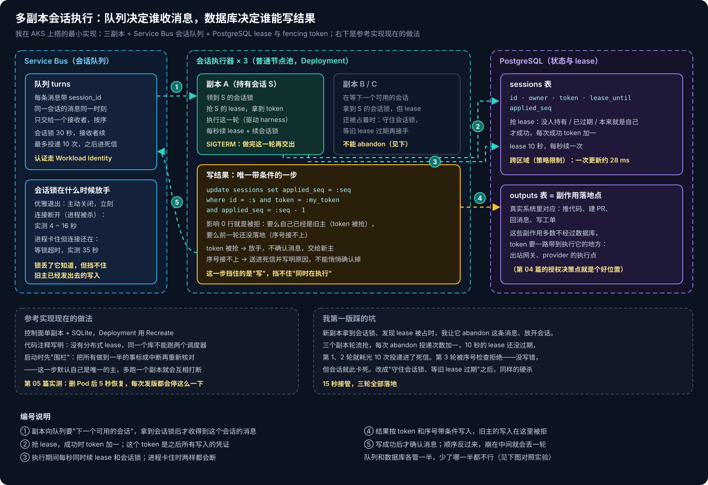
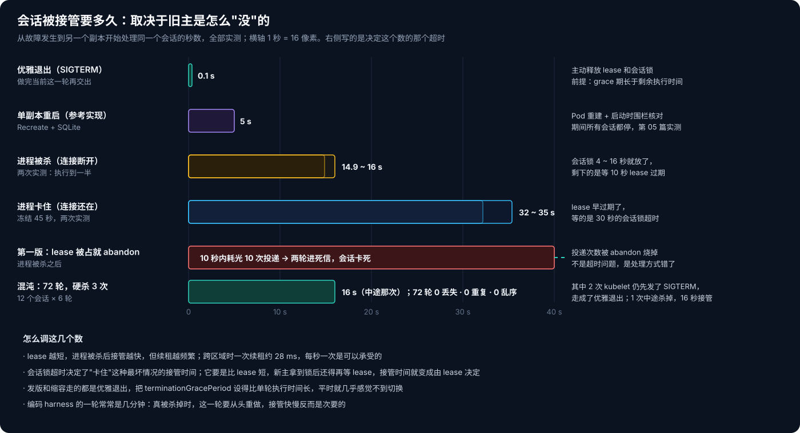
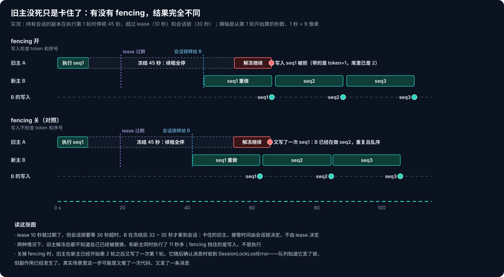

# AKS Agent Runtime 系列 06：会话管理与高可用

[第 05 篇](AKS-Agent-Runtime系列05：会话生命周期与回收.md)里删掉控制面的 Pod，大约 5 秒后恢复服务，做到一半的事也都能接上。这对一个 PoC 够用了，但这 5 秒里所有会话都停着，每次发版也要停这么一下。参考实现为什么只跑一个副本？它的执行器代码里有一句注释说得很直接：没有分布式 lease，同一个数据库不能跑两个调度器。Deployment 也配成了 `Recreate`，新 Pod 起来之前先把旧的删掉。

它的启动过程也说明了这一点：控制面启动时会先做一次"围栏"，把状态库里所有做到一半的事都标成中断，再逐个重新核对。只有确定自己是唯一的主，这么做才是安全的。多跑一个副本，新起来的那个会把另一个正在跑的工作全部打断。

所以要做多副本，得先补两样东西。我在 AKS 上写了一个最小的会话执行器来验证：三个副本，消息走 Service Bus 的会话队列，状态和 lease 放在 PostgreSQL。每条消息代表会话里的一轮，处理就是睡几秒，模拟 harness 在执行，然后把这一轮的结果写进库里。

## 一、两件事：谁收消息，谁能写结果



**谁收消息，交给队列。** Service Bus 的会话队列里，每条消息都带一个 session_id。同一个会话的消息，同一时刻只交给一个接收者，而且按顺序交。副本向队列要"下一个可用的会话"，拿到会话锁之后，才收得到这个会话的消息。会话锁我设的是 30 秒，接收者在处理过程中要不断续。

**谁能写结果，交给数据库。** 拿到会话锁之后，副本还要在 PostgreSQL 里抢这个会话的 lease。lease 10 秒，每秒续一次。每次抢到，token 就加一：

```sql
update sessions set owner = :me, token = token + 1, lease_until = now() + interval '10 seconds'
 where id = :s and (owner is null or owner = :me or lease_until < now())
returning token;
```

这个 token 是之后写结果时的凭证。写结果是整个流程里唯一带条件的一步：

```sql
update sessions set applied_seq = :seq
 where id = :s and token = :my_token and applied_seq = :seq - 1;
```

更新了 0 行就说明被拒了，原因只有两种：要么自己已经是旧主，token 被别人抢走了；要么前一轮还没落地，序号接不上。写成功之后才确认消息。顺序反过来的话，崩在两步之间就会丢掉一轮。

既然队列已经保证了一个会话只交给一个接收者，为什么还要数据库的 lease？因为队列只管"谁收消息"。一个副本卡住之后，会话锁到期，队列会把会话交给别人，但它没法阻止原来那个副本醒过来之后接着往下写。这一点在第四节有实测。

环境方面有两处是被订阅策略逼出来的：Service Bus 的 SAS 认证被策略关掉了，副本改用 Workload Identity 连接；PostgreSQL Flexible Server 在 eastus2 和 eastus 都不让建，最后建在了 centralus。所以每次续 lease 都要跨区域，一次更新大约 28 毫秒。

## 二、先说我踩的坑

第一版代码里有一处想当然：副本拿到会话锁，发现 lease 还被别人占着，我就让它 abandon 这条消息，放开会话，过一会儿再来。

第一次硬杀测试就出了问题。持有会话的副本被杀掉后，Service Bus 4 秒左右就把会话锁放了出来，因为连接断了，不用等锁超时。但 PostgreSQL 里的 lease 还要 10 秒才过期。三个副本轮流拿到会话锁、发现 lease 被占、abandon，每次 abandon 投递次数都加一。lease 还没过期，第 1、2 轮的消息就耗光了 10 次投递机会，被转进了死信队列。lease 过期后，第 3 轮终于被处理，但写入被序号检查拒绝，因为前两轮根本没落地。

序号检查没让第 3 轮写进去，这一步是对的，没有发生乱序写入。但会话就此卡死了。

修法很简单：拿到会话锁就说明队列已经确认只有自己在处理这个会话，lease 被占只能是因为旧主死了或者卡住了。所以守住会话锁，边续锁边等旧 lease 过期，然后接手。改完之后同样的硬杀，15 秒接管，三轮全部落地。

写入被拒时的处理我也一起改了：token 被抢，说明自己是旧主，直接放手，不确认消息，交给新主；序号接不上，就把消息送进死信并写明原因，不能悄悄确认掉。

## 三、几种故障分别要多久



我对持有会话的副本试了几种"让它没掉"的方式，每次都是一个会话、三轮、每轮 20 秒，在第一轮开始 5 秒后动手：

- **优雅退出（删 Pod，收到 SIGTERM）**：副本把当前这一轮做完，主动释放 lease 和会话锁，0.1 秒后另一个副本就接手了下一轮，没有任何重做。前提是 terminationGracePeriod 比剩余的执行时间长。
- **进程被杀**：接管用了 14.9 秒，第一轮从头重做。会话锁 4 秒就放了，剩下的时间都在等 lease 过期。
- **进程卡住**：接管要 32 到 35 秒。lease 早就过期了，等的是 30 秒的会话锁超时，因为连接还在，Service Bus 以为它还活着。

最后跑了一组混沌测试：12 个会话、每个 6 轮，执行期间每 25 秒随机硬杀一个副本，一共 3 次。72 轮结果一条不少，没有重复，没有乱序。这里有个意外：前两次"硬杀"其实没杀硬。即使加了 `--grace-period=0 --force`，kubelet 还是先发了 SIGTERM，那两个副本把手上 3 秒的一轮做完就优雅退出了。只有第三次是在执行中途杀掉的，16 秒接管。

把这几个数放在一起看，调参的思路也就清楚了：

- **lease 越短，进程被杀后接管越快**，但续租越频繁。跨区域一次续租约 28 毫秒，每秒一次完全承受得了。
- **会话锁超时决定了"卡住"这种最坏情况**。它要是比 lease 还短，新主拿到锁后还得再等 lease。
- **发版和缩容走的都是优雅退出**。把 terminationGracePeriod 设得比单轮执行时间长，平时几乎感觉不到切换。

## 四、卡住的旧主和 fencing

最值得测的是"卡住"这种情况。旧主没死，只是一段时间不动，比如一次很长的 GC、宿主机卡顿、网络分区。它醒过来以后，并不知道自己已经被替换了。

我让持有会话的副本在执行第一轮时停顿 45 秒，超过 lease 也超过会话锁，然后放开，分别在 fencing 开和关两种情况下各做一次。（容器里的 PID 1 收不到 SIGSTOP，所以我用 SIGUSR1 让它在主线程里阻塞 45 秒，续租也就全停了。）



两次的前半段一模一样：新主在冻结后 30 多秒拿到会话，以 token=2 重做第一轮；旧主解冻后接着执行，两个副本**同时在跑第一轮，重叠了 11 秒多**。

区别在写入那一刻：

- **fencing 开**：旧主带着 token=1 去写，库里已经是 token=2，被拒绝。0.1 秒后新主写入成功。最终三轮各写一次。
- **fencing 关**：旧主在新主已经开始第二轮之后，又写了一次第一轮。结果第一轮写了两遍，而且顺序乱了。它随后去确认消息时，收到了 `SessionLockLostError`。队列知道它已经丢了锁，但副作用这时已经发生了。

这组实验让我意识到两件事：

**fencing 挡住的是写入，挡不住执行。** 新旧两个副本确实同时在跑。如果这一轮的副作用不经过带 token 校验的那一步，比如 harness 在沙箱里直接 `git push`，那两边都会推。

**所以 token 要一路带到真正产生副作用的地方。** 这个实验里副作用就是写一行数据库，校验 token 很容易。真实的 agent runtime 里，副作用发生在推代码、建 PR、回 Teams 消息、调内部 API，几乎都不经过控制面的数据库。能统一做校验的位置，就是第 04 篇的出站网关和授权决策点：每个出站请求本来就要核对"这个 Pod 是否绑定在一个准备好的会话上"，再加一条"这个绑定是不是当前的 token"就行。会话换了主，沙箱也要重新绑定。旧主驱动的那个执行流，它的请求在网关就会被拒。

## 五、放回 agent runtime 里看

这个执行器只是个验证模型，搬到真实的控制面上，我会这样做：

1. **状态库从 SQLite 换成 PostgreSQL**，会话表上加 owner、token、lease_until 三列。第 03 篇说的"副作用意图先落盘"不用变，只是每一条意图都带上写入它时的 token。
2. **入口消息走会话队列**。Teams、CLI、定时任务、agent 调 agent 都先投递到 Service Bus，session_id 就是会话 ID。顺序和"一个会话一次只跑一轮"由队列保证，控制面副本之间不用互相协调。
3. **启动时的"围栏"改成按 lease 判断**：只有 lease 已经过期的会话，才能当成中断来接管，而不是把整个库里做到一半的事都标成中断。
4. **出站网关校验 token**。这是唯一能挡住"卡住又醒来的旧主"产生外部副作用的地方。
5. **terminationGracePeriod 按 harness 单轮的时长来设**。编码 harness 一轮经常要几分钟，真被杀掉时这一轮要从头重做。比起接管快几秒，让发版走优雅退出更重要。

还有一个现实问题：编码 harness 的一轮重做，是让模型从头再来一遍，代价远比这里的"睡 20 秒"大。所以高可用做到最后，比的是**故障时少重做**，而不只是接管快。这又回到第 05 篇：checkpoint 做得勤一点，重做的范围就小一点。

下一篇换个方向，讲 agent 的定义、注册和发现：一个 agent 到底由哪些东西组成，怎么打包，别人又怎么找到它、知道它能做什么。

## 相关阅读

- [AKS Agent Runtime 系列 03：控制面怎么驱动编码 Harness](AKS-Agent-Runtime系列03：控制面怎么驱动编码Harness.md)
- [AKS Agent Runtime 系列 04：出站治理与逐请求授权](AKS-Agent-Runtime系列04：出站治理与逐请求授权.md)
- [AKS Agent Runtime 系列 05：会话生命周期与回收](AKS-Agent-Runtime系列05：会话生命周期与回收.md)

## 参考资料

- [Azure Service Bus message sessions](https://learn.microsoft.com/azure/service-bus-messaging/message-sessions)
- [Azure Service Bus: Message transfers, locks, and settlement](https://learn.microsoft.com/azure/service-bus-messaging/message-transfers-locks-settlement)
- [Martin Kleppmann: How to do distributed locking](https://martin.kleppmann.com/2016/02/08/how-to-do-distributed-locking.html)
- [Kubernetes: Pod termination](https://kubernetes.io/docs/concepts/workloads/pods/pod-lifecycle/#pod-termination)
- [Use Microsoft Entra Workload ID with AKS](https://learn.microsoft.com/azure/aks/workload-identity-overview)
