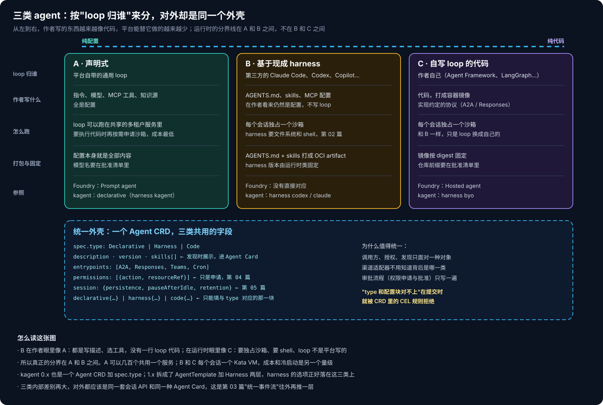
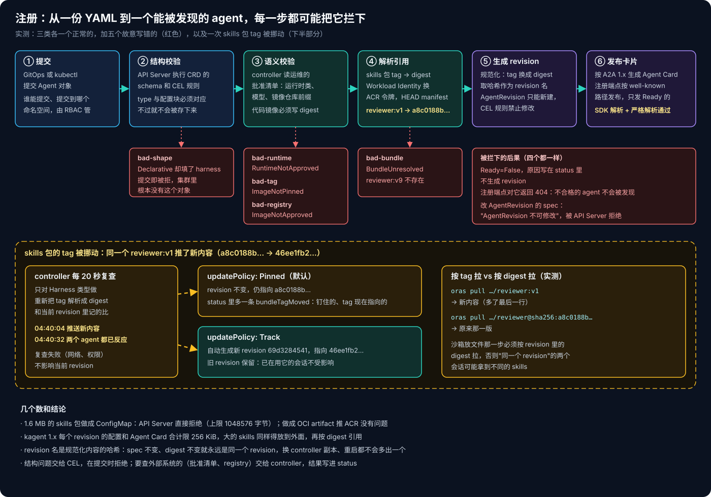
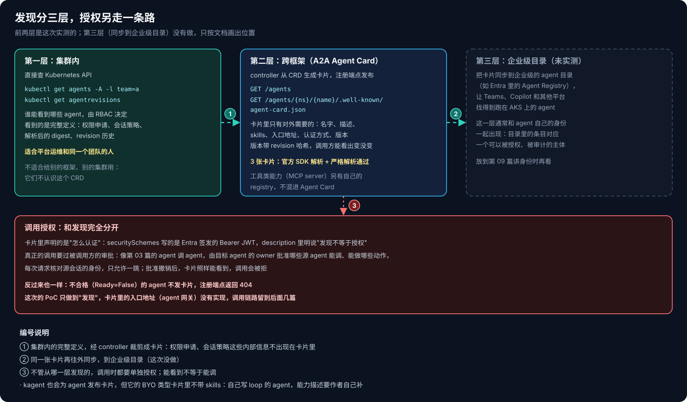

# AKS Agent Runtime 系列 07：Agent 的类型、注册与发现

前几篇讲的都是"一个 agent 怎么跑"：放在哪个沙箱里，出站怎么管，会话怎么保存和接管。这篇往前一步，讲 agent 本身：它由哪些东西组成，怎么打包、怎么注册，别人又怎么找到它、知道它能干什么。

## 一、三类 agent，按"loop 归谁"来分

我一开始是参照 Foundry 来分的：一类是声明式的 prompt agent，另一类是需要自己定义一堆东西的编码 agent。后来发现第二类得再拆一次：



- **A 声明式**：loop 是平台自带的通用 loop，作者只写指令、选模型、挂 MCP 工具和知识源。
- **B 基于现成 harness**：loop 是 Claude Code、Codex、Copilot 这些第三方 harness 的，作者写 AGENTS.md、skills、MCP 配置。
- **C 自写 loop 的代码 agent**：loop 是作者自己用 Agent Framework、LangGraph 写的，打成容器镜像。

拆开 B 和 C 的原因是：**B 在作者眼里像 A，在运行时眼里像 C。** 作者写的仍然只是描述和配置，没有一行 loop 代码；但它跑的是别人写好的 loop，而且这个 loop 需要文件系统和 shell，每个会话都得独占一个沙箱。所以真正的分界在 A 和 B 之间：A 的 loop 可以几百个 agent 共用一个服务，需要执行代码时再按需申请沙箱；B 和 C 每个会话一个 Kata VM，成本和冷启动是另一个量级。

拿外面的东西对照一下：Foundry 的 Prompt agent 对应 A，Hosted agent 对应 C，B 目前没有直接对应。kagent 1.x 的 Harness 有 `kagent`、`byo`、`codex`、`claude` 几种，分别落在这三类上。前几篇用的参考实现，本质上就是一个只做 B 类（外加一个可以跑自定义命令的口子）的平台。

## 二、一个外壳，三种配置块

三类内部差别再大，对平台的其他部分来说最好是同一种东西：调用方、授权、发现、审批都只面对一种对象，渠道适配器也不用关心背后是哪一类。所以我用一个 `Agent` CRD 加 `spec.type`，三类共用的字段放外面，各自的配置放在对应的块里：

```yaml
apiVersion: lab.agentruntime.io/v1alpha1
kind: Agent
metadata: {name: pr-reviewer, namespace: team-a}
spec:
  type: Harness                      # Declarative | Harness | Code
  description: Reviews pull requests in a sandbox and posts a short review.
  version: "1.0.0"
  skills:                            # 进 Agent Card，给别人看的能力
    - {id: code-review, name: Code review, description: Review a diff for correctness and test coverage}
  entrypoints: [A2A, Cron]
  permissions:                       # 只是申请，第 04 篇
    - {action: model.invoke, resourceRef: aoai-model}
  session: {persistence: Durable, pauseAfterIdle: 15m, retention: 7d}
  harness:                           # 只能填和 type 对应的这一块
    harness: Copilot
    runtimeClass: turn-coding-agent-md
    bundle: {ref: "oci://<acr>/agent-bundles/reviewer:v1", updatePolicy: Pinned}
```

"type 和配置块必须对应"这种纯结构的规则，我写成 CRD 里的 CEL 规则，提交时就由 API Server 拒绝。需要查外部系统的规则（批准清单、registry）交给 controller 处理，结果写进 status。

B 类的 AGENTS.md 和 skills 我没有放进 ConfigMap，而是用 oras 打成一个 OCI artifact 推到 ACR。原因很实际：我把一个 1.6 MB 的 skills 包做成 ConfigMap，API Server 直接拒绝了，上限是 1048576 字节。参考实现目前用 ConfigMap 往沙箱里放文件，碰到大一点的 skills 包就会撞上这个限制。kagent 1.x 也有类似的约束：每个 revision 的配置和 Agent Card 合计不能超过 256 KiB。OCI artifact 没有这个问题，而且天然带 digest，可以按内容固定版本。

## 三、注册：每一步都可能把它拦下



controller 处理一个 Agent 的顺序是：

1. **语义校验**：运行时类、模型、镜像仓库前缀必须在运维的批准清单里；代码镜像必须写 digest，不能只写 tag。
2. **解析引用**：B 类的 skills 包要从 tag 解析成 digest。controller 用 Workload Identity 换 ACR 令牌，再 HEAD 一次 manifest 拿到 digest。实测 `reviewer:v1` 解析成 `sha256:a8c0188b…`，和推送时一致。
3. **生成 revision**：把 spec 规范化（tag 换成解析后的 digest），取哈希作为 revision 名，创建一个 AgentRevision。AgentRevision 只能新建，不能修改：我试着改一个 revision 里的 digest，API Server 直接拒绝。
4. **发布卡片**：按 A2A 1.x 生成 Agent Card，注册端点只发布 Ready 的 agent。

三类各建了一个正常的，又故意写错了五个：

- 声明成 Declarative 却填了 harness 块：提交时被 CEL 规则拒绝，集群里根本没有这个对象；
- 用了没批准的运行时类：`RuntimeNotApproved`；
- 代码镜像只写了 tag：`ImageNotPinned`；
- 镜像来自没批准的仓库：`ImageNotApproved`；
- skills 包的 tag 不存在：`BundleUnresolved`。

后四个都是 Ready=False，原因写在 status 里，不生成 revision，注册端点对它们返回 404。**不合格的 agent 不会被别人发现。**

revision 这个概念是从参考实现学来的，它叫"canonical serving revision"：新会话用最新的 revision，已经在跑的会话保持原来的 revision。不过它的文档里有一处前后不一致：一处说已有会话固定在创建时的"配置和权限"上，另一处说权限按应用当前的声明实时计算。第 04 篇的实测是后者，撤销批准 1 秒左右就对运行中的会话生效了。所以准确的说法是：**revision 固定的是配置，权限是每次请求实时算的。**

### tag 被挪动的时候

用 tag 引用 skills 包，最怕的是有人往同一个 tag 推了新内容。我试了一下：建两个引用 `reviewer:v1` 的 agent，一个策略是 `Pinned`（默认），一个是 `Track`，然后改了 AGENTS.md，重新推到同一个 `v1`。

controller 每 20 秒复查一次，28 秒内两个 agent 都有了反应：

- **Pinned**：revision 不变，仍然指向原来的 digest；status 里多了一条 `bundleTagMoved`，写明钉住的是哪个、tag 现在指向哪个。
- **Track**：自动生成了新 revision，指向新的 digest；旧 revision 保留，已经在用它的会话不受影响。

消费的那一侧也要配合。我分别按 tag 和按 digest 拉了一次：按 tag 拉到的是新内容，按 digest 拉到的是原来那一版。所以沙箱放文件那一步必须按 revision 里记的 digest 拉，否则"同一个 revision"下的两个会话，可能拿到不同的 skills。

## 四、发现：分三层，授权另走一条路



**集群内**，直接查 Kubernetes API 就行，`kubectl get agents -l team=a` 能看到完整定义：权限申请、会话策略、解析后的 digest、revision 历史。谁能看到哪些 agent，由 RBAC 管。这一层适合平台运维和同一个团队的人，别的框架、别的集群不认识这个 CRD。

**跨框架**，用 A2A 的 Agent Card。controller 从 CRD 生成卡片，注册端点按 `/.well-known/agent-card.json` 发布。卡片里只放对外需要的东西：名字、描述、skills、入口地址、认证方式、版本。版本号后面带上 revision 哈希，调用方能看出 agent 有没有变。

A2A 1.x 的卡片结构和早期版本不一样，入口从单个 `url` 改成了 `supportedInterfaces` 列表，每一项写明地址、协议绑定（JSONRPC、gRPC、HTTP+JSON）和协议版本。官方 Python SDK 的 AgentCard 现在直接是 protobuf 定义。我对三张卡片做了两次校验：先用 SDK 的 `A2ACardResolver` 按 well-known 路径拉取解析；再用 protobuf 的严格模式解析一遍，不认识的字段直接报错，防止字段名拼错被悄悄忽略。三张都通过了。

**企业级**，把卡片同步到企业的 agent 目录，让 Teams、Copilot 和其他平台也能找到跑在 AKS 上的 agent。这一层这次没有做，它和 agent 自己的身份是一起出现的，放到第 09 篇讲身份时再看。

**能被发现不等于能被调用。** 卡片里写的是"怎么认证"：我在 securitySchemes 里声明要 Entra 签发的 Bearer JWT。真正能不能调，要过被调用方的审批。参考实现里 agent 调 agent 的做法就是这样：目标 agent 的 owner 批准哪些源 agent 能调、能做哪些动作，每次请求核对源会话的身份，只允许一跳。批准撤销以后，卡片照样能看到，调用会被拒。

这次的 PoC 只做到了"发现"这一步，卡片里的入口地址（agent 网关）没有实现。三类 agent 对外要提供同一套会话 API：A 类的平台 loop 直接输出统一事件；B 类像第 03 篇那样用适配器转换各家 harness 的输出；C 类要求镜像实现约定的协议。这些留到后面的篇幅里。

## 五、我会怎么落地

- **一个 CRD 加 type**，结构规则写进 CEL，需要查外部系统的规则放在 controller 里。两者都要有：前者让错误在提交时就暴露，后者让错误原因留在 status 里，可以查。
- **skills 和 AGENTS.md 用 OCI artifact**，默认 `Pinned`。要跟随更新就显式写 `Track`，每次跟随都生成新 revision，留下历史。
- **revision 名取内容哈希**。内容不变就永远是同一个 revision，controller 重启、换副本都不会多出一个。
- **卡片只放对外的信息**，并且只发布 Ready 的 agent。卡片的认证声明和调用授权分开设计，不要因为"能看到"就默认"能调"。

[下一篇](AKS-Agent-Runtime系列08：模型接入层.md)讲模型接入层：Claude Code、Codex 这些 harness 怎么经过网关接到 Foundry 的模型上，以及参考实现里一直没打通的 Claude Code 接 Azure OpenAI 这条路，到底能不能走通。

## 相关阅读

- [AKS Agent Runtime 系列 02：Harness 放在沙箱内还是沙箱外](AKS-Agent-Runtime系列02：Harness放在沙箱内还是沙箱外.md)
- [AKS Agent Runtime 系列 03：控制面怎么驱动编码 Harness](AKS-Agent-Runtime系列03：控制面怎么驱动编码Harness.md)
- [AKS Agent Runtime 系列 04：出站治理与逐请求授权](AKS-Agent-Runtime系列04：出站治理与逐请求授权.md)
- [Agent 基础设施系列 03：kagent 与 Agent Substrate](../../Notes/AI/agent/agent-runtime/Agent基础设施系列03：kagent与Agent-Substrate.md)

## 参考资料

- [A2A Protocol Specification](https://a2a-protocol.org/latest/specification/)
- [a2a-python SDK](https://github.com/a2aproject/a2a-python)
- [kagent docs: Declarative agents](https://kagent.dev/docs/kagent/1.x/agents/declarative-agents)
- [kagent docs: Bring your own agent](https://kagent.dev/docs/kagent/1.x/agents/bring-your-own-agent)
- [ORAS: Pushing and pulling artifacts](https://oras.land/docs/how_to_guides/pushing_and_pulling)
- [Kubernetes: Validation rules (CEL) for CRDs](https://kubernetes.io/docs/tasks/extend-kubernetes/custom-resources/custom-resource-definitions/#validation-rules)
