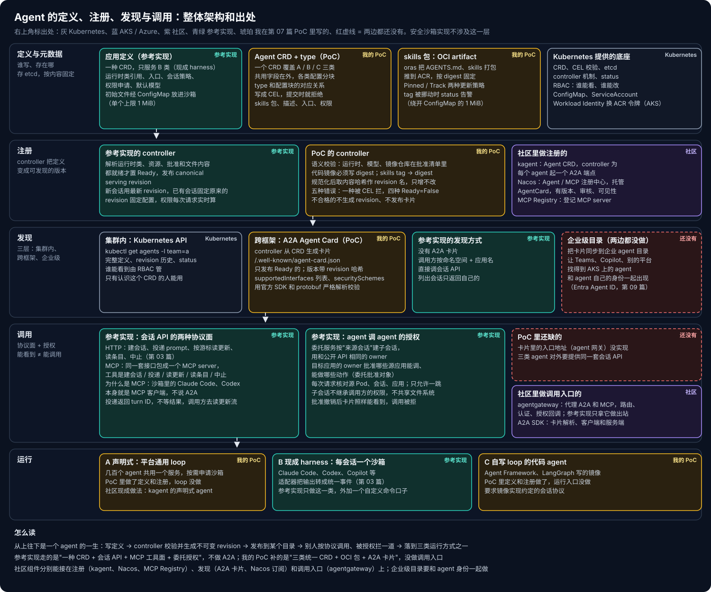
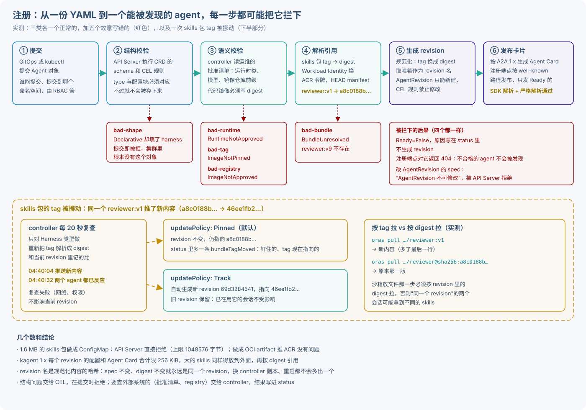

# AKS Agent Runtime 系列 07：Agent 的类型、注册与发现

前几篇讲的都是"一个 agent 怎么跑"：放在哪个沙箱里，出站怎么管，会话怎么保存和接管。这篇往前一步，讲 agent 本身：它由哪些东西组成，怎么打包、怎么注册，别人又怎么找到它、知道它能干什么。

## 整体架构：哪些是自己写的，哪些是社区的

一个 agent 从写定义到被调用，要经过五层：定义与元数据、注册、发现、调用、运行。这一层在参考实现、我的 PoC 和社区项目里各有一部分，安全沙箱实现不涉及。



- **参考实现**：一种应用定义 CRD，只服务基于现成 harness 的那一类；controller 解析运行时类、资源、批准和文件，全部就绪后发布不可变的 serving revision。它**没有 A2A**：调用方按命名空间和应用名直接调会话 API；同一套会话 API 还被包成一个 MCP server，工具就是"建会话、投递、读更新、读条目、中止"。选 MCP 的原因很直接：沙箱里的 Claude Code、Codex 本身就是 MCP 客户端，不说 A2A。agent 调 agent 走委托服务，按来源会话建子会话，目标 owner 批准、只允许一跳、不继承权限。
- **我在这篇 PoC 里写的**：一个覆盖三类 agent 的 `Agent` CRD 加 CEL、用 oras 打包的 OCI skills 包、按内容哈希命名的 revision，以及按 A2A 1.x 生成的 Agent Card。卡片里的调用入口（agent 网关）没有实现。
- **Kubernetes 提供的底座**：CRD、CEL、etcd、controller 机制、RBAC；AKS 的 Workload Identity 用来换 ACR 令牌。
- **社区里能接上的**：注册这一层有 kagent（Agent CRD，每个 agent 自带 A2A 端点）、Nacos 的 AI 注册中心（托管 AgentCard，带版本、审核、可见性，可以搜索、发现、订阅，还能登记 MCP server、Skill、Prompt）、MCP Registry；agent 网关这个角色可以用 agentgateway 项目来做（同时代理 A2A 和 MCP）；协议层有 A2A 和 MCP 的官方 SDK。
- **两边都还没有的**：独立的 agent 网关（参考实现的调用方直接打会话 API，我的 PoC 卡片里的入口地址没有实现），以及企业级 agent 目录，也就是让 Teams、Copilot 和别的平台找得到 AKS 上的 agent。后者要和 agent 自己的身份一起做（第 09 篇）。

### 三种网关别混在一起

系列里反复出现 agentgateway，但它是一个开源项目的名字，不是一种角色。按职责，agent 平台上有三种网关：

| | agent 网关 | 模型网关（LLM proxy） | 出站网关 |
|---|---|---|---|
| 管什么 | agent 的注册、发现和调用转发 | 模型调用 | 沙箱访问外部工具和资源 |
| 典型职责 | 发布卡片、按名字路由到目标 agent、代理 A2A 和 MCP、判断"源 agent 能不能调目标的这个 skill" | 模型路由、协议转换（Messages ↔ Responses）、按请求体模型名授权、token 配额与计费 | 逐请求授权、注入凭据、剥掉伪造的身份头 |
| 调用方 | 渠道、别的 agent | 沙箱里的 harness | 沙箱里的 harness 和它生成的代码 |
| 参考实现 | 没有独立的；调用方直接打会话 API，agent 调 agent 走 MCP 工具和委托服务 | agentgateway（第 08 篇） | agentgateway（第 04 篇） |
| 我的 PoC | 只生成了卡片，入口没实现 | 第 08 篇验证了协议转换 | 第 04 篇补了 CONNECT 路由 |

agentgateway 项目三种角色都能做，但它们面对的调用方、信任边界和授权模型都不一样，最好分开部署、分开配置：agent 网关面向集群外和其他 agent，模型网关和出站网关只面向沙箱。项目本身的功能、本机实测和与其他网关的对比见 [08 补充](AKS-Agent-Runtime系列08补充：agentgateway的定位与三种角色.md)。


## 一、三类 agent，按"loop 归谁"来分

我一开始是参照 Foundry 来分的：一类是声明式的 prompt agent，另一类是需要自己定义一堆东西的编码 agent。后来发现第二类得再拆一次：

| | A · 声明式 | B · 基于现成 harness | C · 自写 loop 的代码 |
|---|---|---|---|
| loop 归谁 | 平台自带的通用 loop | 第三方的 Claude Code、Codex、Copilot… | 作者自己（Agent Framework、LangGraph…） |
| 作者写什么 | 指令、模型、MCP 工具、知识源，全是配置 | AGENTS.md、skills、MCP 配置，作者看来仍是配置 | 代码，打成容器镜像，实现约定的协议（A2A / Responses） |
| 怎么跑 | loop 跑在共享的多租户服务里，要执行代码时再按需申请沙箱 | 每个会话独占一个沙箱（harness 要文件系统和 shell） | 和 B 一样，只是 loop 换成自己的 |
| 打包与固定 | 配置就是全部内容，模型名要在批准清单里 | AGENTS.md + skills 打成 OCI artifact，harness 版本由运行时类固定 | 镜像按 digest 固定，仓库前缀要在批准清单里 |
| 参照 | Foundry Prompt agent；kagent declarative | Foundry 没有直接对应；kagent harness codex / claude | Foundry Hosted agent；kagent harness byo |

- **A 声明式**：loop 是平台自带的通用 loop，作者只写指令、选模型、挂 MCP 工具和知识源。
- **B 基于现成 harness**：loop 是 Claude Code、Codex、Copilot 这些第三方 harness 的，作者写 AGENTS.md、skills、MCP 配置。
- **C 自写 loop 的代码 agent**：loop 是作者自己用 Agent Framework、LangGraph 写的，打成容器镜像。

拆开 B 和 C 的原因是：**B 在作者眼里像 A，在运行时眼里像 C。** 作者写的仍然只是描述和配置，没有一行 loop 代码；但它跑的是别人写好的 loop，而且这个 loop 需要文件系统和 shell，每个会话都得独占一个沙箱。所以真正的分界在 A 和 B 之间：A 的 loop 可以几百个 agent 共用一个服务，需要执行代码时再按需申请沙箱；B 和 C 每个会话一个 Kata VM，成本和冷启动是另一个量级。

拿外面的东西对照一下：Foundry 的 Prompt agent 对应 A，Hosted agent 对应 C，B 目前没有直接对应。kagent 1.x 的 Harness 有 `kagent`、`byo`、`codex`、`claude` 几种，分别落在这三类上。前几篇用的参考实现，本质上就是一个只做 B 类（外加一个可以跑自定义命令的口子）的平台。

## 二、一个外壳，三种配置块

三类内部差别再大，对平台的其他部分来说最好是同一种东西：调用方、授权、发现、审批都只面对一种对象，渠道适配器也不用关心背后是哪一类。所以我用一个 `Agent` CRD 加 `spec.type`，三类共用的字段放外面，各自的配置放在对应的块里：

```yaml
apiVersion: lab.agentruntime.io/v1alpha1
kind: Agent
metadata: {name: pr-reviewer, namespace: team-a}
spec:
  type: Harness                      # Declarative | Harness | Code
  description: Reviews pull requests in a sandbox and posts a short review.
  version: "1.0.0"
  skills:                            # 进 Agent Card，给别人看的能力
    - {id: code-review, name: Code review, description: Review a diff for correctness and test coverage}
  entrypoints: [A2A, Cron]
  permissions:                       # 只是申请，第 04 篇
    - {action: model.invoke, resourceRef: aoai-model}
  session: {persistence: Durable, pauseAfterIdle: 15m, retention: 7d}
  harness:                           # 只能填和 type 对应的这一块
    harness: Copilot
    runtimeClass: turn-coding-agent-md
    bundle: {ref: "oci://<acr>/agent-bundles/reviewer:v1", updatePolicy: Pinned}
```

"type 和配置块必须对应"这种纯结构的规则，我写成 CRD 里的 CEL 规则，提交时就由 API Server 拒绝。需要查外部系统的规则（批准清单、registry）交给 controller 处理，结果写进 status。

B 类的 AGENTS.md 和 skills 我没有放进 ConfigMap，而是用 oras 打成一个 OCI artifact 推到 ACR。原因很实际：我把一个 1.6 MB 的 skills 包做成 ConfigMap，API Server 直接拒绝了，上限是 1048576 字节。参考实现目前用 ConfigMap 往沙箱里放文件，碰到大一点的 skills 包就会撞上这个限制。kagent 1.x 也有类似的约束：每个 revision 的配置和 Agent Card 合计不能超过 256 KiB。OCI artifact 没有这个问题，而且天然带 digest，可以按内容固定版本。

## 三、注册：每一步都可能把它拦下



controller 处理一个 Agent 的顺序是：

1. **语义校验**：运行时类、模型、镜像仓库前缀必须在运维的批准清单里；代码镜像必须写 digest，不能只写 tag。
2. **解析引用**：B 类的 skills 包要从 tag 解析成 digest。controller 用 Workload Identity 换 ACR 令牌，再 HEAD 一次 manifest 拿到 digest。实测 `reviewer:v1` 解析成 `sha256:a8c0188b…`，和推送时一致。
3. **生成 revision**：把 spec 规范化（tag 换成解析后的 digest），取哈希作为 revision 名，创建一个 AgentRevision。AgentRevision 只能新建，不能修改：我试着改一个 revision 里的 digest，API Server 直接拒绝。
4. **发布卡片**：按 A2A 1.x 生成 Agent Card，注册端点只发布 Ready 的 agent。

三类各建了一个正常的，又故意写错了五个：

- 声明成 Declarative 却填了 harness 块：提交时被 CEL 规则拒绝，集群里根本没有这个对象；
- 用了没批准的运行时类：`RuntimeNotApproved`；
- 代码镜像只写了 tag：`ImageNotPinned`；
- 镜像来自没批准的仓库：`ImageNotApproved`；
- skills 包的 tag 不存在：`BundleUnresolved`。

后四个都是 Ready=False，原因写在 status 里，不生成 revision，注册端点对它们返回 404。**不合格的 agent 不会被别人发现。**

revision 这个概念是从参考实现学来的，它叫"canonical serving revision"：新会话用最新的 revision，已经在跑的会话保持原来的 revision。不过它的文档里有一处前后不一致：一处说已有会话固定在创建时的"配置和权限"上，另一处说权限按应用当前的声明实时计算。第 04 篇的实测是后者，撤销批准 1 秒左右就对运行中的会话生效了。所以准确的说法是：**revision 固定的是配置，权限是每次请求实时算的。**

### tag 被挪动的时候

用 tag 引用 skills 包，最怕的是有人往同一个 tag 推了新内容。我试了一下：建两个引用 `reviewer:v1` 的 agent，一个策略是 `Pinned`（默认），一个是 `Track`，然后改了 AGENTS.md，重新推到同一个 `v1`。

controller 每 20 秒复查一次，28 秒内两个 agent 都有了反应：

- **Pinned**：revision 不变，仍然指向原来的 digest；status 里多了一条 `bundleTagMoved`，写明钉住的是哪个、tag 现在指向哪个。
- **Track**：自动生成了新 revision，指向新的 digest；旧 revision 保留，已经在用它的会话不受影响。

消费的那一侧也要配合。我分别按 tag 和按 digest 拉了一次：按 tag 拉到的是新内容，按 digest 拉到的是原来那一版。所以沙箱放文件那一步必须按 revision 里记的 digest 拉，否则"同一个 revision"下的两个会话，可能拿到不同的 skills。

## 四、发现：分三层，授权另走一条路

**集群内**，直接查 Kubernetes API 就行，`kubectl get agents -l team=a` 能看到完整定义：权限申请、会话策略、解析后的 digest、revision 历史。谁能看到哪些 agent，由 RBAC 管。这一层适合平台运维和同一个团队的人，别的框架、别的集群不认识这个 CRD。

**跨框架**，用 A2A 的 Agent Card。controller 从 CRD 生成卡片，注册端点按 `/.well-known/agent-card.json` 发布。卡片里只放对外需要的东西：名字、描述、skills、入口地址、认证方式、版本。版本号后面带上 revision 哈希，调用方能看出 agent 有没有变。

A2A 1.x 的卡片结构和早期版本不一样，入口从单个 `url` 改成了 `supportedInterfaces` 列表，每一项写明地址、协议绑定（JSONRPC、gRPC、HTTP+JSON）和协议版本。官方 Python SDK 的 AgentCard 现在直接是 protobuf 定义。我对三张卡片做了两次校验：先用 SDK 的 `A2ACardResolver` 按 well-known 路径拉取解析；再用 protobuf 的严格模式解析一遍，不认识的字段直接报错，防止字段名拼错被悄悄忽略。三张都通过了。

**企业级**，把卡片同步到企业的 agent 目录，让 Teams、Copilot 和其他平台也能找到跑在 AKS 上的 agent。这一层这次没有做，它和 agent 自己的身份是一起出现的，放到第 09 篇讲身份时再看。

**能被发现不等于能被调用。** 卡片里写的是"怎么认证"：我在 securitySchemes 里声明要 Entra 签发的 Bearer JWT。真正能不能调，要过被调用方的审批。参考实现里 agent 调 agent 的做法就是这样：目标 agent 的 owner 批准哪些源 agent 能调、能做哪些动作，每次请求核对源会话的身份，只允许一跳。批准撤销以后，卡片照样能看到，调用会被拒。

这次的 PoC 只做到了"发现"这一步，卡片里的入口地址（agent 网关）没有实现。三类 agent 对外要提供同一套会话 API：A 类的平台 loop 直接输出统一事件；B 类像第 03 篇那样用适配器转换各家 harness 的输出；C 类要求镜像实现约定的协议。这些留到后面的篇幅里。

## 五、调用：一个 agent 从定义到被调用

编码 CLI 本身就是一个 agent：它有自己的 loop，会调模型、用工具、改文件。但在平台上，用户调用的"那个 agent"不是 CLI，而是一份**应用定义**。CLI 只是这份定义里选定的引擎。

参考实现里，应用定义是一个 Kubernetes 资源，写清五件事：

1. **用哪个运行时**：引用平台方发布的一个运行时类。运行时类里定好了"用哪个镜像，或者从哪个预热池领"，同时钉死了用哪种 harness。应用作者不能自己换 harness，只能在平台批准的运行时里挑。
2. **工作区里放什么**：AGENTS.md、skills、初始文件。controller 先把这些内容解析好，再生成一个不可变的 revision（第三节）。
3. **从哪里进来**：会话 API、定时任务，或者绑定到一个 Teams bot；还有一个现成的流水线模板，可以在 CI 里建会话、发第一条 prompt。
4. **要访问哪些资源**：精确到"哪个资源的哪个动作"。申请不等于批准，要资源 owner 批准后才生效（第 04 篇）。
5. **默认用哪个模型**：必须是一个已经批准过的模型调用权限。

调用时，渠道只跟会话 API 打交道，不管背后是哪种 CLI：

- **建会话**：指定应用，带幂等键。控制面这时把应用当前的 revision 固定下来，后面这个会话一直用它。
- **投递 prompt**：每条消息是会话里的一轮。控制面按[第 03 篇](AKS-Agent-Runtime系列03：控制面怎么驱动编码Harness.md)第二节的八步，经沙箱 provider 在沙箱里用非交互、免确认的参数跑一次 CLI，解析它的输出。
- **订阅更新**：按游标拉事件流，断线后接着读。
- **中止和恢复**：中止会挡住后续的 harness 启动，并停掉这个会话的进程，但不删沙箱；恢复用来接回分配到一半的沙箱。

所以"调用一个编码 agent"在平台上分成三层：用户调的是应用；应用的每一轮由控制面驱动；控制面在沙箱里启动的才是那个编码 CLI。agent 调 agent（第 03 篇第四节）走的也是同一套会话 API，只是调用方从人换成了另一个沙箱里的 agent。

## 六、怎么落地：用开源组件自己搭一套

如果不用参考实现，自己在 AKS 上搭这一层，每一层都有现成的开源底座，要自己写的是中间的胶水：

1. **定义**：只做声明式 agent，可以直接用 kagent 的 CRD；要同时覆盖现成 harness 和自写 loop 两类，就像第二节那样自己定义一个带 `type` 的 `Agent` CRD，结构规则写成 CEL。skills 和 AGENTS.md 用 oras 打成 OCI artifact，ACR、Harbor 都行，沙箱放文件时按 digest 拉。要自己写的是 controller 的语义校验：批准清单、镜像 digest、tag 解析、内容哈希 revision、把原因写进 status。
2. **注册中心**：二选一。Kubernetes API 为准，CRD 本身就是注册表，controller 生成卡片并发布；或者以 Nacos 为准，它管版本、审核、可见性和订阅，适合多集群和非 Kubernetes 的系统。选 Nacos 时，要自己写两边的同步：CRD 状态变化写进 Nacos，Nacos 里的审核结果回写 status，只同步 Ready 的版本。
3. **agent 网关**：所有 agent 前面放一个统一入口，可以用 agentgateway 项目来做：按 agent 名路由、转发调用，同时代理 A2A 和 MCP；用 Entra 签发的 JWT 认证；授权回调交给 OpenFGA，判断"源 agent 能不能调目标的这个 skill"，owner 的批准就是一条元组（[第 04 补充](AKS-Agent-Runtime系列04补充：OpenFGA与关系型授权.md)）。第 04、08 篇用同一个项目做了出站网关和模型网关，但 agent 网关面对的是集群外的调用方和其他 agent，最好单独部署一套，不和那两种共用配置。
4. **协议面**：A2A 给跨框架的 agent（自写 loop 的、外部平台的）；MCP 给编码 harness，因为它们是 MCP 客户端。要自己写的是协议到会话 API 的适配：A2A 的 task 和 message 变成"建子会话、投递一轮"，会话的更新流转成 A2A 的流式事件；MCP 工具调用落到同一套会话 API 上。
5. **企业目录**：卡片同步到 Entra Agent ID 一类的企业目录，和 agent 身份一起管理。

几个注册中心放在一起看：

| | Kubernetes API（自定义 CRD） | kagent | Nacos AI 注册中心 | 企业 agent 目录 |
|---|---|---|---|---|
| 存的是什么 | 完整定义、revision、status | Agent、模型配置、MCP 服务器 | AgentCard、MCP server、Skill、Prompt 及版本 | 卡片和 agent 身份 |
| 谁能发现 | 有 RBAC 权限的集群用户 | 同上，另有 A2A 端点 | 按命名空间和可见性，SDK 订阅 | 企业里的 Teams、Copilot 等 |
| 版本与审核 | 自己写（内容哈希 revision） | 每个 agent 一份配置 | 内置版本、草稿与审核 | 由目录方管理 |
| 适合 | 全在 Kubernetes 上、要和沙箱、会话打通 | 声明式 agent 为主 | 多集群、非 Kubernetes 系统 | 让企业里其他产品找得到 |

### 几条设计原则

- **一个 CRD 加 type**，结构规则写进 CEL，需要查外部系统的规则放在 controller 里。两者都要有：前者让错误在提交时就暴露，后者让错误原因留在 status 里，可以查。
- **skills 和 AGENTS.md 用 OCI artifact**，默认 `Pinned`。要跟随更新就显式写 `Track`，每次跟随都生成新 revision，留下历史。
- **revision 名取内容哈希**。内容不变就永远是同一个 revision，controller 重启、换副本都不会多出一个。
- **卡片只放对外的信息**，并且只发布 Ready 的 agent。卡片的认证声明和调用授权分开设计，不要因为"能看到"就默认"能调"。

### 我会怎么组合

我自己的组合会是：**kagent 管声明式，自定义 CRD 管另外两类，agentgateway 项目单独部署一套做 agent 网关，OpenFGA 管调用授权，Nacos 只在需要跨集群、跨技术栈发现时再加。** 真正要投入的，是 controller 的语义校验和"协议到会话 API"的适配，这两块哪个开源项目都替不了。

[下一篇](AKS-Agent-Runtime系列08：模型接入层.md)讲模型接入层：Claude Code、Codex 这些 harness 怎么经过网关接到 Foundry 的模型上，以及参考实现里一直没打通的 Claude Code 接 Azure OpenAI 这条路，到底能不能走通。

## 相关阅读

- [AKS Agent Runtime 系列 02：Harness 放在沙箱内还是沙箱外](AKS-Agent-Runtime系列02：Harness放在沙箱内还是沙箱外.md)
- [AKS Agent Runtime 系列 03：控制面怎么驱动编码 Harness](AKS-Agent-Runtime系列03：控制面怎么驱动编码Harness.md)
- [AKS Agent Runtime 系列 04：出站治理与逐请求授权](AKS-Agent-Runtime系列04：出站治理与逐请求授权.md)
- [Agent 基础设施系列 03：kagent 与 Agent Substrate](../../Notes/AI/agent/agent-runtime/Agent基础设施系列03：kagent与Agent-Substrate.md)

## 参考资料

- [A2A Protocol Specification](https://a2a-protocol.org/latest/specification/)
- [a2a-python SDK](https://github.com/a2aproject/a2a-python)
- [kagent docs: Declarative agents](https://kagent.dev/docs/kagent/1.x/agents/declarative-agents)
- [kagent docs: Bring your own agent](https://kagent.dev/docs/kagent/1.x/agents/bring-your-own-agent)
- [ORAS: Pushing and pulling artifacts](https://oras.land/docs/how_to_guides/pushing_and_pulling)
- [Kubernetes: Validation rules (CEL) for CRDs](https://kubernetes.io/docs/tasks/extend-kubernetes/custom-resources/custom-resource-definitions/#validation-rules)
