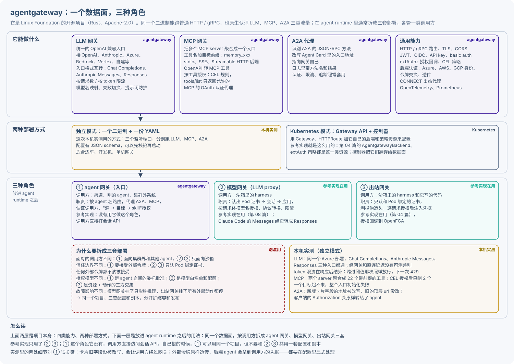
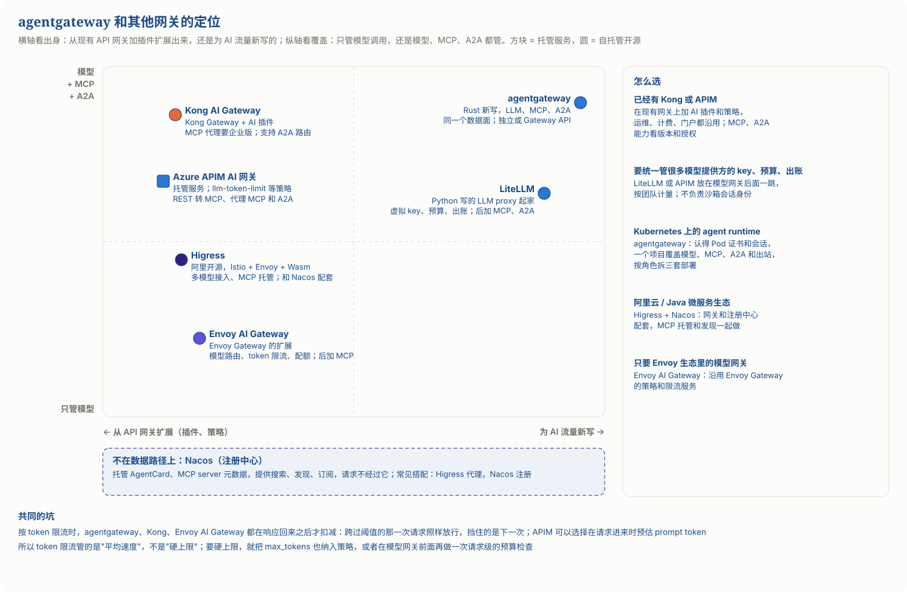

# AKS Agent Runtime 系列 08 补充：agentgateway 的定位与三种角色

agentgateway 在这个系列里出现了三次：[第 04 篇](AKS-Agent-Runtime系列04：出站治理与逐请求授权.md)用它做出站网关，[第 08 篇](AKS-Agent-Runtime系列08：模型接入层.md)用它做模型网关并把 Claude Code 的 Messages 转成 Responses，[第 07 篇](AKS-Agent-Runtime系列07：Agent的类型、注册与发现.md)讨论 agent 网关时又提到它可以承担这个角色。三处是同一个项目，用法却完全不同。

这篇把它单独拿出来：它是什么、能做什么、有哪几种部署方式，在 agent runtime 里应该怎么拆成三种角色，以及它和 Kong、Azure API Management、Higress、Envoy AI Gateway、LiteLLM 这些网关的区别。实验在本机用它的官方二进制完成，模型接的是一个真实的 Azure OpenAI 部署。

## 一、它是什么

[agentgateway](https://github.com/agentgateway/agentgateway) 最早由 Solo.io 开发，后来捐给了 Linux Foundation，用 Rust 写，Apache-2.0 许可。项目对自己的定位是"面向 AI 流量的数据面"：同一个进程既能代理普通的 HTTP 和 gRPC，也原生认识三类 AI 流量。



它的能力分四组：

- **LLM 网关**：对外是 OpenAI 兼容的统一入口，后面接 OpenAI、Anthropic、Azure、Bedrock、Vertex 或自建模型；入口格式可以互转（Chat Completions、Anthropic Messages、Responses）；按请求数或按 token 限流；模型名映射、失败切换、提示词防护。
- **MCP 网关**：把多个 MCP server 聚合到一个入口，后端可以是 stdio、SSE 或 Streamable HTTP；能把 OpenAPI 描述转成 MCP 工具；按工具做授权；可以代理 MCP 的 OAuth 认证流程。
- **A2A 代理**：识别 A2A 的 JSON-RPC 方法，改写 Agent Card 里的入口地址，让它指向网关自己；日志里带方法名和调用结果。
- **通用能力**：HTTP 和 gRPC 路由、TLS；JWT、OIDC、API key 认证；extAuthz 授权回调和 CEL 策略；后端认证可以用 Azure、AWS、GCP 的身份或令牌交换；CONNECT 出站代理；OpenTelemetry 和 Prometheus。

部署方式有两种：

- **独立模式**：一个二进制加一份 YAML，配置有 JSON schema 可以先校验。适合边车、开发机或单机网关，这次本机实测用的就是它。
- **Kubernetes 模式**：用 Gateway API 的 Gateway、HTTPRoute，加上它自己的后端和策略资源来配置，由控制器翻译给数据面。参考实现就是这么用的，第 04 篇里的 `AgentgatewayBackend` 和 extAuth 策略都属于这类资源。

## 二、在 agent runtime 里的三种角色

名字里带"agent"，容易让人以为它只是 agent 网关。放进 agent runtime 之后，按调用方来分，它其实承担三种角色：

1. **agent 网关**：调用方是渠道、别的 agent 和集群外的系统。它负责按 agent 名路由、代理 A2A 和 MCP、认证调用方，以及判断"源 agent 能不能调目标的这个 skill"。参考实现**没有**用它做这个角色，调用方直接访问会话 API（第 07 篇）。
2. **模型网关**：调用方是沙箱里的 harness。它负责认出 Pod 证书对应哪个会话和应用，按请求体里的模型名授权，做协议转换和限流。参考实现在用（第 08 篇）。
3. **出站网关**：调用方是沙箱里的 harness 和它生成的代码。它只认和 Pod 绑定的证书，剥掉伪造的身份头，逐请求授权之后再注入凭据。参考实现在用（第 04 篇），授权回调到 OpenFGA（[04 补充](AKS-Agent-Runtime系列04补充：OpenFGA与关系型授权.md)）。

这三种角色最好**用同一个项目、分三套部署**，原因有四个：

- **调用方不同**：agent 网关面向集群外和其他 agent，另外两个只面向沙箱。
- **信任边界不同**：agent 网关要接受外部令牌；模型网关和出站网关只认 Pod 绑定的证书，任何外部令牌都不该被接受。
- **授权模型不同**：agent 网关管 agent 之间的委托批准；模型网关管模型白名单和配额；出站网关管资源加动作的三方交集。
- **故障影响不同**：模型网关挂了只影响推理；出站网关挂了，所有外部动作都会停下来。

分开部署之后，三者可以各自扩缩容、各自发布，一处配置写错也不会波及另外两处。

## 三、本机实测三种能力

一个进程、三个监听端口：4000 是 LLM 网关，3000 是 MCP 网关，3100 是 A2A 代理。配置压缩一下是这样：

```yaml
llm:
  port: 4000
  policies:
    localRateLimit:
    - {type: tokens, maxTokens: 400, tokensPerFill: 400, fillInterval: 60s}
  models:
  - name: nano
    provider: azure
    params: {model: gpt-4.1-nano, azureResourceName: <aoai-resource>, azureResourceType: openAI}
    auth:
      azure: {developerImplicit: {}}     # 沿用本机 az 登录的身份
binds:
- port: 3000
  listeners:
  - routes:
    - policies:
        mcpAuthorization:
          rules:
          - 'mcp.tool.target == "memory" && mcp.tool.name.startsWith("read")'
          - 'mcp.tool.target == "everything" && mcp.tool.name == "echo"'
      backends:
      - mcp:
          targets:
          - {name: memory, stdio: {cmd: npx, args: ["-y", "@modelcontextprotocol/server-memory"]}}
          - {name: everything, stdio: {cmd: npx, args: ["-y", "@modelcontextprotocol/server-everything"]}}
- port: 3100
  listeners:
  - routes:
    - policies: {a2a: {}}
      backends:
      - host: localhost:9999
```

这个 Azure OpenAI 资源关闭了 API key 认证，所以后端认证用的是 Azure 身份。生产环境里换成托管身份或 Workload Identity 即可，配置结构一样。

### LLM 网关

- **三种入口格式都通**：同一个部署，用 Chat Completions、Anthropic Messages、Responses 三种格式请求，都返回了正确结果；Anthropic 格式的请求，回来的也是 Anthropic 格式的响应。第 08 篇在集群里验证的"Messages 转 Responses"，在这里同样成立。
- **未知模型名直接拒绝**：返回 404 `model_not_found`，请求不会被转到后端。
- **延迟**：同一个部署，直连和经网关各请求 6 次。直连 1.9 到 3.7 秒，经网关 1.4 到 2.3 秒，没有可测的额外开销，波动主要来自跨洋网络。
- **按 token 限流在响应后结算**：限额设为每分钟 400 token，每次请求用掉 40 到 60 个。前几次都放行，跨过阈值的那一次也放行了，再下一次才返回 429，并带上 `retry-after`。

最后一点不是 agentgateway 独有的，后面第四节会讲到，Kong 和 Envoy AI Gateway 的 token 限流也是这样。**token 限流管的是平均速度，不是硬上限**：一次请求能用多少 token，事先并不知道。要硬上限，就把 `max_tokens` 也纳入策略，或者在请求进来时先做一次预算检查。

### MCP 网关

- **工具聚合**：两个 MCP server 合起来暴露 22 个工具，每个工具名前面加上目标名作前缀（`memory_create_entities`、`everything_echo`），网关按前缀把调用路由到对应的 server，调用耗时约 10 毫秒。
- **初始化**：第一次 21.6 秒，因为 stdio 方式的 server 要等 npx 下载并启动；之后约 3 秒。
- **一个目标起不来，整个入口就初始化失败**：一开始我配的第二个 server 用 uvx 安装，本机网络当时连不上 Python 包仓库，那个目标没能启动。结果客户端的 initialize 直接返回 500，另一个正常的 server 也用不了。官方示例里也提醒过这一点。聚合的目标越多，这个风险越大，所以要么保证每个目标都健康，要么把不相关的 server 拆到不同的路由上。
- **按工具授权**：用 CEL 规则只允许两个工具（`memory` 目标里以 `read` 开头的，和 `everything` 的 `echo`）。`tools/list` 直接只返回这 2 个，其余 20 个对客户端不可见；硬调用没授权的工具，返回 HTTP 400。规则里能用 `mcp.tool.target`、`mcp.tool.name`、`mcp.tool.arguments`，配上 JWT 认证后还能用 `jwt.sub` 这类声明。

### A2A 代理

我写了一个最小的 A2A agent：提供 Agent Card，响应 `message/send`，并把自己收到的请求头回显出来。然后经网关访问它：

- **卡片地址只改了一半**：经网关拉到的卡片里，A2A 1.x 的 `supportedInterfaces[0].url` 被改写成了网关地址；但旧版的顶层 `url` 字段**没有改**，还是 agent 的直连地址。调用方如果还在读旧字段，就会绕过网关直接访问 agent。
- **认证头原样透传**：客户端带的 `Authorization: Bearer ...` 被原样转给了后端 agent。要在网关这一层认证，就要配置不往后传，或者换成网关自己的后端凭据，否则后端 agent 能拿到调用方的令牌。
- **日志能识别协议**：访问日志里有 `a2a.method=message/send`、`a2a.response.outcome=success`，转发开销约 3 毫秒。

> [!WARNING]
> 上面两处细节，对用它做 agent 网关的场景很关键。卡片里的直连地址要从源头去掉，或者让网关的网络位置成为访问 agent 的唯一入口；外部令牌要在网关上终结，不能透传给后端。

## 四、和其他网关的区别



这几个产品大致分两类：一类是**从现有 API 网关扩展出来的**，在原来的网关上加 AI 插件和策略，比如 Kong、Azure API Management、基于 Envoy 的 Higress 和 Envoy AI Gateway；另一类是**为 AI 流量新写的**，比如 agentgateway 和 LiteLLM。Nacos 不在这两类里，它是注册中心，请求根本不经过它。

| | agentgateway | Kong AI Gateway | Azure APIM AI 网关 | Higress（+ Nacos） | Envoy AI Gateway | LiteLLM |
|---|---|---|---|---|---|---|
| 出身 | Rust 新写，Linux Foundation | Kong Gateway 加 AI 插件 | Azure 托管的 API 网关 | 阿里开源，Istio + Envoy + Wasm | Envoy Gateway 的扩展 | Python 写的 LLM proxy |
| 模型网关 | 有：多提供方、格式互转、token 限流 | 有：ai-proxy 系列插件、按 token 限流、语义缓存 | 有：llm-token-limit、token 指标、语义缓存、负载均衡 | 有：多模型接入、token 限流、缓存 | 有：模型路由、token 限流、配额 | 有：100 多家提供方、虚拟 key、预算、出账 |
| MCP | 原生：聚合、按工具授权、OAuth | 有 MCP 代理插件（企业版） | 把 REST 暴露成 MCP、代理 MCP | MCP 托管、OpenAPI 转 MCP；Nacos 做 MCP 注册 | 后来加了 MCP 网关 | 支持接入 MCP server |
| A2A | 原生代理、改写卡片 | 支持 A2A 路由与观测 | 支持 A2A agent API | 这次没有查到明确支持 | 这次没有查到 | 有 A2A 网关 |
| 部署 | 独立二进制，或 Kubernetes Gateway API | 自托管或 Konnect | 托管服务 | 自托管，Kubernetes 为主 | Kubernetes | 自托管，或托管版 |
| 适合 | Kubernetes 上的 agent runtime，三种角色一个项目 | 已经用 Kong 管 API | 企业已经用 APIM 管 API 和配额 | 阿里云、Java 微服务生态 | 已经用 Envoy Gateway | 要统一管很多模型 key、预算、出账 |

表里的能力来自各项目自己的文档，版本之间变化很快；除了 agentgateway，其余产品这次都没有实测。

### 和 LLM proxy 怎么配合

agentgateway 自己就带 LLM 网关，和 LiteLLM、APIM 这类模型网关有重叠。放进 agent runtime 里，常见三种组合：

1. **只用 agentgateway**：模型路由、协议转换、限流都在它这里做，只有一跳，会话身份和模型授权在同一处判断。缺点是多提供方的密钥管理、失败切换、按部门出账这些，不如专门的 LLM proxy 丰富。
2. **agentgateway 在前，LLM proxy 在后**：agentgateway 负责"谁能调"，即认出 Pod 证书对应的会话和应用、核对请求体里的模型名、剥掉伪造头；LiteLLM 或 APIM 负责"怎么调"，即选提供方和部署、失败切换、缓存、统一管理密钥、按团队计量。两边不要都做协议转换，也不要都做同一层限流：agentgateway 按会话和应用限流，后面那一跳管整个组织的配额。
3. **应用直接走 LLM proxy，agentgateway 只管 MCP、A2A 和出站**：适合模型调用不经过沙箱的场景，比如平台自己的声明式 agent loop 跑在可信服务里。沙箱里的 harness 不适合这样做，因为 LLM proxy 认不出"这个请求来自哪个会话的哪个 Pod"，会话级的授权和审计就断了。

怎么选，取决于**会话身份在哪一跳能被认出来**。沙箱发出的模型请求，必须先经过一个能核对 Pod 证书和会话绑定的网关；模型提供方的管理和企业级计量，放在这一跳还是后面再加一跳，看组织里是不是已经有 LiteLLM 或 APIM。

### 和 Nacos、Kong 的区别

- **Nacos 不是网关**：它是注册中心，托管 AgentCard 和 MCP server 的元数据，提供搜索、发现和订阅，请求不经过它。和 agentgateway 不是二选一的关系：Nacos 解决"找得到"，agentgateway 解决"调得通、管得住"。在阿里的生态里，和 Nacos 配对的网关是 Higress。
- **Kong 是在一个成熟的 API 网关上加 AI 插件**：已经用 Kong 管 API 的团队，运维、计费、开发者门户都能沿用。agentgateway 是为 MCP 和 A2A 这类有状态、双向流的协议从头写的。两者的差别更多在已有基础设施，而不是功能清单。

## 五、放回 agent runtime 里

- **同一个项目、三套部署**：agent 网关、模型网关、出站网关分开配置、分开扩缩容。agent 网关面向外部，要终结外部令牌；另外两套只认 Pod 证书。
- **MCP 聚合要控制范围**：一个目标起不来，整个入口就不可用。不相关的 MCP server 拆到不同路由上，按工具授权让 `tools/list` 只露出该露的。
- **A2A 卡片从源头只写网关地址**：不要依赖网关去改写，旧字段可能没被处理。
- **token 限流当成平均速度来用**：硬预算要另外做。
- **已经有 APIM 或 LiteLLM 时，放在模型网关后面一跳**：会话身份的判断留在 agentgateway，组织级的计量和密钥管理交给后面那一跳。

## 相关阅读

- [AKS Agent Runtime 系列 04：出站治理与逐请求授权](AKS-Agent-Runtime系列04：出站治理与逐请求授权.md)——出站网关角色
- [AKS Agent Runtime 系列 07：Agent 的类型、注册与发现](AKS-Agent-Runtime系列07：Agent的类型、注册与发现.md)——agent 网关角色与三种网关的区分
- [AKS Agent Runtime 系列 08：模型接入层](AKS-Agent-Runtime系列08：模型接入层.md)——模型网关角色与协议转换
- [AKS Agent Runtime 系列 04 补充：OpenFGA 与关系型授权](AKS-Agent-Runtime系列04补充：OpenFGA与关系型授权.md)——网关授权回调背后的决策

## 参考资料

- [agentgateway/agentgateway](https://github.com/agentgateway/agentgateway)
- [agentgateway 文档](https://agentgateway.dev/docs/kubernetes/latest)
- [Linux Foundation Welcomes Agentgateway Project](https://www.linuxfoundation.org/press/linux-foundation-welcomes-agentgateway-project-to-accelerate-ai-agent-adoption-while-maintaining-security-observability-and-governance)
- [Kong AI Rate Limiting Advanced](https://developer.konghq.com/plugins/ai-rate-limiting-advanced)
- [What Is Higress?](https://higress.ai/en/docs/latest/overview/what-is-higress)
- [Envoy AI Gateway: Usage-based Rate Limiting](https://aigateway.envoyproxy.io/docs/1.0/capabilities/traffic/usage-based-ratelimiting)
- [LiteLLM AI Gateway](https://docs.litellm.ai/docs/simple_proxy)
- [Nacos AI Registry Overview](https://nacos.io/en/docs/next/manual/user/ai/ai-registry-overview)
