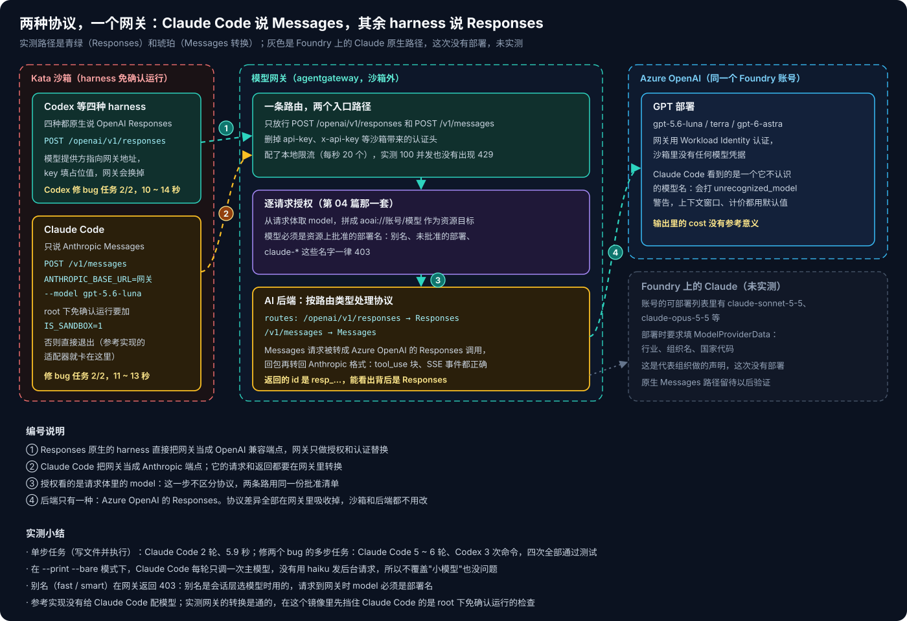
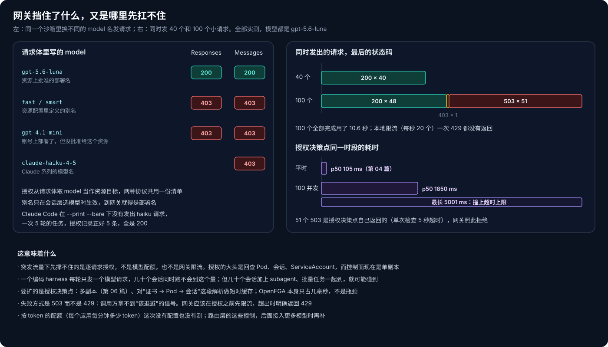

# AKS Agent Runtime 系列 08：模型接入层

到第 07 篇为止，模型调用一直是一个默认能用的前提。第 02 篇画过那条路：harness 在沙箱里发请求，出站边车送到网关，网关用自己的身份调 Azure OpenAI，沙箱里没有任何模型凭据。这条路对 Codex、Copilot、OpenCode、Pi 都是通的，它们原生就说 OpenAI 的 Responses 协议。

Claude Code 是例外。它只说 Anthropic 的 Messages 协议。参考实现的镜像说明里写得很直接：Claude Code 装了，但故意没有配置，因为不能假设它的协议能直接用在只支持 Responses 的模型上；要支持它，需要一个单独验证过的 Anthropic 兼容后端和授权路由。

这篇就验证这件事：Claude Code 能不能经过同一个网关，用上 Azure OpenAI 的 GPT 模型？

## 一、网关其实早就准备好了



翻模型网关的配置时我发现，路由本来就同时匹配两个路径：`POST /openai/v1/responses` 和 `POST /v1/messages`。后端是 agentgateway 的 AI backend，按路径区分路由类型：

```yaml
ai:
  provider:
    azure: {resourceName: <aoai-account>, resourceType: OpenAI, apiVersion: v1}
policies:
  ai:
    routes:
      /openai/v1/responses: Responses
      /v1/messages: Messages
  auth:
    azure: {workloadIdentity: {}}
```

也就是说，网关这一层已经声明了"收到 Messages 请求就按 Messages 处理"，只是没有人验证过。我先在沙箱里用 curl 直接打这个路径，模型写 AOAI 上的 `gpt-5.6-luna`：

- **普通对话**：200，返回的是标准的 Anthropic 消息格式，`stop_reason` 是 `end_turn`。返回的 id 以 `resp_` 开头，能看出网关在背后调的是 Responses。
- **工具调用**：给一个 bash 工具并要求必须用工具，返回了标准的 `tool_use` 块，`stop_reason` 是 `tool_use`。
- **流式输出**：完整的 Anthropic SSE 事件序列，从 `message_start` 一直到 `message_stop`。

协议转换是通的。agentgateway 的文档也写明了这一点：provider 同时支持两种格式时，Messages 请求总是被转换成 Responses 格式。接下来换成真正的 Claude Code。

## 二、先挡住 Claude Code 的是 root 检查

我照着参考实现 Claude 适配器的参数（`--print --bare --safe-mode --output-format stream-json --dangerously-skip-permissions`），把 `ANTHROPIC_BASE_URL` 指向网关，在沙箱里跑了一次。结果它根本没发请求，直接退出：

```text
--dangerously-skip-permissions cannot be used with root/sudo privileges for security reasons
```

沙箱里的进程是 root。Claude Code 拒绝在 root 下跳过权限确认，除非明确声明自己在隔离环境里，也就是设置 `IS_SANDBOX=1`。参考实现的适配器没有设置这个变量，所以就算模型配好了，在这个镜像里也跑不起来。

加上 `IS_SANDBOX=1` 之后再跑，让它写一个打印内核版本的脚本并执行：2 轮对话，调用 Bash 工具，输出 `6.18.28`，正是 Kata 沙箱的 guest kernel，用时 5.9 秒。

stderr 里还有一条警告：`unrecognized_model`。Claude Code 不认识 `gpt-5.6-luna` 这个名字，上下文窗口、计价这些就都用默认值，所以它输出里的 cost 没有参考意义。上下文窗口的默认值如果比实际小，会影响它什么时候压缩历史；长任务里这一点要留意。

## 三、一个多步任务：Claude Code 和 Codex 对照

单步任务说明不了太多。我准备了一个小项目：`calc.py` 里有两个 bug，`mean` 多加了 1，`median` 在偶数个元素时算错，而且空列表时没有报 ValueError；测试一开始 2 个失败、1 个错误。要求是修好代码、不许改测试、最后跑一遍测试。同一个任务，Claude Code 走 Messages 转换，Codex 走原生 Responses，模型都是 `gpt-5.6-luna`，各跑两次：

| | 协议 | 结果 | 用时 | 过程 |
|---|---|---|---|---|
| Claude Code 第 1 次 | Messages → 网关转换 | 测试全部通过 | 12.8 秒 | 6 轮：ls、读两个文件、Edit、跑测试 |
| Claude Code 第 2 次 | Messages → 网关转换 | 测试全部通过 | 11.4 秒 | 5 轮 |
| Codex 第 1 次 | Responses 原生 | 测试全部通过 | 14.0 秒 | 3 次命令执行、1 次文件修改 |
| Codex 第 2 次 | Responses 原生 | 测试全部通过 | 10.4 秒 | 同上 |

四次都只改了 `calc.py`。经过协议转换的 Claude Code，在这种规模的任务上和原生的 Codex 没有看得出的差别。

还有一个我担心过的问题：Claude Code 有一部分后台请求默认用小模型（haiku 系列），而网关只认批准清单里的部署名，这类请求会被拒。我把"小模型"的覆盖去掉又跑了一次，同时按时间窗口统计授权记录：这一次 5 轮对话对应正好 5 次授权，全部是 200。在 `--print --bare` 模式下，它每一轮只调一次主模型，没有发出小模型请求。

## 四、网关挡住了什么，又是哪里先扛不住



**授权看的是请求体里的 model。** 网关把它拼成"账号/模型"作为资源目标，再走第 04 篇那套逐请求授权。两种协议共用同一份批准清单：

- 批准的部署名：200；
- 资源配置里定义的别名 `fast`、`smart`：403。别名是会话层选模型时用的，请求真正到网关时，model 必须是部署名；
- 账号上部署了、但没批准给这个资源的 `gpt-4.1-mini`：403；
- `claude-*` 这类名字：403。

**突发流量下先撑不住的是授权。** 网关上配了每秒 20 个请求的本地限流，我在一个沙箱里同时发了 40 个小请求，全部 200；发 100 个，48 个 200、51 个 503、1 个 403，一个 429 都没有。回去看授权决策点的日志：那段时间它的 p50 从平时的 105 毫秒涨到 1850 毫秒，最长 5001 毫秒，正好撞上单次检查的 5 秒超时。51 个 503 是授权决策点自己返回的，网关按"授权失败即拒绝"挡掉了这些请求。本地限流为什么没触发，我没有再深究它的计数方式。

这个结果和前几篇是连起来的：第 04 篇说过，一次授权的大头是回查 Pod、会话和 ServiceAccount，OpenFGA 本身只占几毫秒；第 06 篇说过，控制面现在是单副本。一个编码 harness 每轮只发一个模型请求，几十个会话同时跑不会到这个量；但会话多起来，再叠加 subagent 和批量任务，就可能碰到。要扩的是授权决策点：多副本，再对"证书 → Pod → 会话"这段解析做短时缓存。

失败方式也值得改。503 对调用方来说只是"服务端出错"，拿不到"该退避"的信号。网关应该在授权之前先限流，超出时明确返回 429。按 token 计的配额（每个应用每分钟多少 token）这次没有配置，也没有测。

## 五、Foundry 上的 Claude 这次没测

另一条路是直接用 Foundry 上的 Claude 模型，走原生的 Messages 协议，不需要转换。账号的可部署列表里有 claude-sonnet-5-5、claude-opus-5-5 等，但部署时要求填写模型提供方信息：行业、组织名、国家代码，相当于代表组织向 Anthropic 做一次声明。这一步这次没有做，所以这条原生路径没有实测。

agentgateway 的 AI backend 支持 `anthropic` provider，`azure` provider 也有 `Foundry` 这种资源类型。等模型部署好以后，同一个网关上应该能再加一条原生路由，两条路在授权这一层的处理是一样的。

## 六、我会怎么配

- **模型接入统一走网关**，沙箱里不放任何模型凭据。harness 的配置只写网关地址和一个占位 key。
- **Claude Code 用 GPT 模型是可行的**，靠网关的 Messages 转换。适配器要补上 `IS_SANDBOX=1`；最好再告诉 Claude Code 实际的上下文窗口，免得它用默认值去决定什么时候压缩。
- **批准清单写部署名**，别名只在会话层用；给 Claude Code 选模型时，确认它不会发出清单之外的模型名。
- **在授权之前先限流**，超出时返回 429；授权决策点要能水平扩展，这是突发流量下最先撑不住的地方。

[下一篇](AKS-Agent-Runtime系列09：Agent以谁的身份行事.md)讲身份：agent 以谁的身份去调外部资源。是平台的身份、agent 自己的身份，还是发起这次会话的那个用户的身份？

## 相关阅读

- [AKS Agent Runtime 系列 02：Harness 放在沙箱内还是沙箱外](AKS-Agent-Runtime系列02：Harness放在沙箱内还是沙箱外.md)
- [AKS Agent Runtime 系列 03：控制面怎么驱动编码 Harness](AKS-Agent-Runtime系列03：控制面怎么驱动编码Harness.md)
- [AKS Agent Runtime 系列 04：出站治理与逐请求授权](AKS-Agent-Runtime系列04：出站治理与逐请求授权.md)
- [AKS Agent Runtime 系列 06：会话管理与高可用](AKS-Agent-Runtime系列06：会话管理与高可用.md)

## 参考资料

- [agentgateway: About LLM consumption](https://agentgateway.dev/docs/kubernetes/latest/llm/about)
- [agentgateway release notes](https://agentgateway.dev/docs/kubernetes/latest/release-notes/release-notes)
- [Claude Code: Settings and environment variables](https://docs.anthropic.com/en/docs/claude-code/settings)
- [Claude Code: LLM gateway configuration](https://docs.anthropic.com/en/docs/claude-code/llm-gateway)
- [Codex CLI: configuration](https://github.com/openai/codex/blob/main/docs/config.md)
- [Azure OpenAI Responses API](https://learn.microsoft.com/azure/ai-foundry/openai/how-to/responses)
- [Claude models in Microsoft Foundry](https://learn.microsoft.com/azure/ai-foundry/foundry-models/how-to/use-foundry-models-claude)
