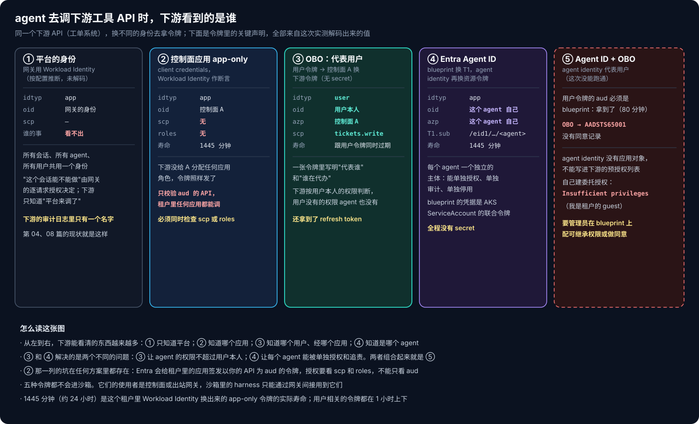
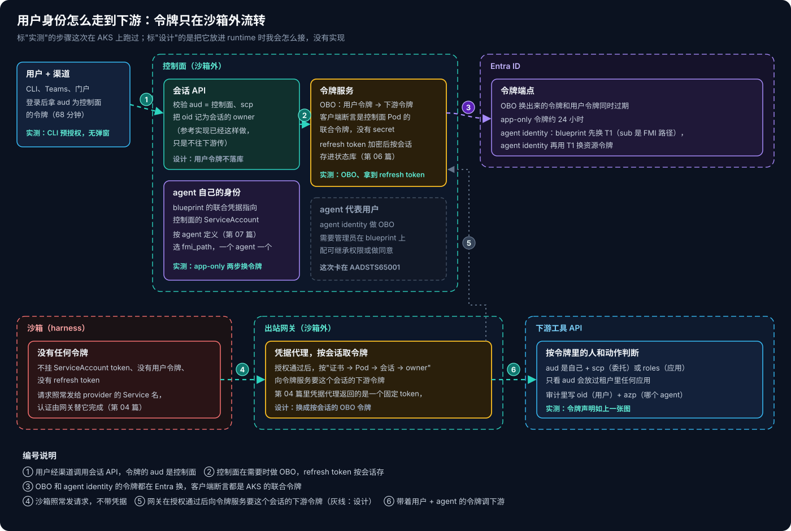

# AKS Agent Runtime 系列 09：Agent 以谁的身份行事

第 04 篇搭的出站路上，网关在授权通过之后注入一个凭据，再去调下游。那个凭据是谁的？是平台的。不管是哪个用户发起的会话、哪个 agent 在干活，下游看到的都是同一个身份。网关的逐请求授权已经决定了"这个会话能不能做这件事"，但下游自己的审计日志里只有一个名字，它也没法按用户本人的权限去判断。

这篇讨论另外几种做法：agent 以用户的身份去调，或者以 agent 自己的身份去调。我在 AKS 上用 Entra 把能跑的都跑了一遍。

## 一、实验怎么搭的

我注册了两个应用：

- **控制面 A**：扮演控制面，暴露一个 `session.invoke` scope，用户用它来发起会话。它是机密客户端，但没有任何 secret：AKS 里控制面 Pod 的 ServiceAccount 通过联合凭据被 A 信任，Pod 的联合令牌就是 A 的客户端断言。
- **工具 API B**：扮演 agent 要调的下游，比如一个工单系统，暴露 `tickets.write` scope，并且预授权给 A。

用户这一侧不需要另写前端，直接用 Azure CLI 申请一个 audience 为 A 的令牌就行（A 预授权了 Azure CLI，没有同意弹窗）。拿到的令牌 `idtyp=user`，`scp=session.invoke`，有效期 68 分钟。

## 二、几种身份，下游分别看到什么



**OBO：代表用户。** 控制面拿着用户令牌，用 MSAL 做 on-behalf-of，换成 B 的令牌。换出来的令牌里：

```text
aud    = 工具 API B
scp    = tickets.write
idtyp  = user
oid    = 用户本人
azp    = 控制面 A
```

一张令牌里同时写明了"代表谁"（oid）和"谁在代办"（azp）。下游按用户本人的权限判断，用户没有的权限，agent 也拿不到。这一步没有任何 secret，也没有同意弹窗（B 预授权了 A），MSAL 还顺带拿到了一个 refresh token。

还有一个细节：换出来的令牌过期时间是 10:14:09，用户原始令牌是 10:14:11。**OBO 换出来的令牌不会比用户令牌活得更久。**

**app-only：以控制面自己的身份。** 同一个控制面 A 用 client credentials 去拿 B 的令牌。我本以为会失败，因为 B 没有给 A 分配任何应用角色。结果令牌照样签发了：`idtyp=app`，没有 `scp`，没有 `roles`，有效期 1445 分钟。

这是一个很容易踩的坑：**Entra 会给租户里的任何应用签发以你的 API 为 audience 的令牌。** 如果下游 API 只校验 aud，那么租户里任何一个应用都能拿到"合法"的令牌来调它。授权必须同时看 `scp`（委托）或 `roles`（应用），这一条和 agent 无关，但 agent 平台会让调用方一下子多出很多来。

## 三、用户令牌过期之后

第 05 篇的 Durable 会话可以保留好几天，而用户令牌只有 68 分钟。OBO 换出来的令牌又和用户令牌同时过期。那么用户登录一小时以后，agent 还能不能以用户的身份做事？

我在用户令牌有效时做了一次 OBO，把 MSAL 的令牌缓存（含 refresh token）存下来，等用户令牌过期后（10:14 过期，10:16 动手）分别试了两件事：

- **用旧的用户令牌重新做 OBO**：失败，`AADSTS500133`，断言不在有效期内。
- **用缓存里的 refresh token 续期**：成功。拿到一张新的委托令牌，用户仍然是本人，代办的仍然是控制面 A，有效期到 11:27。

结论很直接：**要让 agent 在用户离开之后继续以用户身份做事，控制面必须保存 OBO 拿到的 refresh token**，用户令牌本身留着没有用。这把 refresh token 变成了控制面里最敏感的数据：它必须加密存放，按会话隔离，会话删除时一起删掉；它的有效期和吊销策略由租户决定（这次没有测它最终能续多久）。另一种做法是干脆不续：用户令牌过期后，需要以用户身份做的事就停下来，等用户下次回来时重新授权。对很多场景来说，这反而是更安全的默认值。

## 四、Entra Agent ID：每个 agent 一个身份

OBO 解决的是"agent 的权限不超过用户本人"。还有另一个问题：平台上有几十个 agent，在下游看来，它们都是同一个控制面 A。哪个 agent 做了什么，下游分不清，也没法单独给某个 agent 授权或停用它。

Entra Agent ID 就是为这个设计的。它有两层：**agent identity blueprint** 是模板，持有凭据；**agent identity** 是从 blueprint 派生出来的具体身份，每个 agent 一个。我用 Azure CLI 自带的 Graph 权限就建出了 blueprint（这个租户里已经能看到 3 万多个 blueprint），然后：

1. 建 blueprint principal；
2. 给 blueprint 加一个联合凭据，信任 AKS 里另一个 ServiceAccount，同样不用 secret；
3. 在 blueprint 下建一个 agent identity，叫 `agentrt-poc-pr-reviewer`，它的类型是 `ServiceIdentity`。

取令牌分两步。先由 blueprint 用自己的凭据（ServiceAccount 的联合令牌）做 client credentials，带上 `fmi_path=<agent identity 的 id>`，换到一张交换令牌 T1；T1 的 `sub` 是一条 FMI 路径，末尾就是这个 agent identity 的 id。再由 agent identity 用 T1 作客户端断言，去换 B 的令牌。

两步都成功了。最终令牌的 `sub`、`azp`、`oid` 全是这个 agent identity 自己。和前面控制面 A 的 app-only 令牌一比，区别就出来了：那张令牌的 oid 是 A，所有 agent 共用；这张的 oid 是**每个 agent 各自的**，可以单独授权、单独审计、单独停用。

**agent 代表用户这一步没有跑通。** 把两者结合起来，就是让 agent identity 去做 OBO：令牌里的用户是本人，代办的是这个具体的 agent。按文档，用户令牌的 audience 必须是 blueprint，这一步我拿到了（80 分钟）。但 OBO 请求返回了 `AADSTS65001`：没有用户或管理员同意过让这个 agent identity 访问 B。我试了两条路：

- 让 B 预授权这个 agent identity：不行，agent identity 只有服务主体、没有应用对象，不能写进预授权列表；
- 自己建一条只针对我本人的委托授权：被拒，`Insufficient privileges`。我在这个租户里是 guest，没有这个权限。

文档给的正规做法，是由管理员在 blueprint 上配置可继承的权限，或者直接对 agent identity 做管理员同意。所以这条路的结论是：**技术链路上没有障碍，卡住的是授权治理**。这其实也是合理的：让 agent 以用户的名义做事，本来就该由管理员拍板。

## 五、放进 agent runtime 里



这些令牌放进前几篇搭起来的 runtime 里，我会这样接（下面是设计，没有实现）：

1. **会话 API 校验用户令牌**，把 oid 记为会话的 owner。参考实现已经在做这一步，只是到此为止，不往下游传。
2. **控制面里加一个令牌服务**，在需要时做 OBO，refresh token 加密后按会话存进状态库（第 06 篇的 PostgreSQL）。用户令牌本身不落库。
3. **网关的凭据代理按会话取令牌**。第 04 篇里凭据代理返回的是一个固定 token；改成在授权通过之后，按"证书 → Pod → 会话 → owner"这条链，向令牌服务要这个会话对下游的令牌。
4. **agent 自己的身份按 agent 定义来选**。第 07 篇的 Agent CRD 里加一个字段，指向它的 agent identity；控制面做第一步交换时带上对应的 `fmi_path`。
5. **沙箱里一张令牌都没有。** harness 照常把请求发给 provider 的 Service 名，认证全部由网关替它完成。

还有一个现实问题要提前想好：**不是所有下游都支持 OBO。** 很多内部系统只认服务账号，或者只认 API key。这类下游只能继续用平台身份（第 04 篇的做法），用户是谁，靠网关的逐请求授权和审计日志来交代。所以真实的平台里，三种身份会同时存在，每个 Resource 声明自己用哪一种。

## 六、我会怎么做

- **默认用 OBO**，让 agent 的权限天然不超过发起会话的用户。只有下游不支持时，才退回平台身份。
- **下游 API 一定要检查 scp 或 roles**，不能只看 aud。
- **Durable 会话要处理令牌过期**：用户令牌一小时左右就过期，过期后只能靠 refresh token 续。要么加密保存 refresh token 并随会话删除，要么在令牌过期后暂停需要用户身份的操作、等用户回来重新授权
- **agent 多起来之后上 Agent ID**，每个 agent 一个身份，blueprint 的凭据用 AKS 的联合凭据，不放 secret。代表用户的那一步需要管理员配好可继承权限，这个审批要算进上线流程里。

最后一篇做个收尾：既然 Foundry 已经有 Hosted Agents，为什么还要在 AKS 上自己搭这一套？

## 相关阅读

- [AKS Agent Runtime 系列 04：出站治理与逐请求授权](AKS-Agent-Runtime系列04：出站治理与逐请求授权.md)
- [AKS Agent Runtime 系列 06：会话管理与高可用](AKS-Agent-Runtime系列06：会话管理与高可用.md)
- [AKS Agent Runtime 系列 07：Agent 的类型、注册与发现](AKS-Agent-Runtime系列07：Agent的类型、注册与发现.md)
- [AKS Agent Runtime 系列 08：模型接入层](AKS-Agent-Runtime系列08：模型接入层.md)

## 参考资料

- [Microsoft identity platform and OAuth 2.0 On-Behalf-Of flow](https://learn.microsoft.com/entra/identity-platform/v2-oauth2-on-behalf-of-flow)
- [Microsoft Entra Agent ID: Agent identity blueprints](https://learn.microsoft.com/entra/agent-id/agent-blueprint)
- [Agent autonomous app OAuth flow](https://learn.microsoft.com/entra/agent-id/agent-autonomous-app-oauth-flow)
- [Agent OAuth flows: On-behalf-of flow](https://learn.microsoft.com/entra/agent-id/agent-on-behalf-of-oauth-flow)
- [Use Microsoft Entra Workload ID with AKS](https://learn.microsoft.com/azure/aks/workload-identity-overview)
- [OAuth 2.0 Token Exchange (RFC 8693)](https://www.rfc-editor.org/rfc/rfc8693)
