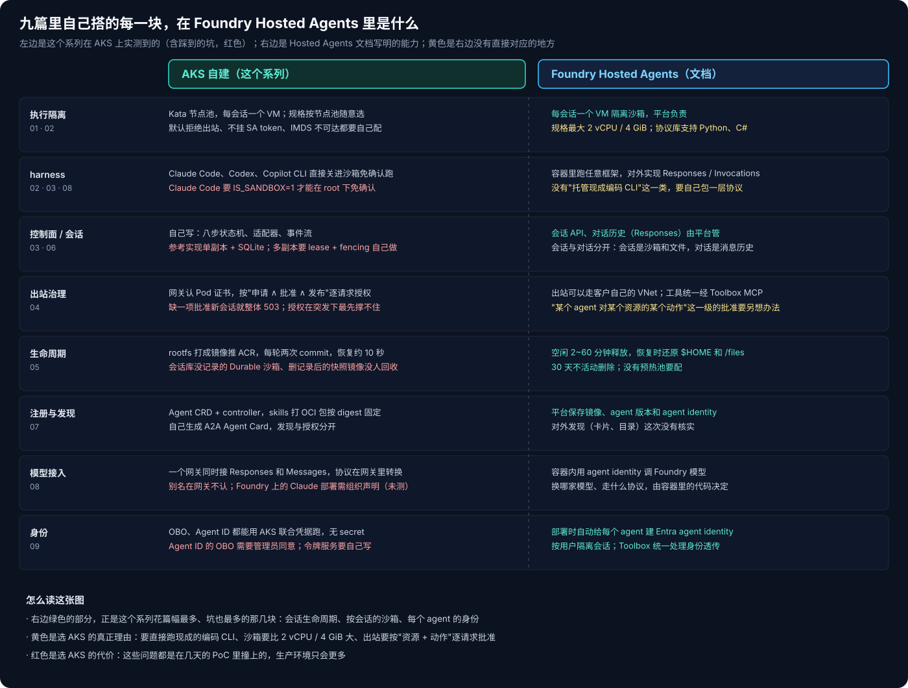
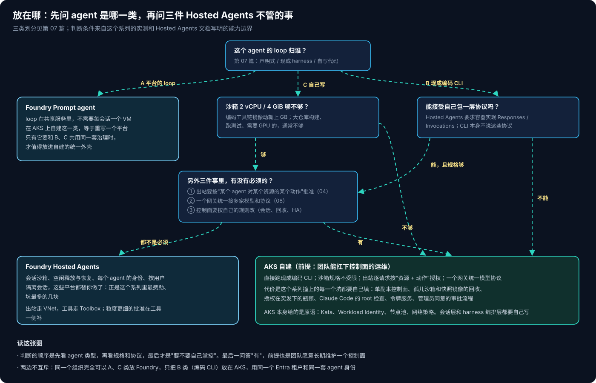

# AKS Agent Runtime 系列 10：为什么在 AKS 上自建

[第 01 篇](AKS-Agent-Runtime系列01：Sandbox之外的三个平面.md)开头我说过，讨论 AKS 做 agent runtime 时，大家的注意力几乎都在沙箱上，但一个编码 agent 从被叫起来到被回收，十步里只有三步发生在沙箱里。九篇下来，执行、会话、治理三个平面各自都实测了一遍。这一篇回到最开始的问题：既然 Foundry 已经有 Hosted Agents，为什么还要在 AKS 上自己搭这一套？

## 一、Hosted Agents 已经替你做了什么

我对着 Hosted Agents 现在的文档，把这个系列里自己搭的每一块都找了一下对应：

对完之后，最直观的感受是：**这个系列花篇幅最多、坑也最多的那几块，Hosted Agents 都已经包了。**

- **每个会话一个 VM 隔离的沙箱。** 第 01、02 篇在 AKS 上配 Kata 节点池、默认拒绝出站、不挂 ServiceAccount token、挡住 IMDS，这些它都由平台负责。
- **会话的生命周期。** 第 05 篇里，checkpoint 是把 rootfs 打成镜像推到 ACR，每轮两次 commit，各要 30 到 40 秒；会话库里没有记录的 Durable 沙箱、删掉记录后的快照镜像，都没人回收，我得自己写对账器。Hosted Agents 空闲 2 到 60 分钟后释放计算，恢复时还原 `$HOME` 和 `/files`，30 天不活动就删除，也没有预热池要配。
- **会话和对话分开。** 它把"会话"（沙箱和文件）和"对话"（消息历史）明确分开管，这正是第 03 篇里控制面要处理的事。
- **每个 agent 的身份。** 第 09 篇我用 Graph 一步步建 blueprint、联合凭据、agent identity；Hosted Agents 部署时就自动给每个 agent 建一个 Entra agent identity。它还支持按用户隔离会话，工具统一走 Toolbox，身份透传在那里处理。

如果你的 agent 是自己写 loop 的代码 agent，规格也在它的范围内，那么这些问题里的大部分根本不用碰。

## 二、它没有覆盖的三件事

剩下的，才是在 AKS 上自建的真正理由。我从这个系列的实测里，总结出三类。

**第一，直接跑现成的编码 CLI。** 第 07 篇按"loop 归谁"把 agent 分成三类，其中 B 类是基于 Claude Code、Codex、Copilot CLI 这些现成 harness 的。Hosted Agents 要求容器实现 Responses 或 Invocations 协议，而这些 CLI 本身不说这些协议，要用它们就得自己再包一层。参考实现做的正是这件事：把编码 CLI 关进沙箱，免确认运行，控制面用适配器统一它们的输出（第 03 篇）。第 08 篇里，Claude Code 经网关的协议转换用上了 GPT 模型，和 Codex 在同一个修 bug 任务上没有看得出的差别。

**第二，沙箱规格。** Hosted Agents 的沙箱最大是 2 vCPU / 4 GiB。编码 agent 的工具链镜像动辄上 GB（第 05 篇里快照镜像就是 1.46 GB），大仓库构建、跑整套测试，2 vCPU 往往不够；需要 GPU 的就更不用说了。AKS 上沙箱的规格由节点池决定，想要多大配多大。

**第三，出站按"资源 + 动作"逐请求批准。** Hosted Agents 的出站可以走客户自己的 VNet，工具经 Toolbox 统一接入。第 04 篇搭的是另一种粒度：网关认 Pod 证书，每个请求都核对"这个 agent 申请过、资源 owner 批准过、平台发布了这个动作"，撤销 1 秒多就生效。如果你的合规要求落在这一级（某个 agent 只能读某个仓库，不能推），就得自己搭。

还有两件可以算半个理由：一个网关统一接多家模型和多种协议（第 08 篇），以及控制面要按自己的规则改（会话分配、回收策略、高可用）。前者在 Hosted Agents 里由容器代码自己决定，后者是平台托管的代价：省了运维，也就少了这部分控制权。

## 三、自建的代价

AKS 给的是原语：Kata、Workload Identity、节点池、网络策略、CSI。会话层和 harness 编排层都要自己写。这个系列里，我在几天的 PoC 里就撞上了下面这些：

- **控制面是单副本加 SQLite**，删 Pod 后要 5 秒才恢复，每次发版都会停一下。做多副本要自己加 lease 和 fencing，我第一版"lease 被占就 abandon"的写法还把两轮消息送进了死信（第 06 篇）。
- **回收只从状态库往外做**，会话库里没有记录的 Durable 沙箱一直占着 VM，快照镜像只删记录不删镜像（第 05 篇）。
- **逐请求授权在突发下最先撑不住**：100 个并发请求时，授权决策点 p50 从 105 毫秒涨到 1.85 秒，返回了 51 个 503，限流一次 429 都没有触发（第 04、08 篇）。
- **有一项申请还没批准，整个应用的新会话就都建不了**，接口只返回笼统的 503（第 04 篇）。
- **Claude Code 在 root 下免确认运行会被它自己拒绝**，要加 `IS_SANDBOX=1`，参考实现的适配器里没有（第 08 篇）。
- **身份那一层要自己写令牌服务**，agent 代表用户还要管理员在 blueprint 上配好权限（第 09 篇）。

再加上订阅策略带来的麻烦：Key Vault 创建即关公网、Service Bus 的 SAS 被禁用、PostgreSQL 在两个区域开不了、集群每天半夜自动停机。这些在生产环境里只会更多。

所以选 AKS 的前提只有一条：**团队愿意长期维护一个 agent 控制面。** 不愿意，前面那三个理由再充分，也应该先想想能不能在 Hosted Agents 那一侧绕过去。

## 四、怎么选

我的判断顺序是：

1. **先看 agent 是哪一类。** 声明式（A 类）放 Foundry 的 Prompt agent，它的 loop 在共享服务里，不需要每会话一个 VM；在 AKS 上自建这一类，等于重写一个平台。
2. **自写代码（C 类）看规格。** 2 vCPU / 4 GiB 够用，再看那三件事有没有必须的；都不是必须，就用 Hosted Agents。
3. **现成编码 CLI（B 类）看能不能接受自己包一层协议。** 能，且规格够，就回到第 2 步；不能，或者规格不够，就在 AKS 上自建。

两边并不互斥。同一个组织完全可以把 A、C 类放在 Foundry，只把 B 类（编码 CLI）放在 AKS，共用同一个 Entra 租户、同一套 agent 身份。第 07 篇的统一外壳和第 09 篇的身份设计，在这种混合布局里一样用得上。

## 五、这个系列留下的东西

最后把这个系列的东西整理一下，方便以后接着做：

- **文章**：01 到 10 共十篇，每篇都配了一组在 AKS 上能复现的实验。
- **验证仓库**：环境脚本和每篇实验（`experiments/04-egress` 到 `09-identity`）的清单、脚本和原始输出，都放在一个私有仓库里，按 README 可以复跑。
- **还没做完的**：Foundry 上 Claude 的原生 Messages 路径（第 08 篇，需要组织声明）；agent identity 代表用户的 OBO（第 09 篇，需要管理员同意）；按 token 计的配额；agent 调 agent 的网关实现（第 07 篇的卡片里只写了入口地址）。

如果只能留一句话：**Agent runtime 的难点不在沙箱，在沙箱外面那一圈：会话、治理、身份。** 沙箱可以交给 Kata 或者 Hosted Agents；那一圈要么交给平台，要么自己长期扛着。

## 相关阅读

- [AKS Agent Runtime 系列 01：Sandbox 之外的三个平面](AKS-Agent-Runtime系列01：Sandbox之外的三个平面.md)
- [AKS Agent Runtime 系列 07：Agent 的类型、注册与发现](AKS-Agent-Runtime系列07：Agent的类型、注册与发现.md)
- [AKS Agent Runtime 系列 09：Agent 以谁的身份行事](AKS-Agent-Runtime系列09：Agent以谁的身份行事.md)
- [Foundry Agent 与 Copilot Studio 的选型](../Foundry-Agent与Copilot-Studio的选型.md)
- [Agent 基础设施系列 01：三层划分与自建路线](../../Notes/AI/agent/agent-platform/Agent基础设施系列01：三层划分与自建路线.md)

## 参考资料

- [Hosted agents in Foundry Agent Service](https://learn.microsoft.com/azure/foundry/agents/concepts/hosted-agents)
- [Manage hosted agent sessions](https://learn.microsoft.com/azure/foundry/agents/how-to/manage-hosted-sessions)
- [Isolate hosted agent sessions per user](https://learn.microsoft.com/azure/foundry/agents/how-to/isolate-sessions-per-user)
- [Deep dive into Foundry Agent Service networking](https://learn.microsoft.com/azure/foundry/agents/concepts/agents-networking-deep-dive)
- [Foundry Hosted Agents（Agent Framework）](https://learn.microsoft.com/agent-framework/hosting/foundry-hosted-agent)
