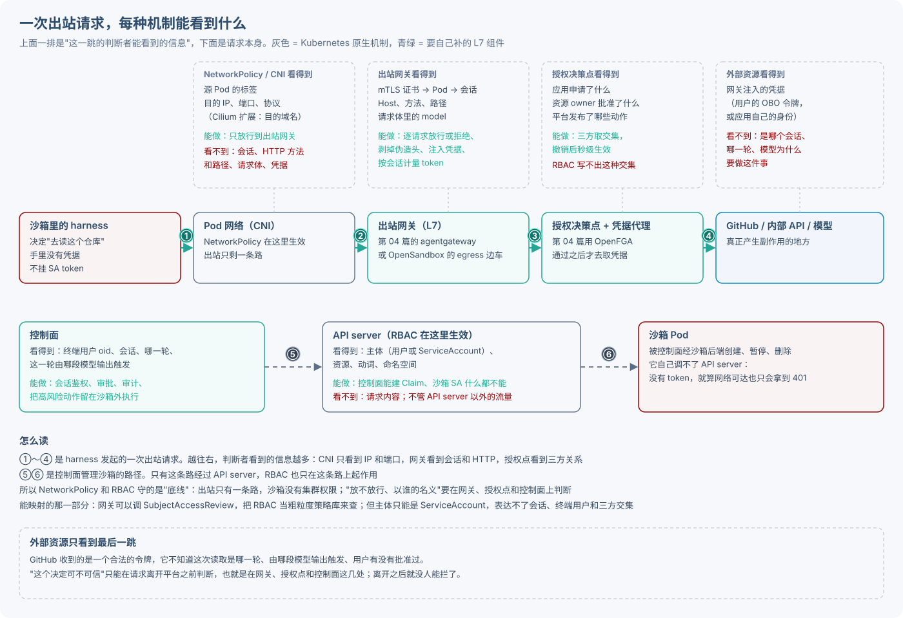
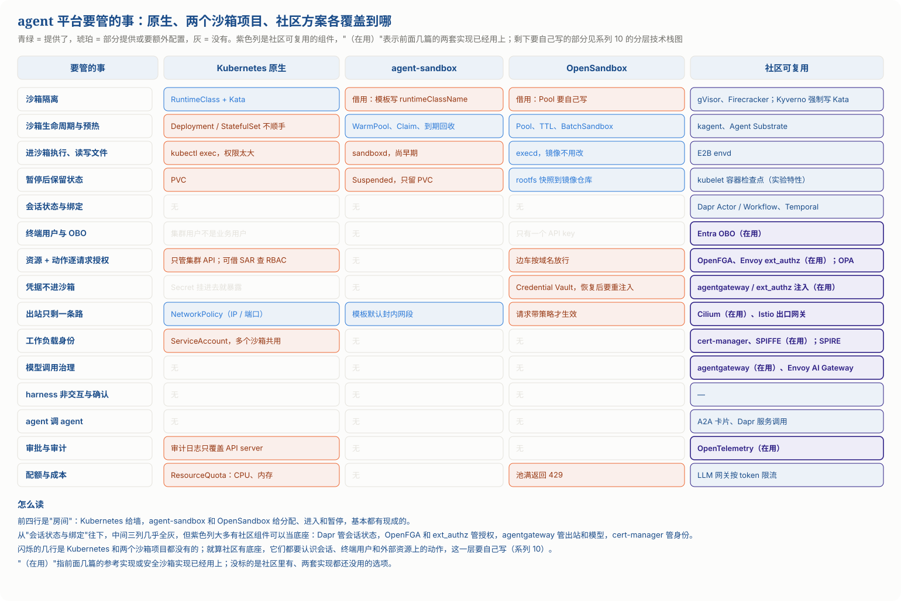

# AKS Agent Runtime 系列 11：Kubernetes 原生机制管不到什么

[系列 01](AKS-Agent-Runtime系列01：Sandbox之外的三个平面.md) 里，会话平面那一行 AKS 一格都填不上，治理平面也只有 Workload Identity 和网络策略可用。Kubernetes 已经有 RBAC、NetworkPolicy、TokenReview，这些机制能管到哪里、在哪里停下，决定了 agent 平台要自己补多少。

## 一、两套原生机制各管到哪

RBAC 和 NetworkPolicy 不是"配得不够细"，而是从机制上就只看得到一部分信息：

- **RBAC 只在 API server 上判断。** 主体是 Kubernetes 的用户和 ServiceAccount，对象是集群 API 里的资源、动词和命名空间。它没有条件，看不到请求内容，也管不到不经过 API server 的流量。
- **NetworkPolicy 只在 L3/L4 上判断。** 它按 Pod 标签选中目标，认的是 IP、端口和协议；Cilium 扩展能认目的域名。它看不到 HTTP 方法、路径、请求体，也不知道一条连接属于哪个会话。
- **TokenReview 只做认证。** 它回答"这个 token 是集群里的谁"，不回答"这个身份能不能做这件事"。要判断能不能做，得再调 SubjectAccessReview，问的还是 RBAC。

放到一次 agent 的出站请求上看，就很直观：

harness 发起的请求，越往右走，判断者能看到的信息越多：CNI 只看到 IP 和端口，网关看到会话和 HTTP，授权决策点看到申请、批准、发布三方的关系。而 RBAC 只出现在控制面管理沙箱的那条路上，也就是控制面去调 API server 的时候。

最右边的外部资源，比如 GitHub，收到的只是一个合法的令牌。它不知道这次读取是哪一轮、由哪段模型输出触发、用户有没有批准过。"这个决定可不可信"只能在请求离开平台之前判断，离开之后就没人能拦了。

## 二、一个具体的例子：router 的鉴权

[03 补充](AKS-Agent-Runtime系列03补充：沙箱后端agent-sandbox与OpenSandbox.md)里实测过 agent-sandbox 的 router：默认 `allow-all`，换成 `tokenreview` 后，一个无关 Pod 的 SA token 照样能访问别人的沙箱。把这段流量交给 Kubernetes 的鉴权，有三条路，每条都有坎：

1. **让流量经过 API server。** 用 `pods/proxy` 或 `pods/exec`，RBAC 就能生效。但 API server 成了数据通道，它不是为大流量、长连接的输出流设计的；而且 RBAC 授权最细只能到 Pod 名，沙箱又在不停地创建和销毁，最后只能按命名空间整体授权，做不到"只能访问自己的那个"。
2. **tokenreview 再加 SubjectAccessReview。** router 先认证调用方，再问 RBAC"这个身份能不能 get 这个 Sandbox"。这条路在机制上走得通，项目文档也把它列为后续工作，但主体仍然是 ServiceAccount，表达不了"这个终端用户只能看自己的会话"。
3. **每个沙箱单独建 Role 和 RoleBinding。** 理论上可行，但沙箱一多 RBAC 对象就成倍增长，RoleBinding 的生效也有延迟，不适合频繁变化的对象。

我最后的做法是换个角度：**能直接访问沙箱的调用方只有控制面一个**，"用户只能看自己的会话"放到控制面的会话 API 上，用 Entra 去校验。这样 router 这一层只需要保证"只有控制面进得来"，而这一点用原生机制就够了：

- RBAC：只有控制面的 ServiceAccount 能创建和删除 Claim；
- NetworkPolicy：router 的入站只放行控制面所在的命名空间；
- tokenreview 并强制带 token，限定 audience，作为第二道防线。

只有当多个调用方都要直接访问 router、彼此又不能互看沙箱时，才需要 scoped-token，或者像那套安全沙箱 API 一样，在 OpenSandbox 前面再包一层带归属校验的 API。

这个例子说明了一个规律：**原生机制擅长守"谁能碰集群对象、谁能连哪里"，不擅长回答"以谁的名义、为哪个会话"。** 后者要么挪到控制面上判断，要么另外补一层。

## 三、agent 平台要管的事，逐项看

先看全貌：每一项需求，Kubernetes 原生、agent-sandbox、OpenSandbox 各覆盖到哪；社区里有哪些组件可以拿来当底座，其中哪些前面几篇的两套实现已经在用。剩下复用不了、要自己写的部分，按层次列在[系列 10](AKS-Agent-Runtime系列10：为什么在AKS上自建.md#三自建时每一层用什么)的分层技术栈图里。

前四行是"房间"：Kubernetes 给墙，两个项目负责分配、进入和暂停，基本都有现成的。从"会话状态与绑定"往下是"住户和规矩"，中间三列几乎全灰，但社区一列大多有现成的底座：Dapr 管会话状态，OpenFGA 和 Envoy 的 `ext_authz` 管授权，agentgateway 管出站和模型，cert-manager 管身份。社区组件之上仍然有一层复用不了，因为它们都要认识会话、终端用户和外部资源上的动作。各组件怎么用、复用时要注意什么，见第五节。下面逐项说。

### 会话

**要管的**：会话、沙箱和当前 Pod 之间的绑定；这一轮是否在跑；由哪个控制面副本负责（lease 和 fencing token）；处于运行、暂停还是保留期；做到一半的副作用怎么处理。

**原生为什么不够**：这些是频繁变化的运行时状态，不是策略。Pod 会被暂停、替换、从快照重建，会话却一直在。RBAC 和 NetworkPolicy 里都没有"会话"这个对象。

**能映射的**：可以把会话定义成一个 CRD，kagent 走的就是这条路。但每条消息、每个事件都写 etcd，写入频率太高。所以参考实现用自己的数据库，Agent Substrate 干脆把 actor 放在 Kubernetes API 之外。

**两个项目做了什么**：只提供沙箱的生命周期原语。agent-sandbox 有 `Running` / `Suspended` 和 `shutdownTime`，OpenSandbox 有 TTL、暂停恢复和快照。"哪个会话用哪个沙箱、暂停多久、什么时候删"要控制面自己决定（[第 05 篇](AKS-Agent-Runtime系列05：会话生命周期与回收.md)、[第 06 篇](AKS-Agent-Runtime系列06：会话管理与高可用.md)）。

### 终端用户

**要管的**：用户是谁（Entra 的 oid），能用哪些应用、看哪些会话；agent 代表用户访问资源时用的 OBO 令牌，以及会话期间令牌过期了怎么续。

**原生为什么不够**：Kubernetes 的用户是集群的运维者，不是业务的终端用户。不可能给每个终端用户建一个集群身份，API server 也不是面向终端用户的接口。

**能映射的**：基本没有，要放到控制面的会话 API 上做（[第 09 篇](AKS-Agent-Runtime系列09：Agent以谁的身份行事.md)）。

**两个项目做了什么**：agent-sandbox 没有终端用户的概念；OpenSandbox 的 server 只有一个 API key。那套安全沙箱 API 在 OpenSandbox 外面加了用户和归属，正是因为这一层缺着。

### 外部资源上的动作

这一类要拆成三件事：逐请求授权、凭据不进沙箱、出站只剩一条路。

**逐请求授权。** 例如"读某个 GitHub 仓库""调某个内部 API 的 POST"。有效权限是三方的交集：应用的申请、资源 owner 的批准、平台的发布。每个请求都要从连接一路查下去：来自哪个 Pod → 属于哪个会话 → 属于哪个应用 → 这个动作有没有批准。批准撤销后要在秒级生效，[第 04 篇](AKS-Agent-Runtime系列04：出站治理与逐请求授权.md)实测约 1.2 秒。

- NetworkPolicy 看不到 HTTP，最多做到"能连 api.github.com 的 443"，分不出读和写，也分不出是哪个仓库；
- RBAC 不认识 GitHub，主体又是一批沙箱共用的 ServiceAccount，区分不了会话。

能映射的部分：把外部资源定义成 CRD，让网关调 SubjectAccessReview 问"某个 ServiceAccount 能不能对某个资源执行 read"，RBAC 支持自定义动词，这样做是成立的。但三处卡住：主体只能是 ServiceAccount，要区分会话就得每个会话建一个，变动太频繁；"申请 ∩ 批准 ∩ 发布"的交集和审批流程写不出来；没有条件，比如请求体里的模型名、时间窗口。参考实现选 OpenFGA，就是因为这种关系型授权 RBAC 表达不了。

**凭据不进沙箱。** Kubernetes 的 Secret 挂进 Pod，就等于交给了不可信的代码。要做到沙箱里只有假值或什么都没有，授权通过之后再由网关或边车在出站时注入。OpenSandbox 的 Credential Vault 做了注入这一半，按 scheme、host、method、path 匹配绑定规则；但它只认识沙箱，不认识会话和资源 owner 的批准，而且 vault 只在边车内存里，暂停恢复后要重新写入。

**出站只剩一条路。** 这是 NetworkPolicy 能做好的底线：沙箱只能连出站网关，别的一律不通，包括节点的元数据地址。agent-sandbox 的模板默认就生成了封内网段的策略；OpenSandbox 要请求带上出站策略才生效，所以沙箱命名空间要有一条兜底策略。

### 模型调用

**要管的**：能用哪些模型部署；请求体里写的 `model` 是否在批准范围内；按会话和应用的 token 配额；成本归属到谁；协议转换，比如 Claude Code 只说 Anthropic Messages，后端只有 Responses（[第 08 篇](AKS-Agent-Runtime系列08：模型接入层.md)）。

**原生为什么不够**：判断依据都在 HTTP 请求体里，只有 L7 网关看得到。NetworkPolicy 只能保证"沙箱只能连模型网关"。两个项目都不管这一块。

### harness 和 agent 调 agent

**harness 的非交互运行。** 编码 CLI 默认假设旁边有人在点确认。要补的是：免确认参数和工具白名单、按任务类型的权限档位、在计划阶段一次性审批、权限不够时快速失败并保存检查点（[第 03 篇](AKS-Agent-Runtime系列03：控制面怎么驱动编码Harness.md)第三节）。这是控制面里 harness 适配器的事，沙箱后端不认识 harness。

**agent 调 agent。** 要补的是：目标应用的 owner 批准哪些调用方能调；子会话不继承调用方的权限；只允许一跳；子会话的配额和限流（第 03 篇第四节、[第 07 篇](AKS-Agent-Runtime系列07：Agent的类型、注册与发现.md)）。RBAC 能管"谁能建子会话这个 API 对象"，但管不到"子会话该拿哪些权限"。

### 不可信的决策

agent 读的是网页、README 和模型输出，里面都可能带 prompt injection，"它决定做的事"不能直接信任。

**要管的**：

- 每个副作用能追溯到哪个用户、哪个会话、哪一轮、由哪段模型输出触发；
- 高风险动作（push、建 PR、部署、调外部系统）放在沙箱外，由控制面执行，需要时由人审批；
- 审批消息由控制面按结构化动作生成，不直接转发 harness 自己写的提示文字；
- 副作用要幂等，结果不确定时不盲目重放。

**原生为什么不够**：Kubernetes 里没有"这个动作是模型在第 N 轮决定的"这层语义，RBAC 只看谁在调用，不看为什么调用。Kubernetes 的审计日志能记下对集群 API 的操作，但 agent 的大多数副作用（调 GitHub、发 Teams 消息）都不经过 API server，只能在控制面和网关上记。

### 配额与成本

**要管的**：token 预算、每个应用和租户的并发会话上限、沙箱总数上限，以及预热池和暂停恢复对同一份 Kata 容量的争抢（03 补充里实测踩过：恢复的沙箱因为预热池补货占满了 CPU 而一直 Pending）。

**原生能做的**：ResourceQuota 管得住命名空间的 CPU、内存和对象数。OpenSandbox 的 Pool 满了会返回可重试的 429。但"这个应用今天用了多少 token""这个租户同时最多开几个会话"，要在控制面和模型网关上算。

## 四、实际的分工：底线和判断

RBAC 和 NetworkPolicy 负责的是**底线**；L7 网关、授权决策点和控制面负责**判断**。

**底线，用 Kubernetes 原生机制：**

- **NetworkPolicy**：沙箱只能出到出站网关，其他一律不通，包括集群内网和节点元数据地址。它保证"出站只有一条路"，这条路上放不放行交给网关。
- **RBAC**：沙箱的 ServiceAccount 什么权限都没有，也不挂 token；控制面只拿它需要的那几项（建 Claim 或调 OpenSandbox）。需要的话，也可以把 RBAC 当成粗粒度的策略库，让网关用 SubjectAccessReview 查询。
- **RuntimeClass**：每个沙箱 Pod 都显式指定 Kata，包括预热池的模板。
- **ResourceQuota**：给沙箱命名空间设 CPU、内存和对象数的上限。

**判断，底座可以复用，agent 语义要自己写（见第五节）：**

- **控制面**：会话、终端用户、harness 适配、agent 调 agent、审批、审计、token 预算；
- **出站网关和授权决策点**：会话绑定、资源加动作的三方授权、凭据注入、模型治理。

**沙箱后端的位置**：agent-sandbox 和 OpenSandbox 都在底线和判断之间，只管"房间"。OpenSandbox 的 egress 边车和 Credential Vault 往判断那边多走了一步，但它只认识沙箱，不认识会话、用户和资源 owner 的批准，所以替代不了网关和授权决策点。

**Kubernetes 管的是"Pod 和集群对象"，agent 平台还要管"会话、终端用户、外部资源上的动作、模型，以及不可信的决策"。** 前者用原生机制就够；后者在 CNCF 生态里大多有现成的底座，真正要自己写的是把 agent 语义接上去的那一层。这也是系列 01 说会话平面一格都填不上、治理平面只填了一半的原因。

## 五、能复用什么：已经在用的、社区还有的、复用不了的

第三节说"要自己补"的那些事，并不都要从零写。前面几篇用到的两套实现——驱动编码 harness 的参考实现，和把 OpenSandbox 包成多租户 API 的那套安全沙箱实现——都大量复用了社区组件，自己写的只是其中一层。

### 两套实现已经在用的社区组件

**参考实现：**

- **沙箱后端**：OpenSandbox；生产配置下面再接 agent-sandbox，测试配置用 OpenSandbox 自己的 BatchSandbox（[03 补充](AKS-Agent-Runtime系列03补充：沙箱后端agent-sandbox与OpenSandbox.md)）。
- **出站与模型网关**：agentgateway，按 Gateway API 配置路由，模型请求和资源请求都走它（第 04、08 篇）。
- **授权决策点**：OpenFGA，存"申请、批准、发布"的关系，网关逐请求来问。
- **沙箱的出站身份**：cert-manager 的 CSI 驱动给出站边车签发和 Pod 绑定的证书，证书主体是 SPIFFE 格式。
- **入口与云身份**：AKS 托管的 Istio 入口网关；快照提交等云上操作用 Workload Identity。
- **状态与观测**：控制面状态用 SQLite；遥测走 OpenTelemetry collector。

**安全沙箱 API 那套实现：**

- **沙箱后端**：OpenSandbox 的 BatchSandbox，对外隐藏。
- **L7 数据面**：Envoy。一个共享的 Envoy 网关做入口，每个沙箱 Pod 里再放一个 Envoy sidecar；授权用 Envoy 的 `ext_authz` 交给外部服务判断。
- **出站**：agentgateway 做租户级出站网关；集群数据面是 Cilium。
- **身份**：SPIFFE 格式的工作负载身份；Entra 联合凭据，出站时换 token。
- **观测**：OpenTelemetry。

我自己在系列 PoC 里另外用过三样：第 06 篇用 Service Bus 会话队列加 PostgreSQL 的 lease 做多副本；第 07 篇用 oras 把 skills 打成 OCI artifact，CRD 校验用 CEL；第 09 篇用 Entra Agent ID 给每个 agent 独立身份。

### 社区还有、两套实现都没用的

- **Dapr**：Actor（每个会话一个 actor，空闲自动停用）、State、Pub/Sub、Workflow（每一步落盘、断点续跑），正好对应会话状态、收件箱和持久执行。还有调用 LLM 的 Conversation API，目前处在早期阶段。
- **Temporal**：另一种持久执行引擎。
- **Kyverno / Gatekeeper**：准入策略。可以在 Pod 创建时直接拒绝"没写 `runtimeClassName`"或"挂了 SA token"的沙箱 Pod。03 补充里 Pool 漏写 Kata、静默跑成 runc 的问题，用它就能拦住。
- **SPIRE**：比 cert-manager 更完整的工作负载身份签发和轮换。
- **OPA、SpiceDB**：另外两种授权引擎，前者偏规则，后者和 OpenFGA 一样偏关系。
- **LLM 网关**：Envoy AI Gateway 一类专门处理模型流量的网关，做模型路由和按 token 限流。

### 复用不了的部分是谁写的

复用不了的部分（按层次的完整清单见[系列 10](AKS-Agent-Runtime系列10：为什么在AKS上自建.md#三自建时每一层用什么)），它们的共同点是：**都要认识会话、终端用户和外部资源上的动作**，而社区组件只认识工作负载、请求和规则。参考实现自己写的是会话 API、状态机、执行器、harness 适配器、沙箱 provider、运行时类和应用定义，以及一个带缓存的 Git 出站服务；安全沙箱实现自己写的是租户级 API 和归属校验、策略控制器（把每个沙箱的策略下发到 Envoy、DNS 和出站网关）、沙箱网络初始化、策略 DNS、出站租约代理，以及两个 `ext_authz` 授权服务和身份控制器。

### 复用时要注意的三点

**sidecar 放在沙箱 Pod 里，就和不可信代码在同一台 VM 里。** Kata 隔离的是 Pod 和宿主，Pod 内部的多个容器之间只有容器级隔离。sidecar 一旦持有证书或凭据，harness 在 VM 里提权就够得着它。参考实现只把证书挂给出站边车，最终判断放在网关上；安全沙箱实现先用包过滤规则把所有流量强制导进边车，策略生效前一律拒绝，也不给工作负载任何 capability。原则是：**sidecar 只负责把流量导出去，判断和凭据放在 Pod 外面。**

**Dapr 适合放在控制面，不适合放进沙箱。** Dapr sidecar 要持有状态存储、消息队列的连接凭据，放进沙箱就等于交给了 agent。

**这些组件的身份粒度是工作负载，不是会话。** Envoy 和 mesh 认 SPIFFE ID，对应 ServiceAccount；Dapr 认 app-id。一批沙箱往往共用一个身份，所以 `ext_authz` 背后的授权服务必须自己查"这个 Pod 现在属于哪个会话"。这一层映射是复用不来的。

还有一个具体的冲突：OpenSandbox 的 Credential Vault 和同一个 Pod 里的 Istio/Envoy 透明代理不能共存，两者都要拦截出站流量。选了 Envoy sidecar 这条路，凭据注入就要放到网关或 `ext_authz` 上做。

## 相关阅读

- [AKS Agent Runtime 系列 01：Sandbox 之外的三个平面](AKS-Agent-Runtime系列01：Sandbox之外的三个平面.md)——三个平面的划分
- [AKS Agent Runtime 系列 03 补充：沙箱后端 agent-sandbox 与 OpenSandbox](AKS-Agent-Runtime系列03补充：沙箱后端agent-sandbox与OpenSandbox.md)——两个沙箱后端的实测与对比
- [AKS Agent Runtime 系列 04：出站治理与逐请求授权](AKS-Agent-Runtime系列04：出站治理与逐请求授权.md)——网关、授权决策点、凭据代理的实现
- [AKS Agent Runtime 系列 09：Agent 以谁的身份行事](AKS-Agent-Runtime系列09：Agent以谁的身份行事.md)——终端用户身份与 OBO
- [AKS Agent Runtime 系列 10：为什么在 AKS 上自建](AKS-Agent-Runtime系列10：为什么在AKS上自建.md)——自建的代价清单
- [AKS Agent Runtime 系列 12：常驻实例与会话调度](AKS-Agent-Runtime系列12：常驻实例与会话调度.md)——另一种 runtime 形态与它的出站模型

## 参考资料

- [Using RBAC Authorization](https://kubernetes.io/docs/reference/access-authn-authz/rbac/)
- [Network Policies](https://kubernetes.io/docs/concepts/services-networking/network-policies/)
- [Authorization: SubjectAccessReview](https://kubernetes.io/docs/reference/access-authn-authz/authorization/#checking-api-access)
- [kubernetes-sigs/agent-sandbox](https://github.com/kubernetes-sigs/agent-sandbox)
- [OpenSandbox](https://github.com/opensandbox-group/OpenSandbox)
- [OpenFGA](https://openfga.dev)
