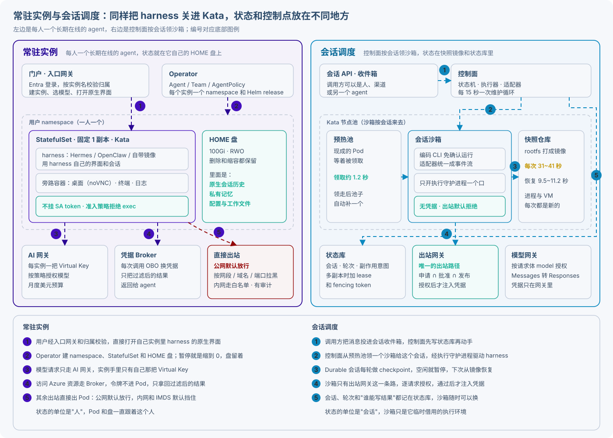
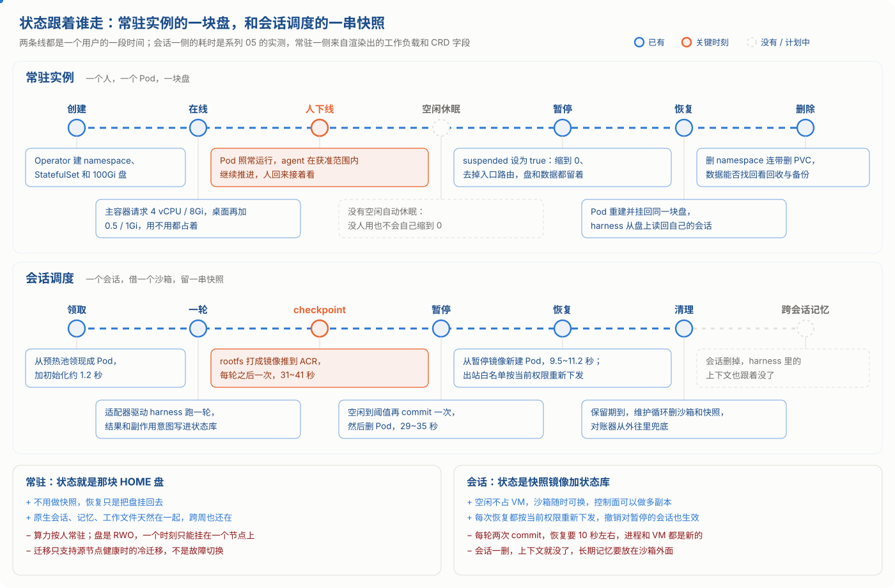

# AKS Agent Runtime 系列 12：常驻实例与会话调度

这个系列前面十一篇搭出来的 runtime 都是一种形态：控制面收到消息，从预热池领一个 Kata 沙箱给这个会话，跑完一轮做 checkpoint，空闲就暂停，保留期到了就回收。状态的单位是会话，沙箱只是临时借来的执行环境。

在 AKS 上还有另一种做法，出发点是"每个工程师一个专属 agent"：Pod 和 HOME 盘长期都在，人下线之后 agent 在获准范围内继续推进，第二天人回来接着看。我最近仔细读了一套这样的实现，下文叫它**常驻实现**，前面一直在用的那套叫**参考实现**。两套都把 harness 整个关进 Kata，凭据都留在沙箱外面，但状态放在哪、控制点放在哪，几乎处处不同。

## 一、两种形态长什么样



**常驻实例**是"给每个人发一台带护栏的云工作站，里面住着一个 agent"。Operator 给每个用户建一个 namespace，里面一个 StatefulSet、一块 HOME 盘。harness 用的是 Hermes、OpenClaw 这类自带界面和会话管理的 agent，也可以换成自带镜像；用户经过入口网关的归属校验，直接打开 harness 自己的界面。旁边还挂着桌面、终端和日志容器。

**会话调度**是这个系列一直在做的：调用方可以是人、渠道或者另一个 agent，消息先进会话收件箱，控制面先写状态库再动手，从预热池领沙箱，经执行守护进程驱动编码 CLI（[系列 03](AKS-Agent-Runtime系列03：控制面怎么驱动编码Harness.md)）。

两边在下面几件事上的做法是一样的：

- harness 整个放进 Kata 沙箱，不挂 ServiceAccount token（[系列 02](AKS-Agent-Runtime系列02：Harness放在沙箱内还是沙箱外.md)）；
- 模型请求只走网关，沙箱里只有一把只能调模型的 key（[系列 08](AKS-Agent-Runtime系列08：模型接入层.md)）；
- 访问企业资源的令牌不进 Pod（[系列 09](AKS-Agent-Runtime系列09：Agent以谁的身份行事.md)）。

分歧主要在三处：状态跟着谁走、出站默认开还是默认关、记忆放在哪。

## 二、常驻实例在 Kubernetes 上是什么

我用 `helm template` 把常驻实现的 agent chart 按最小配置渲染了一遍，没有装进集群，只看它会生成什么。chart 自己的校验很严：不给网关 key 指定 Secret 就拒绝渲染，模板里还写死了"关掉 AI 网关就报错，直接访问模型已不再支持"；原生界面的公开地址不填、格式不对，也都过不了。补齐之后，一个叫 `alice` 的实例渲染出 11 个对象：

```text
StatefulSet × 1    Service × 1         NetworkPolicy × 1
ConfigMap × 1      Secret × 1          ServiceAccount × 1
ValidatingAdmissionPolicy + Binding    （拒绝 pods/exec）
Job + Role + RoleBinding               （升级前钩子，只能 get / delete 这一个 StatefulSet）
```

StatefulSet 里值得看的几项：

```yaml
replicas: 1
runtimeClassName: kata-vm-isolation
automountServiceAccountToken: false
containers:
  - name: agent          # requests 4 CPU / 8Gi，limits 8 CPU / 16Gi
  - name: desktop        # requests 0.5 CPU / 1Gi
  - name: logger         # 只读挂 harness 的数据目录
volumeClaimTemplates:
  - data: ReadWriteOnce, 100Gi          # 挂在 HOME
persistentVolumeClaimRetentionPolicy:
  whenDeleted: Retain
  whenScaled: Retain
```

**为什么是 StatefulSet 而不是 Deployment。** 要的就是 `volumeClaimTemplates` 和稳定的身份：Pod 重建后还是同一个名字、挂同一块盘。文档写明这个 chart 只允许 0 或 1 个副本，开了 HPA 也必须是最小 1、最大 1。这是"一个人一个实例"，不是横向扩容。

**暂停就是缩到 0。** Agent CRD 上有一个 `suspended` 字段，设为 true 时缩到 0 个副本、去掉入口路由，PVC 保留。再设回 false，Pod 重建，挂回同一块盘，harness 从盘上读回自己的会话。它没有"空闲多久自动暂停"这种策略，文档原话是只提供显式暂停。

**盘留着不等于有备份。** 两条 `Retain` 管的是 StatefulSet 删除和缩容时不删 PVC；但实例的 namespace 被删时，PVC 对象会跟着删，数据能不能找回要看 StorageClass 的回收策略和有没有做过备份。文档也专门写了一句"持久的 HOME 不是备份"。

**单写者和迁移。** HOME 是 RWO 盘，一个时刻只能挂在一个节点上。CRD 里有计划内迁移，但注释写得很清楚：只支持源节点健康时的冷迁移，不授权强制删除，也不做故障切换。他们自己的文档也承认，RWO 本身不保证单写者。这和[系列 06](AKS-Agent-Runtime系列06：会话管理与高可用.md) 讨论的是同一类问题：卡住又醒来的旧 Pod 能不能写，换成盘的语境，就是旧节点上的挂载有没有真正释放。

**exec 被准入策略拦住了，终端是另一条路。** 渲染出的 ValidatingAdmissionPolicy 对这个 namespace 里所有 `pods/exec` 一律返回 false。浏览器里的终端走的是独立的 ttyd 和入口路由，不经过 exec，所以这条策略管不到它。系列 02 里"沙箱只开一个口"的思路，在这里变成了"只开平台批准过的几个口"。

## 三、状态跟着谁走

把一个用户的一段时间展开，两种形态在每个时刻做的事完全不同：



**常驻实例的状态就是那块盘。** 原生会话历史、私有记忆、配置和工作文件全在 HOME 上。它不需要 checkpoint：Pod 没了，盘还在，重建出来的 Pod 挂回去就是原来的样子。[系列 05](AKS-Agent-Runtime系列05：会话生命周期与回收.md) 里最费劲的那一块——每轮两次 commit、各 30 多秒、快照镜像要清理、会话库和沙箱要对账——在这里都不存在。

**代价是算力按人常驻。** 主容器请求 4 vCPU / 8Gi，桌面再加 0.5 vCPU / 1Gi。一百个人就是 450 vCPU 的请求量，不管这些 agent 此刻是在干活还是在等人。没有空闲自动休眠，省钱只能靠人去点暂停，或者由运维批量操作。

**会话调度的状态是一串快照加状态库。** 空闲时不占 VM，沙箱随时可以换，控制面可以做多副本。系列 05 里还有一个容易忽略的好处：恢复时出站白名单是按**当前**的权限重新下发的，撤销批准对暂停中的会话同样生效。常驻实例的 Pod 一直在跑，策略变更要靠控制器在运行中改网络策略。

两种形态在状态和成本上的差异可以归成一张表：

| | 常驻实例 | 会话调度 |
|---|---|---|
| 状态放在哪 | HOME 盘（100Gi，RWO） | 快照镜像（ACR）+ 状态库 |
| 第一次用 | 建 namespace、StatefulSet、盘 | 领预热 Pod，约 1.2 秒 |
| 一轮之后 | 不做额外的事 | checkpoint 31~41 秒 |
| 空闲时 | Pod 照常运行，算力一直占着 | 到阈值再 commit 一次后删 Pod |
| 回来继续 | 本来就在；暂停过的话重建 Pod、挂回盘 | 从镜像新建 Pod，9.5~11.2 秒，进程是新的 |
| 多副本 / 故障 | 单副本，只有健康源的冷迁移 | lease + fencing，进程被杀约 15 秒接管（系列 06） |
| 跨任务的记忆 | 天然在盘上 | 会话删掉就没了，要另外放 |

## 四、出站：公网默认放，还是只剩一条路

渲染出的 NetworkPolicy，出站放行的是：集群 DNS、Istio 控制面、AI 网关的 4000 端口、一个指定的内部地址，**以及 `0.0.0.0/0` 减去三个私网段和 IMDS 地址**。也就是说，公网是默认放行的，内网和元数据服务是默认挡住的。

通过 Operator 下发的 AgentPolicy 也是这个模型：网络部分只有 `blockedCIDRs`、`blockedFQDNs`、`blockedPorts` 三个黑名单，加一个 `allowedInternalCIDRs` 内网白名单。按域名拉黑靠的是 TLS 握手里能看到的 SNI，文档明确说不解密 HTTPS，对 ECH 不做保证。出站访问全部记进 Istio 的访问日志，管理员发现异常目的地，就加进黑名单，对整个 Team 生效。

[系列 04](AKS-Agent-Runtime系列04：出站治理与逐请求授权.md) 的做法正好相反：沙箱出站默认拒绝，只剩出站网关一条路，每个请求都核对"申请 ∩ 批准 ∩ 发布"，授权通过后才注入凭据。

两种选择背后是对 agent 用途的不同假设：

- **常驻实例的 agent 是助手**，要查文档、搜资料、读公开仓库，把公网全关掉它就没法用了。令牌本来就不在 Pod 里，直接出站拿到的只是公开内容，所以风险主要在**数据外传**：agent 被提示注入后，把从内部工具拿到的东西发到一个公网地址。黑名单只能挡已知的目的地，新冒出来的挡不住，所以这条路要靠审计加事后处置。
- **会话调度的 agent 是执行者**，要对企业资源做写操作：推代码、改工单、调配置。这时候"能不能做"必须在请求发出之前判断，而且要细到"这个 agent 对这个仓库能不能 push"。

> [!WARNING]
> 如果常驻实例也要对企业资源做写操作，公网默认放行加黑名单就不够了：写操作要收进网关，按资源加动作逐请求授权。只读工具走 Broker、其余流量直接出站的组合，只适合以读为主的助手场景。

## 五、身份、模型与预算：两边很接近

治理面的其他几项，两边的思路基本一致：

| 项目 | 常驻实现 | 这个系列 |
|---|---|---|
| 访问 Azure 资源 | Broker 每次调用用 OBO 换短期凭据，只把过滤后的结果返回给 agent | 控制面用 Workload Identity 作断言做 OBO，令牌只在控制面和网关之间流转（系列 09） |
| 有效权限 | 用户 RBAC ∩ Agent ID 授权上限 ∩ 平台开放的只读工具 | 应用申请 ∩ 资源 owner 批准 ∩ 平台发布（系列 04） |
| 模型接入 | 基于 LiteLLM 的 AI 网关，每实例一把 Virtual Key，按策略授权模型 | agentgateway，按请求体里的 model 授权，别名和未批准的部署一律 403（系列 08） |
| 预算 | 每个 agent 月度美元预算，可选 Team 总额，超额即拒绝 | 只测了按 token 限流，在响应后结算（08 补充） |

有两处值得留意。

**Agent ID 代表用户这一步。** 我在系列 09 里实测时，agent identity 代表用户做 OBO 卡在 AADSTS65001，需要管理员在 blueprint 上授予权限。常驻实现的有效权限公式里有"Agent ID 授权上限"这一项，说明他们同样要先在租户里把这一层配好，这一步省不掉。

**预算是软上限。** 网关的花费是在响应回来之后才知道的，所以月度预算实际的语义是"超了之后拒绝下一次"，挡不住单次请求的超支。对一个按人常驻、长时间自主推进的 agent，这个区别比按会话调用时更明显：它可能在人不在的时候跑满一整晚。

## 六、常驻形态多出来的一层：记忆与 Skills

会话调度里，我一直没碰长期记忆：checkpoint 保住的只是这个会话里 harness 自己的上下文，会话一删，什么都不剩。常驻实例有一块长期在的盘，记忆有地方放，这一层就自然长出来了。

常驻实现的私有记忆是一个平台预装的 skill，放在 HOME 盘上，每个 agent 私有、不共享。它的规矩写在一份注入进沙箱、只读挂载的 `AGENTS.md` 里，其中几条很值得借鉴：

1. **先查再答。** 回答前先查之前的对话定下过什么；工具调用失败会自动记一笔。
2. **存结论，不存原文。** 存的是事实、偏好、决定和自己的建议，每条注明来源和日期；观察到的和推断出来的分开记；不存对话原文、凭据和工具的原始输出。写入是事务式的，每次改动都有版本，可以溯源、修正、遗忘。
3. **记忆不授予任何权限。** 记忆里的一条结论，哪怕是别的 agent 引用过来的，也永远不能当作用户的授权。会变的事实，用前要通过当前有权限的工具重新核对。
4. **从失败中学习要过固定检查。** 重复出现的失败会被整理成一个小的、可测试的"方法候选"，一次只改一个方法，和现有做法对比，在后续任务里试用，通过固定检查才采用，agent 自评不算数。方法的得分同样不授予权限、不调度工作、不批准外部动作。
5. **私有记忆不外泄。** 共享会话、对外发送的消息、附件和转交出去的任务，默认都不带私有记忆。

团队 Skills 走的是另一条路：提交、评审、封版发布、绑定到 Team，在每个实例里只读挂载，出问题可以撤回和回滚。这和[系列 07](AKS-Agent-Runtime系列07：Agent的类型、注册与发现.md) 里 skills 打成 OCI artifact、按 digest 固定是同一个目标——agent 运行时用到的东西必须是平台批准过的那一版——只是落在"Team 绑定"上，而不是"Agent revision"上。

第 3 条是我觉得最关键的一条。记忆一旦能跨任务存在，就会有人想用它记"上次已经批准过"，下次直接跳过审批。会话调度里不存在这个问题，因为会话删掉就什么都不剩；常驻形态必须把"记忆不是授权"写成硬规则。

## 七、两种形态在往一起走


两种形态各缺的那一块，正好是对方已经有的。

常驻实现的路线图上列着两项：**Run / Session 层**，做长任务的检查点与恢复，权限随任务收放；**共享 agent 池**，给无界面、队列驱动的工作用，多副本可互换，HOME 随用随弃而不是私有盘，一把网关 key 按任务归因用量，没有入站路由。后一项照字面看，就是会话调度里的执行池。

会话调度这边缺的是按人归属的长期记忆，以及给人用的入口和原生界面。第六节那一套，常驻实例的盘上已经在做了。

所以我判断两边最后都会长成同一个样子：**轻量的常驻入口加会话执行池**。常驻那一部分负责"这个人是谁、他以前定过什么、他的团队批准了哪些 skills"，不必一直占着 4 vCPU；长任务、批量活和事件触发的 triage 交给会话执行池，按会话领沙箱、做 checkpoint、受逐请求授权管控，做完把结论写回这个人的记忆。中间要补的接口有两个：执行池领任务时带上发起人的身份和记忆的只读视图；任务结束时只回写结论，不回写原始输出。

## 八、怎么选

按图里的顺序问三个问题：

1. **agent 跟着谁？** 很多调用方按次调用，就是会话调度；跟着一个固定的人，往下问。
2. **状态要活多久？** 一个任务内就够，用会话调度的 Ephemeral 会话就行；要跨周、跨月地记得这个人，往下问。
3. **算力能不能按人常驻？** 人数有限、岗位价值高（值班、核心开发），常驻实例最省心；人多且大部分时间闲着，就走混合形态。

不管选哪种，两条单独判断：要对企业资源做写操作，出站就得收成只剩网关一条路；令牌永远不进沙箱。

## 相关阅读

- [AKS Agent Runtime 系列 00：导读](AKS-Agent-Runtime系列00：导读.md)
- [AKS Agent Runtime 系列 04：出站治理与逐请求授权](AKS-Agent-Runtime系列04：出站治理与逐请求授权.md)
- [AKS Agent Runtime 系列 05：会话生命周期与回收](AKS-Agent-Runtime系列05：会话生命周期与回收.md)
- [AKS Agent Runtime 系列 06：会话管理与高可用](AKS-Agent-Runtime系列06：会话管理与高可用.md)
- [AKS Agent Runtime 系列 10：为什么在 AKS 上自建](AKS-Agent-Runtime系列10：为什么在AKS上自建.md)
- [Agent 基础设施系列 01：三层划分与自建路线](../../Notes/AI/agent/agent-platform/Agent基础设施系列01：三层划分与自建路线.md)

## 参考资料

- [Hermes Agent](https://github.com/NousResearch/hermes-agent)
- [OpenClaw](https://github.com/openclaw/openclaw)
- [LiteLLM Proxy：Virtual Keys 与预算](https://docs.litellm.ai/docs/proxy/virtual_keys)
- [StatefulSet 的 PersistentVolumeClaim 保留策略](https://kubernetes.io/docs/concepts/workloads/controllers/statefulset/#persistentvolumeclaim-retention)
- [ValidatingAdmissionPolicy](https://kubernetes.io/docs/reference/access-authn-authz/validating-admission-policy/)
