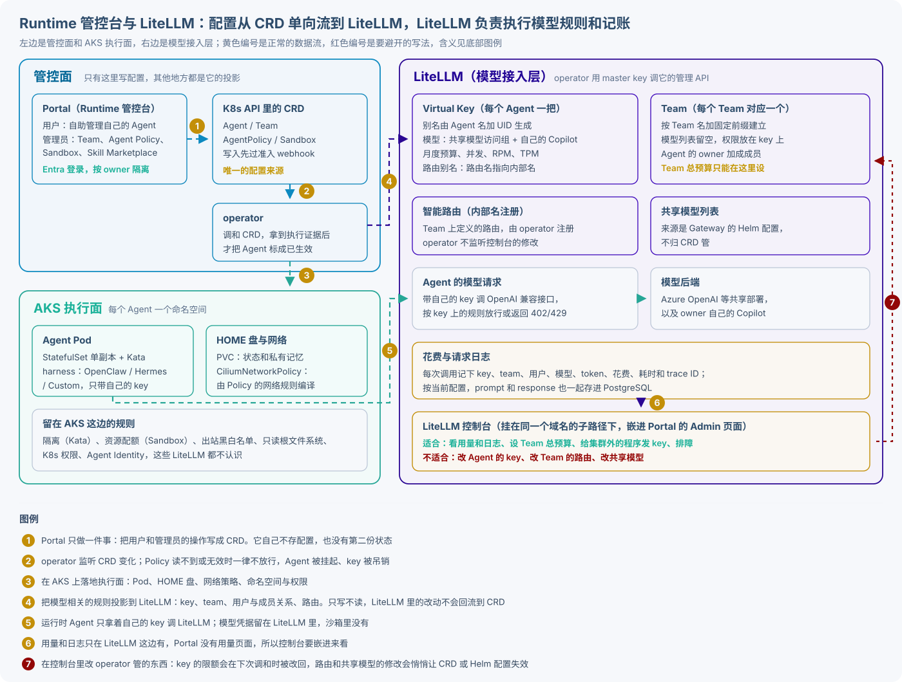
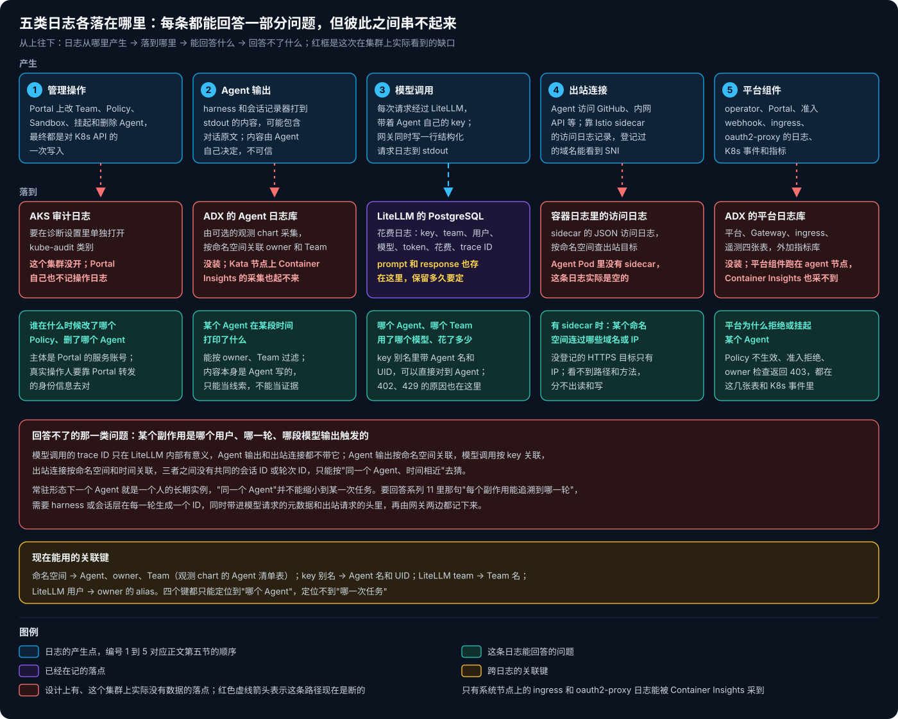
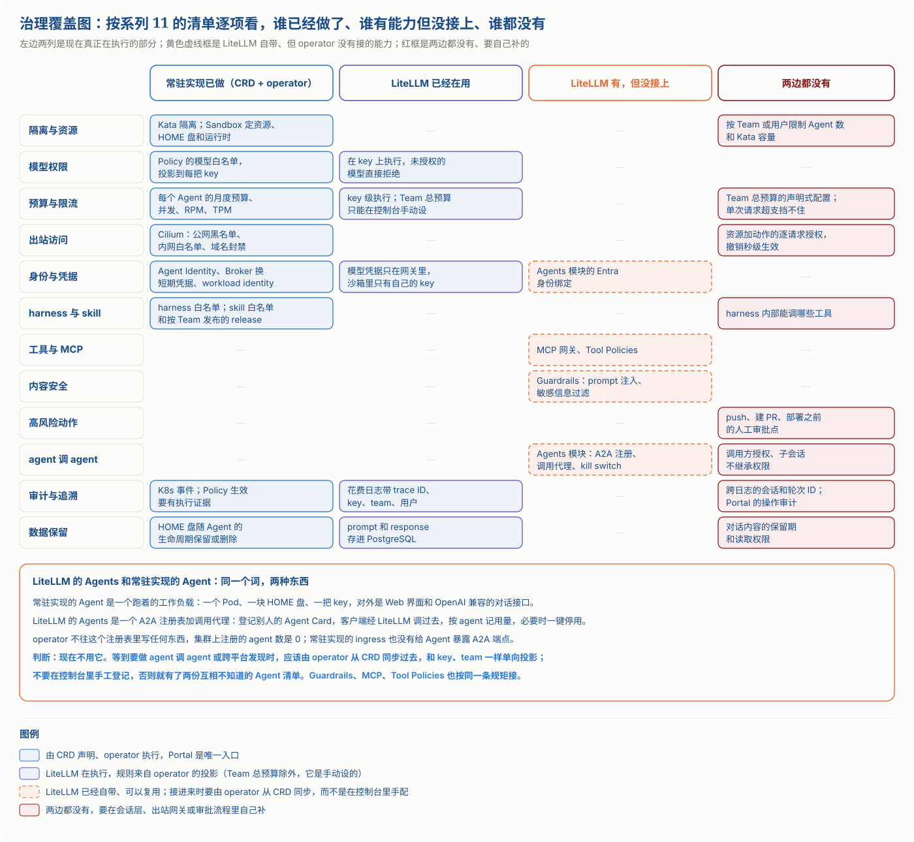

# AKS Agent Runtime 系列 13：Runtime 管控台与 LiteLLM 的分工

[系列 12](AKS-Agent-Runtime系列12：常驻实例与会话调度.md) 里我把常驻实现的 agent chart 渲染出来对照过一遍。后来我把整套平台在 AKS 上装好、用了一段时间，发现管理员手里其实有两个控制台：一个是平台自己的 Portal，用来建 Agent、配 Team 和 Policy；另一个是 AI 网关底下 LiteLLM 自带的控制台，里面也有 Teams、Keys、Budgets，甚至还有一个 Agents 菜单。我把 LiteLLM 的控制台挂到同一个域名下、嵌进 Portal 的 Admin 页面之后，最先冒出来的问题是：同一件事两边都能改，到底以哪边为准？

答案是以 Portal 写下的 CRD 为准。LiteLLM 里和 Agent 有关的对象，几乎都是 operator 从 CRD 投影过去的，只有用量和日志是 LiteLLM 自己产生的。把这条线理清楚，才能判断哪些能力是复用 LiteLLM 得来的、哪些两边都没有。

## 一、两个控制台，一条单向的线

**Portal 是 runtime 管控台，它不另存配置。** 用户在上面自助管理自己的 Agent，管理员配 Team、Agent Policy、Sandbox 和 Skill Marketplace，所有操作最后都是对 K8s API 的一次写入，先过准入 webhook。Portal 前面是 Entra 登录，ingress 上按 owner 做隔离。

**operator 是唯一把 CRD 翻译成执行配置的地方。** 它往两个方向写：

- 往 AKS 写执行面：每个 Agent 一个命名空间，StatefulSet 单副本跑在 Kata 里，HOME 盘是一块 PVC，Policy 里的网络规则编译成 CiliumNetworkPolicy；
- 往 LiteLLM 写模型规则：用 master key 调 LiteLLM 的管理 API，建 key、team、用户和路由。

这条线是单向的。operator 只写不读，LiteLLM 里的改动不会回流到 CRD。规则执行不了的时候它一律不放行：Policy 读不到或无效，Agent 被挂起，key 被吊销；只有拿到执行证据，Agent 才被标成 Policy 已生效。

**LiteLLM 负责执行模型规则和记账。** 运行时 Agent 只拿着自己的 key 调 LiteLLM 的 OpenAI 兼容接口，模型凭据留在 LiteLLM 里，沙箱里没有。是放行，还是返回 402（预算用完）或 429（超限流），都由 key 上的规则决定。每次调用的用量和花费也只记在 LiteLLM 这边，Portal 没有用量页面。

## 二、operator 往 LiteLLM 写了什么

| 常驻实现的对象 | 在 LiteLLM 里变成 | 写了什么 | 用来做什么 |
|---|---|---|---|
| Agent | 一把 Virtual Key | 别名由 Agent 名加 UID 生成；模型是"共享模型访问组 + 这个 Agent 自己的 Copilot 路由"；月度预算、并发、RPM、TPM；路由名到内部名的别名 | 模型授权、限额、按 Agent 归属花费 |
| Team | 一个 LiteLLM team | 按 Team 名加固定前缀建立；模型列表留空，权限都放在 key 上；元数据里记着 Team 名 | 按 Team 汇总用量；需要时在这里设 Team 总预算 |
| Agent 的 owner | 一个 LiteLLM 用户，加进对应 team | 用户 ID 就是 owner 的 alias，不单独发 key | 按人汇总用量 |
| Team 上定义的智能路由 | 一个以内部名注册的路由模型 | 四档模型和分类器 | Agent 用路由名调用，网关按难度分档转发 |

共享模型本身不在这张表里。它们的来源是 AI 网关的 Helm 配置，不归 CRD 管，operator 只负责把共享模型的访问组授给每把 key。

有三个行为直接决定了"在控制台里改东西"会发生什么：

- **key 上的限额每次调和都会对一遍。** 在控制台里把某把 key 的 RPM 改大，下一次调和时 operator 会按 Policy 改回去。
- **路由的修改 operator 不监听。** 在控制台里改了某个由 operator 注册的路由，Team 上的定义不会变，下次 Team 有改动时又会被覆盖回去，中间这段时间两边是不一致的。
- **共享模型在控制台里改，会让 Helm 配置悄悄失效。** LiteLLM 在控制台里改动某个设置块的任何一项，都会把整个块写进数据库；之后数据库里的值优先，Helm 里对应的值就不再起作用，界面上没有任何提示。

Team 这一行还有一个容易踩的坑。LiteLLM 的 team 是一个真正的成员分组，operator 按"一个 Team 对应一个 LiteLLM team"去投影，每把 key 只能挂在一个 team 下面。如果研发和销售都选了同一个 Team，两组的花费会混在同一个 LiteLLM team 里，在那里设的总预算也会被两组共用。所以 Team 的正确用法是一个团队一个：几个团队规则完全一样，也各建一个 Team，让它们引用同一个 Agent Policy 和 Sandbox。真正可复用的"规格"是 Policy 和 Sandbox，Team 只是把它们绑给一组人。Team 本身不维护成员名单，Agent 的 owner 自己选。

## 三、哪些事在哪边做

| 想做的事 | 在哪做 | 为什么 |
|---|---|---|
| Agent 能用哪些模型、预算多少、限流多少 | Portal → Agent Policy | 在控制台改 key，下次调和会被改回 |
| 智能路由 | Portal → Team → Smart routing | operator 不监听控制台的修改，以 Team 上的定义为准 |
| 共享模型的部署、价格 | AI 网关的 Helm 配置 | 控制台里改会让整块 Helm 配置失效 |
| Team 总预算 | LiteLLM 控制台 → Teams | CRD 里没有这一项，这是唯一合理在控制台里改的配置 |
| 看用量、花费、请求日志，查 402 和 429 的原因 | LiteLLM 控制台 | Portal 没有用量页面 |
| 给集群外的程序发 key | LiteLLM 控制台 | 这些 key 不归 operator 管，它不会去动 |

把控制台嵌进 Portal 的时候还有几处要注意：

- **会有两次登录。** 先过 Entra（和 Portal 共用同一个会话，嵌在 Portal 里时这一步是无感的），再用 LiteLLM 自己的管理员账号登录。这套部署没有给 LiteLLM 接单点登录，所以第二次登录免不掉。
- **控制台和管理 API 用的是同一个端口。** 页面本身就要调这些管理 API，所以没办法只开页面、不开 API。能挡住的只有前面那层 Entra，ingress 上的允许组要收到管理员范围。
- **owner 检查是按路径判断的。** ingress 上的 owner 检查从路径的第一段取 Agent 名。我把控制台挂到 `/ai-gateway/` 时，它被当成一个叫 `ai-gateway` 的 Agent，返回了"你不是它的 owner"的 403。要在这段检查之前单独放行这个前缀，同时把浏览器自己的 `Authorization` 头还给 LiteLLM，因为 LiteLLM 页面调 API 靠的就是这个头。
- **允许嵌入要在 ingress 上单独打开。** LiteLLM 自己返回禁止被嵌入的响应头，ingress 默认也一律禁止；要对这个前缀改成只允许同源嵌入，其他路径保持不变。

> [!IMPORTANT]
> 把 LiteLLM 控制台当成"观察和补充"，不要当成第二个管控入口。它能改的东西远多于它应该改的东西，而且改错了界面上不会有任何提示。

## 四、进 Agent 的三个入口

Portal 里打开一个 Agent，工作区左侧有三个入口：Agent UI、Terminal、Desktop。它们进的是同一个 Pod，只是连到不同的容器，和 Agent 打交道的层面也不一样。这个 Pod 里有三个容器：跑 harness 的主容器，带浏览器的桌面边车，以及记录会话的 logger。

| 入口 | 连到哪里 | 用来做什么 |
|---|---|---|
| Agent UI | 主容器里 harness 自带的 Web 应用，路径 `/ui/<名字>/` | 跟 Agent 对话：发任务、看回复和工具调用、管理会话 |
| Terminal | 主容器里 ttyd 提供的网页 shell | 绕过 Agent 直接动它的环境：同一个用户、同一块 HOME 盘，看文件、跑命令、装工具、查 Agent 为什么出错 |
| Desktop | 桌面边车里 noVNC 远程桌面上的 Chrome | 看 Agent 用的浏览器，必要时接手：Agent 通过本机的 CDP 端口操作这个 Chrome，人在桌面上能实时看到，也能自己点 |

分成三个，是因为它们对应三种完全不同的需要：

- **Agent UI 是"让它做"。** 人只描述目标，执行由 Agent 决定，这是日常使用的主入口。它有自己的一层登录，用的是 Overview 页上显示的那组 Webapp Key，和 Portal 的 Entra 登录是两回事。
- **Terminal 是"我自己来"。** 集群上有一条准入策略，专门拒绝对 Agent Pod 做 `kubectl exec`；`kubectl port-forward` 也连不上，因为 Kata Pod 的端口在虚拟机里面，kubelet 在宿主机这一侧找不到。所以平台管理员也没有别的路进这台机器，Terminal 是唯一正式的 shell 入口。
- **Desktop 是"看着它，或者替它过一关"。** 有些事 Agent 自己做不了，比如登录要验证码或 MFA。人在桌面里登录一次，cookie 留在这个 Chrome 里，Agent 之后就能接着用。Agent 在网页上操作时，人也能在旁边看着，出问题随时接手。

拆开还有部署上的考虑。桌面是一个单独的容器，有自己的 CPU 和内存配额；不需要浏览器的 Agent 可以整个不启用，harness 改用 headless 浏览器，这个入口也就没有了。终端在 chart 里也有单独的开关，要求高的环境可以只留 Agent UI。

三个入口都先过 Entra，再过 ingress 上的 owner 检查，只有 Agent 的 owner 能进。管理员在后台的 Agent 列表里能看到所有人的 Agent，但进不去别人的工作区。这也是第三节说的"按路径做 owner 检查"在使用上的直接体现。

还有一点要心里有数：Terminal 拿到的是沙箱里的完整 shell，Desktop 里的 Chrome 是以 `--no-sandbox` 启动的。这两个入口的隔离都只靠 Kata 虚拟机和 owner 检查，把 Agent 开给别人用之前，要清楚这三扇门都能进人。

## 五、LiteLLM 里的 Agents 是什么

LiteLLM 控制台里有一个 Agents 菜单，看名字很容易以为它管的就是常驻实现的那些 Agent。实际上两者是两种东西。

LiteLLM 的 Agents 是一个 **A2A agent 网关**：用 A2A 规范的 Agent Card 登记一个外部 agent，客户端按 A2A 协议调 LiteLLM，LiteLLM 再转发过去；同时按 agent 记用量，提供一个出问题时立刻停用的 kill switch，还能给登记的 agent 绑定一个 Entra 应用身份。它对应的是[系列 07](AKS-Agent-Runtime系列07：Agent的类型、注册与发现.md) 里的注册与发现，以及 [08 补充](AKS-Agent-Runtime系列08补充：agentgateway的定位与三种角色.md)里"三种网关"中的 agent 网关这一角色。

常驻实现的 Agent 则是一个跑着的工作负载：一个 Pod、一块 HOME 盘、一把 key，对外提供的是 Web 界面和 OpenAI 兼容的对话接口。我查了一下，operator 不往 LiteLLM 的 agent 注册表里写任何东西，集群上注册的 agent 数是 0；常驻实现的 ingress 也没有给 Agent 暴露 A2A 端点。

所以我的判断是现在不用它。等到要做 agent 调 agent、或者要让别的平台发现这些 Agent 时，再接这个模块，但要由 operator 从 CRD 同步过去，和 key、team 一样单向投影。不要在控制台里手工登记，否则就有了两份互相不知道对方存在的 Agent 清单。LiteLLM 里的 Guardrails、MCP 网关、Tool Policies 也按这条规矩接：能力可以复用，配置的来源仍然是 CRD。

## 六、日志：五条线各管一段

把一个 Agent 从被配置到干活这一路产生的日志摊开，一共五类：

1. **管理操作。** Portal 上改 Team、Policy，挂起和删除 Agent，最终都是一次 K8s API 写入，要靠 AKS 的审计日志（诊断设置里的 kube-audit 类别）来记。主体是 Portal 的服务账号，真实操作人要靠 Portal 转发的身份信息去对。Portal 自己不记操作日志。
2. **Agent 输出。** harness 和会话记录器打到 stdout 的内容，可能包含对话原文。平台的可选观测 chart 会把它采进 Azure Data Explorer，按命名空间关联 owner 和 Team。这些内容是 Agent 自己写的，只能当线索，不能当证据。
3. **模型调用。** 这是最完整的一条。LiteLLM 每次调用都记下 key、team、用户、模型、token、花费、耗时和 trace ID；key 别名里带着 Agent 名和 UID，可以直接对到具体的 Agent。按当前配置，prompt 和 response 也一起存在 LiteLLM 的 PostgreSQL 里。
4. **出站连接。** 靠 Istio sidecar 的访问日志记录，登记过的域名能看到 SNI，没登记的 HTTPS 目标只有 IP。即使有记录，也看不到路径和方法，分不出读和写。
5. **平台组件。** operator、Portal、准入 webhook、ingress、oauth2-proxy 的日志和 K8s 事件，同样由观测 chart 采进 ADX。

在我这个集群上，这五条线实际有数据的只有第 3 条：

- 观测 chart 没装；
- 节点池分成系统和 agent 两个，平台组件和 Agent 都跑在 agent 节点上，而 agent 节点是 Kata 的节点镜像。Container Insights 的采集 Pod 在这些节点上一直重启，因为节点内核没有 iptables 的 nat 表。结果只有系统节点上的 ingress 和 oauth2-proxy 日志能被采到；
- Agent 的 Pod 里没有 sidecar，出站访问日志实际是空的；
- 审计日志没开。

这几件事装的时候都不报错，要一条条去核对才会发现。

就算五条线都通了，还有一类问题回答不了：**某个副作用是哪个用户、哪一轮、哪段模型输出触发的。** 模型调用的 trace ID 只在 LiteLLM 内部有意义，Agent 输出和出站连接都不带它。Agent 输出按命名空间关联，模型调用按 key 关联，出站连接按命名空间和时间关联，三者之间没有共同的会话 ID 或轮次 ID。常驻形态下一个 Agent 就是一个人的长期实例，"同一个 Agent、时间相近"并不能缩小到某一次任务。要做到[系列 11](AKS-Agent-Runtime系列11：Kubernetes原生机制管不到什么.md) 里说的"每个副作用能追溯到哪一轮"，需要 harness 或会话层在每一轮生成一个 ID，同时带进模型请求的元数据和出站请求的头里，再由两个网关都记下来。

## 七、治理：还缺哪些

按系列 11 的清单逐项对下来，常驻实现在"能装什么"和"能花多少"上做得很扎实：harness 白名单、skill 白名单和按 Team 发布、模型白名单、每个 Agent 的预算和限流，加上 Kata 和 Sandbox 的资源边界。这些都由 CRD 声明、operator 执行，规则执行不了时一律不放行。模型这一块借 LiteLLM 的 key 和计费，比我在[系列 08](AKS-Agent-Runtime系列08：模型接入层.md) 里用网关自己实测的那套更完整。

两边都没有、要自己补的，主要是四块：

- **出站的逐请求授权。** Cilium 能做到"公网黑名单、内网白名单、按域名封禁"，做不到[系列 04](AKS-Agent-Runtime系列04：出站治理与逐请求授权.md) 里"某个 agent 对某个资源的某个动作"这一级，也没有撤销后秒级生效的路径。系列 12 里已经说过，公网默认放行和这个系列"只剩网关一条路"的做法正好相反。
- **高风险动作的审批。** push、建 PR、部署、调外部系统，都在 Agent 自己手里，中间没有人工审批点。对一个人下线之后还在自主推进的常驻 Agent，这一块比按会话调用时更要紧。
- **容量配额。** 每个 Agent 的资源有 Sandbox 管，但"一个 Team 或一个人最多几个 Agent、总共占多少 Kata 容量"没有上限。
- **追溯和审计。** 也就是上一节说的跨日志关联 ID，加上 Portal 自己的操作审计。

预算还有一个语义要记住：花费在响应回来之后才知道，月度预算实际是"超了之后拒绝下一次"，挡不住单次请求的超支。Team 总预算只能在 LiteLLM 控制台里手工设，CRD 里没有声明式的写法。

黄色那一列是 LiteLLM 已经自带、operator 没有接的能力：Guardrails 可以做 prompt 注入和敏感信息过滤，MCP 网关和 Tool Policies 能管工具调用，Agents 模块能做 agent 之间的注册和调用。它们值得复用，但接入方式应该和 key、team 一样，从 CRD 单向投影过去。

## 八、我会怎么用

1. **Portal 是唯一的写入口。** 模型、预算、限流、路由都在 Portal 里改；LiteLLM 控制台只用来看用量、设 Team 总预算、给集群外的程序发 key、排障。
2. **一个团队一个 Team。** 共用的规则放进 Agent Policy 和 Sandbox，Team 只负责"这组人用哪套规则、带什么上下文和 skill"，这样 LiteLLM 里的用量和预算能按团队分开。
3. **控制台只开给管理员。** Entra 的允许组收到管理员范围；LiteLLM 的管理员密码和 master key 分开，因为控制台登录就等于拿到了管理 API。
4. **在 Portal 里补一个只读的用量页面。** 后端直接读 LiteLLM 的花费接口，按 Agent、Team、模型展示，普通用户能看到自己 Agent 的用量，LiteLLM 控制台就只留给管理员。常驻实现自己的路线图上也列着"用量可见"这一项。
5. **先把日志接通，再谈追溯。** 装上观测 chart，打开 AKS 审计日志，确认 Kata 节点上的采集真的有数据，再给 prompt 落库定一个保留期和读取权限。
6. **LiteLLM 的额外能力从 CRD 接。** 要用 Guardrails、MCP、Agents，就在 Policy 或 Team 上加声明，由 operator 同步过去，不在控制台里手配。

## 相关阅读

- [AKS Agent Runtime 系列 00：导读](AKS-Agent-Runtime系列00：导读.md)
- [AKS Agent Runtime 系列 04：出站治理与逐请求授权](AKS-Agent-Runtime系列04：出站治理与逐请求授权.md)
- [AKS Agent Runtime 系列 07：Agent 的类型、注册与发现](AKS-Agent-Runtime系列07：Agent的类型、注册与发现.md)
- [AKS Agent Runtime 系列 08：模型接入层](AKS-Agent-Runtime系列08：模型接入层.md)
- [AKS Agent Runtime 系列 08 补充：agentgateway 的定位与三种角色](AKS-Agent-Runtime系列08补充：agentgateway的定位与三种角色.md)
- [AKS Agent Runtime 系列 11：Kubernetes 原生机制管不到什么](AKS-Agent-Runtime系列11：Kubernetes原生机制管不到什么.md)
- [AKS Agent Runtime 系列 12：常驻实例与会话调度](AKS-Agent-Runtime系列12：常驻实例与会话调度.md)
- [AKS Agent Runtime 系列 14：让 PoC 能交给别人部署](AKS-Agent-Runtime系列14：让PoC能交给别人部署.md)

## 参考资料

- [LiteLLM Proxy：Virtual Keys 与预算](https://docs.litellm.ai/docs/proxy/virtual_keys)
- [Setting Team Budgets](https://docs.litellm.ai/docs/proxy/team_budgets)
- [Agent Gateway (A2A Protocol) - Overview](https://docs.litellm.ai/docs/a2a)
- [Guardrails - Quick Start](https://docs.litellm.ai/docs/proxy/guardrails/quick_start)
- [MCP Overview](https://docs.litellm.ai/docs/mcp)
- [A2A Protocol](https://a2a-protocol.org/latest/)
- [Monitoring data reference for Azure Kubernetes Service](https://learn.microsoft.com/en-us/azure/aks/monitor-aks-reference)
