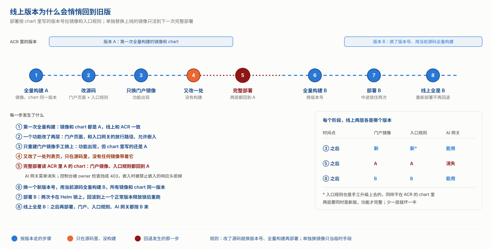
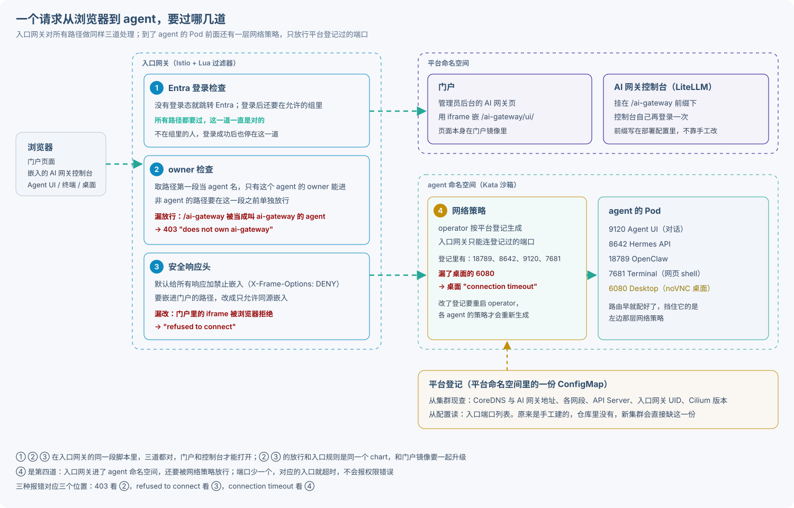

# AKS Agent Runtime 系列 14：让 PoC 能交给别人部署

[系列 12](AKS-Agent-Runtime系列12：常驻实例与会话调度.md) 和 [系列 13](AKS-Agent-Runtime系列13：Runtime管控台与LiteLLM的分工.md) 写完的时候，常驻实例和会话调度两套 runtime 都已经在 AKS 上跑通了。接下来要做的事情很朴素：把两个仓库整理好，让同事 clone 下来就能在自己的订阅里部署；另外给三位同事开权限，让他们直接在我这套环境上做演示。

我原以为这只是补补文档。真正做下来，大部分时间花在一类问题上：**PoC 里我手工做过、仓库里却没有的东西**。在我自己的集群上它们一直在，所以一切正常；换一个人、换一个集群，或者只是再完整部署一次，它们就会冒出来。这篇把这几天遇到的几件事按出现的顺序记下来，最后整理成交接前的做法。

## 一、线上为什么会悄悄回到旧版本

第一个信号是同事截图问我：管理员后台怎么没有 AI 网关的菜单？这个页面我几天前明明上线过，当时还截图写进了系列 13。

把 ACR 里的镜像标签、各个 Helm release 的历史和 Deployment 的滚动记录对起来，经过就清楚了：

- 第一次全量构建时，源码里还没有这个页面；
- 之后我改了源码，只重建了门户镜像，手工换到线上，功能就出现了；
- 再后来做了一次完整部署，部署按 chart 里写的版本号拉镜像，chart 还是第一次构建的那份，门户就被换回了旧镜像。

**部署脚本认的是 chart 里的版本号，不认线上正在跑什么。** 手工换上去的镜像，只能活到下一次完整部署。

更隐蔽的是，这个功能其实改了两层：

- 门户里的页面；
- 入口网关的两条规则：放行 `/ai-gateway` 这条路径，以及允许它被门户嵌入。

那次完整部署把两层一起打了回去。所以就算只把门户镜像再换上去，页面能打开，控制台也还是进不去。中间还有一处改动更惨：我改完之后根本没构建，它从来没有在线上出现过。

所以规则只有一条：**改了源码，就换一个新的版本号，全量构建，再部署。** 单独换镜像只当临时手段，而且当天就要补一次全量构建，不然线上和 ACR 里的"当前版本"就是两回事。

## 二、入口的三道处理和第四道

修好之后再回头看排查过程，最费时间的是同一个功能会以三种完全不同的方式坏掉，报错信息之间看不出联系。把一个请求从浏览器走到 agent 的路径画出来，三种报错各自对应一个位置：

入口网关上有一段脚本，对**所有路径**做同样的三道处理，之后才转给后端：

1. **Entra 登录检查**：没有登录态就跳转 Entra，登录后还要在允许的组里；
2. **owner 检查**：把路径的第一段当成 agent 名，只有这个 agent 的 owner 能进。门户和 AI 网关控制台这类不是 agent 的路径，必须在这一段之前单独放行，否则 `/ai-gateway` 会被当成一个叫 `ai-gateway` 的 agent，返回"你不是它的 owner"的 403；
3. **安全响应头**：默认给所有响应加上禁止嵌入的头。门户的 AI 网关页是用 iframe 嵌控制台的，这条路径要改成只允许同源嵌入，否则浏览器直接显示 refused to connect。

请求进了 agent 的命名空间，还有第四道：**网络策略**。operator 按一份平台登记给每个 agent 生成 CiliumNetworkPolicy，入口网关只能连登记过的端口。这份登记里有 Agent UI、Hermes API、OpenClaw、终端的端口，偏偏没有桌面（noVNC）的 6080。于是三个入口里，Agent UI 和终端都正常，桌面一打开就是 upstream connect error，原因是 connection timeout。路由其实早就配好了，挡住它的是这层网络策略，所以报的是超时，不是权限错误。

> [!TIP]
> 看到 403，先查入口网关的 owner 检查有没有放行这条路径；refused to connect 查安全响应头；connection timeout 而路由又存在，查 agent 命名空间里的网络策略放行了哪些端口。

## 三、手工做过、仓库里没有的东西

桌面这件事追下去，发现那份平台登记根本不在仓库里。

开启沙箱执行之后，operator 要从平台命名空间的一个 ConfigMap 里读两类信息：

- **运行时能力**：Kata 支持哪些特性；
- **网络拓扑**：CoreDNS 和 AI 网关的地址、Pod/Service/节点网段、API Server 地址、入口网关的身份、Cilium 的版本。

上游文档写得很清楚：平台默认不开沙箱执行，也不生成这份登记，要由部署者按自己集群的实际情况提供。我当时是手工查好这些值、用 `kubectl create` 建的，HOME 盘用的 StorageClass 也是手工建的。仓库里没有任何脚本生成它们，同事在新集群上部署到开启沙箱执行这一步就会失败。

我把它改成一个脚本，规则是：**能从集群查到的值一律现查，只有端口列表这种"我的决定"写在配置里。** 现查的好处当场就看到了：手工那份登记里的 Cilium 版本已经和集群对不上，AKS 在这几天里自动升级过一次。

还有一个细节要一起处理：operator 只在启动时读这份登记。所以脚本在登记内容有变化时要重启 operator，各个 agent 的网络策略才会按新登记重新生成。我第一次只更新了 ConfigMap，等了一会儿网络策略纹丝不动；重启 operator 后不到半分钟，6080 就出现在白名单里，桌面就能打开了。

会话型 runtime 那边有一个同类问题。OpenSandbox 的 dashboard 读沙箱和快照时要调 lifecycle API，可 operator 在这个 API 前面的网络策略只放行了控制面，没有放行 dashboard。结果 Snapshots 页面一直显示为空，沙箱详情页报 i/o timeout，而 Pools 页面走 Kubernetes API，又是正常的。NetworkPolicy 是叠加生效的，单独补一条放行就够了，不需要改 operator 自带的那条。这条补丁同样要放进部署脚本，不能只在线上 `kubectl apply` 一下了事。

### 能不能用，取决于开关组合

重建演示 agent 时还遇到一个问题，它不是哪里漏配了，而是开关组合的问题。新版本的工作区里，Identities 一栏显示 "Binding storage is unavailable"。

委托连接的凭据存在 agent 命名空间里，由平台的 agent-broker 读写。operator 只在两种情况下给 broker 授权：

- agent 不在沙箱里跑；
- agent 在沙箱里跑，但开启了沙箱里的委托连接集成。

内置的管理员 agent 不在沙箱里，所以正常；演示 agent 跑在 Kata 沙箱里，而那个集成默认关闭，broker 就没有权限。这一类我没有急着改：那个集成还需要额外的平台登记，而委托连接本身还要租户管理员同意才能用。我把它写进使用说明的已知限制，并写清了原因，让看到这个报错的人不至于以为是自己配错了。

## 四、Helm release 卡在 pending-upgrade

全量构建完正式部署时，又卡了两次，报错都是 release "has an unfinished operation"。Helm 每次升级先把 release 标成 `pending-upgrade`，做完才改成 `deployed`；中途被打断，这个状态就留下来，之后的部署都会拒绝继续。这两次的来路不一样：

- **第一次是我自己打断的。** 之前手工升级入口规则时，我把 `helm upgrade` 的输出接到了 `| head` 上。`head` 读够几行就退出，管道一断，helm 进程被中途终止。资源已经应用上去了，所以入口规则当时就生效了，但 release 永远停在了 `pending-upgrade`；
- **第二次是部署流程自己打断自己的。** 平台升级的最后一步要等内置管理员 agent 就绪，而 agent 的 Helm 升级是 operator 发起的。同一次部署里 operator 本身也在滚动更新，旧 Pod 被替换时，它手上那次升级就断了。agent 停在挂起状态，平台升级等它等到超时。

解法都一样：`helm history` 找到最后一个 `deployed` 的版本，`helm rollback` 回去释放锁，再重跑部署。第二次重跑时 operator 已经是新版本，不会再自己打断自己，一次就过了。

这两次的经验我写进了部署说明：部署失败时先看是哪个 release 卡住了，以及 helm、部署命令的输出不要接任何会提前退出的命令。

## 五、一个值该放在哪里

上面几件事的共同点，是"一个值放错了地方"：版本号写死在构建脚本里，平台登记写死在手工命令里。整理仓库时，我把脚本里出现的每一个具体值都过了一遍，按两个问题分成三类：

- **换一个订阅或集群不会变的，留在代码里。** 命名空间、约定的密钥名、Graph 的固定 app ID、ACR 令牌登录用的全零 GUID 用户名，这些是平台和协议的约定。做成配置项反而有害，别人改了就和代码对不上。我在部署说明里单独列了一节"固定名字，不要改"；
- **会变、但查不到的，进配置文件。** 订阅、区域、资源名、机型、版本号、模型列表和单价、管理员名单、端口列表。一个值只在一处定义：模型列表以前在"部署模型"和"给网关定价"两个地方各写了一份，现在两步都读同一行配置；
- **会变、而且查得到的，部署时现查。** 各种地址、网段、UID、组件版本。查得到还让人填，填错和过时就都是隐患。

分完之后，我在交接前做了三项检查：

1. **变量来源**：用一个小脚本列出所有脚本和模板里用到的变量，逐个确认它在配置模板里，或者由脚本、状态文件生成。最后剩下的几个，要么是临时开关（比如"集群已存在时强制重跑"），要么是 Dockerfile 的构建参数，都写进了文档；
2. **改前改后对比**：把写死的值提成变量后重新生成部署配置，和线上正在用的那份逐字段对比。最后只有两处不同：构建的 commit 和一个镜像 digest，都换成了这次自己构建的值，而这正是本来该有的样子；
3. **全历史扫描**：仓库要公开之前，不只看当前文件，而是扫全部 git 历史，查订阅、租户、对象 ID、密码、私有资源名和同事的账号。历史里提交过的东西，公开后同样能被看到。

这个过程里还顺手扫出了几处会让新部署直接失败的小问题，在我的环境上都碰不到：

- 一个脚本去一个不存在的目录找模板。我本地用的是另一个工作目录，所以从来没触发过；
- 变量名后面紧跟中文标点，比如 `$LOGIN（`。bash 会把全角括号的字节当成变量名的一部分，在 `set -u` 下直接报 unbound variable。改成 `${LOGIN}（` 就好；
- 部署工具要求 TLS 状态目录不能放在源码仓库里。以前源码在另一个目录，所以没事；现在源码就是本仓库，这个目录要挪到仓库外。

## 六、构建机不开任何入站端口

最后是一个和网络有关的问题。全量构建是在 Azure 上一台临时 VM 里做的，原来的脚本靠 SSH 登进去执行命令，先后遇到两个问题：

- 本机开着 Global Secure Access 时，SSH 连上就被 reset；
- 关掉 GSA 之后，公司网络的出口又直接拦了 22 端口。

把 sshd 改到 443 端口的老办法也试了，照样连不上。

最后的做法是**不用 SSH**：命令全部通过 `az vm run-command` 下发。它走的是 Azure 管理面的 API，认证用的就是本机 `az login` 的 Entra 身份，构建机不需要开任何入站端口，NSG 规则也全部删掉了。源码包也不再用 scp 传，而是用 `az acr build` 封进 ACR 里一个只包含这个文件的镜像，构建机 `docker pull` 下来再取出。

run-command 单次调用有超时限制，构建要三四十分钟，所以把构建放到后台跑、结束时写一个退出码文件，本机每两分钟查一次。

## 七、我现在的交接做法

整理下来，交给别人部署之前，我会按这个顺序过一遍：

1. **从一次全量构建开始**：换一个新的版本号，用当前源码构建全部镜像和 chart，确认线上跑的就是这个版本，没有任何手工替换上去的东西；
2. **找出手工做过的事**：翻一遍这段时间在集群上执行过的 `kubectl create`、`kubectl apply`、`kubectl set env`、`helm upgrade`，每一条要么写进部署脚本，要么确认不需要；
3. **值分三类**：平台约定留在代码里并写明，环境值进配置模板并标出必须改的，集群事实部署时现查；
4. **三项检查**：变量来源、改前改后对比、全历史扫描；
5. **写一份部署配置说明**：每个配置项的含义和默认值、运行中生成的文件在哪里、哪些不能提交、常见修改要重跑哪些步骤、部署卡住时怎么解锁；
6. **权限单独交代**：能登录（Entra 组）和能进管理员后台（门户管理员名单）是两件事。同事第一次反馈 403 时，其实已经登录成功了，只是还不在管理员名单里。名单按 Entra 登录名 `@` 前面那段匹配，来宾账号的登录名不一定和邮箱一致，要查他在本租户里的 UPN。

做完这些，这个仓库才算从"我自己能跑"变成了"别人拿去能部署"。常驻型 runtime 的仓库已经公开（参考实现的上游项目本身就是开源的），会话型 runtime 的仓库暂时还不公开。

## 相关阅读

- [AKS Agent Runtime 系列 00：导读](AKS-Agent-Runtime系列00：导读.md)
- [AKS Agent Runtime 系列 01 补充：Kata 运行时与节点池](AKS-Agent-Runtime系列01补充：Kata运行时与节点池.md)
- [AKS Agent Runtime 系列 11：Kubernetes 原生机制管不到什么](AKS-Agent-Runtime系列11：Kubernetes原生机制管不到什么.md)
- [AKS Agent Runtime 系列 12：常驻实例与会话调度](AKS-Agent-Runtime系列12：常驻实例与会话调度.md)
- [AKS Agent Runtime 系列 13：Runtime 管控台与 LiteLLM 的分工](AKS-Agent-Runtime系列13：Runtime管控台与LiteLLM的分工.md)
- [Voice Live 系列 17：Global Secure Access 下数字人的网络问题解析](../VoiceLive/Voice-Live系列17：Global-Secure-Access下数字人的网络问题解析.md)

## 参考资料

- [Azure/CetiRun](https://github.com/Azure/CetiRun)：常驻型 runtime 的上游开源项目
- [cetirun-agent-runtime-poc](https://github.com/huqianghui/cetirun-agent-runtime-poc)：在 AKS 上部署它的脚本、使用指南与部署配置说明
- [Run scripts in an Azure Linux VM by using action Run Commands](https://learn.microsoft.com/en-us/azure/virtual-machines/linux/run-command)
- [Helm Rollback](https://helm.sh/docs/helm/helm_rollback/)
