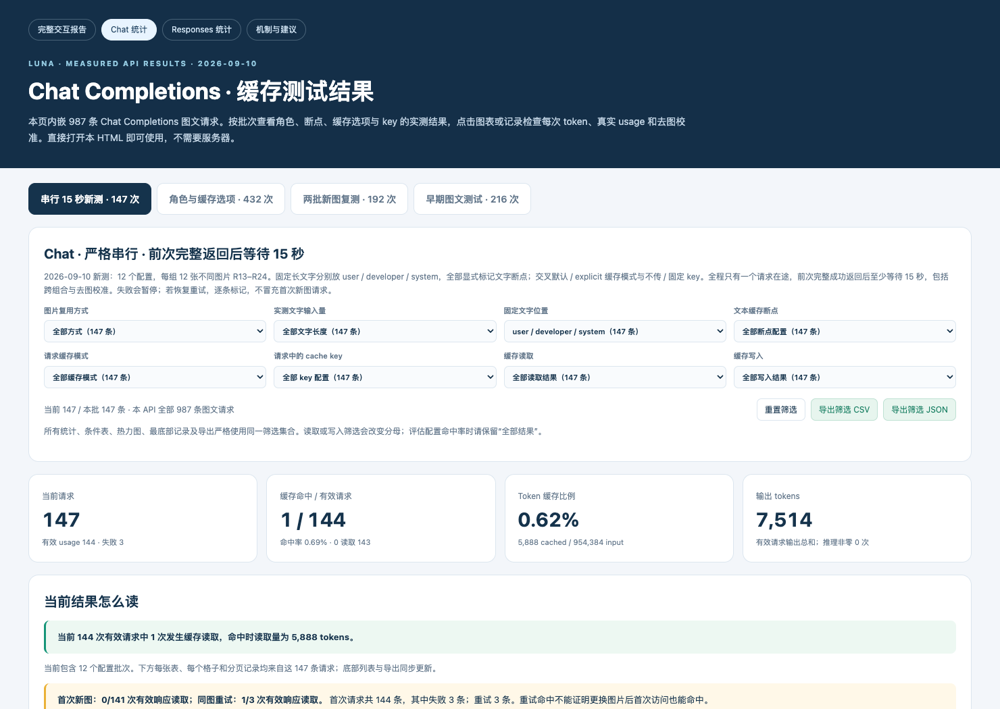
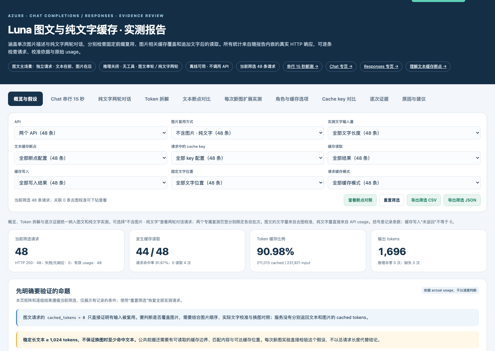

# Prompt Cache 系列 03：Luna 图文缓存实测

> **系列导航**：[01 两代框架](Prompt-Cache系列01：两代缓存框架对比.md) → [02 GPT-5.6 新机制详解](Prompt-Cache系列02：显式断点与Cache-Write计费.md) → **03 Luna 图文实测与异常分析（本篇）**
>
> 历史实验发生于 2026-09-09～10，官方文档复查与诊断补测发生于 2026-09-13，对象为一个 Azure OpenAI 资源上的 gpt-5.6-luna 部署（Chat Completions 与 Responses 两个 API）。所有"命中"均指有效响应的 usage 返回 `cached_tokens > 0`——这是 API 报告的缓存读取，不是对物理执行路径的直接观测。

## 2026-10-12 更新：Chat 换新图已观察到命中，但默认无断点仍为零

服务端对 Chat Completions 图片请求的缓存处理有过更新。本轮在原 Azure 资源上重新发送真实请求，验证的是服务实际返回行为；没有独立确认具体变更内容或根因。**历史上“加文字断点仍零读取”的现象，在本轮对应配置中已不再复现。**

### 测试条件与逐组结果

本轮只测 Chat Completions：8 组 × 12 次图文请求，共 **96 次图文请求＋8 次去图校准＝104 次 HTTP 调用**，全部成功，无失败、无重试。去图校准在每组图文请求结束后进行，避免提前预热主实验。请求模型为 `gpt-5.6-luna`，96 次图文响应均返回 `gpt-5.6-luna-2026-07-09`、`service_tier=default`。

固定文字在图片之前，无多轮历史、无工具，`reasoning_effort="none"`、`store=false`。并发为 1，上一条完整响应后等待至少 15 秒（单调时钟实测 15.000354～15.011303 秒）。使用 4096×3072 JPEG 合成图片；新图组每组依次使用 R13～R24，同图组重复 R13。每组 namespace 独立、组内固定。

下表“文字”是实际去图校准的 input，包含请求框架；“图片 Δ”是带图 input 减去校准 input，**不是 API 原生 image_tokens**。“命中读取量”只列正值，miss 时为 0。顶层 explicit 表示 `{"mode":"explicit","ttl":"30m"}`；文本断点 explicit 表示文字块上设置 `prompt_cache_breakpoint: {"mode":"explicit"}`。

| 图片方式 | 文字位置 | 文本断点 | 顶层 options | key | 文字 | 图片 Δ | 总 input | 命中/有效 | 命中读取量 | 未命中轮次 |
|---|---|---|---|---|---:|---:|---:|---:|---:|---|
| 每次新图 | user | explicit | explicit | 不设置 | 5,685 | 922 | 6,607 | 11/12 | 4,864 | 1 |
| 每次新图 | user | 不设置 | 不设置 | 不设置 | 5,681 | 922 | 6,603 | 0/12 | — | 全部 |
| 每次新图 | user | explicit | 不设置 | 不设置 | 5,685 | 922 | 6,607 | 10/12 | 4,864 | 1、6 |
| 每次新图 | user | explicit | explicit | 固定 | 5,680 | 922 | 6,602 | 10/12 | 4,864 | 1、5 |
| 每次新图 | developer | explicit | explicit | 不设置 | 5,713 | 922 | 6,635 | 11/12 | 4,864 | 1 |
| 每次新图 | system | explicit | explicit | 不设置 | 5,719 | 922 | 6,641 | 9/12 | 4,864 | 1、2、7 |
| 同一张图 | user | 不设置 | 不设置 | 不设置 | 5,684 | 922 | 6,606 | 11/12 | 5,888 | 1 |
| 同一张图 | user | 不设置 | 不设置 | 不设置 | 839 | 922 | 1,761 | 0/12 | — | 全部 |

合计 **62/96** 图文请求有读取；其中新图为 **51/72**，带显式文本断点的新图为 **51/60（85%）**。这三个分母涵盖不同场景，不可互换。本轮 96 次图文响应均**未返回 `cache_write_tokens`**，因此不能把写入填成 0，也不能据此声称没有写入费。

### 必须显式设置文本断点吗？“隐式”要先分清两个层级

**对本轮 user 消息中的“固定长文字＋每次新图”，建议设置显式文本断点：不设置为 0/12，只设置文本断点、不传顶层 options 和 key，就已达到 10/12。** 这里命中的是稳定前缀，不是首次出现的新图片。

两个参数的作用位置不同：

- `prompt_cache_breakpoint: {"mode":"explicit"}` 放在固定文字的 content block 上，标记文字结束的位置。
- `prompt_cache_options: {"mode":"explicit","ttl":"30m"}` 放在请求顶层，选择缓存模式及 TTL。**本轮成功命中不要求一定传它。**

报表中的“文字断点＋默认 options”仍然带着显式文本断点，只是顶层 options 未传，不能作为“完全没有显式断点也能命中”的证据。固定 key 也不是本轮命中的必要条件，12 次样本不足以认定 11/12 的配置优于 10/12。

如果“隐式”指完全不传文本断点和顶层 options，本轮 user＋每次新图仍为 **0/12**；如果指明确发送 `prompt_cache_options: {"mode":"implicit"}`，**本轮没有单独补测该组合**。本轮 developer/system 新图组也都带断点，没有补测它们去掉断点后的默认行为。因此不能把“本轮已验证的有效方案需要断点”写成“所有 Chat 请求都必须显式断点”。长文字＋同图在完全默认配置下已有 **11/12** 命中。

已验证的最简 Chat 请求结构如下（文字和图片为展示占位）：

```json
{
  "model": "gpt-5.6-luna",
  "reasoning_effort": "none",
  "store": false,
  "messages": [
    {
      "role": "user",
      "content": [
        {
          "type": "text",
          "text": "固定且足够长的任务说明，放在图片之前……",
          "prompt_cache_breakpoint": {"mode": "explicit"}
        },
        {
          "type": "image_url",
          "image_url": {"url": "data:image/jpeg;base64,..."}
        }
      ]
    }
  ]
}
```

### 命中覆盖了多少文字，是否包含图片？

- **每次新图的正读取均为 4,864**，低于去图校准的 5,680～5,719。因此只能确认部分稳定前缀复用，不能说整段文字全部命中，也不能把它记作新图片命中。为什么未读取到整个文字边界，本轮尚未定位。
- **长文字＋同图读取 5,888，高于去图校准 5,684**，支持复用覆盖图片相关输入；但 API 没有返回按模态拆分的 cached_tokens，不能把差值直接当成精确的图片缓存 token 数。
- **短文字 839＋图片 Δ922＝总 input 1,761，同图仍为 0/12**。超过 1,024 的总输入不保证命中；本轮没有证明该组失败的具体原因。

### 如何更新 9 月的结论

9 月串行测试中的“文字断点＋每次新图”Chat 组持续零读取；10 月对应带断点配置已出现连续读取。这支持产品更新后行为改善，**不能继续把“Chat 新图零读取”写成当前整体状态**。同时，默认 user 无断点仍为零；没有证据证明所有配置都已命中或所有部署都具有相同行为。

两轮不是同一时刻的单变量实验：namespace 和时间不同，五个带断点的新图配置复用了 9 月串行测试的 R13～R24 图片系列；默认无断点组及同图对照的历史素材并非全部相同。对比时按配置保留历史有效首次请求分母，历史固定 key 的 user 组是 0/11，不能补成 0/12。9 月的 1,899 条实验请求与本轮 96 条图文请求单独统计，不重写旧报告的总数。

本轮也没有补测 Responses 或诊断字段，不更新其 9 月实测状态。客户建议调整为：**先在固定长文字末尾放显式断点，用当前 Chat 接口验证；不用为了获得本轮已观察到的读取而必须切到 Responses、移动到 developer/system 或增加固定 key。** 后续重点检查未覆盖的 implicit 参数组合、无断点 developer/system、读取量为何小于文字校准量，以及实际写入计费。

## 历史背景（9 月）：一个客户投诉引出的完整测量

起因是一个真实的客户问题：怀疑 gpt-5.6-luna 在多模态（图片）场景下，用 Chat API 时 prompt cache 一直无法命中。客户的调用模式是**固定的长文字 prompt 在前＋每次一张不同的图片在后**，单次独立请求、无多轮历史。按[系列02](Prompt-Cache系列02：显式断点与Cache-Write计费.md)讲的机制，只要文字前缀超过 1,024 token 门槛且有合法断点可查，换图后文字部分应该可以复用。实测结果比预期复杂得多——最终演变成 2,000 多次调用的系统性 benchmark，和一个当时未定性的异常。2026-10-12 的读取行为变化见上文；以下保留 9 月实验背景与历史结果。



## 方法学：这些数字为什么可信

几条贯穿全部实验的纪律，也是读任何缓存 benchmark 时该检查的点：

- **只认 usage，不认延迟**。已命中的请求也可能耗时偏长，响应快慢不能作为命中依据；
- **失败不算 miss**。HTTP 超时/500/503 拿不到 usage 的请求单独分类，不进命中率分母；
- **图片 token 用"去图校准"测**。API 不单独返回 `image_tokens`，图片相关增量 Δ = 带图请求 input − 仅移除图片的校准请求 input（其余条件不变）。实测 Δ ≈ 922～923，**不是 128 的倍数**（Luna 按 32×32 像素 patch 计量图片）；
- **字段缺失记"未返回"，不补 0**；
- **不同配置用独立 namespace 前缀**，避免跨组污染；跨组差异不单独归因于某一个变量（部署/网络也可能变化）。

9 月主报告总计 2,059 行 = **1,899 条实验请求（1,851 图文＋48 纯文字）＋160 条校准**。

## 9 月结果分层：哪些场景能命中，哪个场景持续失败

### 总表

| 实验批次 | 请求尝试 | 有效响应 | 有缓存读取 | 解读 |
|---|---:|---:|---:|---|
| 历史固定长文＋**同图**，Chat 默认组 | 12 | 12 | 10 | 第 1、2 次无读取（写入/预热），正读取 5,888 |
| 历史固定长文＋**同图**，Responses 默认组 | 12 | 12 | 10 | 第 1、5 次无读取，正读取 6,604 |
| 9/9 v3 **每次新图**，Chat | 432 | 421 | **0** | 11 次无有效结果单列，不算 miss |
| 9/9 v3 **每次新图**，Responses | 432 | 420 | **276** | 按角色/断点/mode 继续拆分见下 |
| 9/10 Chat 串行 15 秒，首次新图 | 144 | 141 | **0** | 3 次 HTTP 500/503 单独保留 |
| 同批 Chat 失败后的**同图重试** | 3 | 3 | 1 | 读取 5,888；不归入"首次新图" |
| 9/10 Chat **纯文字两轮** | 48 | 48 | **44** | 第一轮 20/24；第二轮 24/24 |

截至 9 月该批次的模式是：**同图重复、纯文字多轮，两个 API 都能命中；固定长文字＋每次新图，Responses 能命中而 Chat 在本资源上 0 命中**。

### 先分层：哪部分不命中是机制预期，哪部分才是异常

**第一层（机制预期，不是 bug）**：客户的朴素结构是一条 user 消息内「文字块＋图片块」。按 GPT-5.6+ 隐式规则，唯一的隐式断点在这条消息**末尾（图片之后）**，文字块与图片块的交界处没有任何 lookup 边界——请求 ① 写入的是「文字＋图片A」整体，请求 ② 在图片处分叉，而唯一可回退查找的位置在分叉点之后，查不到。**这个结构下零命中是官方 Gotcha #1 的多模态版本**，机制给出的修复是：在文字块上打显式断点，或把固定文字挪进 developer/初始消息（让其末尾成为天然边界）。

**第二层（真正的异常）**：实验对两个 API 施加了**同样的修复结构**，Responses 的行为与机制预测严丝合缝——没边界不命中（0/69），给了边界就命中（62/68、11/12）；而 **Chat 在全部修复配置下依然全零**。"异常"的准确定义不是"Chat 图文不命中"，而是"**按官方机制做了修复之后，Chat 仍然不命中**"。下面的矩阵就是这个分层的完整数据。

### v3 矩阵：72 组变量拆解（Responses 侧）

完整设计：API 2 × 文字位置 3（user/developer/system）× 断点 marker 2 × cache options 3（omitted/implicit/explicit）× key 2（不传/固定），共 72 组每组 12 次。explicit 模式不标 marker 的组合是刻意保留的**负对照**（按机制它就不该命中）。

| 结构/配置 | 命中/有效响应 | 说明 |
|---|---:|---|
| user 全部组合 | 62/137 | |
| user，**不标**文字断点 | **0/69** | 跨 key/mode 条件 |
| user，**标**文字断点 | **62/68** | 断点是 user 位置命中的分水岭 |
| developer 全部组合 | 109/142 | |
| system 全部组合 | 105/141 | |
| user＋marker＋explicit，无 key | 11/12 | 正读取 5,678 |
| user＋marker＋explicit，固定 key | 11/12 | key 不改变结果 |
| developer 默认（无 marker、无 key） | 11/12 | 正读取 5,678 |
| system 默认（无 marker、无 key） | 10/12 | 正读取 5,677 |

两个不能写成结论的表述要避免：不能说"只有 Responses＋显式断点才能命中"（developer/system 默认结构也观察到读取——对应官方 implicit 模式"初始连续 developer 块末尾是 lookup 边界"的规则）；也不能说"放到 developer/system 就保证命中"（10～11/12 不是 12/12，命中始终是概率事件，见[系列01](Prompt-Cache系列01：两代缓存框架对比.md)的路由一节）。

**对 user 位置的固定文字，显式断点把命中率从 0/69 拉到 62/68**——这是官方 Gotcha #1（"共享前缀 ≠ 缓存前缀"）在真实数据上的完美复刻。

### Chat 串行 15 秒复测：排除并发和节奏因素

为排除"请求太密/并发路由"的解释：12 组（user/developer/system × omitted/explicit-30m × key 有无），**全部标文字断点**，每组 12 张新图，并发 1，每次完整返回后等待 ≥15 秒（单调时钟核验 15.000～15.011 秒）。无推理、无工具、无多轮。

结果：147 次图文尝试＝144 次首次新图尝试＋3 次同图重试。首次新图有 141 次有效响应，**141/141 读取为 0**；另 3 次 HTTP 失败不能计为 miss。更值得注意的是 explicit 子集的 72 次成功响应**读取 0、写入也是 0**，而同组的去图文字校准请求返回了正常的正写入（5,676～5,683）。这是一条重要线索——同样的文字前缀，纯文字请求能正常写入，带图请求连写入都没报告——但它只能作为排查方向，**不能仅凭它断言"断点被忽略"或"物理上完全没写"**。



### 纯文字两轮对照：证明 Chat 缓存本身没有坏

4 配置 × 6 组对话 × 2 轮 = 48 次调用全部成功。第二轮回放第一轮 user＋实际 assistant 输出，再追加新 user 文字：

| 配置 | 第一轮读取 | 第二轮读取 | 第二轮 cached | 第二轮写入 |
|---|---:|---:|---:|---:|
| 默认（无断点、无 key） | 5/6 | **6/6** | 4,797 | 63～71 |
| 只标文字断点 | 5/6 | **6/6** | 4,793 | 63～71 |
| 断点＋explicit | 5/6 | **6/6** | 4,798 | **0** |
| 断点＋explicit＋固定 key | 5/6 | **6/6** | 4,795 | **0** |

第一轮都是首组未命中（首次写入）、后续 5 组命中。三个机制级观察：**纯文字路径上 key 和断点都不是命中的必要条件**；默认配置第二轮的写入量 63～71 tokens 是**增量写入（delta）的直接证据**；explicit 模式第二轮写入 0 印证"最后一个显式断点之后的内容不产生写入"。但注意，该实验与图文实验的文本内容和消息结构不同，**不是只改"有无图片"的单变量对照**。



## 9 月异常定性与 10 月状态变化

以下定性反映 9 月排查时的状态；10 月带断点新图组已观察到读取，不再沿用“持续零读取”作为当前结论。

9 月推荐表述：**"在本次 Azure 资源/gpt-5.6-luna 部署中持续复现的 Chat 图文缓存异常；疑似实现或部署差异，尚未获得厂商根因确认。"** 如果写"已知问题"，必须限定为"本次实验已知"——截至 9 月排查时，没有 OpenAI/Azure 确认此缺陷的工单结论、issue 编号或修复公告。

**支持异常判断的事实**：长稳定文字＋新图＋合法文字断点的多组 Chat 请求报告零读取；降到并发 1、间隔 15 秒仍复现；同图和纯文字场景 Chat 能正常读取；Responses 在相同素材的部分新图配置下能读取。

**不能据此得出的结论**：Chat 一概不支持 marker/key/developer/system；所有 Chat 缓存不可用；所有 Azure 部署都有此问题。

**待查方向（不是已证实根因）**：具体部署/服务实现差异、图文请求的可查找边界处理、配置与计量路径、缓存可用性和路由。这属于当时的候选解释，不是已证实根因；10 月带断点 Chat 图文请求已实测有读取，不能再用这一猜测断言 Chat 不支持断点。

**一个 n=2 的旁证（纯推测，撑不起结论）**：Chat 图文场景观察到的命中值 5,888、6,144 恰好都是 128 的整数倍（46×128、48×128），而 Responses 的 6,604 和 Chat 纯文字的 4,793～4,798 都不是——方向上与"该部署上带图的 Chat 请求走了旧代际风格的缓存/计量路径"的猜想一致，仅记录待验证。

### 一个有趣的旁证：routing.serving_pipereplica

本次 Chat 响应 JSON 里额外返回了 `routing.serving_pipereplica` 字段（**110/110 返回**；Responses 为 **0/122 返回**——两个 API 的明确差异，但仅限本资源本批次，不是接口承诺）。同图组曾观察到：replica 标识从 r5 变为 r6 的首次请求 miss，随后同标识下恢复命中——与"新副本需要预热"的解释一致，与[系列01](Prompt-Cache系列01：两代缓存框架对比.md)"缓存在单台机器上"的模型吻合。但该字段属于未承诺的元数据：值变化不能直接确定物理拓扑，缺失也不能证明没有路由或没有缓存。排查时**命中判断永远用 usage 的 cached_tokens，replica 字段只作补充线索**，同时保留 `x-request-id`/`apim-request-id` 供服务方追踪。

## 2026-09-13 补测：诊断工具在本资源上字段缺失

按[系列02](Prompt-Cache系列02：显式断点与Cache-Write计费.md)的设想，`prompt_cache_diagnostics` 本该是给这个异常定性的官方工具。9/13 在同一 Azure 资源的 `/openai/v1/responses` 上实测（10 次成功调用，全部 HTTP 200、usage 正常，store=false、非流式、并发 1、间隔 ≥15 秒）：

| 配置/请求 | input | cached | write | 诊断字段 |
|---|---:|---:|---:|---|
| text_baseline | 4,813 | 0 | 4,795 | 未返回（基准未请求诊断） |
| text_identical_comparison | 4,813 | 4,795 | 0 | **未返回（携带比较 ID）** |
| text_prefix_changed_comparison | 4,815 | 0 | 4,797 | **未返回（携带比较 ID）** |
| image_A_baseline | 6,616 | 0 | 5,676 | 未返回（基准未请求诊断） |
| image_B_same_text_comparison | 6,616 | 5,676 | 0 | **未返回（携带比较 ID）** |
| image_C_same_text_comparison | 6,616 | 5,676 | 0 | **未返回（携带比较 ID）** |
| minimal_identical_comparison | 4,807 | 4,804 | 0 | **未返回（携带比较 ID）** |
| minimal_prefix_changed_comparison | 4,811 | 0 | 4,808 | **未返回（携带比较 ID）** |

6 次明确携带 `comparison_response_id`（均来自本批次真实完成的 baseline）的请求，**6/6 没有返回 `prompt_cache_diagnostics` 字段**——不是返回了 `unavailable`，是字段整体缺失。响应回显的 `prompt_cache_options` 保留了 mode/ttl 但不含 comparison_response_id。结论边界：该资源当前未验证诊断功能可用，无法定位是前端、网关、后端还是序列化层的问题，需服务方确认此资源/部署是否已开放该能力；未测 store=true、streaming、其他模型或资源。**9 月这次诊断尝试没有给原 Chat 图文异常提供根因，也没有验证修复。10 月读取复测另见前文；诊断功能本轮未复测。**

顺带一提，这批测试的 usage 本身又一次干净地展示了写入→读取的因果链（image_A 写 5,676 → B/C 各读 5,676，命中的是文字前缀而非新图片）。

## 给同类场景客户的排查与改进清单

1. **确认共同前缀过门槛**：固定文字部分（不是总输入）≥1,024 可见 token。总输入超 1,024 不等于固定前缀超门槛；门槛以下的短文字＋图片组合（实测 985 total）两个 API 都不命中，属于预期行为；
2. **在固定前缀末尾放显式断点**：当前 Chat 的 user＋每次新图实测为无断点 0/12、仅加文本断点 10/12；顶层 explicit 和固定 key 并非本轮命中的必要条件。选择 explicit-only 可参考系列02的文档规则，但本轮 Chat 图文没有返回写入字段，实际节费需核对账单；
3. **保持前缀结构逐字节稳定**：文字、图片顺序、模型、service tier、tools、text.format、reasoning.effort、verbosity 都别动（见系列02 的设置清单）；
4. **动态内容放在可复用前缀＋断点之后**；
5. **监控读、写、缺失三分**：分别统计 `cached_tokens`、`cache_write_tokens`、字段未返回；缺失不补 0，失败不算 miss；
6. **若按当前建议仍持续零读取**：提交最小复现脚本、参数、请求/响应 ID 和时间、完整 usage、文字/图片 hash、首次新图与重试分类、串行间隔及成功对照组。可对比 Responses，但不能用 9 月 Chat 异常直接决定当前必须迁移 API。诊断字段在本资源上的可用性需要另行复测或由服务方确认。

## 未决问题清单

- 9 月 Chat 图文零读取的具体根因与内部修复细节——尚无独立确认；10 月带断点新图组已出现读取；
- 10 月读取 4,864 为何低于文字校准量、明确传 implicit 以及 developer/system 无断点的当前表现——待补测；
- 本资源 `prompt_cache_diagnostics` 字段缺失是能力未开放还是链路问题——待厂商确认；
- Chat API 的 cache write 计费口径（字段缺失时费用如何计）——待账单核验与官方澄清（见系列02）；
- lookup 边界 latest 50 vs 80 的文档表述差异——待官方澄清；
- GPT-5.6+ key 语义（计量隔离、"usage 报 miss 而非物理 miss"）未做专门实验与账单验证。

## 关联阅读

- [Prompt Cache 系列 01：两代缓存框架对比](Prompt-Cache系列01：两代缓存框架对比.md) — 机制背景：缓存位置、路由与命中的概率本质
- [Prompt Cache 系列 02：显式断点与 Cache Write 计费](Prompt-Cache系列02：显式断点与Cache-Write计费.md) — 断点、计费与诊断工具的完整规则
- [prefix-caching](../../wiki/concepts/prefix-caching.md) — 概念页
