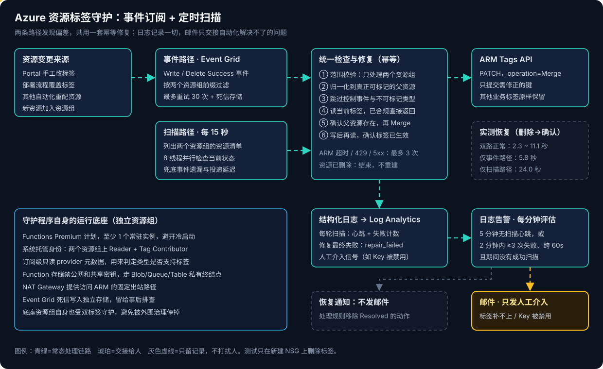
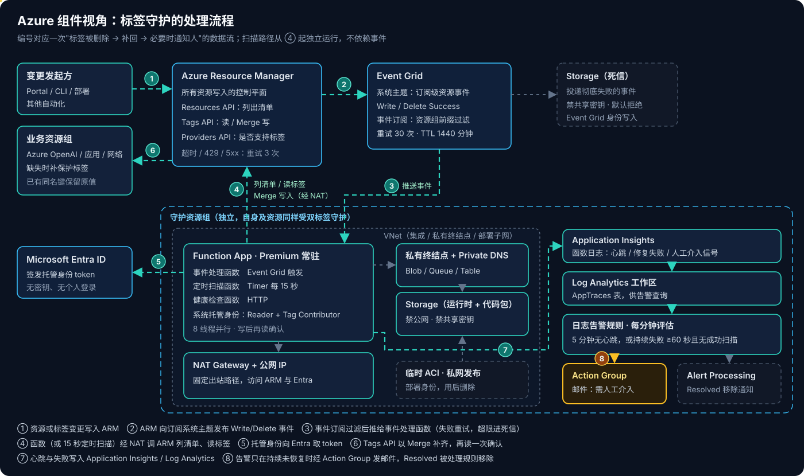
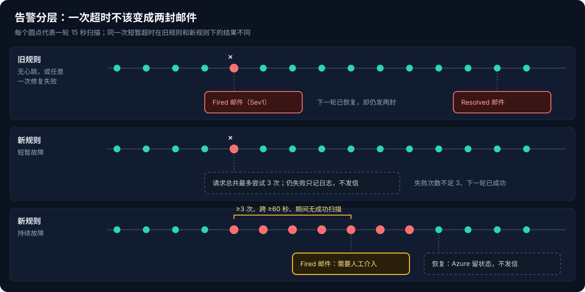

# Azure 资源标签守护：事件订阅与定时扫描的自动修复

## 结论先行

- **标签是持续状态，不是一次性写入**。Portal 手改、部署覆盖、其他自动化、新资源加入都会让它漂移，守护程序要做的是"读真实状态 → 比对规则 → 修偏差"的闭环。
- **两条路径缺一不可**：Event Grid 事件让恢复快（实测仅事件路径 5.8 秒），15 秒定时扫描兜底事件遗漏和投递延迟（实测仅扫描路径 24.0 秒）。两条路径调用**同一套**检查逻辑。
- **修复必须幂等**：用 `Merge` 提交需要修正的键、已合规直接返回、写后再读确认、资源已删除就结束而不是重建。
- **事件里的资源 ID 不一定就是要打标签的对象**——标签扩展、子网、配置子资源、部署记录、Blob 容器都要各自归一化或跳过，这是上线后日志里冒出来最多的问题。
- **告警要分层**：日志记录一切；短暂失败先在请求内重试，持续未恢复（或明确需要人处理，如 Key 认证被禁用）才发邮件，恢复通知不发邮件。



按 Azure 组件展开，一次"标签被删除 → 补回 → 必要时通知人"的数据流如下（编号即处理顺序；定时扫描从 ④ 开始独立运行，不依赖事件）：



## 一、需求与边界

场景：外围治理流程会依据某个保护标签决定是否停用资源，资源组里缺了这个标签的资源有被停掉的风险。目标是：

- 业务资源组下所有支持标签的资源，**缺少保护标签时补上**；已有同名键（哪怕值不同）保留，不覆盖其他标签。
- 删除后在**一分钟内**补回，7×24 运行，不依赖任何人的电脑或终端在线。
- 守护程序自己的资源组也要带上两个保护标签，并且**键和值都必须正确**——否则守护程序自己先被治理流程停掉。

两类范围用两套规则：

| 范围 | 规则 |
|---|---|
| 业务资源组下支持标签的资源 | 缺失时补入保护标签；已有同名键保留原值；标签名比较不区分大小写 |
| 守护程序资源组自身及其资源 | 两个保护标签必须存在且值固定，缺失或值不符都修正 |

这里有一个容易混淆的点：保护标签的"豁免"含义是**这个环境的治理约定**，不是 Azure 自带的免停机开关。守护程序缩短的是"标签缺失"的风险窗口；如果外围策略在窗口内已经执行了动作（比如禁用了某个账户的 Key 认证），守护程序只能检测并交接，不能撤销。

## 二、为什么不只用 Azure Policy

最先考虑的当然是 Azure Policy。几种机制的能力边界：

| 需求 | 合适的机制 | 能否满足分钟级补回 |
|---|---|---|
| 新建或更新资源时缺标签就补 | Policy `Modify`（如内置的 Add a tag to resources） | 只在资源**写入请求**时生效 |
| 存量资源缺标签要补齐 | Policy + Remediation 修复任务 | 合规评估常规约 24 小时一轮，修复任务需要触发 |
| 删除标签的操作直接失败 | Policy `Deny` | 是另一种思路（预防而非修复），需逐个写入路径验证 |
| 标签被删除后尽快补回 | Event Grid + Function，加定时兜底 | 是 |

关键限制在于：`Modify` 拦截的是创建或更新资源的请求，**单独删除标签**这类操作，合规扫描发现了也不等于马上自动修改。需求是"一分钟内补回"，所以最终落在 Event Grid + Function + 定时扫描。Policy 仍可以作为统一规则和合规视图叠加，这次部署没有启用 `Modify`，避免两套机制同时写标签时难以归因。

## 三、两条路径：事件负责快，扫描负责全

**事件路径**：订阅级 Event Grid 订阅 `ResourceWriteSuccess` 和 `ResourceDeleteSuccess`，按两个资源组的前缀过滤后投递给 Function。函数内部**再次校验完整范围**——前缀过滤可能放进名字相似的资源组，不能只信过滤器。投递失败最多重试 30 次、事件生存期 1440 分钟，最终仍失败的事件写入死信存储。

**扫描路径**：timer 每 15 秒列出两个资源组的资源清单，加上守护资源组自身，8 线程并行检查，优先处理 Cognitive Services 账户（最需要保护的资源先查）。验收期间观察到扫描耗时多在约 1.5~3 秒，具体耗时随 ARM 响应和资源数量变化。

两条路径的分工要说清楚：

- 扫描看到的是**某一时刻的当前状态**，两次扫描之间"删了又被别人加回来"的变化它观察不到，它也不是审计日志。
- 事件让检查**及时发生**，但不是每种资源类型、每种操作都一定产生你期望的事件，覆盖面需要实测。
- 可靠性来自两路**都去检查当前状态**，而不是任何一条路径单独保证。

## 四、统一修复：幂等、按范围修正、写后确认

两条路径最后都进入同一个检查函数，步骤如下：

1. **范围校验**：资源 ID 必须落在两个资源组之内，否则直接返回。
2. **归一化**：把事件里的资源 ID 映射到真正需要标记的父资源（见下一节）。
3. **标签支持判定**：查 provider 元数据里该资源类型的 `capabilities` 是否包含 `SupportsTags`；控制类事件和已知不支持标签的子资源直接跳过。
4. **读当前标签**：通过 `.../providers/Microsoft.Resources/tags/default` 读取；已满足规则就直接返回，重复事件不会产生额外写入。
5. **确认父资源仍存在**：读与写之间资源可能被删除，父资源 404 就结束——**守护程序补标签，不重建资源**。
6. **`PATCH` + `operation=Merge`**：只提交需要修正的键：业务资源仅补缺失，守护资源组及其资源会把缺失或错误的保护标签修正为期望值；`environment`、`project`、`managedBy` 等无关业务标签原样保留。
7. **写后再读**：确认目标键值确实生效，否则抛错进入失败统计。

修复请求本身对 ARM 的超时、连接失败和 429/5xx 最多尝试 3 次，间隔递增；只有最终仍失败才记一条修复失败日志。这一点后来在告警设计里很关键（见第七节）。

## 五、事件资源 ID 不等于可标记对象

这是上线后日志里出现最多的问题。Event Grid 给的 `resourceUri` 是"发生写入的那个路径"，不一定是"该打标签的那个资源"：

| 事件里的资源 | 实际含义 | 处理 |
|---|---|---|
| `.../providers/Microsoft.Resources/tags/default` | 标签扩展资源本身的写入 | 去掉后缀，归一化到父资源 |
| `Microsoft.Resources/deployments` | 部署记录 | 视为控制事件忽略（按普通资源处理会得到 405 并产生误报） |
| `Microsoft.Web/sites/config` | Function 站点配置变更 | 视为控制事件忽略 |
| `.../blobServices/default/containers/...` | Blob 容器 | 会产生 ARM 写事件，但不支持 ARM 资源标签，也不出现在 provider 声明的资源类型里，直接跳过 |
| `.../virtualNetworks/<vnet>/subnets/...` | 子网及其服务关联 | 归一化到所属 VNet，检查 VNet 的标签 |
| `.../accounts/<name>/defenderForAISettings/Default` | Azure OpenAI 账户的 Defender 配置子资源 | provider 的资源类型发现结果里没有它；实测它的 Tags 接口返回的就是所属账户的标签，于是归一化到账户，**不去修改 Defender 配置** |

经验是：先让守护程序对"未知资源类型"报错而不是静默跳过，上线后看日志里冒出来哪些类型，再逐个确认它的标签语义并补进归一化规则。静默跳过会把漏网的资源藏起来。

## 六、守护程序自身也要能持续运行

一分钟恢复目标对守护程序自身提出了要求，也带来了部署时最多的问题。

**运行底座**：

- Linux Python 3.11、Functions v4、**Premium 计划至少一个常驻实例**——消费计划的冷启动会直接吃掉恢复时间预算。
- **系统托管身份**：在两个资源组上授予 Reader + Tag Contributor；另加一个订阅级自定义角色，只能读取 provider 元数据（用于第四节第 3 步的标签支持判定），不能读取订阅里的业务资源。
- **存储全私有**：Function 存储禁用公网和共享密钥，通过 Blob/Queue/Table 私有终结点和 Private DNS 访问；运行时存储与代码包都用托管身份认证。
- **出站**：独立 VNet + NAT Gateway 提供访问 ARM 的出站路径，不复用业务网络。
- **死信**：Event Grid 死信写入另一个独立存储（禁共享密钥、默认拒绝、允许受信任 Azure 服务），Event Grid 用自己的托管身份写入。

注意"禁用 Key"不等于故障：守护程序自己的存储按设计禁用共享密钥、走身份认证，这是正常配置；而业务侧的 Azure OpenAI 账户如果依赖 Key 调用，`disableLocalAuth=true` 才是需要人处理的问题。两者在监控里要区分开。

**部署过程中踩到的问题**：

| 现象 | 根因 | 处理 |
|---|---|---|
| Event Grid 创建订阅时终结点验证返回 404，但 Portal 里触发器已列出 | 初版 `host.json` 缺 Event Grid / Timer 所需的扩展包，触发器注册了但处理端点没就绪 | 补扩展包配置；创建订阅前先做一次真实的终结点验证握手，返回正确的验证响应才继续 |
| Premium 计划的文件共享配置被拒绝 | 新存储账户策略不允许共享密钥认证，而 Premium 默认的内容文件共享依赖连接字符串 | 改为托管身份访问存储，代码包放私有 Blob 容器，Function 从包运行 |
| Portal 显示 "We were not able to load some functions…"，运行端点 503 `ServiceUnavailable`，刷新无效 | 存储已关闭公网，但 Function 还没接入能访问存储的私有网络，代码包也没上传成功 | 补齐 VNet 集成、私有终结点、Private DNS 和 NAT 出站，之后端点 200、三个函数 Enabled |
| 后续发布代码时，存储防火墙"只临时放行本机 IP"不稳定 | 本机出口 IP 不唯一，不同公网查询服务返回的出口 IP 不同 | 改为在守护 VNet 的部署子网里临时起一个 Azure CLI 容器，用专用部署身份读取原包、替换源码、经私有 Blob 写回并重启 Function，成功后删除容器。整个发布不经过存储公网 |

最后一条值得单独说：**一旦把存储彻底私有化，"从本机发布"这条路就会反复出问题**，不如一开始就把发布通道也放进私网。

## 七、告警分层：只把自动化解决不了的问题交给人

### 邮件链路：配置完成不等于能投递

告警组里的邮箱在旧版 API 读取显示为 `Enabled`，但测试发送一直被拒绝为"没有有效收件人"。用新版 API 读取才看到 `verificationStatus` 是 `VerificationPending`——Azure Monitor 要求邮箱所有者通过验证邮件确认后才能接收告警。中途验证链接还过期过一次，需要重新保存告警组触发新的验证邮件。验证完成后测试邮件才实际送达。

另一个小坑：Action Group 的测试邮件内容里出现 `test-RG`、`test-logAlertRule-v2` 和一个示例订阅 ID，这是 Azure 的固定测试模板，**不代表创建了这些资源**，也不代表真实规则触发了。

### 一次短暂超时暴露了告警策略的问题

最初的告警规则是"最近 5 分钟没有扫描心跳，或出现任意一次修复失败"。上线后某一轮扫描读取一个测试 NSG 的标签时，ARM 请求超过了 6 秒读取超时，记了一条修复失败；**9 秒后的下一轮扫描就恢复到零失败**。但规则仍然发出了一封 Sev1 的 Fired 邮件，十几分钟后又发了一封 Resolved 邮件。

这两封邮件都没有任何需要人做的事情，却会让人紧张、花时间排查。真正需要人介入的只有两类：**标签持续补不上**，以及**资源被禁止使用 Key 认证**这类自动化不该也不能自己改回去的状态。



### 新规则

分三层处理：

1. **请求内重试**：ARM 超时、连接失败和 429/5xx 总共最多尝试 3 次（最多重试 2 次），递增等待，大部分短暂抖动在这一层就消化了。
2. **只记日志**：重试后仍失败，记一条修复失败日志，下一轮扫描会自动再试，不发邮件。
3. **交接给人**：满足以下任一条件才触发邮件——
   - 最近 5 分钟没有扫描心跳（守护程序自身停了）；
   - 最近 2 分钟内至少 3 条问题记录、首尾跨度至少 60 秒、期间没有成功扫描，且最新问题晚于最近一次成功扫描。

告警规则每分钟评估一次。一个实际遇到的限制：一版更复杂的查询被 Azure 以"一分钟频率不支持"拒绝，需要把查询改写成该频率允许的形式。示例查询（日志标记名为示意）：

```kusto
AppTraces
| where TimeGenerated > ago(5m)
| extend IsHeartbeat = Message startswith 'guardian_heartbeat',
         IsFailure = (Message startswith 'repair_failed'
            or Message startswith 'manual_intervention_required') and TimeGenerated > ago(2m)
| extend IsHealthy = IsHeartbeat and Message matches regex @'failures=0(?:\s|$)'
    and (not(Message contains 'auth_disabled=')
         or Message matches regex @'auth_disabled=0(?:\s|$)')
| summarize Heartbeats=countif(IsHeartbeat),
            RecentHealthy=countif(IsHealthy and TimeGenerated > ago(2m)),
            Failures=countif(IsFailure),
            LastHealthy=maxif(TimeGenerated, IsHealthy),
            FirstFailure=minif(TimeGenerated, IsFailure),
            LastFailure=maxif(TimeGenerated, IsFailure)
| where Heartbeats == 0
    or (Failures >= 3
        and RecentHealthy == 0
        and LastFailure - FirstFailure >= 60s
        and (isnull(LastHealthy) or LastFailure > LastHealthy))
```

**恢复通知**：告警保持状态型（持续同一故障期间不会逐分钟重复发信），再加一条 Alert Processing Rule，条件是"该告警规则 + `MonitorCondition = Resolved`"，动作是 `RemoveAllActionGroups`。恢复状态仍留在 Azure 里可查，只是不发邮件。

**Key 认证监控**：扫描时顺带检查业务资源组里 `kind=OpenAI` 账户的 `disableLocalAuth`。为 `true` 时记一条人工介入日志，**不自动重新开启**——被策略禁用的认证不应由守护程序绕回去。本案例中一个已禁用 Key 且无法恢复的账户已配置为已知例外，不再为这一状态告警，但它的标签仍照常维护；其他 Azure OpenAI 账户继续检查。

告警查询用 8 种 Kusto 情景直接在 Log Analytics 中验证过：短暂错误、旧错误恢复后不重开、恢复后均返回零行；持续错误、五分钟无心跳和 Key 禁用持续存在均返回一行。

## 八、验收：分别验证两条路径

只看"标签补回来了"不够，必须知道是哪条路径补回来的。所有删除测试都只在**新建、未关联网络的 NSG** 上进行，没有在任何 Azure OpenAI 账户上删除标签。

| 场景 | 从删除返回到 ARM 确认恢复 |
|---|---:|
| 双路正常，三次测试 | 6.174 / 2.339 / 6.458 秒 |
| 仅事件路径（临时暂停 timer） | 5.797 秒 |
| 仅扫描路径（事件订阅排除这个测试 NSG） | 24.045 秒 |
| 守护资源组双标签同时删除 | 3.685 秒 |
| 控制事件修正后再次验证 | 11.125 秒 |
| Blob 容器事件修正后再次验证 | 4.039 秒 |
| 告警策略与归一化最终版本 | 6.268 秒 |

计时包含观察轮询的开销；每次都确认无关标签保留。隔离测试结束后在 `finally` 中恢复 timer 和事件过滤。健康接口返回 HTTP 200 只能说明 Web 进程活着，**扫描是否真的在跑要看心跳日志**。

截至 2026-10-26 09:30（北京时间）的只读运行快照：健康接口 HTTP 200，三个函数存在，timer 启用；最近五分钟有 16 条扫描心跳，失败与人工介入日志均为零。清单中的业务组 22 个资源和托管组 32 个资源均有相应保护标签，托管资源组自身也有双标签。这是该时刻的状态核查，不代表连续 24 小时无故障。

## 九、边界与成本

- **一分钟是实测支持的恢复目标，不是硬 SLA**：平台故障、限流、权限被撤销、资源数量大幅增长都可能超时。日志入库和告警评估本身有延迟，告警到达时间也不等于标签恢复时间。
- **7×24 配置不等于已完成 24 小时连续观测**；Portal 全量清空标签、所有资源类型的破坏性测试、云平台故障注入都没有做。
- **为了"只在需要人介入时发信"，没有人为制造故障来验证新规则的邮件**；通知过滤的依据是配置回读、官方机制和查询情景匹配。
- **扩展范围要同步改三处**：Function 配置、托管身份权限、Event Grid 过滤，然后重新验收；死信容器要定期检查。
- **成本**：Premium 常驻实例、NAT Gateway、私有终结点、日志和存储都会持续计费。这是用钱换恢复时间和安全边界的取舍；如果能接受小时级恢复，Policy + 定时 Remediation 会便宜得多。

核心一句话：**自动修复负责缩短偏差存在的时间，邮件负责把持续未解决的问题交给人**——两者要分别设计、分别验收。

## 参考

- [Azure Policy Modify 效果](https://learn.microsoft.com/en-us/azure/governance/policy/concepts/effect-modify)
- [修复不合规资源](https://learn.microsoft.com/en-us/azure/governance/policy/how-to/remediate-resources)
- [Azure Monitor 操作组与收件人验证](https://learn.microsoft.com/en-us/azure/azure-monitor/alerts/action-groups)
- [创建日志告警规则（频率限制与状态恢复）](https://learn.microsoft.com/en-us/azure/azure-monitor/alerts/alerts-create-log-alert-rule)
- [Defender for AI settings 资源定义](https://learn.microsoft.com/en-us/azure/templates/microsoft.cognitiveservices/accounts/defenderforaisettings)
