# Copilot Managed Runtime 系列 01：托管环境对比与选型

> [!IMPORTANT]
> Copilot Managed Runtime 撰写时（2026-10）仍是 **Preview**。本文涉及的许可、仓库限制、域名能力都以当时的公开文档为准，落地前必须在目标租户实测。

## 系列导航

| 篇 | 主题 | 回答什么 |
|---|---|---|
| **01** | 托管环境对比与选型 | 是什么、和谁比、怎么选 |
| [02](Copilot-Managed-Runtime系列02：实战部署与权限解析.md) | 实战部署与权限解析 | 一次完整部署：认证链路、权限、发布步骤与踩坑 |
| [03](Copilot-Managed-Runtime系列03：宿主沙箱与安全边界.md) | 宿主沙箱与安全边界 | iframe、CSP、JSON-RPC：应用能做什么、不能做什么 |
| [04](Copilot-Managed-Runtime系列04：SDK与数据接入.md) | SDK 与数据接入 | SDK 接口、加数据源、本地调试、构建期与运行期 |
| [05](Copilot-Managed-Runtime系列05：在应用里调用AI的几条路.md) | 在应用里调用 AI 的几条路 | Copilot Studio agent、M365 Copilot、Azure OpenAI 能不能接、怎么选 |
| [06](Copilot-Managed-Runtime系列06：参考应用拆解与功能模式.md) | 参考应用拆解与功能模式 | 一个已上线应用的九个可复用模式 |
| [07](Copilot-Managed-Runtime系列07：零Connector的分析页面.md) | 零 Connector 的分析页面 | 实践：构建期五个 JSON 撑起洞察、建议、统计、演进四页 |
| [08](Copilot-Managed-Runtime系列08：用App-state保存用户数据.md) | 用 App state 保存用户数据 | 实践：阅读进度与收藏；Dataverse 被 DLP 挡住后改用 App state |
| [09](Copilot-Managed-Runtime系列09：本地检索加Work-IQ的问答.md) | 本地检索加 Work IQ 的问答 | 实践：带结构化引用的问答，返回格式与实测耗时 |
| [10](Copilot-Managed-Runtime系列10：调用Copilot-Studio-Agent为何走不通.md) | 调用 Copilot Studio Agent 为何走不通 | 实践：三次尝试都失败；agentId 被忽略的误判与对照实验；仅剩的异步做法 |
| [11](Copilot-Managed-Runtime系列11：用Azure-OpenAI-Connector直调模型.md) | 用 Azure OpenAI Connector 直调模型 | 实践：默认问答后端；API Key 共享连接、allowedActions、部署下拉框与两种后端对比 |
| [12](Copilot-Managed-Runtime系列12：方案回顾与Connector接入清单.md) | 方案回顾与 Connector 接入清单 | 回顾：问答后端与存储怎么选、Connector 七关、哪些功能离不开平台 |

Copilot Studio 本身（Power Platform 地基、环境、Connector、harness、agent / workflow / app 协作）见姊妹系列 [Copilot Studio 系列 01：产品全景与环境](../Copilot-Studio/Copilot-Studio系列01：产品全景与环境.md)。

## 结论先行

- 在 Copilot Studio 里用 **Create apps** 生成的应用，以及 Copilot Cowork、Copilot Code、`ms` CLI/SDK 写出的应用，最终都运行在同一个托管环境——**Microsoft Copilot Managed Runtime**，用户入口是 `managedapps.cloud.microsoft`。
- 它**不是** Azure Managed Applications，也**不是** App Service / Container Apps 的包装层。它是 Microsoft 365 侧的"企业内部 SPA 托管 + 治理"平台。
- 平台替你承担的是：**Entra 登录、按人/组分享、Conditional Access、DLP/ACP、管理后台可见性**。你放弃的是：**自有域名、任意后端运行时、网络层控制**。
- 选型的分界线很清楚：**公开站点 → GitHub Pages / Static Web Apps；内容协作 → SharePoint；企业内部交互应用 → Managed Runtime；自有后端与容器 → App Service / Container Apps**。复杂场景常是"Managed Runtime 前端 + Azure 后端"的组合。
- 两个最容易踩的坑：**有 Microsoft 365 不等于能免费运行**（需 Power Apps Premium 或 Managed Application Copilot Credits）；**个人 GitHub 仓库不能直接绑定**（只支持 GitHub Enterprise Cloud 组织仓库或平台托管仓库）。

> 范围说明：本文讨论的是 Copilot Studio **应用（app）** 的运行环境。Copilot Studio 的 **agent** 跑在各自的 harness 上、发布到 Teams、Microsoft 365 Copilot 等渠道，见 [Copilot Studio 系列 03](../Copilot-Studio/Copilot-Studio系列03：四种Harness对比与选型.md)；Azure 侧 agent 的托管形态可参考 [Foundry Agent 三种形态对比与选型](../Foundary-Agent/Foundry-Agent三种形态对比与选型.md)。

---

## 一、先分清名字：五个"托管"不是一回事

"Managed Apps"这个名字最容易误导人——它和 Azure 里的 Managed Applications 只是名字像。

| 名称 | 归属 | 解决什么问题 | 一句话区分 |
|---|---|---|---|
| **Copilot Managed Runtime / Managed Apps** | Microsoft 365 | 托管企业内部业务 SPA，自带 Entra、分享、Connector 与治理 | 本文主角 |
| Azure Managed Applications | Azure | 发布者把一套 Azure 资源方案交付给客户并代为运维（Marketplace / Service Catalog） | 交付的是 Azure 资源，不是网页应用 |
| Azure App Service | Azure | 托管 Web 应用和 API 的 PaaS | 自带后端、自有域名 |
| Azure Container Apps | Azure | 托管容器化服务、Jobs、Dapr | 运行你自己的服务 |
| GitHub Pages | GitHub | 静态站点托管 | 公开、无后端 |
| SharePoint Online | Microsoft 365 | 文档、页面、列表、权限与协作 | 内容平台，也可以是数据源 |

---

## 二、它是什么：四个入口、一种产物、一个宿主



官方把一个运行中的应用拆成三个逻辑组件：

| 组件                                             | 由谁负责 | 做什么                                                                               |
| ---------------------------------------------- | ---- | --------------------------------------------------------------------------------- |
| 你的代码                                           | 应用作者 | TypeScript / JavaScript SPA——这是**前提条件**，不支持服务端渲染或任意后端                             |
| Managed Runtime SDK（`@microsoft/managed-apps`） | 平台提供 | 暴露宿主 API；添加 Connector 时生成 TypeScript models 与 services，应用代码不必手写 Connector HTTP 请求 |
| Managed Runtime host                           | 平台负责 | Entra 认证、加载应用、运行时治理（Conditional Access、DLP、ACP、分享限制）、加载失败时给出上下文提示                 |

不同角色的入口：

| 角色    | 在哪里工作                         | 做什么                                           |
| ----- | ----------------------------- | --------------------------------------------- |
| 最终用户  | `managedapps.cloud.microsoft` | 查找并打开自己有权限的应用                                 |
| Maker | **Copilot Studio**            | 打开 Preview 体验后在 Apps 中用自然语言或已有数据生成应用，预览、发布、分享 |
| 业务用户  | Copilot Cowork / Copilot Code | 在对话里描述需求，由 coding agent 生成应用                  |
| 专业开发者 | `ms` CLI + SDK                | 脚手架、编码、部署，可配合 AI 编码助手                         |
| 管理员   | Microsoft 365 admin center    | 应用清单、运行健康、使用分析                                |

关键点：**创作入口再多，产物都是同一种 SPA 静态包，跑在同一个宿主里**。所以 Copilot Studio 生成的应用和手写的 React 应用，在运行能力和限制上没有本质差别——差别只在"怎么写出来"。

---

## 三、一个实际应用拆开看：为什么它像静态网站

观察一个已上线的企业内部分析看板（筛选、钻取、图表、建议卡片、Ask Copilot 入口），浏览器里的加载结构是两层 iframe：

```text
managedapps.cloud.microsoft/apps/<app-id>        ← 宿主播放器（壳层、登录、HostChrome）
    └─ Managed Host Loader iframe
        └─ apps-<app-id>.<...>.powerplatformusercontent.com
            └─ App iframe
                ├─ /assets/index-*.js            ← 应用自身的打包产物
                └─ /assets/index-*.css
```

从发布包能看出的事实：

| 观察 | 说明 |
|---|---|
| 一个约 2 MB 的 ES module bundle + 一个 CSS bundle，`modulepreload` 引导 | 典型的 Vite 类工具打包的 React SPA |
| bundle 里有 React、Recharts、TanStack Query、React Router、Lucide | 应用自选的前端技术栈；宿主壳层用 Fluent 不代表应用本身用 Fluent |
| 部分业务数据文本直接出现在 bundle 里 | 至少一部分指标是**随发布产物携带的快照或预计算数据**，不是每次实时查库 |

这解释了它"看起来像静态网站"：**托管的确实是静态资源，但入口前面多了一层由平台控制的身份与治理壳层**。同类看板完全可以复现——难点不在托管，而在业务指标语义、数据准备和页面设计。

这层壳具体怎么隔离应用（两层 iframe、独立子域名、CSP、唯一出口 `http/send`）见 [系列 03](Copilot-Managed-Runtime系列03：宿主沙箱与安全边界.md)；这类看板逐页的实现模式见 [系列 06](Copilot-Managed-Runtime系列06：参考应用拆解与功能模式.md)。

---

## 四、发布链路：两个 URL 与两级权限



用 `ms` CLI 是 dev → push → build → deploy → share 五步；Copilot Studio 把同样的步骤收进界面（生成草稿 → 交互式预览 → 发布 → 分享）。具体命令、每一步用的是谁的身份与凭据，见 [系列 02](Copilot-Managed-Runtime系列02：实战部署与权限解析.md)。选型时需要知道的是下面三张表。

### 两个 URL 的区别

| | Preview URL | Live URL |
|---|---|---|
| 谁能看 | 仅对绑定仓库有写权限的开发者 | 被分享的用户、组，或组织范围链接 |
| 何时更新 | 每次 `ms app build` | 只在 `ms app deploy` 时，是**固定快照** |
| 用途 | 自测 | 对最终用户分享 |

### 两级分享权限

| 权限 | 授予什么 | 适合谁 |
|---|---|---|
| `play`（默认） | 运行应用 | 最终用户 |
| `edit` | 修改应用源码 | 协作开发者 |

两级互相独立，`ms app unshare --access edit` 只撤 edit、保留 play。另可创建"组织内所有人"范围、可撤销的分享链接。应用**默认私有**。

### 代码仓库限制

| 仓库类型 | 能否绑定 |
|---|---|
| 平台托管的 Git 仓库 | ✅ |
| GitHub Enterprise Cloud 组织仓库（`github.com` 或 `.ghe.com`） | ✅ |
| 个人账号拥有的 GitHub 仓库 | ❌ |
| 非 Enterprise Cloud 的 GitHub 组织 | ❌ |
| GitHub Enterprise Server | ❌ |
| Azure DevOps 等其他 Git 服务 | ❌ |

绑定不了时的替代：用平台托管仓库；把企业版镜像到客户的 GitHub Enterprise Cloud 组织；或用 GitHub Actions 部署外部 artifact（`--repo none`，需先确认管理员允许）。

---

## 五、七个维度横向对比

| 维度 | GitHub Pages | **Copilot Managed Runtime** | SharePoint Online | App Service | Container Apps |
|---|---|---|---|---|---|
| 核心定位 | 公开静态站点 | **企业内部业务应用** | 内容协作与门户 | Web / API PaaS | 容器化服务 |
| 默认 URL | `<user>.github.io/<repo>` | `managedapps.cloud.microsoft/apps/<id>` | `<tenant>.sharepoint.com/sites/...` | `<app>.azurewebsites.net` | `<app>.<region>.azurecontainerapps.io` |
| 自有域名 | ✅ 配 DNS 即可 | ❌ 公开文档未提供，**不要承诺** | ⚠️ 租户级域名治理，非单站点绑定 | ✅ DNS + 证书 | ✅ DNS + 证书 |
| 默认访问 | 公开 | **私有，Entra 登录 + 显式分享** | SharePoint 权限模型 | 应用自己实现 | 应用 + Ingress + 网络层 |
| 静态前端 | ✅ 强项 | ✅ SPA | ⚠️ 复杂前端需 SPFx | ✅ | ✅ |
| 后端代码 | ❌ | ⚠️ 只有 Connector，复杂 API 要外接 | ⚠️ 列表、流程、Graph，非通用运行时 | ✅ 多语言 | ✅ 任意容器 |
| 企业数据 | 自建 API | ✅ 1500+ Connector | ✅ 原生文档与列表 | 自建（Managed Identity / SDK） | 自建 |
| 治理与合规 | 很少 | ✅ CA / DLP / ACP / Admin center 开箱即用 | ✅ 租户级 | 需自己配 | 需自己配 |
| 网络与运维控制 | 很少 | 平台管，作者控制有限 | 租户管理为主 | 较多（VNet / Private Endpoint） | 最多（VNet / Ingress / 伸缩 / Dapr） |
| 额外许可 | 无 | **Power Apps Premium 或 Copilot Credits** | M365 订阅内 | Azure 按量 | Azure 按量 |

一句话：**越往左越省事、越公开；Managed Runtime 用"放弃域名和后端自由"换来"零配置的企业身份与治理"；越往右控制越多、要自己扛的也越多。**

---

## 六、能力边界：哪些事它做不了

| 限制 | 撰写时现状 | 影响 | 应对 |
|---|---|---|---|
| 自有域名 | 平台分配 URL，未提供 custom / vanity domain | 不能给出 `insights.contoso.com` 这类地址 | 需要品牌域名就选 App Service / Static Web Apps |
| 后端 | 只有 SPA + Connector；CSP 禁止直连外部 API、嵌外部 iframe、用 Web Worker | 复杂计算、向量检索、批处理、定时任务无处可放 | 外接 App Service / Container Apps，经**自定义 Connector** 调用（见 [Copilot Studio 系列 02](../Copilot-Studio/Copilot-Studio系列02：Connector与连接.md)）；后台重活交给 workflow / agent 写表 |
| 许可 | 开发者本地运行和终端用户运行都受 license enforcement | "有 M365 就能用"不成立 | 用户需 Power Apps Premium，或按 app launch + API call 消耗 Managed Application Copilot Credits（文档写每次 API call 0.1 credits） |
| 可用性 | 符合条件的 commercial cloud 租户自动获得，无需单独开启 | 其他云环境、地区未必可用 | 项目启动前在目标租户验证 |
| 仓库 | 只支持平台托管仓库或 GitHub Enterprise Cloud 组织仓库 | 个人仓库、Azure DevOps 项目不能直接绑定 | 见第四节替代方案 |
| 数据实时性 | 平台不保证，取决于应用实现 | 打包进 bundle 的数据只在重新 deploy 后更新 | 需要实时数据就走 Connector，并在页面上标明数据时间 |
| Connector 权限 | 受连接身份、SharePoint 权限、DLP / ACP、CA 共同约束 | 能加 SharePoint Connector ≠ 用户能读任意站点 | 明确连接用谁的身份、读哪些站点和列表 |
| Preview | 版本、许可、范围都可能变 | 文档结论有时效 | 关键能力以租户实测为准，不写进长期承诺 |

---

## 七、SharePoint 的两种角色

SharePoint 和 Managed Runtime 经常被放在一起比较，但它们其实**不在同一层**：

| 角色 | SharePoint 做什么 | 边界 |
|---|---|---|
| **内容平台** | 文档库、新闻、部门门户、列表、搜索、简单页面和表单、Teams / Viva 入口 | 不能当作任意 React / Three.js / WebGL 应用的运行时，复杂前端要 SPFx 或嵌入外部应用 |
| **Managed Runtime 的数据源** | 通过 SharePoint Connector 提供站点、列表、文档 | 连接身份要对目标站点有权限；Connector 不能被 DLP / ACP 拦掉 |

添加 SharePoint 数据源：

```bash
ms connector list --search SharePoint
ms app add data-source --connector <connector-id>
```

CLI 会引导选择或创建 connection、选择 dataset（SharePoint 站点）和 table（列表），并生成 TypeScript models 与 services。

职责划分可以这样记：

| 层 | 负责 |
|---|---|
| SharePoint | 内容、文件、列表、站点权限 |
| Managed Runtime | 应用入口、Entra 登录、应用分享、Connector 治理 |
| Entra ID | 身份与条件访问 |
| Azure | 复杂 API、计算、索引、数据库、容器、后台作业 |

---

## 八、怎么选



按需求反推，而不是按功能多少排序：

| 关键需求 | 优先候选 |
|---|---|
| 公开互联网、SEO、个人品牌、自有域名 | GitHub Pages、Azure Static Web Apps、App Service |
| 企业内部 SPA，需要 Entra、按组分享和 M365 治理 | **Copilot Managed Runtime** |
| 主要是文档、列表、协作、门户 | SharePoint |
| 自定义 API、数据库、后台逻辑、自有域名 | App Service |
| 容器、事件驱动、多服务、异步作业、Dapr | Container Apps |
| 用企业文档或列表作为数据源 | SharePoint + Managed Runtime Connector，或 SharePoint + 自建 Azure API |
| 企业受控、融合组织数据的复杂应用 | Managed Runtime 前端 + SharePoint / SQL / Graph + 必要的 Azure 后端 |

### 组合架构

前端和后端需求分属两边时，常见的组合是：

```text
企业用户
    │ Entra ID
    ▼
Copilot Managed Runtime SPA
    ├─ 报表、图谱、筛选、交互
    ├─ SharePoint Connector：文档与列表
    └─ SQL / Graph Connector：标准业务数据
             │
             ▼
Azure App Service 或 Container Apps
    ├─ 复杂业务 API
    ├─ 向量检索 / AI 任务
    ├─ 批处理与定时任务
    └─ 数据库与对象存储
```

这不是每个项目都需要的。只读、公开、静态的页面，GitHub Pages 更简洁。

---

## 九、从选型到落地

选型只回答"该不该用"。后续几篇按落地顺序展开：

| 遇到的问题 | 看哪篇 |
|---|---|
| CLI、git、最终用户三条链路各用什么凭据；为什么不需要审批也能发布；静态站点迁过来改哪里 | [系列 02](Copilot-Managed-Runtime系列02：实战部署与权限解析.md) |
| 为什么不能 `fetch` 外部 API、不能嵌网页聊天 | [系列 03](Copilot-Managed-Runtime系列03：宿主沙箱与安全边界.md) |
| 怎么拿用户身份、读写 SharePoint / Dataverse、本地调试 | [系列 04](Copilot-Managed-Runtime系列04：SDK与数据接入.md) |
| 怎么加一个"问 Copilot"面板 | [系列 05](Copilot-Managed-Runtime系列05：在应用里调用AI的几条路.md) |
| 一个成熟的应用长什么样 | [系列 06](Copilot-Managed-Runtime系列06：参考应用拆解与功能模式.md) |

---

## 参考资料

- [What is Microsoft Copilot Managed Runtime (preview)](https://learn.microsoft.com/en-us/microsoft-365/managed-apps?view=o365-worldwide)
- [Copilot Managed Runtime architecture (preview)](https://learn.microsoft.com/en-us/microsoft-365/managed-apps/developer/architecture?view=o365-worldwide)
- [Build apps with the Microsoft Copilot Managed Runtime SDK (preview)](https://learn.microsoft.com/en-us/microsoft-365/managed-apps/developer?view=o365-worldwide)
- [Quickstart: Create a Managed Runtime app with the CLI](https://learn.microsoft.com/en-us/microsoft-365/managed-apps/developer/quickstart-managed-apps-cli?view=o365-worldwide)
- [Build, preview, and deploy Managed Runtime apps](https://learn.microsoft.com/en-us/microsoft-365/managed-apps/developer/dev-inner-loop?view=o365-worldwide)
- [Share a Managed Runtime app with users and groups](https://learn.microsoft.com/en-us/microsoft-365/managed-apps/developer/share-app?view=o365-worldwide)
- [Connect a Managed Runtime app to data](https://learn.microsoft.com/en-us/microsoft-365/managed-apps/developer/connect-to-data?view=o365-worldwide)
- [Deploy Managed Runtime apps with GitHub Actions](https://learn.microsoft.com/en-us/microsoft-365/managed-apps/developer/deploy-managed-apps-github-actions?view=o365-worldwide)
- [CLI command reference](https://learn.microsoft.com/en-us/microsoft-365/managed-apps/developer/ms-cli-command-reference?view=o365-worldwide)
- [Configure Content Security Policy for Managed Runtime apps](https://learn.microsoft.com/en-us/microsoft-365/managed-apps/developer/content-security-policy?view=o365-worldwide)
- [Azure Managed Applications overview](https://learn.microsoft.com/en-us/azure/azure-resource-manager/managed-applications/overview)（用于区分名称）

相关文章：

- [Copilot Studio 系列 01：产品全景与环境](../Copilot-Studio/Copilot-Studio系列01：产品全景与环境.md)
- [Azure Copilot 生态：Skills、MCP 与 Agents 的协作](../Azure-Copilot生态：Skills、MCP与Agents的协作.md)
- [Foundry Agent 三种形态对比与选型](../Foundary-Agent/Foundry-Agent三种形态对比与选型.md)
