# Copilot Managed Runtime 系列 02：实战部署与权限解析

> [!IMPORTANT]
> 本文基于 2026-10 的 Preview 版 `ms` CLI 实操。命令参数、默认行为和许可要求都可能变化，以官方文档和目标租户的实际表现为准。

[系列 01](Copilot-Managed-Runtime系列01：托管环境对比与选型.md) 讲了 Managed Runtime 是什么、和谁比、怎么选。本篇走一遍真实的部署：把一个**已经公开在 GitHub Pages 上的静态知识站点**（README 导航 + 几百篇 Markdown 文章 + 一个 React 知识图谱）原样搬进企业租户，变成一个需要 Entra 登录才能打开的内部应用。

## 结论先行

- **它用的就是你的身份。** 整个过程只有一个 Entra 工作账号，CLI 和 git 各自缓存了一份令牌，所以后续命令不再弹登录。租户由账号的 home tenant 决定，不需要额外指定。
- **不需要管理员审批，是平台的设计而不是漏洞。** 符合条件的商业租户默认启用 Managed Runtime；新应用**默认私有**，只有作者自己能打开；治理靠**事前策略**（Conditional Access、DLP/ACP、分享限制、可选的部署审批）和**事后可见**（admin center 清单），而不是逐个审批。
- **三条认证链路要分开理解**：CLI → 平台 API、git → 平台托管仓库、最终用户 → 应用。前两条决定"能不能发布"，第三条决定"谁能打开"。
- **静态站点要改四处**：Vite `base` 改回根路径、用 hash 路由、把内容同步成平台能接受的文件、把站内链接改写成应用内路由。
- **三个实际踩坑**：native 模式依赖 Git Credential Manager 且会接管全局凭据配置；平台仓库自带一个初始提交；平台构建**拒绝符号链接**。

---

## 一、例子：同一份内容，两个站点

| | 公开静态站点 | Managed Runtime 应用 |
|---|---|---|
| 托管 | GitHub Pages | Copilot Managed Runtime |
| 地址 | `<user>.github.io/<repo>/...` | `play.<...>.managedapps.cloud.microsoft/apps/<app-id>` |
| 谁能打开 | 任何人 | 登录后、被分享了 play 权限的租户用户 |
| 内容 | README + 文章 + 图谱 | 同一份，构建时从仓库同步 |
| 构建 | GitHub Actions 生成数据后发布 Pages artifact | push 到平台仓库后 `ms app build` / `deploy` |
| 更新 | 推送即发布 | 同步 → 提交 → 推送 → deploy；Live 是固定快照 |

内容完全一样，变化只在**访问模型**和**发布链路**——这也是这类迁移最值得看清的部分。

---

## 二、为什么能直接发布到租户

这是实操时最直观的疑问：全程没有走任何审批，应用就出现在了企业租户里。

| 问题        | 实际情况                                                                                                                       |
| --------- | -------------------------------------------------------------------------------------------------------------------------- |
| 用了谁的身份？   | 开发者自己的 Entra 工作账号。`ms auth login` 交互登录过一次，之后 CLI 静默续期令牌；`ms auth status` 可以看到当前账号                                          |
| 为什么是这个租户？ | 账号属于哪个租户，应用就建在哪个租户。CLI 没有"选租户"这一步                                                                                          |
| 应用放在哪里？   | Power Platform 的某个环境里。`ms app init` 不带 `--environment-id` 时，CLI 自动选了一个该账号有创建权限的环境；要放进指定环境就显式传 `-e`                         |
| 要不要先开通？   | 符合条件的商业租户自动获得 Managed Runtime，管理员一般无需单独安装或打开                                                                               |
| 为什么没有审批？  | 新应用默认私有，影响面只有作者本人；分享出去之前，它对其他人不可见                                                                                          |
| 管理员怎么管？   | 事前：Conditional Access、DLP / ACP、分享限制；可启用 Managed DevOps 让 `deploy` 等待人工审批；可禁止外部 artifact 部署。事后：admin center 中的应用清单、健康与使用分析 |
| 有没有前提？    | 账号本身要满足许可要求（Power Apps Premium 或 Managed Application Copilot Credits），且租户策略没有禁止                                            |


一句话：**平台把"发布"和"扩散"分开管**。发布到自己名下是低风险操作，默认放开；把应用分享给别人、让它访问企业数据，才是策略真正卡的地方。

---

## 三、三条认证链路



| 链路 | 用途 | 凭据 | 存放 | 如何撤销 |
|---|---|---|---|---|
| ① CLI → 平台 API | 建应用记录、build、deploy、share | Entra 令牌（MSAL） | 本机 CLI 缓存目录 | `ms auth logout` |
| ② git → 平台托管仓库 | push / pull 源码 | Entra OAuth 令牌，scope 为 Power Platform API | 系统钥匙串（access + refresh token） | 删除钥匙串条目或 `git credential reject` |
| ③ 最终用户 → 应用 | 打开应用 | 浏览器中的 Entra 会话 | 浏览器 | 撤销 play 权限 / 租户策略 |

第 ② 条值得多看一眼。平台托管仓库是一个 HTTPS Git 远端，域名形如 `<environment>.environment.api.powerplatform.com`。`ms app init` 会在**仓库本地** git 配置里写入这个域名的 OAuth 参数：

```ini
[credential "https://<environment>.environment.api.powerplatform.com"]
    oauthAuthorizeEndpoint = https://login.microsoftonline.com/<tenant-id>/oauth2/v2.0/authorize
    oauthTokenEndpoint     = https://login.microsoftonline.com/<tenant-id>/oauth2/v2.0/token
    oauthClientId          = <platform-client-id>
    oauthScopes            = https://api.powerplatform.com/.default offline_access
    oauthRedirectUri       = http://localhost
```

Git Credential Manager 读到这些参数后，用 Entra 的授权码流程拿令牌。浏览器里已有 Entra 会话时，SSO 可以无感完成，所以第一次 `git push` 也可能看不到登录界面。

三条链路有两个共同点：**都不需要应用代码参与**，**凭据都不进仓库**。

---

## 四、权限模型：谁能做什么

| 角色 / 权限 | 能做什么 | 怎么获得 |
|---|---|---|
| 作者 | 全部：改代码、build、deploy、share | 创建应用的人 |
| `edit` | 修改应用源码的协作者；Preview 只对仓库有写权限的人开放 | `ms app share <who> --access edit` |
| `play`（默认） | 运行 Live 版本 | `ms app share <who>` 或组织范围链接 |
| `test` | 测试操作者 | `ms app share <who> --access test` |
| 组织范围链接 | 租户内拿到链接的人可运行，可撤销 | `ms app share link create` |
| 管理员 | 不需要分享即可在 admin center 看到应用、健康与使用情况；通过策略约束 | 租户角色 |

几个容易误解的点：

- **Preview URL 不是分享链接。** 它只对仓库有写权限的人有效，对最终用户分享的永远是 Live URL。
- **各级权限相互独立。** `ms app unshare <who> --access edit` 只撤 edit，play 保留。
- **分享对象可以是用户、组或服务主体**，服务主体要用 object ID，不能用 application (client) ID。

---

## 五、部署步骤


### 0. 准备

```bash
npm install -g @microsoft/managed-apps-cli
ms --version
brew install --cask git-credential-manager   # native 仓库模式必需，需要 sudo
```

### 1. 用独立目录承载应用

不要在原来的内容仓库里直接 `ms app init`：它会写入 `ms.config.json`、添加平台远端和凭据配置。原仓库若还包含不该进企业租户的内容，混在一起就失去了边界。做法是**新建一个只放应用源码的目录**，内容在构建前同步进来（见第六节）。

### 2. 登录并确认身份

```bash
ms auth login
ms auth status        # 确认 active account 是预期的工作账号
```

### 3. 建应用记录

```bash
ms app init --display-name "Knowledge Wiki" --description "Knowledge graph and article index" --repo native
```

`--repo` 三选一：

| 值 | 含义 | 适合 |
|---|---|---|
| `native` | 平台托管 Git 仓库 | 想完整走 push → build → preview → deploy |
| `<repo-url>` | 绑定 GitHub Enterprise Cloud 组织仓库 | 已有企业组织仓库；个人仓库不支持 |
| `none` | 本地构建、上传 artifact | 只要结果，不要平台构建；需管理员允许 |

生成的 `ms.config.json` 记录了应用 ID、环境 ID、仓库类型，以及 `buildCommand`（默认 `npm run build`）、`buildPath`（默认 `./dist`）、`buildEntryPoint`（默认 `index.html`）。

### 4. 推送、构建、上线

```bash
git add . && git commit -m "Initial import"
git pull --rebase origin main        # 平台仓库自带一个初始提交，先合并
git push -u origin HEAD

ms app build                          # 平台侧构建，成功后可用 Preview
ms app deploy                         # 部署当前 HEAD；同一 commit 已构建过则直接复用
```

`deploy` 默认部署 HEAD；工作区有未提交改动或本地领先远端时会拒绝，`--force` 可跳过。

### 5. 分享

```bash
ms app share colleague@contoso.com                 # play
ms app share dev-team@contoso.com --access edit
ms app share link create                           # 组织范围链接
ms app list                                        # 查看自己可访问的应用和 Play URL
```

---

## 六、静态站点要改什么

原站点是 React + Vite 单页应用，加上一批 Markdown。搬进 Managed Runtime 要改四处：

| 改动 | 原因 | 做法 |
|---|---|---|
| Vite `base` | GitHub Pages 部署在仓库子路径下 | `base: '/'` |
| 路由 | 应用跑在宿主的 iframe 里，不能假设服务端会把任意路径回退到 `index.html` | 用 hash 路由：`#/doc/<path>`、`#/graph`（宿主还用 CSP 限制了应用能加载和连接的地址，所有依赖都要打包进来，见 [系列 03](Copilot-Managed-Runtime系列03：宿主沙箱与安全边界.md)） |
| 内容同步 | 构建只认应用目录里的文件 | 构建前用脚本把文章、图片、图谱数据复制进 `public/`，生成 `manifest.json` 映射原路径 |
| 链接改写 | 文章里的相对链接、wikilink、图片路径都按原仓库目录写 | 渲染时把相对 `.md` 链接解析成 `#/doc/...`，图片按 manifest 换成同步后的文件，指向公开站点图谱的链接改成应用内 `#/graph` |

内容同步有两个刻意的选择：

- **只取 git 跟踪的文件**（`git ls-files`）。原仓库里被 `.gitignore` 排除的私人目录天然不会被复制——仓库的公开边界就是应用的内容边界，不另起一套白名单。
- **文件改用哈希命名**（路径的 SHA-1 前缀）。原文件名含中文和全角标点，换成 ASCII 名可以避开打包和 URL 编码上的不确定性，manifest 负责还原显示路径。

规模参考：约 380 篇 Markdown（5 MB）+ 约 190 张图片（35 MB），JS bundle 约 1 MB，平台构建与部署都正常通过。

---

## 七、踩坑清单

| 现象 | 原因 | 解决 |
|---|---|---|
| `ms app init` 报 Git Credential Manager is required | native 仓库模式用 GCM 做 Entra OAuth | 安装 GCM（需要 sudo） |
| 装完 GCM 后，其他 GitHub 仓库 push 也开始要求重新登录 | `git-credential-manager configure` 在**全局**配置里写入空 `helper` 再加 GCM，清掉了原有的凭据助手链 | 先备份 `~/.gitconfig`；init 完成后恢复全局配置，只在应用仓库的**本地**配置里加 GCM（先写空 `helper` 再写 GCM 路径） |
| 第一次 `git push` 被拒：fetch first | 平台托管仓库创建时自带一个只有 README 的初始提交 | `git pull --rebase` 后再推 |
| `ms app build` 返回 400：`tree entry ... is a symbolic link, which is not allowed in flat archives` | 平台构建把仓库打成平面归档，不接受符号链接 | 换成真实文件；同步脚本里用复制而不是链接 |
| 往符号链接路径 `cp` 文件，结果写到了仓库外 | `cp` 会跟随已有的符号链接写到目标位置 | 先删链接再复制，复制后 `find . -type l` 自检 |
| `ms app build` 成功，但看不到 Preview URL | 当前 CLI 输出与 `ms app info` 都不打印 Preview 地址 | 用 `ms app play --mode preview [--branch x]` 直接打开；或 `ms app dev` 本地运行（详见 [系列 04](Copilot-Managed-Runtime系列04：SDK与数据接入.md)） |
| `ms app deploy` 退出码 1，提示轮询构建状态时网络超时 | CLI 轮询超时，平台上的构建其实还在跑（一次较大的构建约 20 分钟） | 先 `ms app build-status --commit <sha>`，看到 Succeeded 后再 `ms app deploy --commit <sha>`，会直接用缓存的构建、几秒上线；不要急着重推提交 |
| 第一次带 App state 的 deploy 返回 504 | 平台侧偶发 | 直接重试（见 [系列 08](Copilot-Managed-Runtime系列08：用App-state保存用户数据.md)） |
| 平台仓库普通推送被拒 | 平台 `main` 上有一个 GitHub 侧没有的提交（例如早期直接在平台仓库改过配置） | 只在一处开发，平台仓库当作镜像：`git push platform +main:refs/heads/main` 强制对齐后再 deploy |

---

## 八、日常更新

Live 是固定快照，内容变了不会自动同步：

```bash
python3 scripts/sync-content.py <content-repo>   # 重新同步文章、图片、图谱数据
git add -A && git commit -m "Sync content"
git push
ms app deploy
```

想要"推送即发布"，可以把这四步放进 CI，参考官方的 GitHub Actions 部署文档；对个人仓库，只能用 `--repo none` 的外部 artifact 模式。

源码同时要备份到 GitHub 时，一个顺手的做法是给应用仓库配两个远端：`github` 放源码与历史，`platform` 是平台托管仓库、只作构建来源。发布脚本依次做"同步 → 本地 build 验证 → 提交 → 推 `github` → 强制推 `platform` → `ms app deploy --commit <HEAD>`"。`ms.config.json` 必须在仓库树里（平台构建要读），里面只有应用、环境、仓库的标识，不含凭据，可以放心入库；加了 Connector 之后同理，见 [系列 04](Copilot-Managed-Runtime系列04：SDK与数据接入.md)。

---

## 九、上线前验证清单

| 检查项 | 怎么验证 |
|---|---|
| 资源路径 | JS / CSS / JSON / 图片都从应用域名加载，无 404 |
| 链接 | 导航页的每个文章链接都解析到应用内路由（本例 212 个链接：209 个文章、3 个图谱） |
| 访问控制 | 同租户另一账号未被分享时打不开，分享 play 后需登录才能打开 |
| 权限分工 | 被分享 edit 的协作者能 clone 仓库、看到 Preview；play 用户不能 |
| 许可 | 被分享的用户实际能运行，没有被许可检查拦下 |
| 管理员视角 | admin center 能看到应用与健康状态 |
| 数据源（如有） | Connector 未被 DLP / ACP 拦截，连接身份与站点权限符合预期 |

---

## 参考资料

- [What is Microsoft Copilot Managed Runtime (preview)](https://learn.microsoft.com/en-us/microsoft-365/managed-apps?view=o365-worldwide)
- [Quickstart: Create a Managed Runtime app with the CLI](https://learn.microsoft.com/en-us/microsoft-365/managed-apps/developer/quickstart-managed-apps-cli?view=o365-worldwide)
- [Build, preview, and deploy Managed Runtime apps](https://learn.microsoft.com/en-us/microsoft-365/managed-apps/developer/dev-inner-loop?view=o365-worldwide)
- [Share a Managed Runtime app with users and groups](https://learn.microsoft.com/en-us/microsoft-365/managed-apps/developer/share-app?view=o365-worldwide)
- [Deploy Managed Runtime apps with GitHub Actions](https://learn.microsoft.com/en-us/microsoft-365/managed-apps/developer/deploy-managed-apps-github-actions?view=o365-worldwide)
- [CLI command reference](https://learn.microsoft.com/en-us/microsoft-365/managed-apps/developer/ms-cli-command-reference?view=o365-worldwide)
- [Git Credential Manager](https://github.com/git-ecosystem/git-credential-manager)

相关文章：

- [Copilot Managed Runtime 系列 01：托管环境对比与选型](Copilot-Managed-Runtime系列01：托管环境对比与选型.md)
- [Copilot Managed Runtime 系列 03：宿主沙箱与安全边界](Copilot-Managed-Runtime系列03：宿主沙箱与安全边界.md)
- [Copilot Studio 系列 01：产品全景与环境](../Copilot-Studio/Copilot-Studio系列01：产品全景与环境.md)
- [Entra Agent ID 的双层身份模型](../Foundary-Agent/Entra-Agent-ID的双层身份模型.md)
