# Copilot Managed Runtime 系列 03：宿主沙箱与安全边界

> [!IMPORTANT]
> 本文的 CSP、sandbox 属性、JSON-RPC 方法表都来自 2026-10 对一个已部署应用的浏览器实测和公开 npm 包的类型定义。平台是 Preview，细节可能变化，但"宿主掌控所有边界"的设计思路不太会变。

[系列 01](Copilot-Managed-Runtime系列01：托管环境对比与选型.md) 说 Managed Runtime "看起来像静态网站，但入口前面多了一层平台控制的身份与治理壳层"。本篇把这层壳拆开：应用被关在什么样的格子里，能做什么、不能做什么，以及为什么。

## 结论先行

- **应用被装在两层 iframe 里**：宿主播放器 → Managed Host Loader → 应用。应用跑在每个应用独立的 `powerplatformusercontent.com` 子域名下，同源策略天然把它和宿主、和其他应用隔开。
- **应用文件本身也在认证后面**：未登录访问应用的 `/` 和任何内容文件都返回 401，只有加载器空壳是公开的——这是它和 GitHub Pages 的本质区别。
- **CSP 把应用能直接接触的外部世界压到零**：不能直连外部 API、不能嵌外部 iframe、不能用 Web Worker、不能从 CDN 加载依赖。
- **唯一的出口是 Connector**：应用把请求交给宿主（`http/send`），宿主校验后才注入凭据转发。**应用能访问的外部世界，就是 `ms.config.json` 里登记过的那些 Connector，一个都不多。**
- **现在没有后端**。协议里已有"中间层函数"，看起来是 V8 isolate 级别的受限函数，同样只能访问平台命名空间。

---

## 一、全景



左边三层嵌套的虚线框就是浏览器里实际的 iframe 结构：

1. **宿主播放器** `play.managedapps.cloud.microsoft`——MSAL 登录、顶部 HostChrome、持有所有 token；
2. **Managed Host Loader** `apps-<appId>....powerplatformusercontent.com/_platform/app/loader`——公开的空壳页面，拿到 token 后才去取应用文件；
3. **应用 SPA**——同一子域名下的 `/`、`/assets`、`/content`，就是 `npm run build` 的产物。

三层之间用 postMessage + JSON-RPC 2.0 通信。**只有宿主对外发请求**：启动走 Power Platform API（`/appframework/apps/<id>/launch`、`logAppOpen` 使用统计），Connector 调用走 API Hub（`/<connectionId>/...`）。

### 1.1 两个域名上的设计细节

**每个应用一个独立子域名**（`apps-` 加去掉连字符的 appId，再接 `.pp.<cluster>.gateway.prod.island.powerplatformusercontent.com`）：应用 A 的脚本读不到应用 B 的 localStorage 和 cookie。实测应用落在美国 West US 2 的 first release 环，这从响应头 `x-ms-request-id` 的区域前缀能看出来。

**域名是 `powerplatformusercontent.com`，不是 `powerplatform.com`**：用户代码放在单独的"用户内容"域名下，即使应用里有恶意脚本，也碰不到平台主域名的 cookie。这是托管用户代码的通行做法。

---

## 二、CSP：应用被允许做什么

### 2.1 先说 CSP 是什么

CSP（Content Security Policy，内容安全策略）是浏览器的一项安全机制：**服务器返回网页时附带一张白名单，告诉浏览器这个页面只能从哪里加载脚本、图片、iframe，只能向哪里发请求。** 越界的请求浏览器直接拦下，Console 里报 `Refused to connect ... because it violates the Content Security Policy directive: connect-src 'self'`——代码本身没错，只是被拒绝。

它管用的原因有两个：规则由**服务器**下发，页面代码改不了（最多再加一条更严的 meta 标签，不能放宽）；执行者是**浏览器**，不依赖应用守规矩。CSP 最初用来防 XSS，Managed Runtime 把它用得更进一步——**不只防攻击者，也约束应用本身**。

自己看的方法：F12 → Network → 选中应用的 HTML 文档请求 → Response Headers 里的 `content-security-policy`。读法是"指令 来源"，`'self'` 表示只允许本域名，`'none'` 表示完全禁止。

### 2.2 实测的 CSP

```text
default-src 'self'; script-src 'self'; style-src 'self' 'unsafe-inline';
connect-src 'self'; frame-src 'self'; child-src 'none'; worker-src 'none';
img-src 'self' data:; media-src 'self' data:; font-src 'self';
form-action 'none'; manifest-src 'none'; base-uri 'self';
frame-ancestors 'self' https://*.powerapps.com
                https://play.managedapps.cloud.microsoft
                https://play.preview.managedapps.cloud.microsoft
```

逐条翻译成"能不能做"：

- **`connect-src 'self'`**——`fetch`、XHR、WebSocket 只能回自己的域名。任何外部 API 都连不上；同域的静态 JSON 可以。
- **`frame-src 'self'` / `child-src 'none'`**——不能嵌入任何外部 iframe。这就是"Copilot Studio 网页聊天嵌不进 managed app"的直接答案；嵌入代码要求 agent 关闭认证、应用读不到 iframe 里的回答，这两个原因也成立，但 CSP 已经足够把这条路堵死。
- **`script-src` / `font-src` / `img-src` 都是 `'self'`**——不能从 CDN 加载脚本、字体、图片，所有依赖必须打包进 bundle。
- **`worker-src 'none'`**——不能起 Web Worker，想在后台线程跑向量检索也不行。
- **`form-action 'none'`**——表单不能直接提交，要用 JS 处理。
- **`frame-ancestors`**——只有宿主能嵌入应用，用户看到应用时外面一定套着宿主。

> [!NOTE]
> 会不会放开？CSP 技术上支持按白名单放开，Power Apps Code Apps 已有可配置 frame-src 的先例；managed app 目前没有类似设置。即使开放，大概率也是**管理员在租户级加白名单**，而不是应用作者自己决定。

---

## 三、唯一的出口：JSON-RPC 方法表

宿主加载器是公开的静态页面，配合 npm 包 `@microsoft/managed-apps-common` 的类型定义，可以看到应用能请求的全部方法：

| 组 | 方法 | 说明 |
|---|---|---|
| 应用 | `app/getContext` | 即 SDK 的 `getContext()` |
| 身份 | `auth/getUser`、`auth/getGatewayToken`、`auth/signOut` | `getGatewayToken` 只签发访问**应用文件网关**的 PoP token（绑定调用方公钥），不是 Graph 或 Connector 的 token |
| 授权 | `challenge/consent` | 首次使用某 Connector 时弹出同意 / 建连接 |
| 数据 | `data/getAppConnections`、`data/ensureConnectionsReady`、`data/connectionStateChanged` | 解析 `connectionReferences` |
| HTTP | `http/send`、`http/result` | **Connector 调用的唯一出口** |
| 中间层函数 | `function/invoke`、`function/result`、`function/cancel` | 尚未开放 |
| Cowork | `cowork/invokePrompt`、`cowork/streamPrompt` 等 | 实验性，见 [系列 05](Copilot-Managed-Runtime系列05：在应用里调用AI的几条路.md) |
| 遥测 / 生命周期 | `telemetry/*`、`channel/*`、`runtime/*`、`loader/*`、`dev/*` | SDK 的 logger、加载、`ms app dev` 热更新 |

`http/send` 有两条硬校验，类型定义里标注为 **"Load-bearing for security"**：请求里的 `apiId` 必须在应用已解析的连接里；请求 URL 的 origin 必须等于**该连接**的 `runtimeUrl`。两条都通过，宿主才注入连接的认证信息并转发，而允许的目标只有 Power Platform API 和 API Hub 两类。

这就是治理模型落在代码上的样子：管理员在 admin center 看到"这个应用用了 SharePoint 和 Work IQ 两个 Connector"，那就真的只有这两个，没有隐藏的第三条通道。

---

## 四、宿主用 iframe 装应用，却不让应用再嵌 iframe

看起来矛盾，其实方向相反、目的相同——**宿主掌控所有边界，应用只待在中间那一层**。向内，宿主用 iframe 把应用关进一个隔离的格子；向外，宿主用 CSP 不让应用开后门通到外面。



### 4.1 iframe 装应用的五层保护

1. **认证在外层，token 不给应用。** 应用拿到的身份只有 `getUser()` 的三个字段（姓名、objectId、tenantId）；调 Connector 时只把请求交给宿主，由宿主注入凭据。
2. **应用文件本身也在认证后面。** 未登录直接访问，`/` 和 `/content/manifest.json` 都是 401，只有 `/_platform/app/loader` 是 200。文章、数据不是"知道网址就能看"。
3. **不同域名，浏览器自动隔离。** 应用读不到宿主的 DOM、cookie、token；应用之间也互相读不到。
4. **iframe 的 `sandbox` 属性限制行为。** 宿主开放了 `allow-forms allow-popups allow-scripts allow-same-origin allow-modals allow-downloads` 等，但**没有** `allow-top-navigation`：应用不能把整个浏览器页面导走，无法伪造登录页钓鱼。`allow` 属性只给应用域名开放 geolocation、microphone、camera、fullscreen、clipboard-write。
5. **`frame-ancestors` 防止应用被别处嵌入。**

### 4.2 为什么不让应用往外开口子

如果应用能嵌外部 iframe 或直接 `fetch`，三件事会立刻失控：**数据外流**——应用可以把页面上的业务数据塞进 iframe URL 或 postMessage 发给外部网站，完全绕过 Connector、DLP 和管理员审核；**钓鱼**——外部页面出现在"公司认证过的应用"里，用户会误以为可信；**治理失效**——管理员看到"只用了 SharePoint"，实际却在和任意网站通信。

---

## 五、还没开放的中间层

协议里已经有 `function/*` 方法和对应类型，几个细节透露了它的形态：

- 调用参数带 `tenantId / userObjectId / environmentId / appId / commitHash / timeout`；
- 终止原因包括 `invocation_timeout`、`memory_limit_exceeded`、**`isolate_crashed`**——说明函数很可能跑在 **V8 isolate** 里（和 Cloudflare Workers 同类的轻量隔离），而不是容器；
- 函数内的 `fetch()` 走 `http/send` 的 `appFetch` 策略：只允许平台自己的命名空间，其他目标一律 403，不注入任何凭据。

第三方文章也写到"中间层不在 public preview 范围内"。所以**将来的后端会以"受限的函数"形式出现，而且同样不能随意访问外网**。现在需要真正的后端，路径仍是自定义 Connector 接 Azure 服务，见 [Copilot Studio 系列 02](../Copilot-Studio/Copilot-Studio系列02：Connector与连接.md)。

---

## 六、对写代码的直接影响

- **所有依赖、字体打包进 bundle**——不要用 CDN 引 Google Fonts、图表库。
- **外部数据一律走 Connector**；同域静态 JSON 可以直接 `fetch`。
- **重计算放构建期**，或主线程分片；不能靠 Web Worker。
- **表单全部用 JS 提交。**
- **深层路由优先用 hash 路由**：宿主不保证把任意路径回退到 `index.html`。实测也有应用用 `history.pushState` 路径路由，刷新深层路径是否回退未验证。
- **外部深链到不了应用**：外层地址里的 `#/doc/…` 或 `?doc=…` 不会传进宿主新建的加载器 iframe，`getContext()` 也不带，发给别人的应用内链接总是打开首页（[系列 13](Copilot-Managed-Runtime系列13：静态内容缓存与深链限制.md) 第二节）。
- **内容不会被搜索引擎收录**，也不能当公开资源被外部引用。

---

## 参考资料

- [Copilot Managed Runtime architecture (preview)](https://learn.microsoft.com/en-us/microsoft-365/managed-apps/developer/architecture?view=o365-worldwide)
- [Configure Content Security Policy for Managed Runtime apps](https://learn.microsoft.com/en-us/microsoft-365/managed-apps/developer/content-security-policy?view=o365-worldwide)
- [MDN：Content Security Policy](https://developer.mozilla.org/en-US/docs/Web/HTTP/CSP)
- [MDN：iframe sandbox](https://developer.mozilla.org/en-US/docs/Web/HTML/Element/iframe#sandbox)
- [Copilot Managed Runtime explained（中间层未开放）](https://recursion.no/blogs/copilot-managed-runtime-explained)

相关文章：

- [Copilot Managed Runtime 系列 04：SDK 与数据接入](Copilot-Managed-Runtime系列04：SDK与数据接入.md)
- [Copilot Studio 系列 02：Connector 与连接](../Copilot-Studio/Copilot-Studio系列02：Connector与连接.md)
