# Copilot Managed Runtime 系列 04：SDK 与数据接入

> [!IMPORTANT]
> 本文依据撰写时（2026-10）Preview 版 `ms` CLI 的 `--help` 输出、npm 包 `@microsoft/managed-apps` 的类型定义与实际试用。包名、子路径、方法签名都可能随版本变化，升级后先重新核对。

[系列 02](Copilot-Managed-Runtime系列02：实战部署与权限解析.md) 部署的是一个纯静态应用，没碰任何平台能力；[系列 03](Copilot-Managed-Runtime系列03：宿主沙箱与安全边界.md) 说明了应用唯一的出口是交给宿主的 `http/send`。本篇讲写代码时怎么用这个出口：SDK 有什么、怎么加数据源、本地怎么调试、数据该在什么时候算。

## 结论先行

- **三层**：CLI（`ms`，脚手架、构建、部署、加数据源）、客户端 SDK（`@microsoft/managed-apps`）、宿主（登录、加载、治理、转发 Connector 调用）。
- **SDK 不直接发网络请求**，而是把请求交给宿主，由宿主带着连接身份调 Connector。所以 SDK 只在宿主里可用，纯 `npm run dev` 下要降级。
- **`getUser()` 只有姓名、objectId、tenantId 三个字段**；**`DataClient` 不抛异常**，必须检查 `success`。
- **`ms app add data-source` 一次做三件事**：在租户里建连接、改 `ms.config.json`、生成强类型 Service。配置文件和生成代码都要入库——里面只有标识，没有凭据。
- **能构建期算的不放运行期**；按 `objectId` 过滤只是筛选，不是授权——按用户保存数据优先考虑 App state 的 `perUser` 集合，由平台按登录身份隔离。

---

## 一、一条命令、三件事，和运行时的五跳



图的上半部分是**开发时**。`ms app add data-source --connector <id> --as action --use-sso` 看起来只是"加个依赖"，实际同时动了三处：

1. **租户里建连接**——选用或新建一个属于某人身份的连接。这是**对外可见的变更**，执行前确认用谁的身份、在哪个环境。
2. **改 `ms.config.json`**——在 `connectionReferences` 写入 apiId、connectionId、数据集 / 表名。平台构建要读它，所以必须入库；里面只有标识，凭据存在 Power Platform 的连接对象里。
3. **生成 TypeScript**——一份数据源描述（喂给 `getClient`）加上每个动作 / 表一个强类型 Service 类，内部就是 `client.executeAsync(...)` 或 `client.retrieveMultipleRecordsAsync(...)`。构建要用，同样入库。

执行后**先 `git status` 看清生成了哪些文件**，再决定 import 路径。Dataverse 表目前一次只能加一张，多张表要执行多次；Connector 元数据变了用 `ms app refresh data-source` 重新生成。

> [!CAUTION]
> Azure OpenAI 这类 API key 连接，key 存在连接对象里、不会写进 `ms.config.json`——但也**不要**把 key 写进代码或 `appSettings`。这类连接是**共享**的（条目里带 `sharedConnectionId`），部署时平台要求在条目里声明 `allowedActions` 白名单，`ms app dev` 不做这项检查，见 [系列 11](Copilot-Managed-Runtime系列11：用Azure-OpenAI-Connector直调模型.md)。

```bash
# 动作型（Copilot Studio、Azure OpenAI、MCP Connector）
ms app add data-source --connector shared_microsoftcopilotstudio --as action --use-sso

# Dataverse 表
ms app add data-source --connector commondataserviceforapps --as action \
  --connection-id <id> --dataverse-environment-id <env-guid> --table <logical_name>
```

图的下半部分是**运行时**：应用代码 → 生成的 Service → SDK `executeAsync` → 宿主 `http/send` 校验 → API Hub 注入凭据 → Connector 后端。两个直接推论：SDK 只在宿主里（Live、Preview、`ms app dev`）可用；应用代码里**不出现**任何密钥、token、Connector URL。Connector 本身的概念见 [Copilot Studio 系列 02](../Copilot-Studio/Copilot-Studio系列02：Connector与连接.md)。

---

## 二、SDK 接口

包没有根入口，只能按子路径导入。

**身份 `@microsoft/managed-apps/auth`。** `getUser()` 返回 `{ fullName, objectId, tenantId }`，没有邮箱、头像、部门；要更多资料，加 Office 365 Users Connector（支持 SSO）。

**上下文 `@microsoft/managed-apps/app`。** `getContext()` 返回 `ctx.app = { appId, environmentId }` 和 `ctx.host = { sessionId }`。

**遥测 `@microsoft/managed-apps/telemetry`。** `initializeLogger(logger)` 后能收到宿主推来的会话加载、网络请求、数据请求汇总等指标，调试 Connector 延迟时有用。

**数据 `@microsoft/managed-apps/data`。** `getClient(dataSourcesInfo)` 返回 `DataClient`：

| 方法 | 用途 |
|---|---|
| `retrieveMultipleRecordsAsync<T>(table, options?)` | 表查询；`options` 支持 `select / filter / orderBy / top / skip / count / skipToken / maxPageSize` |
| `retrieveRecordAsync<T>(table, id, options?)` | 取一条 |
| `createRecordAsync / updateRecordAsync / deleteRecordAsync` | 增改删 |
| `uploadFileToRecord / downloadFileFromRecord / downloadImageFromRecord / deleteFileOrImageFromRecord` | Dataverse 文件与图片列 |
| `executeAsync<TReq, TRes>({ connectorOperation: { tableName, operationName, parameters } })` | 调 Connector **动作**（Copilot Studio、Azure OpenAI、MCP Connector 都走这里） |

所有方法返回同一个结构：

```ts
interface IOperationResult<T> {
  success: boolean;
  data: T;
  error?: Error;
  skipToken?: string;   // 分页
  count?: number;
}
```

> [!WARNING]
> **不会抛异常，失败只体现在 `success` 上。** 不检查就直接读 `data`，拿到的是 `undefined`，错误会在离调用点很远的地方才暴露。

---

## 三、本地调试：`ms app dev`

```bash
ms app dev                                                        # 起 config server + npm run dev
ms app dev --local-app-url http://localhost:5173 --config-only    # 自己起 Vite
```

它启动一个本地 config server 并运行 `package.json` 的 `dev` 脚本，打印 `Ready. You can play your app locally at: <url>`。打开这个 URL，宿主会加载本机的 Vite 页面，于是 `getUser()` 和 Connector 调用在本地也能跑。CLI 会检测 `vite.config.ts` 是否注册了名为 `managedApps` 或 `powerApps` 的插件，有插件就不需要 `--config-only`。

几个限制：本地运行同样受许可校验（Power Apps Premium 或 Copilot Credits）；实验性的 App state **不支持 `ms app dev`**；要看 Preview 用 `ms app play --mode preview [--branch x]`，只对仓库有写权限的人有效。

### 3.1 让纯 Vite 开发仍然可用

大部分 UI 工作在最快的纯 Vite 循环里完成更舒服。做法是把所有 SDK 调用收进一处，对外暴露"可能不可用"的接口：

```ts
import type { IUser } from '@microsoft/managed-apps/auth';

// 不在宿主里时 getUser 拿不到结果；限时等待，超时视为匿名
export async function currentUser(timeoutMs = 3000): Promise<IUser | null> {
  try {
    const { getUser } = await import('@microsoft/managed-apps/auth');
    return await Promise.race([
      getUser(),
      new Promise<null>((resolve) => setTimeout(() => resolve(null), timeoutMs)),
    ]);
  } catch {
    return null;
  }
}
```

拿到 `null` 时页面显示"该功能需在 Managed App 中运行"，而不是报错或白屏。只有涉及平台能力时才切到 `ms app dev`。

---

## 四、数据在什么时候算



Managed Runtime 没有后端，所以"什么时候算"比"用什么算"更重要。图里从左到右四档：

- **构建期预计算**——依赖全部正文或全量数据的东西（字数、链接健康度、标签分布、业务指标、规则建议），在构建前脚本里算好写进静态 JSON。结果在 deploy 那一刻固定，页面要标明生成时间和数据源版本。
- **运行期前端计算**——只依赖一份小 JSON 的聚合、筛选、钻取，同域 `fetch` 即可。但 CSP 禁了 Web Worker，重计算别放这里。
- **运行期用户数据**——依赖当前用户的东西（进度、收藏、审核决定），以用户身份经 Dataverse / SharePoint Connector 读写，或存进平台托管的 App state。
- **运行期 LLM**——问答、解释、总结，经 Connector 调用，见 [系列 05](Copilot-Managed-Runtime系列05：在应用里调用AI的几条路.md)。

越往左越快、越便宜、越稳定。一个已上线的看板应用把数据每周算好打包进 bundle、零 Connector、秒开，只有共享状态和 AI 问答走 Connector，见 [系列 06](Copilot-Managed-Runtime系列06：参考应用拆解与功能模式.md)；同样的做法在一个知识库应用上的完整落地见 [系列 07](Copilot-Managed-Runtime系列07：零Connector的分析页面.md)。

### 4.1 个性化：用户身份 + 按用户的数据

> [!NOTE]
> **2026-10-27 实践更新**：下面的 Dataverse 方案在一个企业租户里被 DLP 挡住了写入，最终改用 App state 实现，过程与对比见 [系列 08](Copilot-Managed-Runtime系列08：用App-state保存用户数据.md)。这里保留原设计，作为"数据要被 agent / workflow 共享时"的做法。

以"阅读进度与收藏"为例：`getUser()` 拿到 `objectId`；在同一环境的 Dataverse 建两张表（阅读进度含用户 objectId、文档路径、滚动比例、最近阅读时间；收藏含用户 objectId、文档路径、备注）；每张表执行一次 `ms app add data-source ... --table <logical_name>`；打开文档时按用户和路径过滤查询，滚动停止后去抖写回。

> [!CAUTION]
> **按 `objectId` 过滤只是筛选，不是授权。** 前端传来的 `objectId` 可以伪造。要防止用户读写别人的记录，在 Dataverse 用"用户或团队拥有"的表和安全角色，让记录 owner 就是当前用户，由平台按连接身份判断权限。

还有一个实验性选项 **App state**：`ms feature enable --name state` 开启后，用 `ms project state add/alter` 定义 schema、`generate-code` 生成强类型服务，由平台托管按用户 / 共享的数据，可以替代 Dataverse 做个性化。它是实验性的，且不支持 `ms app dev`。按用户隔离要在 schema 里手加 `x-ms-ownership: perUser`（否则是全员共享）；它走同源 `/.ms/state`，不经 Connector、不受 Connector DLP 影响。数据只给这个应用用时选它，要和 agent、workflow 共享时选 Dataverse。

### 4.2 接自己的后端

CSP 禁止应用直连外部 API，中间层函数尚未开放。需要复杂计算、向量检索、批处理时，正规途径是**自定义 Connector** 包装部署在 Container Apps / App Service 上的 API，再 `ms app add data-source` 加进应用。步骤与"企业租户常常阻止自定义 Connector"的现实约束见 [Copilot Studio 系列 02](../Copilot-Studio/Copilot-Studio系列02：Connector与连接.md)。

---

## 参考资料

- [Build apps with the Microsoft Copilot Managed Runtime SDK (preview)](https://learn.microsoft.com/en-us/microsoft-365/managed-apps/developer?view=o365-worldwide)
- [Connect a Managed Runtime app to data](https://learn.microsoft.com/en-us/microsoft-365/managed-apps/developer/connect-to-data?view=o365-worldwide)
- [Build, preview, and deploy Managed Runtime apps](https://learn.microsoft.com/en-us/microsoft-365/managed-apps/developer/dev-inner-loop?view=o365-worldwide)
- [CLI command reference](https://learn.microsoft.com/en-us/microsoft-365/managed-apps/developer/ms-cli-command-reference?view=o365-worldwide)
- [Dataverse security roles and privileges](https://learn.microsoft.com/en-us/power-platform/admin/security-roles-privileges)

相关文章：

- [Copilot Managed Runtime 系列 03：宿主沙箱与安全边界](Copilot-Managed-Runtime系列03：宿主沙箱与安全边界.md)
- [Copilot Managed Runtime 系列 05：在应用里调用 AI 的几条路](Copilot-Managed-Runtime系列05：在应用里调用AI的几条路.md)
