# Copilot Managed Runtime 系列 05：在应用里调用 AI 的几条路

> [!IMPORTANT]
> 资料截至 2026-10-27。〔实测〕指对已部署应用的抓包、`ms connector list-actions` 结果和一个已上线参考应用的前端结构分析；〔待实测〕是文档没写清、需要在租户里验证的行为。

> [!CAUTION]
> **2026-10-28 实测更正**：下文路线 ① 原计划经 Copilot Studio Connector 的 `ExecuteCopilotAsyncV2` 调 Standard agent，**在 managed app 里走不通**——草稿 agent 被重定向到门户、被 CORS 拦截；已发布 agent 的这个动作要求回调地址 `notificationUrl`，不传返回 400。改走"发布到 Microsoft 365 Copilot、经 Work IQ `copilot_chat` 传 `agentId`"也不行：复测证明 `agentId` 被忽略，回答来自 M365 Copilot 本体。**从浏览器里的 managed app，四种 harness 的 agent 都同步调不到**，见 [系列 10](Copilot-Managed-Runtime系列10：调用Copilot-Studio-Agent为何走不通.md)。第二节保留原计划作记录。路线 ② ③ 都已实测跑通，见 [系列 09](Copilot-Managed-Runtime系列09：本地检索加Work-IQ的问答.md) 与 [系列 11](Copilot-Managed-Runtime系列11：用Azure-OpenAI-Connector直调模型.md)。

在 managed app 里加一个"问 Copilot"面板，听起来只是调个 API。但 [系列 03](Copilot-Managed-Runtime系列03：宿主沙箱与安全边界.md) 已经说明：应用不能 `fetch` 外部地址，不能嵌外部 iframe，唯一的出口是 Connector。本篇把能走通、走不通的路逐条摆出来。

## 结论先行

- **规划了三条路，实测走通两条**：② Work IQ Copilot MCP 直调 **M365 Copilot**；③ Azure OpenAI Connector + 前端检索。形态都是"请求—等待—一次性返回文本"。
- **走不通的**：① Copilot Studio agent，哪种 harness 都不行——Copilot Studio Connector 是回调式，Work IQ 的 `agentId` 被忽略（[系列 10](Copilot-Managed-Runtime系列10：调用Copilot-Studio-Agent为何走不通.md)）；GitHub Copilot harness 更是三层全堵；iframe 嵌网页聊天（CSP 禁止）。真要用 agent，只能经 workflow 异步中转。
- **回答里没有结构化引用**。可行做法是在提示词里**约定输出协议**（如最后一行 `RELATED: id1, id2`），由应用解析并渲染成应用内链接。
- **数字和定义由应用给，模型只负责组织语言**——从根上避免编造。
- 宿主已实现的 `cowork/streamPrompt` 能流式输出、带工具，很可能是将来的官方路径，但目前是实验性。

---

## 一、全景



所有路线都穿过中间那张"宿主 + API Hub"卡片，这决定了它们共同的形状：单次请求约 120 秒上限、不能把流式响应交给调用方、用的是当前用户（或共享）连接的身份。右边四条路的差别在于**后面接的是什么**：

| 路径 | 身份 | 引用 | 主要代价 |
|---|---|---|---|
| ① Copilot Studio agent | 原计划：每个用户自己的 Entra 连接 | 靠输出协议 | **实测走不通**：Connector 动作是回调式，Work IQ 的 agentId 被忽略 |
| ② Work IQ → M365 Copilot | 用户自己的身份，SSO | 靠输出协议 | Work IQ API 单独按量；Preview Connector |
| ③ Azure OpenAI + 前端检索 | 实测只能用 API key 共享连接（Entra 方式报 AADSTS50011），须声明 allowedActions | 天然结构化 | token 计费；检索、评估都要自己做 |
| ④ Cowork（实验性） | 需手工配置 token | — | 不稳定，SDK 未封装 |

---

## 二、路线 ①：Copilot Studio Connector 调 Standard agent

> [!WARNING]
> 本节是原计划，实测不可用（见文首更正）。2.1 的建 agent 要点仍然成立；2.2 的接入代码在 managed app 里拿不到回答。

链路是：应用调用生成的 `MicrosoftCopilotStudioService.ExecuteCopilotAsyncV2(...)` → SDK 经 `http/send` 交给宿主 → 宿主校验后注入当前用户凭据 → API Hub 调 `/powervirtualagents/.../proactivecopilot/executeAsyncV2` → Copilot Studio 经典运行时一次性返回 `{ lastResponse, responses[], conversationId }`。每一跳都是"请求—等待—一次性响应"，所以能通。

### 2.1 建 agent 的要点

1. **必须选 Standard harness**——在 Agents 页点 New agent 右侧的下拉箭头，选 "Other ways to build" 下的 **Agent（Standard）**；直接点按钮建出的是 GitHub Copilot harness。harness 创建后不能互转，原因见 [Copilot Studio 系列 03](../Copilot-Studio/Copilot-Studio系列03：四种Harness对比与选型.md)。
2. **放在和应用相同的环境**最省事（`environmentId` 参数可以跨环境，但多一层排查）。
3. **指令写清三件事**：只根据知识源回答；用什么语言回答；找不到就明确说"知识库里没有"，不要编。
4. **agent 自己挂知识源时，关掉通用知识和 Web 搜索**，否则无法判断回答是否来自你的知识源；资料由应用检索后写进消息时，可以开着 Web 搜索当兜底，要求回答标明来自公开网络（[系列 10](Copilot-Managed-Runtime系列10：调用Copilot-Studio-Agent为何走不通.md)）。
5. **认证选 "Authenticate with Microsoft"**，这样 Connector 调用时就是当前用户身份。
6. **发布（Publish）**后才能被调用〔已实测：草稿会被重定向到门户页面〕，发布前必须先加渠道；`Copilot` 参数填 agent 的 **schema name**（如 `mf_MindforgeAsk`），它在创建对话框里就定死、之后不能改，见 [Copilot Studio 系列 05](../Copilot-Studio/Copilot-Studio系列05：Agent的存储与标识.md)。

知识源有三种做法：**公开网站**零维护、随站点更新，但依赖 Bing 索引、新内容有延迟；**上传文件**精确可控、可复现，但要手动或脚本重传；**SharePoint 文档库**是企业场景最常见的，权限跟随 SharePoint，但多一套同步。先用上传文件走通，再换公开网站对比回答质量和新鲜度。

### 2.2 接进应用

```bash
npm i @microsoft/managed-apps
ms connector list-actions --connector shared_microsoftcopilotstudio   # 确认动作未被策略阻止
ms app add data-source --connector shared_microsoftcopilotstudio --as action --use-sso
```

Connector 有两个对话动作：`ExecuteCopilot` 只返回会话 ID，适合配合流程回调的异步场景，前端用不上；**`ExecuteCopilotAsyncV2` 发消息并等待**，问答面板用它。参数是 `Copilot`（agent 标识，必填）、`message`、`x-ms-conversation-id`（传上一轮的值实现多轮）、`locale`（如 `zh-CN`）和可选的 `environmentId`。

```ts
const AGENT = '<agent schema name>';

export async function askAgent(message: string, conversationId?: string) {
  const res = await MicrosoftCopilotStudioService.ExecuteCopilotAsyncV2(AGENT, {
    message,
    locale: 'zh-CN',
    'x-ms-conversation-id': conversationId,
  });
  // SDK 不抛异常，失败只体现在 success 上
  if (!res.success) throw res.error ?? new Error('Copilot Studio 调用失败');
  return { text: res.data.lastResponse, conversationId: res.data.conversationId };
}
```

### 2.3 上线前要想清楚的五件事

- **两边都要分享。** 用户既要能打开应用（play），也要能使用 agent。只分享应用、不分享 agent，问答会失败。
- **每个用户自己建连接。** Copilot Studio Connector 只支持 Entra OAuth 且连接不可共享，每个用户第一次用都会被提示创建；agent 以该用户身份访问知识源。
- **两笔账。** 应用侧按 Managed Runtime 许可或 Credits，agent 侧按 Copilot Studio 消息。
- **限流与延迟。** 每连接 300 次 / 60 秒，不要做"输入即发请求"的联想；"and wait" 是同步等到生成完成，要有明显的加载态和超时提示。
- **DLP 会变。** 租户策略变更会让问答失效，页面要有可读的错误提示。

> [!TIP]
> 这个 Connector 还暴露了 agent **评测**：列测试集、触发一次评测、轮询运行状态、读每题的指标与 AI 判定理由。在应用里加一个评测页，"换知识源 / 改指令后回答是变好还是变差"就变成可量化的事。

---

## 三、为什么 GitHub Copilot harness 接不上

这不是"SDK 少一个函数"，而是三层同时被堵：**Connector 层**没有公开的"在 Agentic Runtime 上发起一轮"的操作（官方确认）；**协议层** Agentic Runtime 只回 SSE 流，而 Connector 不能把流交给调用方、单次约 120 秒超时；**应用层**又不能绕过 Connector 直接连（`connect-src 'self'`）。社区的自定义连接器只解决了第一层。

需要它的能力（长任务、生成文件）时换个思路：让它通过 workflow 在后台跑、把结果写进数据表、应用读表——这是 [Copilot Studio 系列 04](../Copilot-Studio/Copilot-Studio系列04：Agent、Workflow与App的协作.md) 的共享数据模式。

---

## 四、路线 ②：Work IQ Copilot MCP 直调 M365 Copilot

一个已上线的内部分析看板应用，问答面板底部写着 "Microsoft 365 Copilot, under your own sign-in"。首次打开时的同意框只列了两个 Connector：Work IQ Copilot MCP 和 SharePoint。它不用 Copilot Studio agent，**直接调用 M365 Copilot**。从前端 bundle 里的生成代码与调用代码能还原出完整时序：



几个值得注意的地方：

- **MCP Connector 以普通 Connector 动作的形式调用。** 应用自己按 MCP JSON-RPC 格式组 body——`{ jsonrpc: "2.0", id, method: "tools/call", params: { name: "copilot_chat", arguments: { message } } }`——POST 到 `/{connectionId}/servers/mcp_m365copilot`，可带 `Mcp-Session-Id` 头；返回的 `result.content[]` 里是文本片段，还要自己校验 `id` 对应、处理 JSON-RPC error。
- **提示词是"落地"的。** 右侧的结构把模型的自由度收得很紧：约束段要求"Answer ONLY from the GLOSSARY and APP DATA SNAPSHOT below — do not search files, mail or the web"；数据快照摘要和页面、周报同源；本题相关数据行由应用在本地预检索好塞进去。
- **引用靠输出协议。** "End with one last line exactly like: RELATED: id1, id2"，应用解析这一行，把术语 id 渲染成链接。

这套做法同时解决了三个难题：Connector 只返回纯文本 → **在提示词里约定输出协议**；模型可能编数字 → **数字由应用算好塞进提示词**，页面明示"数字来自本期数据，定义来自 Copilot"；GitHub Copilot harness 调不了 → **不建 agent，直接调 M365 Copilot**。

代价也很清楚：Work IQ API 单独按量计费，Power Apps Premium 不覆盖；提示词长度限制了快照大小；依赖 Preview Connector。

> [!TIP]
> **这条路线已在一个知识库应用上实际跑通**：检索全在前端做，引用由 `[n]` 与 RELATED 行约定。实测要注意三件事——回答文本要剥六层包装（`reply` 为空、真正内容在字符串化的 `rawResponse` 里）；每个用户首次调用要授权，之后每次 15–20 秒；`copilot_chat` 还有可选的 `agentId` 参数，实测被忽略，不能借它进入 Copilot Studio agent。完整过程见 [系列 09](Copilot-Managed-Runtime系列09：本地检索加Work-IQ的问答.md)。

---

## 五、路线 ③：Azure OpenAI Connector + 前端检索

完全自己掌控检索与引用：

1. **构建期**把文章切块，生成 `chunks.json`（块文本 + 路径 + 锚点）。先用前端关键词检索（如 Fuse.js）就能跑起来；进阶再离线生成向量、前端算余弦相似度，或把检索交给 Azure AI Search Connector。
2. **运行期**用户提问 → 前端检索 top-k 块 → 拼进提示词 → Azure OpenAI Connector 的 Chat Completions 动作。
3. **引用天然结构化**：就是检索出来的那几块，可以精确跳到段落。

注意 `worker-src 'none'`：向量检索只能在主线程做，数据量大时要分片或放构建期预计算。

> [!NOTE]
> **2026-10-28 实测**：问答页的默认后端就是这条路线，同一问题 4.6 秒（Work IQ 15–26 秒）。四点和原计划不同或原计划没写到：Entra ID Integrated 连接建不出来（`AADSTS50011`），只能用 API Key；API Key 连接是共享连接，部署时必须在 `ms.config.json` 里声明 `allowedActions`；部署名是每次调用的参数，不在连接里；资源名只填裸名，填网址会 502。见 [系列 11](Copilot-Managed-Runtime系列11：用Azure-OpenAI-Connector直调模型.md)。

和路线 ① 相比，这是"可控性换维护量"：知识更新要重新同步、重新部署，而不是改知识源；引用精确到段落，而不是解析文本；提示词、检索、排序全可控，而不是"指令 + 平台检索"的黑盒；但连接是 API key、通常共享作者身份，治理和评估也要自己做。

---

## 六、路线 ④：宿主里的 Cowork 通道（实验性）

宿主已经实现了 `cowork/streamPrompt`：应用发一个 prompt，宿主直连 Cowork 后端，把 SSE 流拆成 `started / text / status / tool / file / connectionRequired / done` 等事件**流式**推回应用——正好绕开 Connector 不能流式的限制。

> [!WARNING]
> 目前不可用于正式应用：类型定义标注 **"⚠️ Experimental — not part of the stable protocol"**、"Shapes may change or be removed without notice"；默认关闭，需要宿主开发者设置里的开关并手工粘贴 token；公开 SDK 没有包装这些方法。值得关注——它很可能是将来调用"带推理、带工具、流式输出"的 Copilot 的官方路径。

---

## 七、怎么选

- **想用 Copilot Studio agent 的能力**（固定模型、网页兜底、同一个 agent 也给 Teams 用户用）→ 浏览器里同步调不到；经 workflow 异步中转，或让用户直接在 M365 Copilot 里用 agent。
- **回答依赖应用里的数据，要求数字绝对准确，用户都有 M365 Copilot** → ② Work IQ + 提示词落地。
- **要精确到段落的引用、完全可控的检索** → ③ Azure OpenAI + 前端检索。
- **长任务、生成文件、多步推理** → 不要同步调用；GitHub Copilot harness agent 放后台，结果写表。
- **流式输出** → 等 ④ 稳定。

验收时逐条检查：`list-actions` 显示动作为 Allow；配置文件与生成代码已提交；纯 Vite 下问答页显示"需在宿主中运行"而不是白屏；多轮对话生效；至少一条引用能跳到应用内原文；用只有 play 权限的账号验证首次连接提示与失败提示。

---

## 参考资料

- [Microsoft Copilot Studio connector reference](https://learn.microsoft.com/en-us/connectors/microsoftcopilotstudio/)
- [Connect a code app to Copilot Studio](https://learn.microsoft.com/en-us/power-apps/developer/code-apps/how-to/connect-to-copilot-studio)
- [ExecuteCopilotAsyncV2 does not support GitHub Copilot harness agents（官方答复）](https://github.com/microsoft/PowerAppsCodeApps/discussions/434)
- [Call Copilot Studio agents from Power Automate](https://learn.microsoft.com/en-us/power-automate/call-copilot-studio-agent)
- [Connect a Managed Runtime app to data](https://learn.microsoft.com/en-us/microsoft-365/managed-apps/developer/connect-to-data?view=o365-worldwide)
- [Copilot Managed Runtime licensing FAQ](https://learn.microsoft.com/en-us/microsoft-365/admin/manage/apps/licensing-faq)
- [Model Context Protocol specification](https://modelcontextprotocol.io/specification)

相关文章：

- [Copilot Studio 系列 03：四种 Harness 对比与选型](../Copilot-Studio/Copilot-Studio系列03：四种Harness对比与选型.md)
- [Copilot Managed Runtime 系列 06：参考应用拆解与功能模式](Copilot-Managed-Runtime系列06：参考应用拆解与功能模式.md)
- [Copilot Managed Runtime 系列 09：本地检索加 Work IQ 的问答](Copilot-Managed-Runtime系列09：本地检索加Work-IQ的问答.md)
- [Copilot Managed Runtime 系列 10：调用 Copilot Studio Agent 为何走不通](Copilot-Managed-Runtime系列10：调用Copilot-Studio-Agent为何走不通.md)
- [Copilot Managed Runtime 系列 12：方案回顾与 Connector 接入清单](Copilot-Managed-Runtime系列12：方案回顾与Connector接入清单.md)
