# Copilot Managed Runtime 系列 06：参考应用拆解与功能模式

> [!NOTE]
> 本文拆解的是一个已上线的企业内部 managed app，只记录**技术结构**——页面组织、网络请求、前端依赖与实现模式，不涉及任何业务数据、名称或指标值。

前五篇讲的是平台：托管在哪、边界在哪、SDK 怎么用、AI 怎么调。本篇换个角度看一个真正在用的应用怎么在这些边界里把功能做出来。结论很反直觉——**它几乎没用平台能力**。

## 结论先行

- 整个应用**只用了两个 Connector**：Work IQ Copilot MCP（问答）和 SharePoint（共享状态）。指标、图表、筛选、钻取、导出、邮件、术语表全都不经过 Connector。
- 核心做法是**"能静态的都静态"**：数据每周刷新一次、打包进 bundle，零 Connector、零调用费、秒开；页面上写清版本号和数据截止日期。
- **只有两件事静态做不到，才走 Connector**：多人共享的"状态 / 判断"，和 AI 问答。
- **能用浏览器原生能力的不用 Connector**：`mailto:` 代替 Outlook Connector，浏览器端导出 Excel / PDF。
- 归纳出九个模式，**七个不需要任何 Connector**。

---

## 一、全貌

图分三栏，正好对应"应用之外、应用之内、Connector"：

**左栏在应用之外，每周一跑一次。** 数据准备脚本计算本周指标、和上周快照比较、跑规则产出建议；同时发出一封同源的周报邮件（问答提示词里也会提到它）；然后把快照和术语表打包进 bundle 重新部署——主 bundle 约 3.6 MB，数据就在里面。页面标题下写着"数据截至某日 · 刷新于某日"，标题旁有 "Live, version x.y" 徽标和可展开的 "What's new" 横幅。

**中栏是 bundle 内的一切。** 四个视图（本周简报、规划建议、多维探索、关系墙）加上术语与问答两个侧面板。前端库是 React、React Router、TanStack Query、Recharts、Radix、Lucide，导出用 SheetJS 与 jsPDF + html2canvas，少量 d3。路由用的是路径路由，说明 `history.pushState` 在宿主 iframe 里可用。

**右栏只有两个 Connector。** SharePoint 存两张列表——行动项的状态与备注、异常值的审核决定；Work IQ Copilot MCP 支撑问答面板。两个都支持 SSO，用户首次打开时平台直接静默建好连接（实测 `PUT` 返回 201），同意框随即消失。

最下面那条回流线（④）最值得看：**人在应用里做的判断写进 SharePoint，下一次周一刷新时数据脚本把它读回去**。数据是周更的，人对数据的判断是实时共享的。

---

## 二、逐个功能拆解

### 2.1 本周简报

区块依次是：本周范围与"待处理 / 待核查 / 无跟进"计数 → 关键指标卡（带"与上周比"）→ 优先核查（行动 / 核查 / 备注三级）→ 本周变化 → 重点动作 → 行动项列表（按开放 / 全部 / 已关闭过滤，可"邮件通知负责人"）。

这一页用到了四种手法。**指标卡和"与上周比"**来自构建期预计算加快照历史——第一周页面写明"首次记录，下次刷新起显示变化"。**优先核查和重点动作**来自一个规则引擎：固定规则从数据里挑出问题，每条都带"为什么"的说明；连负责人的分派规则（交易级找谁、客户级找谁）都直接写在页面说明里，可解释。**行动项状态**写进 SharePoint 列表，页面明确说"状态对所有打开应用的人共享"。**邮件通知**是一个预填收件人、抄送、主题、正文的 `mailto:` 链接，打开用户自己的邮件客户端，不用 Outlook Connector；导出则完全在浏览器端完成。

### 2.2 规划建议

筛选（年初至今 / 各季度、价值类型）→ 推荐动作（按团队过滤，单选按钮上带每个团队的条数）→ 投入与产出对比图。每条建议分成"数据说明了什么"和"建议动作"两段：**读者先看证据再看建议**，这是建议卡片最值得抄的结构。

### 2.3 多维探索

六维筛选（财季、财月、团队、角色、市场、业务单元）→ 两组 KPI 卡 → 月度堆叠柱状图 + 明细表 → 散点图（投入 vs 产出，带平均线，可切换维度）。关键在于**点击图表 = 设置筛选条件**：所有图表和表格共用同一份筛选状态，点一个月份，团队与客户拆分就跟着变。指标名带虚线下划线，点击打开术语面板并定位到该术语。

### 2.4 关系墙

每个团队是一张"案卷"，旁边挂若干条"线索"（建议），可缩放、重新布局，侧边记录浏览路径。数据和规划建议同源——**同一份规则结论换一种可视化**：列表适合逐条处理，墙适合看全局关系。

### 2.5 术语面板与问答

右侧面板有两个标签页：术语和问答。术语按类别分组、中英双语、可搜索，每条都有 id。**同一份静态术语数据服务三处**：术语面板、页面上的术语下划线、问答提示词里的"权威定义"。

问答走 Work IQ Copilot MCP 直调 M365 Copilot：本地预检索相关数据行 → 拼进带术语表和数据快照的提示词 → 约定最后一行 `RELATED: id1, id2` → 应用解析并渲染成术语链接。完整时序和提示词结构见 [系列 05](Copilot-Managed-Runtime系列05：在应用里调用AI的几条路.md)。

### 2.6 异常值审核：人在回路

"有 N 个异常值待审核"弹窗：明显异常的金额**在审核前不计入合计**，审核决定写进另一张 SharePoint 列表。这是 [Copilot Studio 系列 04](../Copilot-Studio/Copilot-Studio系列04：Agent、Workflow与App的协作.md) 里"共享数据"模式的最小版本——连 workflow 都不需要。

---

## 三、九个模式

每张卡片写了三件事：参考应用里怎么用、套到一个知识库应用上可以怎么用、需不需要 Connector。知识库应用指的是 [系列 02](Copilot-Managed-Runtime系列02：实战部署与权限解析.md) 部署的那个站点——文章加上一个带论断与置信度的知识图谱。

看下来有两个结论：

- **九个里七个不需要任何 Connector**，在 GitHub Pages 上也能做。它们的共同点是"把计算挪到构建期、把交互留在前端"。
- **只有 P6 共享状态表和 P8 提示词落地问答需要 managed app**——再加上"只有登录的内部用户能看"，这三点就是选 Managed Runtime 的真正理由，和 [系列 01](Copilot-Managed-Runtime系列01：托管环境对比与选型.md) 的选型结论一致。

这些模式后来在知识库应用上逐个落地了：构建期快照、规则引擎、共享筛选状态见 [系列 07](Copilot-Managed-Runtime系列07：零Connector的分析页面.md)；P6 的"按用户状态"改用不经 Connector 的 App state 实现，见 [系列 08](Copilot-Managed-Runtime系列08：用App-state保存用户数据.md)；P8 的提示词落地问答见 [系列 09](Copilot-Managed-Runtime系列09：本地检索加Work-IQ的问答.md)。

> [!TIP]
> 给自己的应用做功能规划时，按这个顺序问：这件事能不能在构建期算好？能不能用浏览器原生能力？能不能用一张共享表代替一条工作流？三个都不行，才考虑加 Connector。每多一个 Connector，用户首次打开就多一次授权，每次调用多 0.1 Credits。

---

## 四、两个副产品

1. **SSO Connector 的连接会被静默创建。** 对用户是"打开即用"；对管理员，用户的连接列表里会多出这些连接。
2. **宿主会上报 API 消耗。** 网络里能看到 `appframework/apps/<id>/reportApiConsumption` 和 `monitoringhub/.../logDataRequests`，对应"每次 Connector 调用 0.1 Credits"的计费规则——这也是"能静态就静态"在费用上的意义。

---

## 参考资料

- [Copilot Managed Runtime architecture (preview)](https://learn.microsoft.com/en-us/microsoft-365/managed-apps/developer/architecture?view=o365-worldwide)
- [Connect a Managed Runtime app to data](https://learn.microsoft.com/en-us/microsoft-365/managed-apps/developer/connect-to-data?view=o365-worldwide)
- [Copilot Managed Runtime licensing FAQ](https://learn.microsoft.com/en-us/microsoft-365/admin/manage/apps/licensing-faq)
- [SheetJS](https://docs.sheetjs.com/)
- [jsPDF](https://github.com/parallax/jsPDF)

相关文章：

- [Copilot Managed Runtime 系列 05：在应用里调用 AI 的几条路](Copilot-Managed-Runtime系列05：在应用里调用AI的几条路.md)
- [Copilot Studio 系列 02：Connector 与连接](../Copilot-Studio/Copilot-Studio系列02：Connector与连接.md)
