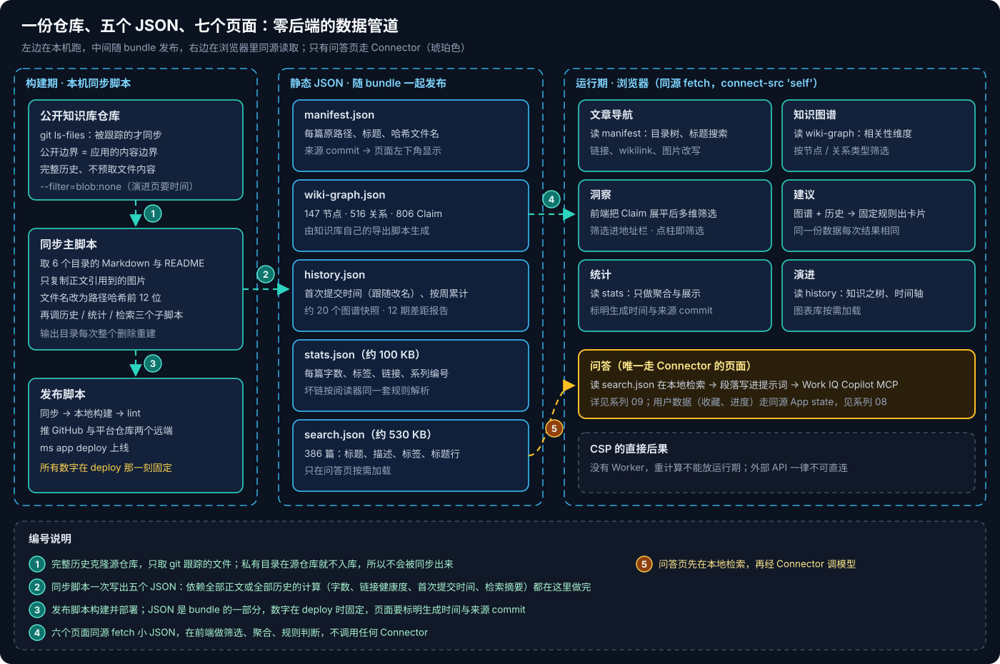
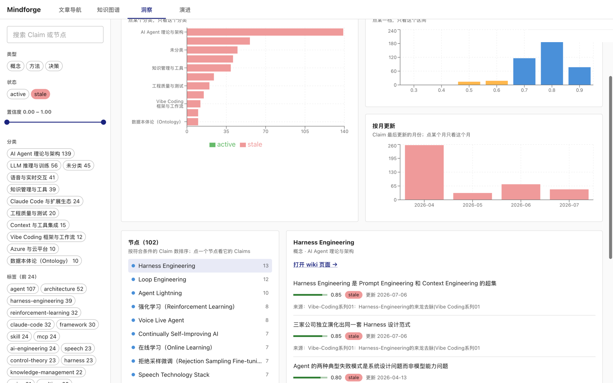
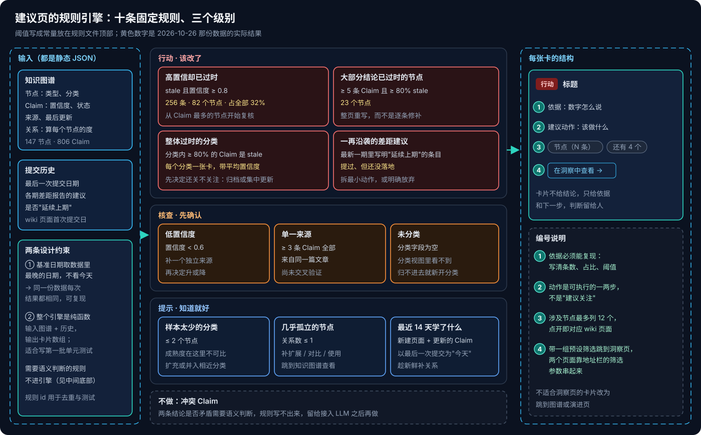
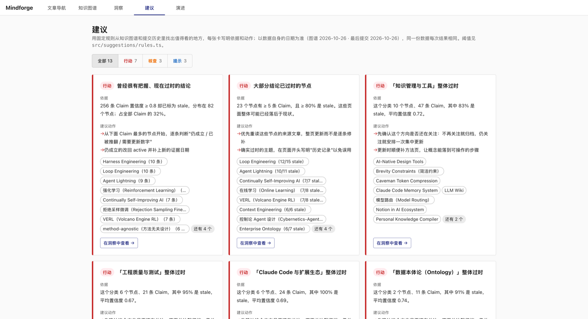
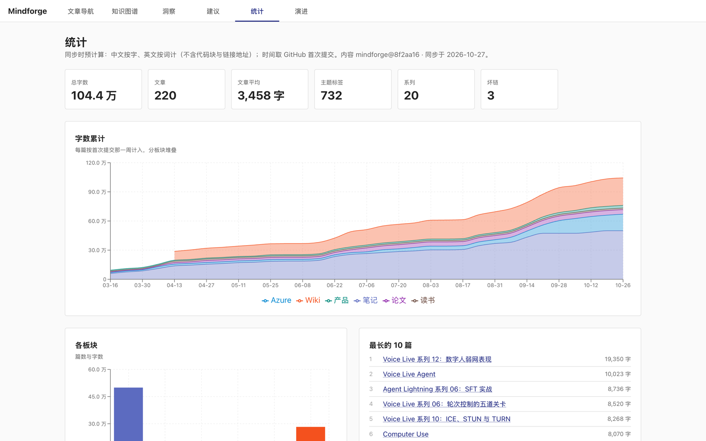
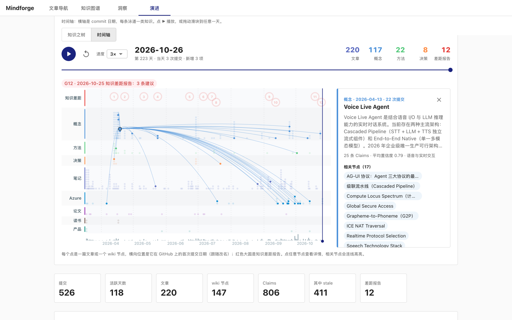

# Copilot Managed Runtime 系列 07：零 Connector 的分析页面

> [!IMPORTANT]
> 本文是 [系列 06](Copilot-Managed-Runtime系列06：参考应用拆解与功能模式.md) 九个模式的一次落地实践，对象是 [系列 02](Copilot-Managed-Runtime系列02：实战部署与权限解析.md) 部署的那个个人知识库应用（文章加一个带论断与置信度的知识图谱）。文中数字来自 2026-10-26 的数据快照。

系列 06 的结论是"九个模式里七个不需要 Connector"。本篇验证这句话：在同一个应用上加了洞察、建议、统计、演进四个页面，没有加任何数据源，用户打开时也不会多一次授权。

## 结论先行

- **数据全在构建期备好。** 同步脚本一次写出五个静态 JSON（文章清单、图谱、提交历史、统计、检索摘要），随 bundle 发布；页面同源 `fetch`，在前端筛选、聚合。
- **要时间维度，就不能浅克隆。** `--depth 1` 拿不到每篇的首次提交时间；改成 `--filter=blob:none` 的完整历史克隆，只拉提交、不预取文件内容。
- **建议页是纯函数规则引擎**：十条规则、固定阈值、三个级别，基准日期取数据里最晚的那一天而不是"今天"，同一份数据每次结果相同。冲突检测需要语义判断，刻意不放进规则。
- **筛选状态进地址栏。** 刷新不丢、链接可分享，建议卡片也靠它一键跳到洞察页的对应筛选。
- **数字在 deploy 那一刻固定**，每个页面都要标出生成时间和来源版本，否则读者会把快照当实时数据。

---

## 一、管道全景

图从左往右分三段，对应三个"在哪里算"的决定：

**构建期（本机）。** 同步脚本只取源仓库里 git 跟踪的文件，所以私有目录不会被带出来；文件名改成路径哈希，避开中文文件名在打包和 URL 上的问题。新增的三个子脚本分别算提交历史、文档统计和检索摘要，结果都写成 JSON。

**静态 JSON（随 bundle 发布）。** 五个文件加起来不到 1 MB（检索摘要约 530 KB，只在问答页按需加载；统计约 100 KB）。它们是 bundle 的一部分，`ms app deploy` 之后就固定了。

**运行期（浏览器）。** 七个页面里六个只读这些 JSON；唯一调用 Connector 的是问答页，见 [系列 09](Copilot-Managed-Runtime系列09：本地检索加Work-IQ的问答.md)。CSP 禁了 Web Worker，所以"依赖全部正文"的重计算（字数、链接解析）必须留在构建期，前端只处理已经聚合过的小数据。

> [!TIP]
> 判断一项计算放哪里，看它依赖什么：依赖全部正文或全部提交历史 → 构建期；只依赖图谱这类小 JSON（本例 147 节点、806 条 Claim）→ 前端；依赖当前用户 → App state（[系列 08](Copilot-Managed-Runtime系列08：用App-state保存用户数据.md)）；依赖模型 → Connector。

### 1.1 一个容易漏的前提：完整提交历史

第一版同步用浅克隆，图快、目录也小。做统计和演进页时才发现：**"这篇文章是哪天写的"要从提交历史里拿**——front matter 不一定有日期，而公开时间线要以 GitHub 上的提交时间为准。

改成 `git clone --filter=blob:none` 之后：

- 历史完整，但文件内容按需拉取，克隆体积仍然可控；
- 首次提交时间用 `git log --follow` 计算，**跟随改名**——系列文章改过标题的，时间不会被重置成改名那天；
- 演进页需要按周取样的图谱快照（约 20 个），每个快照要读一次历史版本的图谱 JSON，首次同步因此要一分多钟，之后增量很快。

同步脚本会识别旧的浅克隆缓存并自动替换。这一步不能省：浅克隆里每个文件只有一个提交，算出来的时间线会静默地全挤在同一天。

### 1.2 链接健康度：同一套规则写两遍

统计页的"坏链"要在构建期算（依赖全部正文），但"什么算一个链接、怎么解析"是前端阅读器定义的：相对路径、URL 编码、wikilink、指向私有日记的 `[[YYYY-MM-DD…]]`。只好在 Python 里把同一套规则重写一遍，并约定**两边不一致时以前端为准**——读者点的是前端渲染出来的链接。指向私有日记的链接单独计为"私有"，不算坏链：它们在源仓库里是有意不公开的。

---

## 二、洞察：把图谱展平成一张 Claim 表

图谱页回答"什么和什么相关"，洞察页回答"哪里的知识过时了、把握有多大"。做法是把每个节点下的 Claim 展平成一行一条，带上所属节点的类型、分类和标签，然后在前端做多维筛选。

- **七个筛选维度**：类型、状态、置信度区间、分类、标签、更新月份、关键词。
- **四张图都可以点**：分类 × 状态堆叠柱、置信度分布、按月更新、关系类型。点一根柱子等于设置一个筛选条件，列表和其他三张图同时联动——这是系列 06 的"所有图表共享一份筛选状态"。
- **逐层钻取**：节点列表按命中的 Claim 数排序 → 点节点看它的 Claim（置信度条、状态、更新日期）→ 点来源跳回原文。Claim 记的来源是文章标题，要拿标题去文章清单里匹配，**77% 能匹配上**；剩下的是标题后来改过、或来源本来就不是一篇文章。这个匹配函数后来被问答页的引用解析复用。

**筛选状态写进地址栏**（`#/insights?cat=…&status=stale`），而不是只放在组件 state 里。代价是多写一对序列化 / 解析函数；收益是刷新不丢、链接能发给别人，以及下一节的建议卡片能直接拼出一个带筛选的链接。

---

## 三、建议：可解释、可复现的规则引擎

系列 06 的参考应用用规则引擎产出"规划建议"，这里照搬了思路：**不用模型，用固定阈值的规则**，每张卡写清依据和下一步，判断留给人。

图中三条泳道就是三个级别：

- **行动**——数据已经在说"该改了"：高置信却过时的 Claim、大部分结论已过时的节点、整体过时的分类、差距报告里一再沿袭的建议。
- **核查**——需要先补证据再决定：低置信度、单一来源、未分类。
- **提示**——知道就好：样本太少的分类、几乎孤立的节点、最近 14 天学了什么。

在这份数据上共产出 13 张卡（行动 7、核查 3、提示 3）。第一张最有信息量：**256 条 Claim 置信度 ≥ 0.8 却已标为 stale，占全部的 32%**——曾经很有把握的结论，现在过时了，是最值得复核的一批。

几个让它"可复现"的取舍：

1. **基准日期取数据里最晚的日期**（最后一次提交或图谱生成时间），不取浏览器的"今天"。否则同一份部署，下周打开时"最近 14 天"就变成空的，建议也跟着变。
2. **整个引擎是纯函数**：输入图谱和历史，输出卡片数组；每条规则有稳定的 id。这是项目里最适合写第一批单元测试的地方。
3. **阈值全部写成常量**放在规则文件顶部，页面上明示"阈值见规则文件"。读者质疑"为什么 0.8"时，答案在代码里，而不是在模型的某次输出里。
4. **刻意不做冲突检测。** "两条 Claim 是否互相矛盾"需要语义判断，规则写不出来，硬写只会产出噪声；留到接入 LLM 之后。

> [!NOTE]
> 规则引擎和 LLM 不是二选一。规则负责"哪里有问题"（可复现、零成本），LLM 适合"这条结论现在还成立吗"（需要理解）。路线图里的下一步，就是从建议卡片和洞察页的 Claim 上加"问 Copilot"入口，预填问题后跳到问答页。

---

## 四、统计：预计算，前端只展示

统计页的每个数字都依赖全部正文，所以全部在构建期算好：

- **字数**：中文按字、英文按词，去掉代码块和链接地址——否则一篇贴了大段配置的文章会显得比实际长得多。本例共 104.4 万字、220 篇，篇均约 3,500 字。
- **按周累计**：每篇按首次提交那一周计入，分板块堆叠。这张图离不开 1.1 节的完整历史。
- **标签分布**：大小写合并，去掉 `wiki`、`concept` 这类结构性标签，只留主题标签。
- **系列完成度**：从文件名里的"系列 NN"识别 20 个系列，缺号用虚线标出，30 天内有新篇的算"进行中"。
- **链接健康度**：站内、外部、私有、坏链四类，坏链列出所在文章和目标，本例 3 个。

页面标题下方写着"同步时预计算……内容 `<commit>` · 同步于 `<日期>`"。这一行看起来是细节，实际是构建期方案的必要部分：**读者需要知道这是哪个时刻的快照**。

---

## 五、演进：时间维度的两种看法

图谱是相关性维度，演进页补上时间维度。数据全部来自 1.1 节的 `history.json`：每个文章和节点的首次提交时间、按周的累计增长、约 20 个图谱快照（active / stale 比例、分类规模），以及 12 期知识差距报告和其中的建议（是否沿袭上期、点名的页面后来有没有建出来）。

**知识之树**是给人看的：一棵按固定种子生成的分形树，每翻过一个有内容的日子（右侧台历，共 106 页）就长高、分叉一点；文章和 wiki 节点是叶子，12 期差距报告是花，可选 1×–10× 速度。鼠标移上去就暂停，叶子换成知识类别的颜色，悬停看标题、点击看详情。**固定种子**保证每次打开长出的是同一棵树——和建议页的"可复现"是同一个原则。

**时间轴**是给分析用的：横轴是提交日期，每条泳道一类知识，红圈是差距报告，可以播放或拖到任意一天。选中一个节点，会把图谱里的相关节点和贡献它的文章连线叠加回来——时间和相关性两个维度在同一张图上交汇。下方还有累计增长、每周活动、Claims 健康度、分类成长和各期差距报告的建议。

图表库体积不小，演进页和洞察页都用 `React.lazy` 按需加载；顺带解决了主 chunk 超过 500 KB 的构建警告。

---

## 六、回头看：为什么这四页都不需要 managed app

这四个页面放在 GitHub Pages 上一样能跑——它们没有用到任何平台能力。现在它们连同文章导航已经同步到了 [公开站点](https://huqianghui.github.io/mindforge/wiki/#/insights)，与 managed app 版本功能一致；只有依赖平台的部分留在 managed app 里：问答要经 Work IQ Connector，阅读记录的跨设备同步要用 App state（公开站点上阅读进度和收藏只存在本机浏览器）。把它们做在 managed app 里，价值在于**和需要平台能力的功能放在同一个应用里**：同一个登录身份下，洞察页的一条 Claim 可以收藏（[系列 08](Copilot-Managed-Runtime系列08：用App-state保存用户数据.md)），建议卡片可以一键提问（[系列 09](Copilot-Managed-Runtime系列09：本地检索加Work-IQ的问答.md)）。

做功能规划时的顺序因此没变：**先问能不能构建期算好，再问能不能前端做，最后才加 Connector**。每多一个 Connector，用户首次打开就多一次授权、多一份 DLP 风险。

---

## 参考资料

- [Build apps with the Microsoft Copilot Managed Runtime SDK (preview)](https://learn.microsoft.com/en-us/microsoft-365/managed-apps/developer?view=o365-worldwide)
- [Build, preview, and deploy Managed Runtime apps](https://learn.microsoft.com/en-us/microsoft-365/managed-apps/developer/dev-inner-loop?view=o365-worldwide)
- [git clone --filter（partial clone）](https://git-scm.com/docs/partial-clone)
- [Recharts](https://recharts.org/)

相关文章：

- [Copilot Managed Runtime 系列 04：SDK 与数据接入](Copilot-Managed-Runtime系列04：SDK与数据接入.md)
- [Copilot Managed Runtime 系列 06：参考应用拆解与功能模式](Copilot-Managed-Runtime系列06：参考应用拆解与功能模式.md)
- [Copilot Managed Runtime 系列 08：用 App state 保存用户数据](Copilot-Managed-Runtime系列08：用App-state保存用户数据.md)
