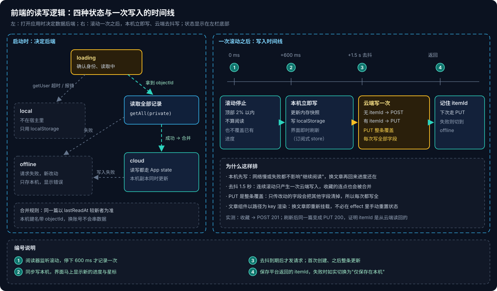
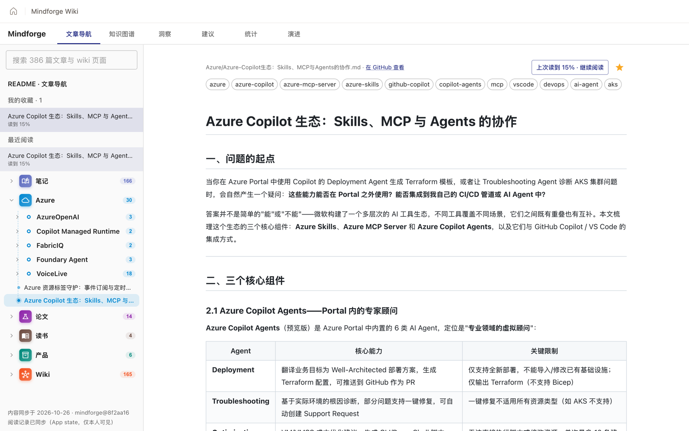

# Copilot Managed Runtime 系列 08：用 App state 保存用户数据

> [!IMPORTANT]
> App state 撰写时（2026-10）是 `ms` CLI 的**实验特性**，命令、schema 扩展字段、接口路径都可能变化。文中的"实测"是在一个企业租户里对已部署应用的抓包与操作结果，DLP 表现取决于各自租户的策略。

[系列 07](Copilot-Managed-Runtime系列07：零Connector的分析页面.md) 的页面都是"所有人看到同一份数据"。阅读进度和收藏不一样：每个人一份，要写、要跨设备、不能被别人读到。这是应用第一次需要**按用户保存数据**。[系列 04](Copilot-Managed-Runtime系列04：SDK与数据接入.md) 当时的建议是"先用 Dataverse 走通标准做法，再拿 App state 对比"。实际走下来，顺序反过来了。

## 结论先行

- **Dataverse 方案在这个租户里写不进去。** `ms app add data-source` 提示 "Skipped 22 of 45 actions due to your organization's connector policy"，所有写入动作被 DLP 屏蔽；改用 SDK 的通用写入接口返回 404。手工补回被屏蔽的动作等于绕过组织策略，不做。
- **App state 走同源 `/.ms/state`**，不经 Connector，所以不受 Connector DLP 管控，用户也不需要授权连接。
- **按用户隔离要手改 schema**：集合上加 `x-ms-ownership: perUser`。不加就是**全体用户共享**的集合——最容易踩、后果最严重的坑。
- **隔离由平台强制**：请求带 `scope=private`，前端不传、也伪造不了用户 ID。这比"按 objectId 过滤"安全得多。
- **本地开发不提供接口**，`ms app dev` 也不行，只能部署后验证。
- 数据只属于这个应用。哪天要让 Copilot Studio agent 读"我收藏的文章"，就得回到 Dataverse。

---

## 一、需求与两条路


需求很小：文章右上角一个星标；滚动位置自动记录，再次打开显示"上次读到 N% · 继续阅读"；左栏列出"我的收藏"和"最近阅读"。进度和收藏的主键都是（用户, 文章），所以合成一张表，每人每篇一条记录，四个字段：文章路径（建索引）、滚动比例、最后阅读时间、是否收藏。

图上下两条泳道就是两次尝试：上面 ①–④ 是最终采用的 App state，下面 ⑤–⑧ 是没走通的 Dataverse。两条路在第二步就分开了——**App state 的请求发给应用自己的域名，Dataverse 的请求要经宿主转发给 Connector**，而 DLP 管的正是后者。

---

## 二、Dataverse 为什么没走通

按"标准做法"走了三步：

1. **建表。** 用 Dataverse Web API 幂等创建发布者（前缀 `mf`）、解决方案和一张**用户拥有**的表。表名、列名都带发布者前缀，这也是后来建 Copilot Studio agent 时 schema name 带 `mf_` 的原因（见 [Copilot Studio 系列 05](../Copilot-Studio/Copilot-Studio系列05：Agent的存储与标识.md)）。令牌直接用 `az account get-access-token --resource <org-url>` 取。
2. **加数据源。** `ms app add data-source --connector commondataserviceforapps --as action --table <表> --use-sso`。连接自动建好了，但 CLI 打印了一行容易被忽略的提示：

   ```text
   Skipped 22 of 45 actions due to your organization's connector policy
   ```

   被跳过的是 `CreateRecordWithOrganization`、`UpdateRecordWithOrganization` 这类写入动作。生成的 Service 里只剩列表、读取、删除。
3. **在宿主里试。** 读取返回 200。直接调 SDK 的通用写入 `createRecordAsync` 返回 **404**——SDK 对这种调用走的是表格型接口路径，而 Dataverse Connector 不提供这条路径；Dataverse 表的写入只能走上面那些被屏蔽的动作。

到这里有一个诱惑：把被跳过的动作手工补进生成的数据源描述里。**这等于绕过组织的 DLP 策略**，即使技术上能调通，也不应该这么做。最后用 `ms app remove data-source` 移除了这两个数据源——否则每个用户打开应用都要授权一个用不到的连接。表和建表脚本留着作对比。

> [!WARNING]
> `ms app add data-source` 不会因为动作被策略跳过而失败。**执行后一定要读完输出**，并用 `ms connector list-actions --connector <id>` 确认需要的动作是 Allowed，再开始写代码。

---

## 三、App state 的做法

```bash
ms feature enable --name state                 # 实验特性，ms.config.json 会多出 state.enabled
ms project state add --collection readingState
ms project state add --collection readingState --property docPath --type string --required true \
  --index true --index-ignore-case false --max-length 400
ms project state add --collection readingState --property scroll --type number --min-value 0 --max-value 1
ms project state add --collection readingState --property lastReadAt --type datetime
ms project state add --collection readingState --property favorite --type boolean
ms project state generate-code                 # 生成模型、校验与强类型 Service，不要手改
```

命令会写出一份 JSON Schema。**按用户隔离没有命令行参数**，要手工在集合定义上加一行，再重新生成代码：

```json
"$defs": {
  "readingState": {
    "type": "object",
    "x-ms-ownership": "perUser",
    "properties": { "docPath": { "type": "string", "maxLength": 400, "x-ms-index": { "ignoreCase": false } } }
  }
}
```

实测要点：

- **不加 `perUser` 时，生成的客户端构造参数里有一个 `false`**——集合是所有用户共享的，任何人都能读到别人的收藏。加上之后重新生成，请求带 `?scope=private`，返回的每条记录都有 `@ms.scope`。生成代码里这一个布尔值的差别，就是"个人数据"和"公共数据"的差别，代码评审时值得专门看一眼。
- **接口是同源的 `/.ms/state/<集合>/items`**，符合 CSP `connect-src 'self'`（[系列 03](Copilot-Managed-Runtime系列03：宿主沙箱与安全边界.md)）。它不是 Connector，所以没有连接、没有授权弹窗、不受 Connector DLP 影响。
- **线上验证**：`GET …/items?scope=private` 200 → 收藏后 `POST` 201 → 刷新页面后同一篇变成 `PUT …/items/<itemId>` 200。最后这一步很关键：它证明 itemId 是从云端读回来的，不是本机缓存。
- **生成的客户端代码会触发 ESLint 的 `no-control-regex`**，把生成目录加进 lint 的忽略列表即可，不要改生成代码。

### 3.1 只能部署后验证

`npm run dev` 和 `ms app dev` 都不提供 `/.ms/state`（Connector 调用在 `ms app dev` 里是能跑的，App state 不行）。每改一次都要部署，于是用了一个小流程：

1. 建一个临时提交，**只推到平台仓库**并 deploy；
2. 在线上验证读写；
3. 通过后 `git commit --amend` 整理提交，再推 GitHub。

这样 GitHub 上的历史保持干净，平台仓库本来就只是构建来源（[系列 02](Copilot-Managed-Runtime系列02：实战部署与权限解析.md) 的"两个远端"）。第一次带 state 的 deploy 返回过一次 504，直接重试成功。

---

## 四、两种方案对比

| | Dataverse 表 | App state |
|---|---|---|
| 定义 schema | Web API 或 maker portal，要有发布者与解决方案 | `ms project state add`，schema 跟源码一起入库 |
| 是否经过 Connector | 是：要建连接，受 DLP 管控 | 否：同源 `/.ms/state` |
| 按用户隔离 | 表的拥有者 + 安全角色；前端按 objectId 过滤只是筛选 | `x-ms-ownership: perUser`，平台强制 |
| 本地调试 | `ms app dev` 可用 | 不可用，只能部署后验证 |
| 成熟度 | 正式功能，Power Apps / Power Automate / agent 都能共用 | 实验特性，数据只属于这个应用 |
| 本租户结果 | 读可以，写被 DLP 屏蔽 | 读写都通 |

**选择依据**：阅读进度只给这个应用自己用，不需要和 agent、workflow 共享，App state 更简单也更安全。

反过来，如果数据要被别人消费，就该回到 Dataverse：比如让 Copilot Studio agent "根据我收藏的文章回答"，或者让一个 workflow 每周汇总大家的阅读情况。这正是 [Copilot Studio 系列 04](../Copilot-Studio/Copilot-Studio系列04：Agent、Workflow与App的协作.md) 的"共享数据"模式——它要求数据放在 agent 和 workflow 都能读到的地方，App state 不是这样的地方。那时需要请管理员为这张表放开 Dataverse 的写入动作。

> [!NOTE]
> [系列 04](Copilot-Managed-Runtime系列04：SDK与数据接入.md) 提醒过"按 objectId 过滤只是筛选，不是授权"。App state 的 `perUser` 从机制上解决了这个问题：用户身份来自平台的登录会话，而不是前端传来的参数。

---

## 五、前端：本机先写，云端去抖写



所有 SDK 调用收在一个平台目录里，阅读状态是一个模块级的订阅式 store（React 用 `useSyncExternalStore` 订阅），页面组件不直接碰 SDK。

**启动时决定后端**（图左）。先 `getUser()`，限时 3 秒，超时视为不在宿主里，进入 `local`；拿到身份后读取全部记录，成功进入 `cloud`，失败进入 `offline`。读回的云端记录和本机副本按 `lastReadAt` 合并，较新者胜。本机键名带上 objectId，同一台电脑换账号不会串数据。

**一次写入**（图右）。滚动停下 600 ms 记录一次（顶部 2% 以内不算，也不覆盖已有进度）；本机立即写、界面立即刷新；云端写去抖 1.5 秒，没有 itemId 就 `create`（POST），有就 `update`（PUT）。**PUT 是整条覆盖**，所以每次都写全部字段——只传变了的字段，会把其他字段清空。



左栏底部如实显示当前状态："阅读记录已同步（App state，仅本人可见）"，或者"仅保存在本机"。用户知道数据在哪里，比任何一个兜底逻辑都重要。

---

## 参考资料

- [Build apps with the Microsoft Copilot Managed Runtime SDK (preview)](https://learn.microsoft.com/en-us/microsoft-365/managed-apps/developer?view=o365-worldwide)
- [Connect a Managed Runtime app to data](https://learn.microsoft.com/en-us/microsoft-365/managed-apps/developer/connect-to-data?view=o365-worldwide)
- [CLI command reference](https://learn.microsoft.com/en-us/microsoft-365/managed-apps/developer/ms-cli-command-reference?view=o365-worldwide)
- [Data loss prevention policies](https://learn.microsoft.com/en-us/power-platform/admin/wp-data-loss-prevention)
- [Dataverse security roles and privileges](https://learn.microsoft.com/en-us/power-platform/admin/security-roles-privileges)

相关文章：

- [Copilot Managed Runtime 系列 04：SDK 与数据接入](Copilot-Managed-Runtime系列04：SDK与数据接入.md)
- [Copilot Managed Runtime 系列 09：本地检索加 Work IQ 的问答](Copilot-Managed-Runtime系列09：本地检索加Work-IQ的问答.md)
- [Copilot Studio 系列 02：Connector 与连接](../Copilot-Studio/Copilot-Studio系列02：Connector与连接.md)
