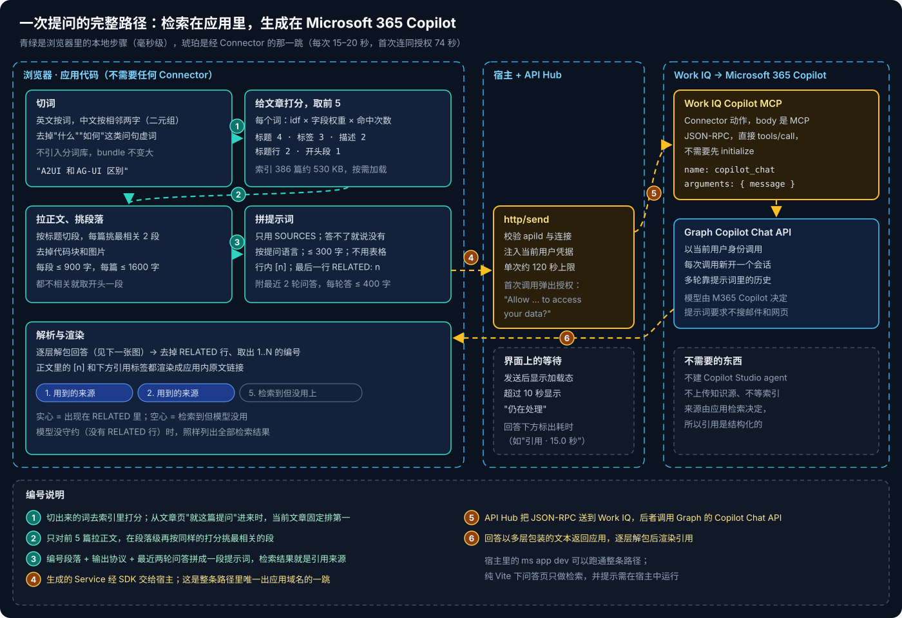
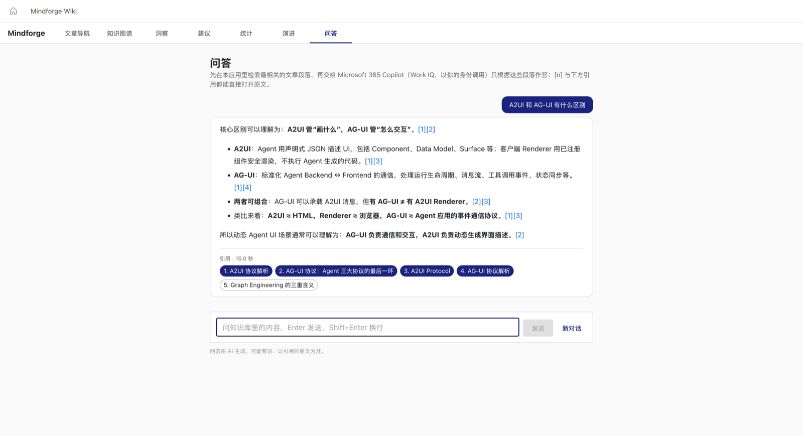
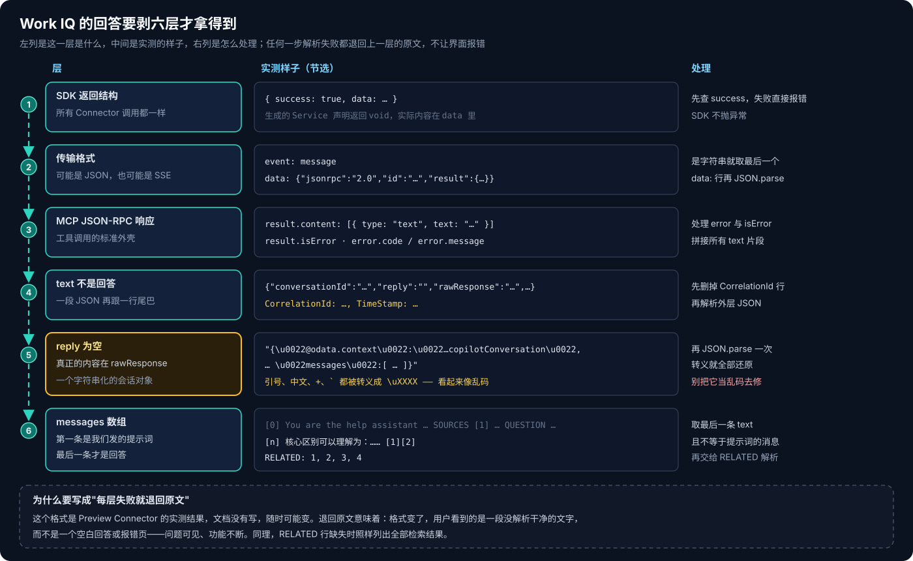

# Copilot Managed Runtime 系列 09：本地检索加 Work IQ 的问答

> [!IMPORTANT]
> Work IQ Copilot MCP Connector 撰写时（2026-10）是 **Preview**。本文的返回格式、耗时都是在一个企业租户里的实测结果，官方文档没有写到这一层，升级后要重新核对。

[系列 05](Copilot-Managed-Runtime系列05：在应用里调用AI的几条路.md) 列了在 managed app 里调 AI 的几条路，路线 ② 的依据是拆解一个已上线应用。本篇是在自己的知识库应用上把这条路完整走一遍：从检索算法、提示词，到返回格式和部署时的坑。

先做这一条而不是 Copilot Studio agent，原因有两个：**不需要建 agent**（少一个要分享、要发布、要维护知识源的东西）；**引用由应用自己控制**——来源是应用检索出来的，不是从回答文本里猜的。

## 结论先行

- **分工**：检索在浏览器里做，生成交给 Microsoft 365 Copilot。整条路径只有一跳出应用域名。
- **检索不需要向量和分词库**：英文按词、中文按相邻两字切，idf 乘字段权重给文章打分，取前 5 篇，再在段落级挑最相关的两段。索引在构建期生成，约 530 KB，只在问答页加载。
- **引用靠输出协议**：段落带编号写进提示词，要求行内用 `[n]` 标注、最后一行写 `RELATED: 1, 3`。应用把编号渲染成原文链接，用到的和没用到的来源分开显示。
- **回答要剥六层**：SDK 结构 → 可能是 SSE → JSON-RPC → 外层 JSON 加一行 CorrelationId → `reply` 为空、`rawResponse` 是字符串化的会话 → `messages` 的最后一条。每层失败都退回原文。
- **耗时**：每个用户首次调用要授权，连同授权约 74 秒；之后每次 15–20 秒。
- **提示词里别留网址**：`copilot_chat` 会把提示词里的网址自动抽成 grounding 文件，还会把 Markdown 的右括号吞进网址；资料正文已在 SOURCES 里，去掉网址只留链接文字。
- **`agentId` 参数不生效**：传了也由 M365 Copilot 本体作答，不能借它调 Copilot Studio agent。
- **CLI 部署超时不等于构建失败**，先查 `ms app build-status`。

---

## 一、全景



图里青绿色的 ①–③ 都在浏览器里，毫秒级完成，不调用任何 Connector；琥珀色的 ④–⑥ 是唯一经 Connector 的往返。下面按这个顺序讲。



---

## 二、本地检索

### 2.1 索引：构建期生成的每篇摘要

同步时（[系列 07](Copilot-Managed-Runtime系列07：零Connector的分析页面.md) 的管道）多生成一个检索索引：每篇只存**标题、描述、标签、各级标题、开头一段**和路径，386 篇约 530 KB。正文不进索引——命中之后再按需拉正文，索引保持小。

### 2.2 打分

1. **切词**：英文按词（保留 `c#`、`gpt-4o` 这类带符号的词），中文按相邻两字切成二元组。一个汉字单独成段时保留单字。不引入中文分词库，bundle 不变大。
2. **去虚词**：问句里的"什么""如何""区别""之间"这类二元组几乎每篇都有，只会拉低区分度，直接去掉。
3. **打分**：每个词的 idf（出现的篇数越少越重要）× 字段权重 × 命中次数（同一字段最多算 3 次）。字段权重是**标题 4、标签 3、描述 2、各级标题 2、开头段 1**。取得分最高的 5 篇。

从文章页点"就这篇提问"进来时，当前文章固定排第一，其余按得分补齐。

### 2.3 挑段落

对这 5 篇拉正文，去掉 front matter、代码块和图片，按 Markdown 标题切成段，用同一套打分给段落排序，每篇取最相关的 2 段，按原文顺序拼接。每段最多 900 字、每篇最多 1600 字；没有一段命中时取开头一段。

> [!NOTE]
> 这套检索在个人知识库这个规模（几百篇、标题和标签写得规范）上够用。它的天花板也很清楚：同义词、换种说法的问题检索不到。到那一步，再考虑构建期离线生成向量、前端算相似度，或者换成 [系列 05](Copilot-Managed-Runtime系列05：在应用里调用AI的几条路.md) 的路线 ③。

---

## 三、提示词与输出协议

提示词的结构参考了系列 05 拆解的那个应用，核心是把模型的自由度收紧：

```text
You are the help assistant inside <应用名>, a personal knowledge base about ...
Answer ONLY from the SOURCES below. Do not search files, mail, chats or the web, and do not use other knowledge.
If the SOURCES do not contain the answer, say so plainly (in Chinese: 知识库里没有相关内容) ...
Rules: answer in the language of the question; at most 300 Chinese characters or 200 English words; no tables;
cite sources inline as [n]; keep product names, commands and code identifiers exactly as written.
End with one last line exactly like: RELATED: 1, 3   (RELATED: none if you used none).

SOURCES
[1] <标题> (<路径>)
<段落摘录>
...
EARLIER IN THIS CONVERSATION      ← 最近 2 轮，每轮回答截到 400 字
QUESTION
<用户的问题>
```

几处取舍：

- **明确禁止搜索邮件、聊天和网页。** M365 Copilot 默认会用用户的企业数据；不禁止的话，回答可能混进一封邮件里的内容，引用就对不上了。
- **不用表格。** 回答框窄，表格渲染出来很难读；也减少模型输出长篇结构的倾向。
- **产品名、命令照抄原文。** 否则模型会把 CLI 参数"润色"成另一种写法。
- **多轮靠提示词。** 每次调用都会新开一个 Copilot 会话（`conversationId` 每次不同），所以上下文只能自己带。只带最近两轮、每轮截断，控制提示词长度。

**解析 RELATED**：从后往前找第一行以 `RELATED:` 开头的（兼容加粗和中文冒号），取出 1..N 范围内的编号去重，然后把这一行从正文里删掉。模型没守约时 RELATED 为空，界面照样列出全部检索结果——这是 [系列 05](Copilot-Managed-Runtime系列05：在应用里调用AI的几条路.md) 说的"引用靠输出协议"的完整形态。

实测模型遵守了协议：回答按 `[1][2]` 标注，检索到但没用上的来源不会出现在 RELATED 里。界面上用到的来源是实心标签，没用上的是空心标签——读者一眼能看出模型的回答依据了哪几篇。

---

## 四、接入

```bash
ms connector list-actions --connector shared_a365copilotchatmcp
#   Work IQ Copilot (Preview)   Allowed   mcp_m365copilot
ms app add data-source --connector shared_a365copilotchatmcp --as action --use-sso --non-interactive
```

生成的 Service 只有一个方法，返回类型声明是 `void`，实际内容要自己解析。请求体是 MCP 的 JSON-RPC，**直接 `tools/call`，不需要先 `initialize`**：

```ts
const res = await WorkIQCopilotMCPService.mcp_m365copilot(undefined, {
  jsonrpc: '2.0',
  id: crypto.randomUUID(),
  method: 'tools/call',
  params: { name: 'copilot_chat', arguments: { message: prompt } },
});
// SDK 不抛异常，失败体现在 success 上
if (!res.success) throw res.error ?? new Error('Work IQ Copilot 调用失败');
```

`copilot_chat` 还有一个可选参数 `agentId`（"Agent ID for the Microsoft Copilot conversation"）。看上去可以借它把问题交给发布到 M365 Copilot 的 Copilot Studio agent，实测**不生效**：调用成功、`agentId` 被原样回显（随手编的也一样），回答却与不传时无法区分。怎么发现的、该怎么验证，见 [系列 10](Copilot-Managed-Runtime系列10：调用Copilot-Studio-Agent为何走不通.md)。

---

## 五、返回格式：要剥六层



这是整个实现里最花时间的部分。`result.content[0].text` **不是回答本身**：

- 外层是一段 JSON（`conversationId`、`timeZone`、`reply`、`rawResponse`、`message`），后面还跟一行 `CorrelationId: …, TimeStamp: …`；
- `reply` **实测为空**，不能直接用；
- `rawResponse` 是**字符串化**的 Graph `copilotConversation`。服务端序列化器把引号、中文、`+`、反引号都转义成了 `\uXXXX`，第一版界面原样显示时看起来像乱码。其实这是合法的 JSON 转义，`JSON.parse` 一次就全部还原；
- `messages` 的第一条是我们发出去的提示词，**最后一条**才是回答。

解析代码因此写成一串"尝试—退回"：去掉 CorrelationId 行 → 解析外层 → 有非空 `reply` 就用它 → 否则解析 `rawResponse` → 取最后一条文本不等于提示词的消息。任何一步失败都返回上一层的原文。

> [!TIP]
> 遇到"看起来像乱码"的返回，先数一数是不是 `\u` 加四位十六进制。是的话，问题不在编码，而在于少解析了一层 JSON。

---

## 六、实测记录

| 观察 | 说明 |
|---|---|
| 首次调用时宿主弹出 "Allow … to access your data?"，列出 Work IQ Copilot MCP | 每个用户第一次用都要同意；同意后平台为这个应用建一条新连接，挂起的那次调用随后正常返回，连同授权共约 74 秒 |
| 之后每次 15–20 秒 | 超过 10 秒，界面显示"仍在处理"；回答下方标出耗时 |
| `ms app dev` 可用 | Connector 调用在本地宿主里能跑（App state 不行，见 [系列 08](Copilot-Managed-Runtime系列08：用App-state保存用户数据.md)）；纯 Vite 下问答页只做检索，并提示需要在宿主中运行 |
| 改了平台调用相关的文件后，Vite 整页刷新 iframe | 宿主里的问答状态会丢，测试时要重新提问 |
| 一次部署时，平台构建跑了约 20 分钟 | 见下 |

**CLI 超时不等于构建失败。** `ms app deploy` 轮询构建状态时两次网络超时并退出（exit 1），但平台上的构建一直在继续。用 `ms app build-status --commit <sha>` 看到 Succeeded 后，再执行一次 `ms app deploy --commit <sha>`，CLI 提示已有缓存的构建、直接部署，几秒就上线了。所以看到 deploy 失败，第一步是查 build-status，而不是重新推一个提交。

---

## 七、实验：提示词里的网址

`copilot_chat` 返回的外层 JSON 里有两个字段 `fileUris` 和 `autoExtractedFileUris`。对照提示词可以看出，工具会把**提示词里出现的网址**取出来，当作 grounding 文件交给 Copilot。检索摘录里常带原文的外链，这会不会拖慢回答、把资料以外的内容混进来？

做了一次对照：三个示例问题，同一份提示词，分"保留网址"和"去掉网址（只留链接文字）"两种，经 Work IQ 各调 2 轮，交替先后顺序以抵消缓存和时段的影响。

| 问题 | 摘录中的网址 | 保留：耗时 / 被抽取 | 去掉：耗时 / 被抽取 |
|---|---|---|---|
| A2A 和 MCP 分别解决什么问题？ | 0 | 15.0、16.0 秒 / 0 | 14.9、15.9 秒 / 0 |
| Voice Live 在弱网下表现如何？ | 0 | 20.2、17.4 秒 / 0 | 18.8、21.5 秒 / 0 |
| Prompt Cache 新旧两代有什么区别？ | 5 | 20.4、16.3 秒 / **2** | 15.7、15.3 秒 / 0 |

三点观察：

- **只有摘录里真有网址时才会被抽取**，而且不是全抽：5 个里抽了 2 个。
- **抽出来的网址有一个是坏的**，形如 `…/prompt-caching/diagnostics)）与`。工具按空白切网址，把 Markdown 链接的右括号和后面的中文都吞了进去——中文正文里网址后面紧跟标点、没有空格，是这种切法最容易出错的场景。
- **去掉网址后第三题两次都快了一些**（平均 18.4 → 15.5 秒），但同一题前后两次本身就能差 4 秒，样本太少，不能说一定更快。回答长度与 `[n]` 引用数没有明显差别。

**结论**：资料正文已经在 SOURCES 里，让 Copilot 再去抓外链没有好处，还可能把资料以外的内容混进回答。所以拼 SOURCES 时去掉网址、只留链接文字。这个处理放在两个后端共用的提示词构造里，Azure OpenAI 后端也顺带少了几个 token。

> [!NOTE]
> 与此相关的另一个现象：返回里 M365 Copilot 本体的 `webSearchEnabled` 显示为 `false`，但资料外的问题它照样会引用公开网页。"只依据 SOURCES"在这个后端上只能靠提示词约束，不能指望那个字段。

---

## 八、入口与计时

问答页做完后，把它和其他页面串了起来：

- **"问 Copilot →"入口**：洞察页每条 Claim、建议页每张卡片下方都有一个，跳到 `#/ask?q=<预填问题>`。**只预填、不自动发送**，用户可以先改问题或换后端。Claim 的入口还带上来源文章，把它固定为第一条资料——[系列 07](Copilot-Managed-Runtime系列07：零Connector的分析页面.md) 里规则引擎刻意不做的"这条结论还成立吗"，交给这里回答。
- **两段计时**：回答下方分开显示**检索**耗时（本地，通常几十毫秒）和**回答**耗时（connector + 后端模型）。几十毫秒对十几秒，一眼就知道优化该往哪里使劲。

---

## 九、和 Azure OpenAI 后端怎么比

这条路线解决了"不建 agent、引用可控"，代价也清楚：

- **模型不可选**，由 M365 Copilot 决定；每次 15–20 秒，比直接调模型慢。
- **要求每个用户都有 M365 Copilot**，Work IQ 的调用另外计费。
- **依赖 Preview Connector**，返回格式可能变——所以第五节的"每层退回原文"不是过度防御。

路线图上原本还有两种对比实验：

1. **Copilot Studio agent**：Copilot Studio Connector 是回调式动作，本篇这个工具的 `agentId` 又被忽略，从浏览器里调不到，问答页上曾经的 agent 切换项已移除，见 [系列 10](Copilot-Managed-Runtime系列10：调用Copilot-Studio-Agent为何走不通.md)。
2. **Azure OpenAI Connector + 同一套前端检索**：已上线并成为默认后端，检索不变、只换生成端，同一问题 4.6 秒；连接只能用 API Key 共享连接、部署时要声明 `allowedActions`，见 [系列 11](Copilot-Managed-Runtime系列11：用Azure-OpenAI-Connector直调模型.md)。

两种后端怎么选、整套方案的回顾，见 [系列 12](Copilot-Managed-Runtime系列12：方案回顾与Connector接入清单.md)。

---

## 参考资料

- [Connect a Managed Runtime app to data](https://learn.microsoft.com/en-us/microsoft-365/managed-apps/developer/connect-to-data?view=o365-worldwide)
- [Model Context Protocol specification](https://modelcontextprotocol.io/specification)
- [CLI command reference](https://learn.microsoft.com/en-us/microsoft-365/managed-apps/developer/ms-cli-command-reference?view=o365-worldwide)
- [Copilot Managed Runtime licensing FAQ](https://learn.microsoft.com/en-us/microsoft-365/admin/manage/apps/licensing-faq)

相关文章：

- [Copilot Managed Runtime 系列 05：在应用里调用 AI 的几条路](Copilot-Managed-Runtime系列05：在应用里调用AI的几条路.md)
- [Copilot Managed Runtime 系列 06：参考应用拆解与功能模式](Copilot-Managed-Runtime系列06：参考应用拆解与功能模式.md)
- [Copilot Studio 系列 05：Agent 的存储与标识](../Copilot-Studio/Copilot-Studio系列05：Agent的存储与标识.md)
- [Copilot Managed Runtime 系列 10：调用 Copilot Studio Agent 为何走不通](Copilot-Managed-Runtime系列10：调用Copilot-Studio-Agent为何走不通.md)
- [Copilot Managed Runtime 系列 12：方案回顾与 Connector 接入清单](Copilot-Managed-Runtime系列12：方案回顾与Connector接入清单.md)
