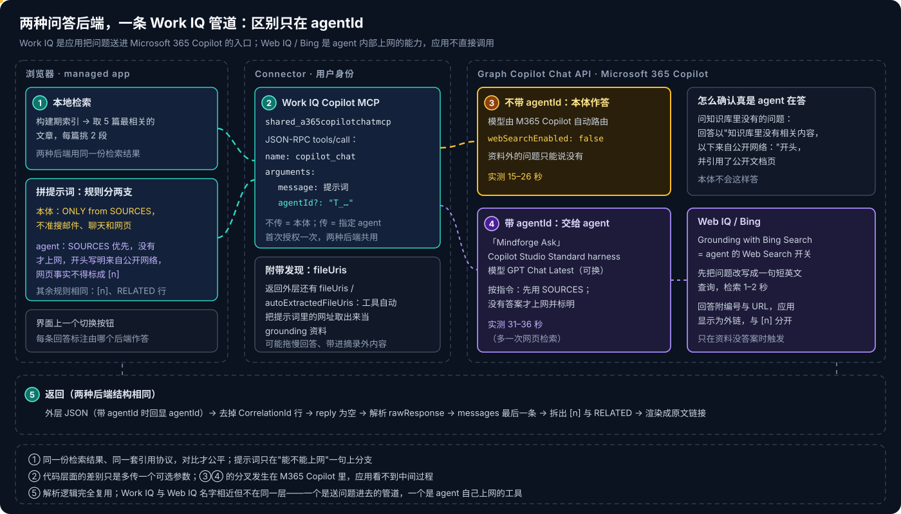
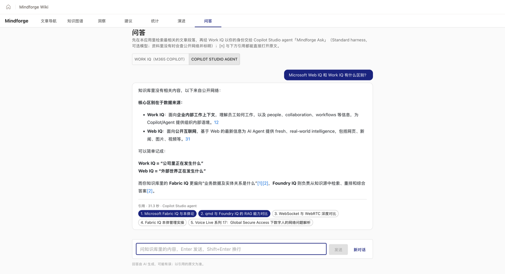

# Copilot Managed Runtime 系列 10：经 Work IQ 调用 Copilot Studio Agent

> [!IMPORTANT]
> 资料截至 2026-10-28，是在一个企业租户里对已部署 managed app 的实测记录。Work IQ Copilot MCP Connector 仍是 **Preview**，`agentId` 参数的行为官方文档只有一句描述，升级后要重新核对。

[系列 09](Copilot-Managed-Runtime系列09：本地检索加Work-IQ的问答.md) 用 Work IQ 直调 Microsoft 365 Copilot，做出了带引用的问答页。路线图上的下一步，是加一个 **Copilot Studio Standard agent** 作为可切换的第二种后端：同样的检索结果，换一个可以选模型、能上网兜底的回答者，对比质量、引用和延迟。

[系列 05](Copilot-Managed-Runtime系列05：在应用里调用AI的几条路.md) 给这一步规划的路线是 Copilot Studio Connector 的 `ExecuteCopilotAsyncV2`——也是官方 Code Apps 文档的标准做法。本篇记录它为什么走不通，以及最后走通的那条路。agent 本身的配置与发布见 [Copilot Studio 系列 06](../Copilot-Studio/Copilot-Studio系列06：Standard-Agent的配置与发布.md)。

## 结论先行

- **Copilot Studio Connector 在浏览器前端里走不通，有两种失败方式。** 草稿 agent：Connector 把请求重定向到门户页面，浏览器跟随后被 CORS 拦截，SDK 却返回 `success: true, data: null`。已发布 agent：`ExecuteCopilotAsyncV2` 的 body 要求必填的回调地址 `notificationUrl`，不传就是 400——这是给 Power Automate 设计的 webhook 式等待。
- **可行的路是绕道 Microsoft 365 Copilot。** 发布 agent 时勾选"在 Microsoft 365 Copilot 中可用"，它就有了 titleId（`T_…`）；Work IQ 的 `copilot_chat` 带上 `agentId: <titleId>`，M365 Copilot 就把这一轮交给它。
- **代码差别只有一个可选参数。** 两种后端用同一个 Connector、同一个工具、同一条用户连接，不需要额外授权；返回结构也相同，解析逻辑完全复用。
- **Work IQ 和 Web IQ 不在同一层。** Work IQ 是应用把问题**送进** M365 Copilot 的管道；Web IQ / Bing 是 agent **内部**在资料没答案时上网的工具，应用不直接调用。
- **实测对比**：agent 后端可以选模型、资料外的问题会查公开网络并声明来源，耗时 31–36 秒；直调 M365 Copilot 本体不能选模型、不上网，15–26 秒。
- **先发布再测。** 草稿 agent 的失败被包装成"成功但没有数据"，最容易被误判成指令或知识源的问题。

---

## 一、三次尝试


三条泳道从上往下是时间顺序。前两条红色的都是 Copilot Studio Connector，第三条青绿色的是最后可行的路径。

### 1.1 草稿 agent：重定向、CORS，和一个"成功"

按计划加数据源：

```bash
ms app add data-source --connector shared_microsoftcopilotstudio --as action --use-sso
```

生成的 Service 方法是 `ExecuteCopilotAsyncV2(Copilot, body, x-ms-conversation-id?, environmentId?)`，`Copilot` 填 agent 的 schema name。agent 还没发布时调用，浏览器网络面板里能看到：Connector 运行时没有把请求交给 agent，而是**重定向到门户里这个 agent 的页面**（`copilotstudio.microsoft.com/…/bots/<id>`）；浏览器跟随重定向，跨域请求被 CORS 拦截。

麻烦的是 SDK 那一层的表现：返回 `{ success: true, data: null }`。如果只看 SDK 结果，会以为 agent 答了一个空回答，然后去改指令、查知识源——方向完全错了。

> [!WARNING]
> managed app 里调 Connector，`success` 只表示"这次调用在宿主与 API Hub 之间没有出错"，不保证业务上拿到了结果。`data` 为空时，第一步是打开网络面板看真实的请求与重定向，而不是改提示词。

### 1.2 已发布 agent：400，因为它要一个回调地址

发布之后再调，body 传 `{ message, locale }`，返回 **400 "Invalid request body"**。翻这个动作的 schema 才看到原因：

- body 里的 `notificationUrl` 是**必填**字段，标注为 `x-ms-notification-url`；
- 响应只定义了 **201 Accepted**。

这是 Power Platform Connector 的 webhook 式异步模式：调用方提供一个回调地址，服务端接受请求后立即返回 201，生成完成后再把结果 POST 到这个地址。Power Automate 的流可以挂起等待回调，所以动作名里有 "and wait"；而 managed app 是跑在浏览器里的前端，**没有可以被服务端回调的地址**。

这和权限、DLP、harness 都无关，是动作本身的形态与调用方不匹配。[系列 05](Copilot-Managed-Runtime系列05：在应用里调用AI的几条路.md) 说过，managed app 里能走通的 AI 路线，形态都是"请求—等待—一次性返回"；回调式的动作不在其中。

### 1.3 清理

既然走不通，就把这个数据源从应用里移除：

```bash
ms app remove data-source --name microsoftcopilotstudio
```

不只是为了代码干净。每个数据源都会出现在用户首次使用时的授权框里（[系列 09](Copilot-Managed-Runtime系列09：本地检索加Work-IQ的问答.md) 第六节），留着一个用不上的 Connector，等于让每个用户多同意一项、多建一条连接。

---

## 二、换路：Work IQ 加 agentId



[系列 09](Copilot-Managed-Runtime系列09：本地检索加Work-IQ的问答.md) 已经提到，Work IQ 的 `copilot_chat` 有一个可选参数 `agentId`，描述是 "Agent ID for the Microsoft Copilot conversation"。Work IQ 包装的是 Graph Copilot Chat API，这是程序进入 M365 Copilot 的入口；如果 agent 本身就在 M365 Copilot 里，这条已经跑通的链路应该能把问题交给它。

### 2.1 前提：agent 要在 M365 Copilot 里

发布 agent 时，Microsoft 365 and Teams 渠道里保持勾选 **"Make agent available in Microsoft 365 Copilot"**，agent 就进入 M365 Copilot 的 Agent Store。渠道面板里 "See agent in Teams" 打开的链接形如：

```text
https://teams.microsoft.com/l/app/?titleId=T_xxxxxxxx-xxxx-xxxx-xxxx-xxxxxxxxxxxx
```

这个 `T_…` 就是 `agentId`。注意它**不是** schema name：schema name 是 agent 在 Dataverse 里的逻辑名，titleId 是它在 M365 里的标识，两条路各认各的。三套标识的对照见 [Copilot Studio 系列 06](../Copilot-Studio/Copilot-Studio系列06：Standard-Agent的配置与发布.md)。

### 2.2 代码：一个可选参数

在系列 09 的调用函数上加一个可选参数：

```ts
/** agentId：交给指定的 Microsoft 365 Copilot agent 回答；不传则由 M365 Copilot 本体回答 */
export async function askCopilot(message: string, agentId?: string): Promise<string> {
  const res = await WorkIQCopilotMCPService.mcp_m365copilot(undefined, {
    jsonrpc: '2.0',
    id: crypto.randomUUID(),
    method: 'tools/call',
    params: { name: 'copilot_chat', arguments: agentId ? { message, agentId } : { message } },
  });
  if (!res.success) throw res.error ?? new Error('Work IQ Copilot 调用失败');
  // 之后的六层解析与系列 09 完全相同
  ...
}

const AGENT_ID = 'T_xxxxxxxx-…';   // agent 的 titleId
export const askAgent = (message: string) => askCopilot(message, AGENT_ID);
```

问答页上加一个切换按钮，两种后端走同一个检索、同一个解析，只在发出请求时选 `askCopilot` 或 `askAgent`。每条回答下方标注由哪个后端作答、耗时多少，方便对比。

**不需要额外授权**：用的是同一个 Work IQ 连接，用户第一次用 Work IQ 后端时已经同意过，切到 agent 后端不会再弹授权框。

### 2.3 提示词：只在"能不能上网"一句上分支

两种后端用同一套提示词，区别只在开头的规则：

```text
# 直调 M365 Copilot（不能上网）
Answer ONLY from the SOURCES below. Do not search files, mail, chats or the web, and do not use other knowledge.
If the SOURCES do not contain the answer, say so plainly (in Chinese: 知识库里没有相关内容) ...

# 交给 agent（开着 Web Search）
Answer from the SOURCES below first. Only if they do not contain the answer, search the public web,
start the answer with the line "知识库里没有相关内容，以下来自公开网络：" and cite the web pages; never present web facts as [n].
```

后面的规则（按提问语言作答、字数上限、不用表格、行内 `[n]`、最后一行 `RELATED:`）、SOURCES 段落、最近两轮对话都相同。agent 自己的指令里也写了同样的优先级和兜底声明，两边一致，模型守约的概率更高。

### 2.4 返回：结构不变，外层回显 agentId

返回结构与不带 `agentId` 时完全相同——外层 JSON 加一行 CorrelationId，`reply` 为空，`rawResponse` 是字符串化的会话，最后一条消息是回答。唯一的区别是外层多了一个 `agentId` 字段，回显这次交给了哪个 agent。

**怎么确认真是 agent 在答**：问一个知识库里肯定没有的问题。agent 后端的回答以"知识库里没有相关内容，以下来自公开网络："开头，并引用了公开文档页面；而不带 `agentId` 时，返回里 M365 Copilot 本体的 `webSearchEnabled` 是 `false`，只会回答"知识库里没有"。这是 agent 的指令和 Web Search 共同作用的结果，本体做不到。

> [!TIP]
> **Work IQ 与 Web IQ 别混淆。** 两者名字相近，在这条链路里分工完全不同：**Work IQ**（Copilot MCP Connector 的 `copilot_chat`）是应用调用的入口，`agentId` 决定交给谁；**Web IQ / Bing**（agent 的 Web Search 开关，Grounding with Bing Search）是 agent 在资料没答案时自己调用的，应用看不到也不直接调。

---

## 三、两种后端的实测对比



截图里问的是"Web IQ 和 Work IQ 有什么区别"——知识库里只有相邻的内容（Fabric IQ、Foundry IQ）。agent 先声明"知识库里没有相关内容，以下来自公开网络"，用网页回答了两者的区别，又用 `[1][2]` 把知识库里相关的部分接上。下方实心标签是用到的知识库文章，空心是检索到但没用上的。

| | 直调 M365 Copilot 本体 | Copilot Studio agent（经 Work IQ + agentId） |
|---|---|---|
| 模型 | M365 Copilot 自动路由，不可选 | 在 agent 里选（当前 GPT Chat Latest） |
| 资料外的问题 | 只能说"知识库里没有" | 查公开网络并声明；网页引用是外链，知识库引用是 `[n]` |
| 实测耗时 | 15–26 秒 | 31–36 秒（多一次网页检索） |
| 首次授权 | Work IQ 连接 | 同一条连接，不需要额外授权 |
| 维护 | 无 | agent 在 Copilot Studio，改指令、换模型都要重新发布 |
| 别处复用 | — | 同一个 agent 也能在 Teams、M365 Copilot 里直接对话 |

两个使用中发现的细节：

- **网页引用的显示还要打磨。** Copilot 返回的网页引用编号直接跟在句末，渲染出来是"…语境。12"这样的数字，容易误读成正文；后续可以改成上标或单独的方括号样式，与知识库的 `[n]` 区分开。
- **多轮仍然靠提示词。** 和系列 09 一样，每次调用都新开会话，前几轮由应用拼进提示词带过去；换成 agent 并没有改变这一点。

---

## 四、一个附带发现：fileUris

返回的外层 JSON 里还有 `fileUris` 和 `autoExtractedFileUris` 两个字段。对照提示词可以看出，它们是 Work IQ **自动从提示词里提取出来的网址**——文章摘录里出现的链接——并作为 grounding 资料交给了 Copilot。

这个行为两种后端都有，影响有两面：多取几个网页可能拖慢回答；也可能让回答带进摘录之外的内容，削弱"只依据 SOURCES"的约束。如果要严格只依据摘录，可以在拼提示词前去掉摘录里的网址。去掉之后延迟和回答会有多大变化，还没有测。

---

## 五、对系列 05 路线 ① 的更正

[系列 05](Copilot-Managed-Runtime系列05：在应用里调用AI的几条路.md) 列的三条可行路线里，路线 ① 原来写的是"Copilot Studio Connector 调 Standard agent"。实测之后应改为：

- **Standard agent 仍然是唯一能从 managed app 调到的 Copilot Studio agent**，GitHub Copilot harness 依旧三层全堵（[Copilot Studio 系列 03](../Copilot-Studio/Copilot-Studio系列03：四种Harness对比与选型.md)）。
- **但入口不是 Copilot Studio Connector**，而是：发布到 Microsoft 365 Copilot → Work IQ `copilot_chat` + `agentId`。这样路线 ① 和路线 ② 实际上合并成了同一个 Connector 的两种用法。
- **代价随之改变**：要求每个用户都有 M365 Copilot（Work IQ 的前提）；agent 要对使用者可见（分享或管理员批准）；Work IQ API 另行计费。
- Copilot Chat 类 agent 也运行在 M365 Copilot 里，按道理同样能用 `agentId` 调到，但没有单独验证。

什么时候值得用 agent 后端而不是直调本体：**需要固定或比较模型**、**希望资料外的问题有网页兜底**、**同一个回答者还要在 Teams 和 M365 Copilot 里给人直接用**。只要"严格只依据应用给的资料"，直调本体更快、少一个要维护的东西。

路线图上剩下的对比是第三种后端：**Azure OpenAI Connector + 同一套前端检索**，检索不变、只换生成端。已上线，同一问题 4.6 秒，三种后端的完整对比见 [系列 11](Copilot-Managed-Runtime系列11：用Azure-OpenAI-Connector直调模型.md)。

---

## 参考资料

- [Connect a Managed Runtime app to data](https://learn.microsoft.com/en-us/microsoft-365/managed-apps/developer/connect-to-data?view=o365-worldwide)
- [Microsoft Copilot Studio connector reference](https://learn.microsoft.com/en-us/connectors/microsoftcopilotstudio/)
- [Connect a code app to Copilot Studio](https://learn.microsoft.com/en-us/power-apps/developer/code-apps/how-to/connect-to-copilot-studio)
- [Connect and configure an agent for Teams and Microsoft 365 Copilot](https://learn.microsoft.com/en-us/microsoft-copilot-studio/publication-add-bot-to-microsoft-teams)
- [CLI command reference](https://learn.microsoft.com/en-us/microsoft-365/managed-apps/developer/ms-cli-command-reference?view=o365-worldwide)

相关文章：

- [Copilot Managed Runtime 系列 05：在应用里调用 AI 的几条路](Copilot-Managed-Runtime系列05：在应用里调用AI的几条路.md)
- [Copilot Managed Runtime 系列 09：本地检索加 Work IQ 的问答](Copilot-Managed-Runtime系列09：本地检索加Work-IQ的问答.md)
- [Copilot Studio 系列 06：Standard Agent 的配置与发布](../Copilot-Studio/Copilot-Studio系列06：Standard-Agent的配置与发布.md)
- [Copilot Managed Runtime 系列 11：用 Azure OpenAI Connector 直调模型](Copilot-Managed-Runtime系列11：用Azure-OpenAI-Connector直调模型.md)
