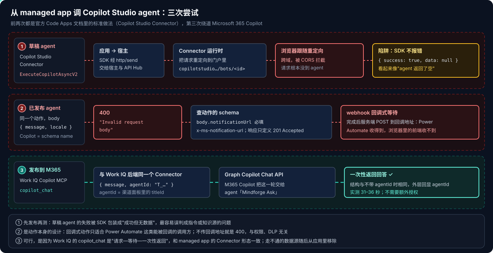
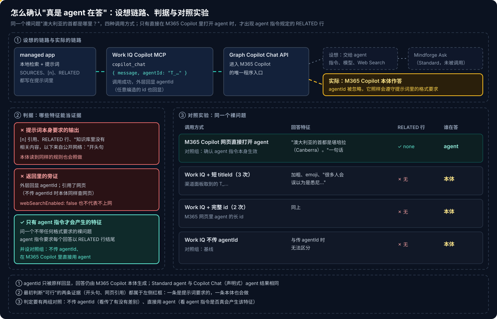
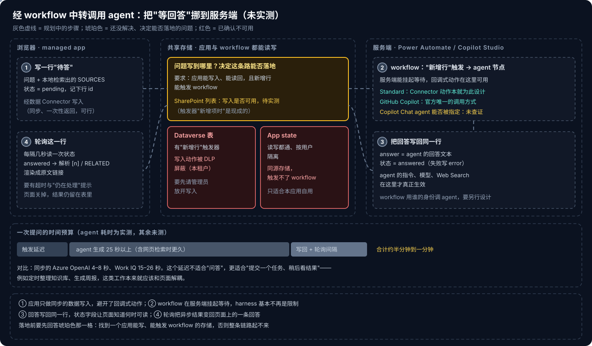

# Copilot Managed Runtime 系列 10：调用 Copilot Studio Agent 为何走不通

> [!IMPORTANT]
> 资料截至 2026-10-28，是在一个企业租户里对已部署 managed app 的实测记录。本篇初版的结论是"经 Work IQ 传 `agentId` 可以调到 agent"，同日复测证明**这个结论是错的**，现已整篇改写；错在哪里、怎么发现的，本身就是本篇最有用的部分（第二节）。Work IQ Copilot MCP Connector 仍是 **Preview**，`agentId` 的行为以后可能改变，升级后按第二节的方法重测。

[系列 09](Copilot-Managed-Runtime系列09：本地检索加Work-IQ的问答.md) 用 Work IQ 直调 Microsoft 365 Copilot，做出了带引用的问答页。路线图上的下一步，是加一个 **Copilot Studio agent** 作为可切换的第二种后端：同样的检索结果，换一个可以选模型、能上网兜底的回答者，对比质量、引用和延迟。

[系列 05](Copilot-Managed-Runtime系列05：在应用里调用AI的几条路.md) 给这一步规划的路线是 Copilot Studio Connector 的 `ExecuteCopilotAsyncV2`——也是官方 Code Apps 文档的标准做法。agent 本身的配置与发布见 [Copilot Studio 系列 06](../Copilot-Studio/Copilot-Studio系列06：Standard-Agent的配置与发布.md)，判定方法的展开见 [Copilot Studio 系列 07](../Copilot-Studio/Copilot-Studio系列07：如何确认是Agent在回答.md)。

## 结论先行

- **三条路都没走通。** Copilot Studio Connector 对草稿 agent 重定向到门户、被 CORS 拦截；对已发布 agent 要求必填的回调地址 `notificationUrl`。改走 Work IQ `copilot_chat` 传 `agentId`，调用成功，但 **`agentId` 被忽略**，回答来自 M365 Copilot 本体。
- **第三条最危险，因为它看起来是成功的。** 回答带着"知识库里没有相关内容，以下来自公开网络："和网页引用，外层还回显了 `agentId`——但开头句是我们自己的提示词要求的，本体照样遵守；不传 `agentId` 时本体同样查网页；随手编的 `T_<GUID>` 也会被原样回显。
- **判定"真是 agent 在答"要用只有 agent 指令才会产生的特征。** 问一个不带任何格式要求的裸问题，并设两组对照：不传 `agentId`、在 M365 Copilot 里直接用 agent。只有后者出现了 agent 指令规定的 `RELATED` 行。
- **四种 harness 从浏览器里的 managed app 都调不到。** Standard、Copilot Chat（声明式）实测不行，GitHub Copilot harness 官方不支持 Connector 调用，Customer Conversation 的渠道被应用的 CSP 挡住（推断）。
- **根因在 managed app 这一侧**：只能经 Connector 访问外部、不能直连外部地址或嵌 iframe；能调 agent 的 Connector 动作是回调式，浏览器收不到回调；唯一能同步拿到回答的 Work IQ 不认 `agentId`。agent 本身没问题，在 M365 Copilot、Teams 里直接用时指令生效。
- **剩下的只有异步、经 workflow 中转的做法**（未实测）：应用写一行 → workflow 触发、调 agent、写回 → 应用轮询。代价是半分钟到一分钟的体验，以及"问题写到哪里能触发 workflow"这个未解的问题。
- **问答页的 agent 切换项已移除。** 它真正起作用的只剩"提示词允许上网"，挂着 agent 的名字只会误导；现在问答页只保留 Work IQ 和 Azure OpenAI 两种后端（[系列 11](Copilot-Managed-Runtime系列11：用Azure-OpenAI-Connector直调模型.md)）。

---

## 一、三次尝试



三条泳道从上往下是时间顺序，三次都以红色收尾；黄色框是"看起来没问题"的陷阱。前两次失败得很直接，第三次失败得最像成功。

### 1.1 草稿 agent：重定向、CORS，和一个"成功"

按计划加数据源：

```bash
ms app add data-source --connector shared_microsoftcopilotstudio --as action --use-sso
```

生成的 Service 方法是 `ExecuteCopilotAsyncV2(Copilot, body, x-ms-conversation-id?, environmentId?)`，`Copilot` 填 agent 的 schema name。agent 还没发布时调用，浏览器网络面板里能看到：Connector 运行时没有把请求交给 agent，而是**重定向到门户里这个 agent 的页面**（`copilotstudio.microsoft.com/…/bots/<id>`）；浏览器跟随重定向，跨域请求被 CORS 拦截。

麻烦的是 SDK 那一层的表现：返回 `{ success: true, data: null }`。如果只看 SDK 结果，会以为 agent 答了一个空回答，然后去改指令、查知识源——方向完全错了。

> [!WARNING]
> managed app 里调 Connector，`success` 只表示"这次调用在宿主与 API Hub 之间没有出错"，不保证业务上拿到了结果。`data` 为空时，第一步是打开网络面板看真实的请求与重定向，而不是改提示词。

### 1.2 已发布 agent：400，因为它要一个回调地址

发布之后再调，body 传 `{ message, locale }`，返回 **400 "Invalid request body"**。翻这个动作的 schema 才看到原因：

- body 里的 `notificationUrl` 是**必填**字段，标注为 `x-ms-notification-url`；
- 响应只定义了 **201 Accepted**。

这是 Power Platform Connector 的 webhook 式异步模式：调用方提供一个回调地址，服务端接受请求后立即返回 201，生成完成后再把结果 POST 到这个地址。Power Automate 的流可以挂起等待回调，所以动作名里有 "and wait"；而 managed app 是跑在浏览器里的前端，**没有可以被服务端回调的地址**。

这和权限、DLP、harness 都无关，是动作本身的形态与调用方不匹配。走不通之后就把数据源移除：

```bash
ms app remove data-source --name microsoftcopilotstudio
```

不只是为了代码干净：每个数据源都会出现在用户首次使用时的授权框里（[系列 09](Copilot-Managed-Runtime系列09：本地检索加Work-IQ的问答.md) 第六节），留着一个用不上的 Connector，等于让每个用户多同意一项。

### 1.3 Work IQ 加 agentId：调用成功，agent 却没接手

[系列 09](Copilot-Managed-Runtime系列09：本地检索加Work-IQ的问答.md) 已经提到，Work IQ 的 `copilot_chat` 有一个可选参数 `agentId`，描述是 "Agent ID for the Microsoft Copilot conversation"。Work IQ 包装的是 Graph Copilot Chat API，这是程序进入 M365 Copilot 的唯一入口；agent 如果在 M365 Copilot 里，这条已经跑通的链路看上去就能把问题交给它。

**前提是 agent 进入 M365 Copilot。** 发布时在 Microsoft 365 and Teams 渠道里保持勾选 **"Make agent available in Microsoft 365 Copilot"**，agent 就有了一个 `T_…` 形式的 titleId（渠道面板 "See agent in Teams" 的链接里、或 Dataverse `bot` 行的应用清单信息里都能取到）。它不是 schema name，三套标识的对照见 [Copilot Studio 系列 06](../Copilot-Studio/Copilot-Studio系列06：Standard-Agent的配置与发布.md)。

**代码只多一个可选参数**：

```ts
/** agentId：设想是交给指定的 M365 Copilot agent；实测被忽略 */
export async function askCopilot(message: string, agentId?: string): Promise<string> {
  const res = await WorkIQCopilotMCPService.mcp_m365copilot(undefined, {
    jsonrpc: '2.0',
    id: crypto.randomUUID(),
    method: 'tools/call',
    params: { name: 'copilot_chat', arguments: agentId ? { message, agentId } : { message } },
  });
  if (!res.success) throw res.error ?? new Error('Work IQ Copilot 调用失败');
  // 之后的六层解析与系列 09 完全相同
  ...
}
```

提示词与 Work IQ 后端相同，只在开头一句分支：本体版写 "Answer ONLY from the SOURCES"；agent 版写"SOURCES 优先，没有答案才查公开网络，并以'知识库里没有相关内容，以下来自公开网络：'开头"。

**调用的表现和预期完全一致**：返回结构不变，外层多了一个回显的 `agentId` 字段；问知识库里没有的问题，回答以那句开头句起首、引用了公开文档页面，耗时 31–36 秒，比直调本体慢一截。当时据此判断"可行"，并把它作为问答页的第二种后端上线。

---

## 二、复测：同一份证据，换一种问法



### 2.1 最初的证据为什么不算数

回头看，当初的三条证据都落在图中左侧的红框里：

- **开头句和 `[n]`、`RELATED` 格式**：是**应用自己的提示词**要求的。M365 Copilot 本体读到同样的规则，也会照做。
- **网页引用**：不传 `agentId` 时，本体同样会查网页。返回里本体的 `webSearchEnabled` 显示为 `false`，但这个字段并不代表"不上网"——问"Microsoft Web IQ 是什么"，传不传 `agentId` 都引用了 13–15 个公开网页。
- **外层回显 `agentId`**：Work IQ 对**任意** agentId 都返回成功并原样回显，包括随手编的 `T_<任意 GUID>`，不报错。

慢一截也不是证据：多出的十秒，可能只是因为提示词允许上网。

### 2.2 只有 agent 才会留下的痕迹

agent 的指令里有一条规则：**每个回答都以 `RELATED` 行结尾**。在应用的提示词里也有这条要求，所以平时没法区分；但如果问一个**不带任何格式要求的裸问题**，提示词里就没有这条规则了——还出现 `RELATED` 行，就只能是 agent 指令在起作用。

于是用同一个裸问题"澳大利亚的首都是哪里？"跑四组：

| 调用方式 | 次数 | 回答特征 | RELATED 行 |
|---|---|---|---|
| M365 Copilot 网页里直接打开 agent | 1 | "澳大利亚的首都是堪培拉（Canberra）。"一句话 | **有**（`RELATED: none`） |
| Work IQ + 渠道面板里的短 titleId | 3 | 加粗、emoji、"很多人会误以为是悉尼…" | 无 |
| Work IQ + M365 网页里 agent 的完整 id | 2 | 同上 | 无 |
| Work IQ，不传 agentId | 1 | 与传 agentId 时无法区分 | 无 |


第一组是"agent 指令确实会产生这个特征"的对照，第四组是"传与不传有没有差别"的对照。两组一夹，结论很清楚：**经 Work IQ 传 `agentId` 时，agent 从未接手。**

对一个专门建的 Copilot Chat（声明式）agent 做同样的实验，结果相同（[Copilot Studio 系列 07](../Copilot-Studio/Copilot-Studio系列07：如何确认是Agent在回答.md)）。

> [!CAUTION]
> 判断"确实是某个组件在处理"，不能用你自己要求它输出的东西，也不能看"回显了参数"。要找只有那个组件才会产生的特征，再用"不经过它""直接用它"两组对照把结论夹住。这一条不只适用于 agent：任何"多传一个参数就换了处理者"的接口都该这样验。

---

## 三、四种 harness 都调不到

复测之后，把 Copilot Studio 的四种 harness 从浏览器里的 managed app 同步调用的可能性逐一核对：

| harness | 能否从问答页同步调用 | 依据 |
|---|---|---|
| Standard | 不能 | Copilot Studio Connector 的 `ExecuteCopilotAsyncV2` 要回调地址；Work IQ 忽略 `agentId`（都实测） |
| Copilot Chat（声明式） | 不能 | 只跑在 M365 Copilot 里，Connector 调不到；Work IQ 忽略 `agentId`（实测） |
| GitHub Copilot（新建默认） | 不能 | Connector 官方不支持，只能在 workflow 的 agent 节点里调（[Copilot Studio 系列 03](../Copilot-Studio/Copilot-Studio系列03：四种Harness对比与选型.md)） |
| Customer Conversation | 不能（推断，未实测） | 渠道是网站聊天和电话；网站聊天要 iframe 或 Direct Line，都被应用的 CSP（`frame-src`、`connect-src 'self'`）挡住 |

**根本原因在 managed app 这一侧**，三个约束叠在一起：

1. 应用只能经 Connector 访问外部，不能直连外部地址，也不能嵌外部 iframe（[系列 03](Copilot-Managed-Runtime系列03：宿主沙箱与安全边界.md) 的 CSP）；
2. 能调 agent 的 Connector 动作是回调式的，浏览器收不到回调；
3. 唯一能同步拿到回答的 Work IQ，不认 `agentId`。

agent 本身没有问题。同一个 agent 在 M365 Copilot、Teams 里直接用时，指令、模型、Web Search 都生效——它只是不能被一个浏览器里的应用当作函数来调。

---

## 四、剩下的一条路：经 workflow 异步中转



回调式动作调不了，是因为调用方在浏览器里。把"等回答"这件事挪到服务端，就能绕开：这正是 [Copilot Studio 系列 04](../Copilot-Studio/Copilot-Studio系列04：Agent、Workflow与App的协作.md) 里的"共享数据"模式。四步：

1. **问答页把问题写进一张表**（新增一行，状态"待答"）；
2. **workflow 的"新增行"触发器启动**，用 agent 节点调 agent；
3. **workflow 把回答写回同一行**，状态改为"已答"；
4. **问答页轮询这一行**，读到回答再显示。

workflow 跑在服务端，能等 agent 的异步回答，所以 harness 基本不再是限制：Standard 的 Connector 动作本来就是给 Power Automate 这类能接回调的调用方设计的；GitHub Copilot harness 官方给出的唯一调用方式，就是 workflow 的 agent 节点。Copilot Chat agent 能否在 workflow 里被指定，没有查证。

**两处还没解决，所以没有实测**：

- **问题写到哪里。** Dataverse 写入动作在这个租户被 DLP 屏蔽（[系列 08](Copilot-Managed-Runtime系列08：用App-state保存用户数据.md)）；App state 写得进去，但它是 managed app 的同源存储，触发不了 workflow；SharePoint 列表的写入是否可用要实测。
- **体验。** agent 本身就要 25 秒以上，再加触发延迟和轮询间隔，一次可能要半分钟到一分钟。对"问答"这种交互来说偏慢；对"提交一个任务，稍后看结果"的场景更合适。

---

## 五、对系列 05 路线 ① 的更正

[系列 05](Copilot-Managed-Runtime系列05：在应用里调用AI的几条路.md) 列的三条可行路线里，路线 ① 原来写的是"Copilot Studio Connector 调 Standard agent"，本篇初版又改成"发布到 M365 Copilot 后经 Work IQ `agentId` 调"。实测之后，两种写法都不成立：

- **从浏览器里的 managed app，没有能同步调用 Copilot Studio agent 的路**，四种 harness 都一样。
- **路线 ② Work IQ 与路线 ③ Azure OpenAI 是仅有的两条同步路线**，问答页现在就是这两个后端，选型见 [系列 11](Copilot-Managed-Runtime系列11：用Azure-OpenAI-Connector直调模型.md) 与 [系列 12](Copilot-Managed-Runtime系列12：方案回顾与Connector接入清单.md)。
- **真需要 agent 的能力**（固定模型、网页兜底、同一个回答者也给 Teams 用户用），要么接受经 workflow 的异步体验，要么让用户直接在 M365 Copilot / Teams 里用这个 agent，应用只负责把人带过去。

---

## 参考资料

- [Connect a Managed Runtime app to data](https://learn.microsoft.com/en-us/microsoft-365/managed-apps/developer/connect-to-data?view=o365-worldwide)
- [Microsoft Copilot Studio connector reference](https://learn.microsoft.com/en-us/connectors/microsoftcopilotstudio/)
- [Connect a code app to Copilot Studio](https://learn.microsoft.com/en-us/power-apps/developer/code-apps/how-to/connect-to-copilot-studio)
- [Connect and configure an agent for Teams and Microsoft 365 Copilot](https://learn.microsoft.com/en-us/microsoft-copilot-studio/publication-add-bot-to-microsoft-teams)
- [CLI command reference](https://learn.microsoft.com/en-us/microsoft-365/managed-apps/developer/ms-cli-command-reference?view=o365-worldwide)

相关文章：

- [Copilot Managed Runtime 系列 05：在应用里调用 AI 的几条路](Copilot-Managed-Runtime系列05：在应用里调用AI的几条路.md)
- [Copilot Managed Runtime 系列 09：本地检索加 Work IQ 的问答](Copilot-Managed-Runtime系列09：本地检索加Work-IQ的问答.md)
- [Copilot Managed Runtime 系列 11：用 Azure OpenAI Connector 直调模型](Copilot-Managed-Runtime系列11：用Azure-OpenAI-Connector直调模型.md)
- [Copilot Managed Runtime 系列 12：方案回顾与 Connector 接入清单](Copilot-Managed-Runtime系列12：方案回顾与Connector接入清单.md)
- [Copilot Studio 系列 06：Standard Agent 的配置与发布](../Copilot-Studio/Copilot-Studio系列06：Standard-Agent的配置与发布.md)
- [Copilot Studio 系列 07：如何确认是 Agent 在回答](../Copilot-Studio/Copilot-Studio系列07：如何确认是Agent在回答.md)
