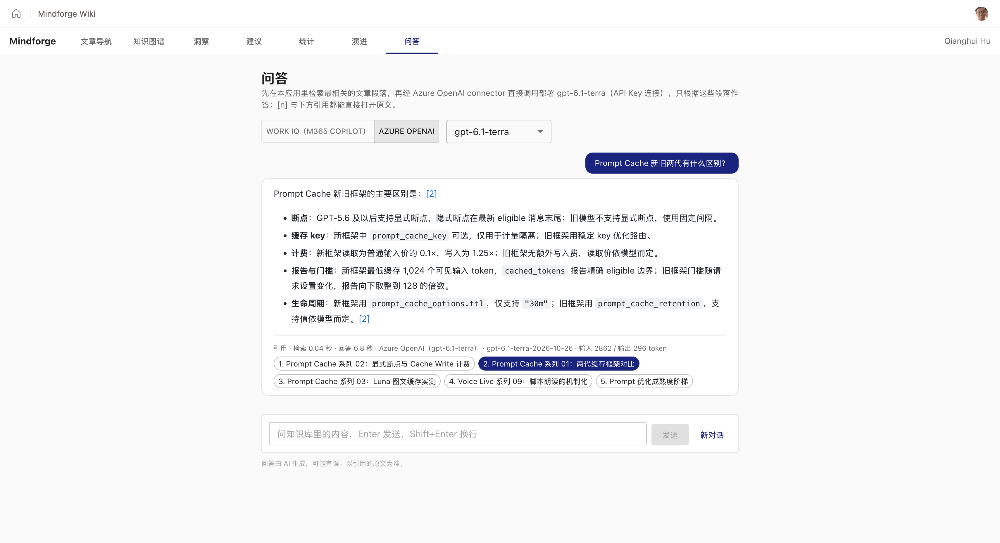

# Copilot Managed Runtime 系列 11：用 Azure OpenAI Connector 直调模型

> [!IMPORTANT]
> 资料截至 2026-10-28，是在一个企业租户里对已部署 managed app 的实测记录。Azure OpenAI Connector 的 Entra ID 认证能否创建取决于 connector 侧的应用注册，微软修复后结论可能改变；`allowedActions` 的校验规则目前只见于部署报错信息，官方文档还没有展开。

[系列 09](Copilot-Managed-Runtime系列09：本地检索加Work-IQ的问答.md) 用 Work IQ 直调 Microsoft 365 Copilot 做出了带引用的问答页，但要经过 M365 Copilot 的编排，最快也要 15 秒，模型不可选。[系列 10](Copilot-Managed-Runtime系列10：调用Copilot-Studio-Agent为何走不通.md) 想换成可以选模型的 Copilot Studio agent，复测证明从浏览器里调不到。

路线图上剩下的是 [系列 05](Copilot-Managed-Runtime系列05：在应用里调用AI的几条路.md) 的路线 ③：**Azure OpenAI Connector**。检索不变、提示词不变，只把生成端换成直接调模型部署，看"快、可控"能换来多少，又要付出什么。

## 结论先行

- **代码最少的一种后端。** 一个生成的 Service 方法、三个参数（请求体、部署名、api-version），返回是标准的 Chat Completions 响应——不用像 Work IQ 那样剥六层包装，还多拿到 `model` 和 `usage`。
- **认证只剩 API Key 一条路。** Entra ID Integrated 在企业租户里创建连接时报 `AADSTS50011`：connector 的第一方应用没有登记回调地址，错误发生在登录页之前，用户侧无解。Managed Identity 只适用于 Logic Apps。
- **API Key 连接是共享连接，平台要求声明 `allowedActions`。** 应用分享出去，所有人共用这把 key 和这份配额；所以部署时必须列出应用经这条连接能调的动作，只放行 Chat Completions。`ms app dev` 不做这项检查，本地能跑、部署才报错。
- **部署名不在连接里。** 连接只认资源，`deployment-id` 是每次调用的参数，同一条连接能调这个资源下的任何部署。
- **资源名只填裸名。** 填成 `https://….openai.azure.com/` 会被 connector 拼坏，表现是 502，而连接状态照样显示 Connected。
- **部署列表要前端自己维护。** connector 没有"列出部署"的动作；问答页的下拉框读代码里的一份清单，同一条连接实测调通 8 个对话部署。
- **同一问题实测 4.6 秒**，Work IQ 本体 15–26 秒。它因此成为问答页的默认后端；快和可控的代价是：自己的 Azure 资源、key 管理、共享身份，以及没有企业 grounding 和网页兜底。

---

## 一、链路：只换生成端



图里六个编号就是一次提问经过的六步。和 Work IQ 后端比，左边第一张卡片完全相同——同一份检索结果、同一套 `[n]` 与 `RELATED` 引用协议，这是两种后端能公平对比的前提；差别从第二步开始。

### 1.1 加数据源

```bash
ms connector list-actions --connector shared_azureopenai      # 先确认动作是 Allow
```

加数据源的命令和其他动作型 Connector 相同（见 [系列 04](Copilot-Managed-Runtime系列04：SDK与数据接入.md)），区别是 API Key 连接不支持 SSO，用的是事先在 Power Apps 里建好的那条连接。生成物也一样：`ms.config.json` 里多一个 `connectionReferences` 条目，外加一份数据源描述、一个模型文件和一个 Service 类。Service 里有 Chat Completions、Embeddings（单条与批量）和 On Your Data 扩展四个方法，本篇只用第一个。

### 1.2 调用

```ts
const DEPLOYMENT = '<部署名>';
const API_VERSION = '2024-10-21';

export async function askAzureOpenAI(prompt: string) {
  const res = await AzureOpenAIService.ChatCompletions_Create_2024Feb15Preview(
    { messages: [{ role: 'user', content: prompt }] },
    DEPLOYMENT,
    API_VERSION,
  );
  if (!res.success) throw new Error(JSON.stringify(res.error).slice(0, 500));
  const choice = res.data.choices?.[0];
  const text = choice?.message?.content;
  if (!text) throw new Error(`返回了空回答（finish_reason: ${choice?.finish_reason ?? '未知'}）`);
  return {
    text,
    model: res.data.model,
    promptTokens: res.data.usage?.prompt_tokens,
    completionTokens: res.data.usage?.completion_tokens,
  };
}
```

三个值得注意的地方：

- **方法名里的 `2024Feb15Preview` 是 connector 动作的名字，不是实际用的 API 版本。** 真正发给 Azure OpenAI 的 api-version 是第三个参数，这里传的是 GA 版本 `2024-10-21`。
- **整个提示词放进一条 `user` 消息。** 规则、SOURCES、最近两轮对话都在里面，和 Work IQ 后端一字不差（Work IQ 的 `copilot_chat` 只接受一个 `message` 字符串），没有拆成 system + user。以后单独优化这个后端时，把规则挪进 `system` 是第一件可做的事。
- **空回答要报出 `finish_reason`。** `content` 为空通常是被内容过滤或长度截断，把原因显示出来，比显示一个空气泡好排查得多。

### 1.3 返回与显示

返回就是标准的 OpenAI 响应：`choices[0].message.content` 是回答，交给与 Work IQ 后端共用的解析器拆出 `[n]` 和 `RELATED` 行。另外两个字段 Work IQ 给不了：

- **`model`**：实际作答的模型版本（带日期后缀），部署升级了能直接看出来；
- **`usage`**：输入 / 输出 token，成本可以逐条算。

问答页在每条回答下方分开显示**检索**耗时（本地，通常几十毫秒）和**回答**耗时（connector + 模型），再跟上后端、部署、模型版本与输入 / 输出 token。两段分开，慢在哪一段一眼可见。



截图里的问题是"Prompt Cache 新旧两代有什么区别"。回答按要点列出断点、缓存键、计费、门槛、生命周期五项差别，只引用了检索到的第 2 篇（实心标签）；小字是"检索 0.04 秒 · 回答 6.8 秒 · Azure OpenAI（部署名）· 模型版本 · 输入 2862 / 输出 296 token"。

---

## 二、连接：理想的那种建不出来



### 2.1 三种认证方式

Azure OpenAI Connector 声明支持三种认证，图上半部分是它们在一个企业租户里的实际结果。

**Microsoft Entra ID Integrated 本来是最理想的。** 只要填资源名；每个用户用自己的身份调用，需要在资源上有 Cognitive Services OpenAI User 角色；连接不共享，谁调的一清二楚——和 Work IQ 一样是"每人各自连接"的模型。

但创建连接时，登录弹窗直接报 **`AADSTS50011`**：connector 的第一方应用没有登记 `https://global.consent.azure-apim.net/redirect/azureopenai` 这个回调地址。判断这不是自己的问题有两条依据：

1. 错误发生在**输入账号之前**——这是 Entra 在受理登录请求时对应用注册做的校验，和账号、权限无关；
2. Chrome 与 Firefox、清不清缓存，结果完全一致。

> [!NOTE]
> 即使 Entra 方式能建连接，还有一层跨租户问题：connector 的登录走 `/common`，令牌由账号的主租户签发；资源若在另一个租户，通常会被拒。本机用 `az account get-access-token --subscription <资源所在租户的订阅> --resource https://cognitiveservices.azure.com` 直接调能通，那是因为令牌直接从资源所在租户取——connector 没有这个选项。所以第一个资源在别的租户时，最后换成了一个与账号同租户的资源。

**Managed Identity 只适用于 Logic Apps**，managed app 和 Power Apps 里用不上。

剩下的 **API Key** 能用：填资源名和 key，key 只保存在 Power Platform 的连接对象里，不进代码、不进 `ms.config.json`、不进仓库。代价是这条连接是**共享**的——下一节的约束全部由此而来。

### 2.2 部署名不在连接里

建连接时只填资源名，不选模型。部署是每次调用的参数 `deployment-id`，所以**同一条连接能调这个资源下的任何部署**。"用哪个模型"这件事因此拆成了三层，各管一件：

- **用哪个资源、什么凭据**——Power Platform 连接（资源名 + key），改它要重新授权；
- **用哪个部署**——前端：代码里的一份部署清单，加问答页上的下拉框，选择记在本机；
- **部署背后的模型版本**——Azure 门户里该部署的配置，升级模型不用动应用。

**connector 没有"列出部署"的动作**，所以清单只能在代码里维护：用 `az cognitiveservices account deployment list` 查出来，手工补进去。只放对话部署，realtime、image、embedding 部署不适用 Chat Completions。

清单里 8 个对话部署，用同一条连接、同样的参数逐个实测（提示"只回答两个字：你好"，`ms app dev`），全部调通：

| 模型代际 | 部署数 | 单次耗时 |
|---|---|---|
| GPT-6.1 | 2 | 6.0 秒（第一个调用，含冷启动）、2.6 秒 |
| GPT-6 | 3 | 2.0–2.9 秒 |
| GPT-5.6 | 3 | 1.5–3.1 秒 |

换成正式问题"Prompt Cache 新旧两代有什么区别？"，同一份 2954 token 的提示词：最新代部署 4.6 秒（输出 265 token），GPT-5.6 部署 3.7 秒（输出 251 token）。回答质量的差别要更多样本才能说清，但"换模型只是换一个下拉框选项"这件事已经成立。

这和 Work IQ 正好相反：那边连接是用户自己的，模型却由 M365 Copilot 决定；这边连接是共享的，模型完全由应用决定。

### 2.3 踩坑：资源名填成了完整网址

第一次调用一直返回 **502 BadGateway**，内层是 500 Internal server error，换 api-version 也一样。连接状态显示 Connected，看不出问题。

最后用 Power Apps API 查这条连接的非机密参数才找到原因：

```text
GET …/apis/shared_azureopenai/connections/<连接 ID>
→ properties.connectionParametersSet.values
```

资源名一栏填的是 `https://<资源名>.openai.azure.com/`。connector 会自己拼 `https://<资源名>.openai.azure.com/…`，填进完整网址就拼成了一个不存在的主机。改成只填 `<资源名>` 后正常。

> [!WARNING]
> **连接状态 Connected 只说明凭据还有效，不校验资源名这类参数。** API Key 连接出现 502 / 500，先查连接的参数值，再怀疑 api-version、部署名或模型本身。

---

## 三、部署：共享连接必须声明 allowedActions

### 3.1 部署被拒

本地 `ms app dev` 一切正常，第一次 `ms app deploy` 却被拒：

```text
connectionReferences.<id>.allowedActions: Shared connection references without dataset tables
must declare connector-level allowedActions.
```

原因在 `ms.config.json` 里这个条目的形状。和 Work IQ（`certOauth`、每人各自连接）不同，它带着一个 `sharedConnectionId`：

```json
"authenticationType": "keyBasedAuth",
"sharedConnectionId": "/providers/Microsoft.PowerApps/apis/shared_azureopenai/connections/<连接 ID>",
"dataSets": {},
"allowedActions": ["ChatCompletions_Create_2024Feb15Preview"]
```

最后一行是补上的。规则的逻辑是：**共享连接意味着别人在用你的凭据**。应用分享给同事后，同事的浏览器里跑的也是这条连接；如果不加限制，任何能打开应用的人都可以借它调用这个 connector 的任意动作。所以对"没有数据集表"的共享连接——也就是动作型 Connector——平台要求在部署时列出白名单。

只放行用到的那一个动作：别人借这条连接只能调 Chat Completions，调不了 Embeddings 或 On Your Data 扩展。

> [!TIP]
> `ms app dev` 不做 `allowedActions` 检查，只有部署时才校验。加任何**共享**连接的数据源后，先手动补上 `allowedActions` 再提交，不要等部署报错；以后用到新动作（比如 Embeddings），也要同步加进白名单。

### 3.2 线上首问：两条连接的授权框

上线后第一次提问，宿主弹出授权框，同时列出两条连接：Azure OpenAI（标明是共享连接）和 Work IQ。

点 Allow 之前的等待被算进了那次提问的计时，显示 230 秒；授权之后线上实测 **8.4 秒**（输入 5087 / 输出 179 token）。

> [!CAUTION]
> 测延迟一定要用授权之后的数字。首问计时里混着人在授权框前停留的时间，会把一个 5 秒的后端测成 4 分钟。

---

## 四、两种后端对比


图的上半部分是请求经过的层。Azure OpenAI 只有"应用检索 → connector → 部署"三跳；Work IQ 多了 Copilot 编排和企业搜索 grounding，每多一层，就多大约十秒。灰色的第三行是曾经上线过的"Copilot Studio agent"后端：复测发现 Work IQ 忽略了 `agentId`，它实际等于"Work IQ + 允许上网的提示词"，已从问答页移除（[系列 10](Copilot-Managed-Runtime系列10：调用Copilot-Studio-Agent为何走不通.md)）。

同一问题"Prompt Cache 新旧两代有什么区别？"的实测：

| | Azure OpenAI | Work IQ（M365 Copilot 本体） |
|---|---|---|
| 调用链 | 应用 → Azure OpenAI connector → 自己的部署 | 应用 → Work IQ → Graph Copilot Chat API → M365 Copilot |
| 耗时 | **4–8 秒**（典型 4.6 秒） | 15–26 秒 |
| 模型 | 每次调用选部署（下拉框） | M365 Copilot 自动路由，不可选 |
| 连接身份 | 共享一把 API Key | 每个用户自己，SSO |
| 用户前提 | 无，分享应用即可用 | 每人有 M365 Copilot 许可证 |
| 资料外的问题 | 只看 SOURCES，不上网 | 会引用网页，即使 `webSearchEnabled: false` |
| 可观测 | 返回模型版本和 token 用量 | 只有回答文本，外加回显的 fileUris |
| 计费 | 资源所在订阅按 token | 用户的 Copilot 许可证 |
| 改行为 | 改提示词或换部署，前端发版即生效 | 只能改提示词 |

两者的引用都遵守 `[n]` + `RELATED` 协议。这正是 [系列 05](Copilot-Managed-Runtime系列05：在应用里调用AI的几条路.md) 的原则：**事实由应用给，模型只负责组织语言**——检索和协议固定在应用里，生成端就可以像插件一样替换，换谁主要影响速度、成本和治理。

### 怎么选

- **默认用 Azure OpenAI。** 快 3–5 倍，结果可复现，能看到用量；只要有自己的 Azure 资源，这是做应用内问答最直接的路。前提是接受共享身份：资源侧看不到是谁在调，配额和费用都算在资源所有者头上，用量治理只能靠 `allowedActions` 和资源配额。
- **没有 Azure 资源、用户都有 Copilot 许可证** → Work IQ。零配置、用户自己的身份、有企业 grounding，也是参考应用的做法；代价是不能选模型、最慢，"只依据 SOURCES"只能靠提示词约束。
- **想要 Copilot Studio agent 的能力**（固定模型、网页兜底、同一个回答者也给 Teams 用户用）→ 从浏览器里的 managed app 同步调不到，只能经 workflow 异步中转，或让用户直接在 M365 Copilot 里用这个 agent（[系列 10](Copilot-Managed-Runtime系列10：调用Copilot-Studio-Agent为何走不通.md) 第四节）。

问答页现在保留这两种后端，Azure OpenAI 为默认；每条回答都标注由谁作答、检索与回答各耗时多少。

---

## 五、还没做的

- **把规则挪进 `system` 消息。** 现在为了与 Work IQ 后端对齐，整个提示词塞在一条 `user` 消息里。
- **流式输出。** Azure OpenAI 本身支持流式，但 Connector 经宿主转发，只能一次性返回（[系列 03](Copilot-Managed-Runtime系列03：宿主沙箱与安全边界.md)）；5 秒的等待目前还能接受。
- **向量检索。** 现在检索仍是构建期索引 + 前端关键词打分。Connector 里有 Embeddings 动作，但每次提问都多一次调用、白名单也要放开；更合适的是构建期离线算好向量随应用发布，运行期只在前端算余弦相似度。
- **部署间的质量对比。** 下拉框已经让 A/B 变得很便宜，但目前只比了耗时和 token；回答质量要一组固定问题批量跑才有结论。

---

## 参考资料

- [Azure OpenAI connector reference](https://learn.microsoft.com/en-us/connectors/azureopenai/)
- [Azure OpenAI REST API reference](https://learn.microsoft.com/en-us/azure/ai-foundry/openai/reference)
- [Connect a Managed Runtime app to data](https://learn.microsoft.com/en-us/microsoft-365/managed-apps/developer/connect-to-data?view=o365-worldwide)
- [CLI command reference](https://learn.microsoft.com/en-us/microsoft-365/managed-apps/developer/ms-cli-command-reference?view=o365-worldwide)

相关文章：

- [Copilot Managed Runtime 系列 05：在应用里调用 AI 的几条路](Copilot-Managed-Runtime系列05：在应用里调用AI的几条路.md)
- [Copilot Managed Runtime 系列 09：本地检索加 Work IQ 的问答](Copilot-Managed-Runtime系列09：本地检索加Work-IQ的问答.md)
- [Copilot Managed Runtime 系列 10：调用 Copilot Studio Agent 为何走不通](Copilot-Managed-Runtime系列10：调用Copilot-Studio-Agent为何走不通.md)
- [Copilot Managed Runtime 系列 12：方案回顾与 Connector 接入清单](Copilot-Managed-Runtime系列12：方案回顾与Connector接入清单.md)
- [Copilot Studio 系列 02：Connector 与连接](../Copilot-Studio/Copilot-Studio系列02：Connector与连接.md)
