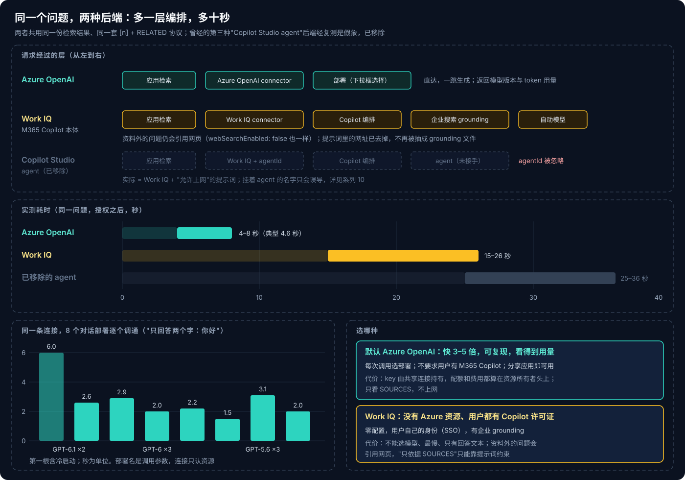
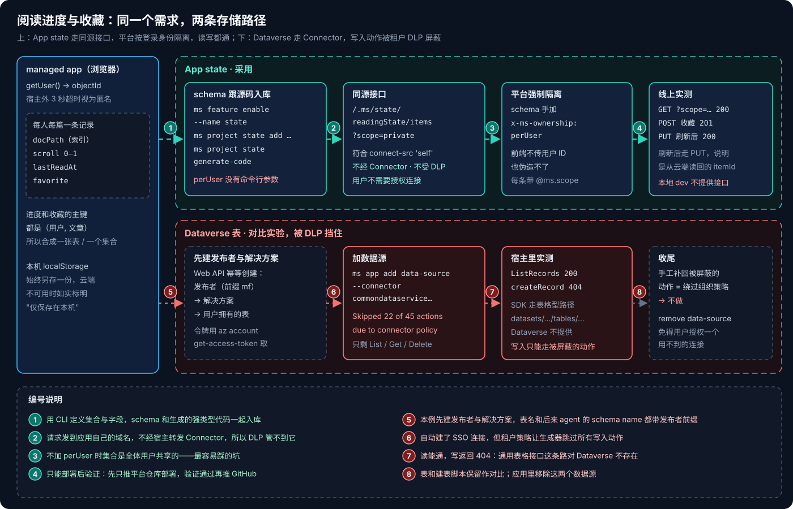
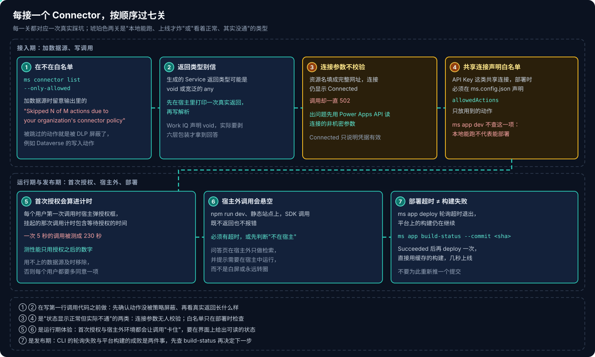
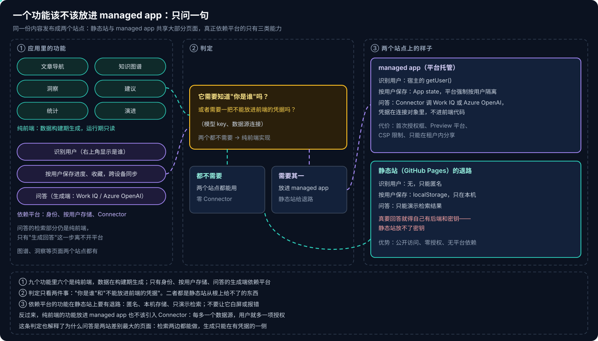

# Copilot Managed Runtime 系列 12：方案回顾与 Connector 接入清单

> [!IMPORTANT]
> 基线 2026-10-28，是一个知识库 managed app 把路线图六个阶段全部做完后的回顾。平台仍是 Preview，下文的耗时和"能 / 不能"都是在一个企业租户里的实测，换租户（DLP 策略不同）或升级 CLI / SDK 后要重新核对。

系列 07–11 一篇一个功能，记的是"怎么做出来"。本篇换一个角度：**同一件事试过几种做法、各自的代价是什么，下次再做类似功能时怎么选。** 细节和踩坑过程都在前面的文章里，这里只做比较和结论。

## 结论先行

- **问答后端默认用 Azure OpenAI**：快 3–5 倍、结果可复现、能看到用量；没有 Azure 资源、用户都有 Copilot 许可证时用 Work IQ。**Copilot Studio agent 从浏览器里的 managed app 同步调不到**，四种 harness 都一样，只能经 workflow 异步中转。
- **判断"是不是某个组件在处理"，要用只有它才会产生的特征**，并设"不经过它""直接用它"两组对照。提示词要求的格式、回显的参数都不算证据。
- **只给本应用用的个人数据放 App state**；要让 agent 或 Power Automate 读到同一份数据才用 Dataverse，且要先请管理员放开写入。**App state 默认是所有用户共享的**，必须手改 schema 加 `x-ms-ownership: perUser`。
- **每接一个 Connector 过七关**：白名单、返回类型、连接参数、`allowedActions`、首次授权、宿主外悬空、部署超时。其中两关是"状态显示正常但其实不通"。
- **一个功能要不要放进 managed app，只问一句**：它需要知道"你是谁"，或者需要一把不能放进前端的凭据吗？都不需要的，纯前端实现，静态站和 managed app 都能用。

---

## 一、问答的后端

问答页现在有两个后端，用**同一份本地检索结果和同一套提示词**（SOURCES + `[n]` + `RELATED:`）。完整对比见 [系列 11](Copilot-Managed-Runtime系列11：用Azure-OpenAI-Connector直调模型.md) 第四节，这里只列决定选型的几项：

- **速度**：Azure OpenAI 4–8 秒；Work IQ 15–26 秒，提示词允许上网时 25–36 秒。
- **用户前提**：Azure OpenAI 无，分享应用即可用；Work IQ 要求每人有 M365 Copilot 许可证。
- **谁出钱、谁的身份**：Azure OpenAI 是共享连接里的一把 key，费用和配额都算在资源所有者头上；Work IQ 用当前用户的身份和许可证。
- **能控制什么**：Azure OpenAI 每次调用选部署、返回模型版本与 token；Work IQ 只能改提示词，模型自动路由，只拿到回答文本。
- **上网**：Azure OpenAI 只看 SOURCES；Work IQ 即使 `webSearchEnabled: false`，资料外的问题也会引用网页。

**怎么选**：

1. **默认 Azure OpenAI。** 只要有自己的 Azure 资源，这是做应用内问答最直接的路。
2. **Work IQ** 适合"没有 Azure 资源、用户都有 Copilot 许可证"的组织，也是参考应用的做法（[系列 06](Copilot-Managed-Runtime系列06：参考应用拆解与功能模式.md)）。零配置、有企业 grounding，代价是不能选模型、最慢。
3. **Copilot Studio agent 目前从浏览器里调不到**。Copilot Studio Connector 的动作是回调式的，浏览器收不到回调；唯一能同步拿到回答的 Work IQ 又不认 `agentId`。想打通只剩异步、经 workflow 中转这条路，问题写到哪里、体验能否接受都还没解决（[系列 10](Copilot-Managed-Runtime系列10：调用Copilot-Studio-Agent为何走不通.md) 第四节）。

> [!CAUTION]
> **这一节最贵的教训不是选型，是验证方法。** "Copilot Studio agent 后端"曾经上线过一天：调用成功、回答格式正确、还回显了 `agentId`。但格式是我们自己的提示词要求的，M365 Copilot 本体照样会遵守；`agentId` 对任意值都回显。判断"确实是 agent 在答"，要问一个不带任何格式要求的裸问题，看有没有只有 agent 指令才会产生的特征，并和"不传 agentId""在 M365 Copilot 里直接用 agent"两组对照。方法的展开见 [Copilot Studio 系列 07](../Copilot-Studio/Copilot-Studio系列07：如何确认是Agent在回答.md)。

---

## 二、用户数据：App state 还是 Dataverse

阅读进度和收藏两条路都试过（[系列 08](Copilot-Managed-Runtime系列08：用App-state保存用户数据.md)），在这个租户里的结果：

| | App state（采用） | Dataverse 表 |
|---|---|---|
| 本租户结果 | 读写都通 | 读可以；写入动作被 DLP 屏蔽，SDK 的 `createRecordAsync` 走表格路径返回 404 |
| 隔离 | `x-ms-ownership: perUser`，平台强制 | 表的拥有者 + 安全角色 |
| 经过 Connector | 否（同源存储） | 是，要授权连接，受 DLP 管控 |
| 本地调试 | 不行，只能部署后验证 | `ms app dev` 可用 |
| 共享给 agent / 流程 | 不能 | 能 |
| 成熟度 | 实验特性 | 正式功能 |

**结论**：只给本应用用的个人数据（进度、收藏、偏好）放 App state。要让 agent 或 Power Automate 读到同一份数据时才用 Dataverse，并且要先请管理员放开写入动作。

两条要特别记住：

- **App state 默认是所有用户共享的集合。** 不手改 schema 加 `x-ms-ownership: perUser`，A 用户的阅读进度会被 B 用户看到、覆盖。这是整个平台最容易踩、后果也最严重的坑。
- **不要手工把被屏蔽的动作补进生成的数据源描述。** 加数据源时被跳过的动作就是被组织策略屏蔽的，手工补回去等于绕过 DLP。实验做完后，空表和那条连接也一并删掉了，免得留着一个用户用不到却要授权的数据源。

这个选择还间接决定了第一节的异步方案：App state 写得进去，但它是同源存储，**触发不了 workflow**；能触发 workflow 的 Dataverse 又写不进去。所以"应用写表、workflow 调 agent"这条路，卡在了存储上。

---

## 三、Connector 接入检查清单

每接一个 Connector，按顺序过一遍。七关都是这个项目实际踩到的：

1. **在不在白名单。** `ms connector list --only-allowed` 先看；`ms app add data-source` 的输出里留意 **"Skipped N of M actions due to your organization's connector policy"**——被跳过的动作就是被 DLP 屏蔽了。
2. **返回类型别信。** 生成的 Service 返回类型可能是 `void` 或宽泛的 `any`（Work IQ 就是），实际格式要先在宿主里打印一次再写解析（[系列 09](Copilot-Managed-Runtime系列09：本地检索加Work-IQ的问答.md) 的"剥六层"）。
3. **连接参数不校验。** Azure OpenAI 的资源名填成网址，连接仍显示 Connected，调用却一直 502。出问题先用 Power Apps API 读连接的非机密参数（[系列 11](Copilot-Managed-Runtime系列11：用Azure-OpenAI-Connector直调模型.md) 2.3 节）。
4. **共享连接声明白名单。** API Key 这类共享连接，部署时必须在 `ms.config.json` 声明 `allowedActions`，只放用到的动作。`ms app dev` 不查这一项，本地能跑不代表能部署。
5. **首次授权会算进计时。** 每个用户第一次调用时宿主弹授权框，挂起的那次调用计时包含等待授权的时间，不要拿它当性能数据。
6. **宿主外调用会悬空。** `npm run dev`、静态站点上，SDK 调用既不返回也不报错，必须有超时或"不在宿主"判断，界面上给出可读的提示。
7. **部署超时不等于构建失败。** `ms app deploy` 轮询超时退出时，先 `ms app build-status --commit <sha>`；成功后再 deploy 一次，直接用缓存的构建。

> [!TIP]
> 第 3、4 关最值得提前做：它们是"状态显示正常但实际不通"的类型，出问题时最不容易想到。加任何**共享**连接的数据源后，先手动补 `allowedActions` 再提交；连接一旦 502 / 500，先查参数值，再怀疑 api-version、部署名或模型。

---

## 四、哪些功能离不开平台

这个知识库同时发布成两个站点：一个 GitHub Pages 静态站，一个 managed app。两者共享内容和大部分页面——导航、图谱、洞察、建议、统计、演进都是纯前端，数据在构建期生成。真正依赖平台的只有三类：

| 能力 | 依赖什么 | 静态站上的退路 |
|---|---|---|
| 识别用户 | 宿主的 `getUser()` | 无，只能匿名 |
| 按用户保存、跨设备同步 | App state | localStorage，只在本机 |
| 问答 | Connector（Work IQ / Azure OpenAI） | 只能演示检索；要真回答就得自己有后端和密钥，静态站放不了密钥 |

所以判断一个功能要不要放到 managed app，可以只问一句：

> **它需要知道"你是谁"，或者需要一把不能放进前端的凭据吗？**

都不需要的，纯前端实现，两个站点都能用；需要其中之一的，放进 managed app，并在静态站上给出退路，而不是白屏或报错。

反过来也成立：纯前端的功能放进 managed app，也不该为了"在平台上"而引入 Connector——每多一个数据源，每个用户就多一项授权。[系列 07](Copilot-Managed-Runtime系列07：零Connector的分析页面.md) 的洞察、建议、统计三页零 Connector，就是按这个原则做的。

---

## 五、还没定论的问题

两个原本挂着的问题已经实测结案：

- **Copilot Chat（声明式）agent 能否经 `agentId` 调用**：不能，Standard 也不能（第一节）。
- **提示词里的网址是否拖慢 Work IQ**：网址会被抽成 grounding 文件（还会抽坏），去掉后略快但在波动范围内；现在拼 SOURCES 时已去掉网址（[系列 09](Copilot-Managed-Runtime系列09：本地检索加Work-IQ的问答.md) 第七节）。

还开着的：

- **多轮对话。** 现在每次调用都是新会话，靠提示词里带最近两轮。Work IQ 返回了 `conversationId`，能否传回去续接会话，待实测。
- **异步调 agent 的存储。** SharePoint 列表的写入在这个租户是否可用，决定了第一节的 workflow 方案能否起步。
- **部署间的质量对比。** 下拉框让换模型变得很便宜，但目前只比了耗时和 token，回答质量要一组固定问题批量跑才有结论。

---

## 参考资料

- [Connect a Managed Runtime app to data](https://learn.microsoft.com/en-us/microsoft-365/managed-apps/developer/connect-to-data?view=o365-worldwide)
- [CLI command reference](https://learn.microsoft.com/en-us/microsoft-365/managed-apps/developer/ms-cli-command-reference?view=o365-worldwide)
- [Microsoft Copilot Studio connector reference](https://learn.microsoft.com/en-us/connectors/microsoftcopilotstudio/)
- [Azure OpenAI connector reference](https://learn.microsoft.com/en-us/connectors/azureopenai/)
- [Data loss prevention policies](https://learn.microsoft.com/en-us/power-platform/admin/wp-data-loss-prevention)

相关文章：

- [Copilot Managed Runtime 系列 08：用 App state 保存用户数据](Copilot-Managed-Runtime系列08：用App-state保存用户数据.md)
- [Copilot Managed Runtime 系列 09：本地检索加 Work IQ 的问答](Copilot-Managed-Runtime系列09：本地检索加Work-IQ的问答.md)
- [Copilot Managed Runtime 系列 10：调用 Copilot Studio Agent 为何走不通](Copilot-Managed-Runtime系列10：调用Copilot-Studio-Agent为何走不通.md)
- [Copilot Managed Runtime 系列 11：用 Azure OpenAI Connector 直调模型](Copilot-Managed-Runtime系列11：用Azure-OpenAI-Connector直调模型.md)
- [Copilot Studio 系列 07：如何确认是 Agent 在回答](../Copilot-Studio/Copilot-Studio系列07：如何确认是Agent在回答.md)
