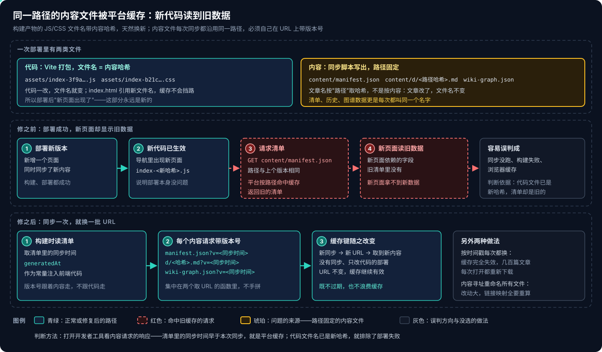
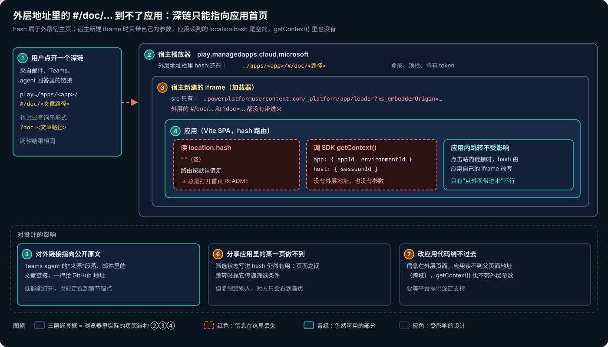

# Copilot Managed Runtime 系列 13：静态内容缓存与深链限制

> [!IMPORTANT]
> 基线 2026-10-29，来自一个知识库 managed app 在路线图做完之后的两次部署与一次外部链接实验。平台仍是 Preview，缓存策略和深链行为都可能在后续版本里变化，结论要在自己的租户里复核。

[系列 12](Copilot-Managed-Runtime系列12：方案回顾与Connector接入清单.md) 回顾的是功能怎么选。本篇记两个和功能无关、却会让应用"看起来坏了"的问题：**部署成功了，页面却显示旧数据**；**链接发出去，打开的却总是首页**。两者都出在应用和宿主的交界处，而且都是改了代码才发现、事先在文档里找不到的。

## 结论先行

- **平台按路径缓存应用的静态文件。** Vite 产出的 JS/CSS 文件名带内容哈希，代码一改就换名，不受影响；同步脚本写出的清单、文章、历史和图谱数据每次都叫同一个名字，部署后会继续拿到旧的。
- **症状很迷惑**：新页面已经出现在导航里，说明部署没问题；但它依赖的数据是旧清单里没有的，于是显示为空。容易误判成同步没跑或构建失败。
- **解法是让内容 URL 跟着内容变**：构建时读清单里的同步时间，注入为前端常量，每个内容请求加 `?v=<同步时间>`。同步一次换一批 URL；只改代码不同步时 URL 不变，缓存照常有效。
- **外层地址里的 hash 和查询串到不了应用。** 宿主新建的加载器 iframe 只带自己的参数，应用读到的 `location.hash` 为空，`getContext()` 只有 appId、environmentId、sessionId。`…/apps/<app>/#/doc/<路径>` 这类深链总是打开首页。
- **改应用代码绕不过去**：信息在跨域的父页面里，应用读不到。所以对外链接（邮件、Teams、agent 回答）一律指向公开原文。
- **同一份内容可以有两个出口。** 应用负责浏览、可视化和个人数据；另做一个 Copilot Studio 知识库 agent 发布到 Teams，负责聊天里的问答（[Copilot Studio 系列 08](../Copilot-Studio/Copilot-Studio系列08：把文章库发布成Teams知识库Agent.md)）。

---

## 一、内容文件被按路径缓存



### 1.1 一次部署里有两类文件

图的最上面一行。这个知识库应用的部署包里有两类静态文件，命名方式完全不同：

- **代码**：Vite 打包出的 `assets/index-<内容哈希>.js` 和 `.css`。代码一改，哈希就变，`index.html` 引用新文件名，缓存天然挡不住。
- **内容**：同步脚本从文章仓库写出的 `content/manifest.json`、`content/d/<哈希>.md`、`content/i/<哈希>.png`、`history.json`、`wiki-graph.json` 等（[系列 02](Copilot-Managed-Runtime系列02：实战部署与权限解析.md) 第六节、[系列 07](Copilot-Managed-Runtime系列07：零Connector的分析页面.md)）。文章文件名虽然也是哈希，但取的是**路径的哈希**，不是内容的——文章改了，文件名不变；清单和数据文件更是每次都叫同一个名字。

### 1.2 症状

图的中间一行。一次部署同时做了两件事：新增一个页面，并同步了新内容。部署后：

1. 导航里出现了新页面，代码文件名是新哈希——**部署本身没问题**；
2. 新页面请求 `content/manifest.json`，路径与上个版本相同，**平台按路径返回了旧的清单**；
3. 新页面依赖的字段在旧清单里不存在，页面拿不到新数据。

这种"新代码 + 旧数据"的组合很迷惑：最容易怀疑的是同步脚本没跑、构建失败，或者浏览器缓存。判断方法是打开开发者工具看内容请求的响应：**代码文件已是新哈希、清单里的同步时间却早于本次同步**，就是平台侧的缓存。

### 1.3 解法：版本号跟着内容走

图的最下面一行。思路是让内容的 URL 只在内容变化时改变：

```ts
// vite.config.ts：构建时读清单，把同步时间注入为常量
const manifest = JSON.parse(readFileSync(new URL('./public/content/manifest.json', import.meta.url), 'utf-8'))

export default defineConfig({
  plugins: [react()],
  define: {
    __CONTENT_VERSION__: JSON.stringify(String(manifest.generatedAt ?? '')),
  },
})
```

前端取内容时统一加上查询串：

```ts
const VERSION = `?v=${encodeURIComponent(__CONTENT_VERSION__)}`
fetch(`${CONTENT_BASE}manifest.json${VERSION}`)
```

几个要点：

- **所有内容请求都要带**，包括清单、单篇文章、图片、历史数据和放在根目录的图谱数据。拼 URL 集中在一两个函数里，页面代码只调函数、不手拼，才不会漏。
- **版本号用内容的同步时间，不用构建时间。** 只改代码、不同步内容的部署，URL 保持不变，几百篇文章的缓存继续有效。
- **另外两种做法没有选**：每次部署都用时间戳，缓存完全失效，每次打开都重新下载全部内容；把所有内容文件改成按内容哈希命名，改动大，文章之间的链接映射也要跟着重算。

> [!TIP]
> 这和 GitHub Pages、CDN 上的老问题是同一类，只是 managed app 的缓存在平台侧、规则不公开，开发者控制不了响应头。所以**凡是固定路径、内容会变的文件，都应该在 URL 上带版本**，不要指望平台的缓存策略。部署后自查时，新页面和新数据要一起看。

---

## 二、深链到不了应用



### 2.1 实验

做 Teams 知识库 agent 时，想让回答里的"来源"直接链到应用内的文章页，于是试了两种深链：

- `https://play.preview.managedapps.cloud.microsoft/apps/<app>/#/doc/<文章路径>`
- `…/apps/<app>/?doc=<文章路径>`

两种都打开了首页。图里从外往里看原因：

1. **宿主播放器**（②）的地址栏里 hash 还在；
2. 宿主为应用新建的**加载器 iframe**（③）只带自己的参数：`…powerplatformusercontent.com/_platform/app/loader?ms_embedderOrigin=…`，外层的 `#/doc/…` 和 `?doc=…` 都没有带进来；
3. **应用**（④）读 `location.hash` 是空的，路由按默认值走到首页；调 SDK 的 `getContext()`，拿到的是 `app: { appId, environmentId }` 和 `host: { sessionId }`，也没有外层地址或参数。

### 2.2 为什么改代码也没用

应用要知道"用户想看哪篇"，只有两条路：自己读外层地址，或者由宿主传进来。

- **自己读不到。** 外层页面在 `play.managedapps.cloud.microsoft`，应用在每个应用独立的 `powerplatformusercontent.com` 子域名下（[系列 03](Copilot-Managed-Runtime系列03：宿主沙箱与安全边界.md)），跨域的子 iframe 读不到父页面的地址。这正是宿主隔离设计的一部分。
- **宿主不传。** `getContext()` 里没有这类字段。

所以这不是应用的 bug，在平台提供深链支持之前没有解法。

### 2.3 对设计的影响

图的最下面一行：

- **对外链接指向公开原文。** Teams agent 的"来源"段落、邮件里的文章链接，都给 GitHub 地址。谁都能打开，还能定位到章节锚点。
- **"分享应用里的某一页"做不到。** 筛选状态写进 hash 仍然有用，页面之间跳转靠它传递筛选条件（[系列 07](Copilot-Managed-Runtime系列07：零Connector的分析页面.md)）；但复制给别人，对方只会看到首页。
- **应用内跳转不受影响。** 站内链接改的是应用自己 iframe 的 hash，路由照常工作；只有"从外面带进来"不行。

> [!NOTE]
> 这条限制也解释了 [系列 01](Copilot-Managed-Runtime系列01：托管环境对比与选型.md) 说的"没有自有域名"在实际使用中意味着什么：不只是网址不好看，应用对自己的入口地址也几乎没有控制权。需要可分享、可收藏的单页链接的场景，静态站或 SharePoint 页面更合适。

---

## 三、同一份内容的两个出口

[系列 10](Copilot-Managed-Runtime系列10：调用Copilot-Studio-Agent为何走不通.md) 的结论是应用调不到 Copilot Studio agent。但"在 Teams 里问文章"这个需求本身不必经过应用：把同一批文章导出成知识文件，建一个 Standard agent、发布到 Teams 和 M365 Copilot，用户直接和 agent 对话（[Copilot Studio 系列 08](../Copilot-Studio/Copilot-Studio系列08：把文章库发布成Teams知识库Agent.md)）。

两边的分工：

- **应用**：目录树、阅读、图谱与分析页面、阅读进度与收藏、带本地检索的问答页。适合"打开应用专门读"。
- **Teams agent**：按问题找文章、摘要、对比，回答带引用和 GitHub 原文链接。适合"在聊天里顺手问一句"。读不到 App state，也没有可视化。

这样分开还带来一个意外的好处：**agent 和应用可以放在不同的环境、不同的区域。** 实际做的时候，应用所在环境处于抢先体验区域，上传文件的索引一直不完成，agent 于是搬到了一个正式区域的新环境；因为 Teams 用户不经过应用，这次搬迁对应用没有任何影响。

回到 [系列 12](Copilot-Managed-Runtime系列12：方案回顾与Connector接入清单.md) 第四节"哪些功能离不开平台"的判断：问答依赖 Connector，所以放在 managed app 里；但如果用户本来就在 Teams 里，**另起一个 agent 往往比把人引到应用里更顺手**，两个出口共用同一份内容即可。

---

## 四、部署后自查补两条

系列 12 的七关针对 Connector。内容型应用每次部署后，再补两项：

1. **新页面和新数据一起看。** 新功能出现了不代表数据是新的；打开开发者工具，确认内容请求带着本次同步的版本号，返回的清单生成时间是本次同步的时间。
2. **不要把应用深链发给别人。** 需要指向某篇文章时，给公开原文地址；需要指向应用时，只给应用首页，并说明进去之后点哪里。

---

## 参考资料

- [Vite：Shared options — define](https://vite.dev/config/shared-options.html#define)
- [MDN：HTTP caching](https://developer.mozilla.org/en-US/docs/Web/HTTP/Guides/Caching)
- [MDN：Same-origin policy](https://developer.mozilla.org/en-US/docs/Web/Security/Same-origin_policy)
- [Copilot Managed Runtime architecture (preview)](https://learn.microsoft.com/en-us/microsoft-365/managed-apps/developer/architecture?view=o365-worldwide)

相关文章：

- [Copilot Managed Runtime 系列 02：实战部署与权限解析](Copilot-Managed-Runtime系列02：实战部署与权限解析.md)
- [Copilot Managed Runtime 系列 03：宿主沙箱与安全边界](Copilot-Managed-Runtime系列03：宿主沙箱与安全边界.md)
- [Copilot Managed Runtime 系列 07：零 Connector 的分析页面](Copilot-Managed-Runtime系列07：零Connector的分析页面.md)
- [Copilot Managed Runtime 系列 12：方案回顾与 Connector 接入清单](Copilot-Managed-Runtime系列12：方案回顾与Connector接入清单.md)
- [Copilot Studio 系列 08：把文章库发布成 Teams 知识库 Agent](../Copilot-Studio/Copilot-Studio系列08：把文章库发布成Teams知识库Agent.md)
