# Copilot Studio 系列 01：产品全景与环境

> [!IMPORTANT]
> 撰写时（2026-10）Copilot Studio 的新版界面、Apps 体验与多项能力仍是 **Preview**，菜单位置和计费规则变化很快。本文的路径都是实际点过的，落地前仍以当时界面为准。

## 系列导航

本系列讲 Copilot Studio 本身；它生成的应用跑在哪里、怎么开发，见姊妹系列 [Copilot Managed Runtime](../Copilot-Managed-Runtime/Copilot-Managed-Runtime系列01：托管环境对比与选型.md)。

- **01 产品全景与环境**（本篇）——Copilot Studio 和 Power Platform 什么关系、环境是什么、入口都在哪
- [02 Connector 与连接](Copilot-Studio系列02：Connector与连接.md)——一个连接池、三种用法；自定义 Connector
- [03 四种 Harness 对比与选型](Copilot-Studio系列03：四种Harness对比与选型.md)——Standard、GitHub Copilot、Copilot Chat、Customer Conversation 跑在哪、能不能被调用
- [04 Agent、Workflow 与 App 的协作](Copilot-Studio系列04：Agent、Workflow与App的协作.md)——共享数据、同步调用、触发 workflow
- [05 Agent 的存储与标识](Copilot-Studio系列05：Agent的存储与标识.md)——agent 是 Dataverse 里的几行记录；Solution、发布者前缀与不可改的 schema name
- [06 Standard Agent 的配置与发布](Copilot-Studio系列06：Standard-Agent的配置与发布.md)——配置存在哪段 YAML、测试面板与真实调用的差别、发布需要渠道、titleId
- [07 如何确认是 Agent 在回答](Copilot-Studio系列07：如何确认是Agent在回答.md)——一次误判与"指纹 + 两组对照"的验证方法；Copilot Chat 声明式 agent 与 Standard 的区别
- [08 把文章库发布成 Teams 知识库 Agent](Copilot-Studio系列08：把文章库发布成Teams知识库Agent.md)——知识文件怎么准备、分批上传、区域导致索引不完成、Fallback topic 拒答、发布到 Teams

## 结论先行

- **Power Platform 是地基和管理平面，Copilot Studio 是盖在上面的一个产品。** 环境、Dataverse、Connector、DLP、Solutions 属于地基，所以 Copilot Studio、Power Apps、Power Automate 共用同一套 Connector 目录和数据策略。
- Copilot Studio 里能造**三类东西**：agent、workflow、app。它们像 Power Virtual Agents、Power Automate 流程、Power Apps 应用的新版，但**运行时是新的**——共享的是地基，不是运行时。
- **一个 managed app 的管理横跨两个 admin center**：清单、使用量、Credits 在 Microsoft 365 一侧；环境、连接、DLP 在 Power Platform 一侧。
- **环境是租户里的隔离容器**。个人开发者环境不占容量、自己能建，但**长期不活动会被禁用再删除**。

---

## 一、一张图看清位置

图里有三层，从上往下读：

**产品层**是"造东西的地方"。Power Apps、Power Automate、Power Pages、Power BI 是多年的经典产品；Copilot Studio 是其中以 AI 为中心的那个，2026 年起把 agent、workflow、app 放进了"一个 studio"，以自然语言描述为主、由 AI 生成，再按需改代码。

**运行时层**是最容易被忽略、也最决定行为的一层。同样叫"agent"，Standard harness 跑在经典运行时（前身 Power Virtual Agents），GitHub Copilot harness 跑在另一套 Agentic Runtime，Copilot Chat harness 干脆由 M365 Copilot 自己的编排器执行，面向外部客户的 Customer Conversation harness 又是另一种；Copilot Studio 里生成的 app 跑在 Copilot Managed Runtime，**不是** Power Apps 播放器。运行时不同，能力、计费、能不能被调用就都不同——这是 [系列 03](Copilot-Studio系列03：四种Harness对比与选型.md) 的主题。

**地基层**是大家共用的部分。能直接看到的证据有三处：同一个环境 ID 同时出现在 Copilot Studio 地址、Power Apps 门户地址和 managed app 的 `ms.config.json` 里；Copilot Studio 左下角 **…** 菜单直接链到 Solutions 和 Power Platform admin center；Standard agent 的调用路径带着 `/powervirtualagents/dataverse-backed/`，说明 agent 定义存在环境的 Dataverse 里——它就是 `bot` 表的一行，见 [系列 05](Copilot-Studio系列05：Agent的存储与标识.md)。

### 容易混的三组

- **Power Apps 的应用 vs Copilot Studio 的 Apps**：前者拖拽 / 公式，跑在 Power Apps 播放器；后者自然语言生成或用 `ms` CLI 写代码，跑在 Copilot Managed Runtime。
- **Power Automate 流程 vs Copilot Studio 的 Workflows**：功能相近；后者能直接编排 agent、用 Copilot 节点调用 M365 Copilot（Copilot Chat、Cowork 任务、Researcher / Analyst）。
- **Power Pages vs managed app**：前者面向**外部**、可匿名；后者只给**内部**、必须 Entra 登录。

还有一个"该不该用"的判断：轻量看板在 app 里用图表库画更省事、不额外占许可；复杂数据模型和多人共享报表才交给 Power BI。

> [!TIP]
> 记住一句话：**app 是给人用的界面，不是服务。** 它可以调用 agent，但 agent 和 workflow 没有"调用 app"的入口。三者怎么配合，见 [系列 04](Copilot-Studio系列04：Agent、Workflow与App的协作.md)。

### 新旧两套界面

2026-08 起 Copilot Studio 默认进入新版界面，左侧只有 **Home / Chat / Agents / Workflows / Apps**，新建 agent 默认是 GitHub Copilot harness——首页的 Agent / Workflow / App 三张卡片都标着 GitHub Copilot。要建 Standard harness 的 agent，在首页点 **Other ways to build**，或在 Agents 页点 New agent 右侧的下拉箭头选 **Agent（Standard）**；四个菜单项与四种 harness 的对应见 [系列 03](Copilot-Studio系列03：四种Harness对比与选型.md)。不同 harness 的 agent 不能互转。

---

## 二、两个 admin center 各管什么

图右侧那一栏是排查问题时最常走错的地方。

**Microsoft 365 admin center** 管"应用作为 M365 资产"的一面：**Apps** 里是 managed app 清单、运行健康和使用分析，管理员不需要被分享就能看到；**Copilot → Cost management** 里是 Credits 消耗。用户入口 `managedapps.cloud.microsoft` 也属于这一侧。

**Power Platform admin center** 管"地基"：**Manage → Environments** 里创建环境、看类型和到期警告；**Security → Data and privacy** 下面是 **Data policy**（DLP，允许 / 阻止 Connector）和 **Azure Virtual Network policies**（Connector 流量走虚拟网络）。旧版界面里 DLP 在 Policies → Data policies。

> [!NOTE]
> 普通账号也能打开 Data policy 页，但列表是**空的**——策略存在，只是无权查看。要知道某个 Connector 是否被阻止，用 `ms connector list` 看 `isBlocked` 字段，或者在添加时看报错。

---

## 三、环境

**环境是租户里的一个隔离容器**，装着应用、agent、流程、连接和 Dataverse 数据库。它是这几样东西的边界：

- **数据**——每个环境最多一个 Dataverse 数据库，数据不跨环境；
- **连接**——连接属于环境，不跨环境复用；
- **权限**——环境级的安全组、安全角色决定谁能进、能做什么；
- **区域**——创建时选定，数据存在那里；
- **策略**——DLP 可以按环境或环境组设置。

### 3.1 六种类型

| 类型 | 用途 | 谁能建 | 占容量 | 特点 |
|---|---|---|---|---|
| **Default** | M365 场景的个人小工具 | 自动 | — | 所有许可用户都是制作者，通常被 DLP 管得最严 |
| **Production** | 正式业务 | 管理员（或租户允许的人） | 需要 Dataverse 容量 | 长期保留 |
| **Sandbox** | 开发、测试、UAT | 管理员 | 需要容量 | 可复制、重置 |
| **Developer** | 个人开发空间 | 制作者自己（Developer Plan，免费） | **不占** | 每人最多 3 个；**长期不活动会被清理**；不能装 Dynamics 365 应用 |
| **Trial** | 短期试用 | 用户 | — | 到期自动删除 |
| **Dataverse for Teams** | Teams 里的轻量应用 | 自动 | — | 跟随 Teams 团队 |

**Managed Environment** 是叠加在环境上的"高级治理"开关（共享限制、使用洞察、数据策略等），和类型正交。个人开发者环境常被租户统一放进一个环境组并开启它。

### 3.2 开发者环境的不活动清理

学习和原型通常放在个人开发者环境里，它最容易踩的坑是被自动清理：

几个要点：

- **阈值看环境类型**：普通开发者环境 30 天；开启了 Managed Environment 的个人开发者环境 60 天。之后的节奏一样——禁用 15 天后删除，删除后 7 天内可恢复。
- **"活动"指真实的增删改查**：只打开首页、解决方案浏览器、设计器不算。
- **以页面倒计时为准，不要按文档推算**。实测出现过"不活动 0 天、3 天后禁用"这种和文档对不上的显示。
- **Trigger environment activity** 按钮只在有警告时出现在详情页的 "Environment inactive" 卡片上，点后几秒"最近活动"刷新为今天。它背后是 admin center 的管理接口而非公开 API，做成定时脚本可以，但要接受它随时可能变化。

> [!WARNING]
> 给别人长期用的东西**不要放开发者环境**。它的定位是个人工作区，官方要求不用于生产；正式使用申请 Production 环境，并把源码放 Git、agent 用 Solutions 导出，环境没了也能重建。

### 3.3 开发 → 测试 → 生产

三类对象跨环境搬运的方式不一样：

1. **Power Apps、Power Automate、Copilot Studio agent** 用 **Solutions**——开发环境导出、目标环境导入，或用 Pipelines in Power Platform 自动化。
2. **managed app（代码应用）** 源码在 Git。`ms` CLI 有预览功能 `projects` / `alm`（多目标部署、部署审批），默认未开启。
3. **连接不搬**。Solutions 里只带"连接引用"，导入时绑定目标环境的连接——这一点在 [系列 02](Copilot-Studio系列02：Connector与连接.md) 里会展开。

---

## 四、入口速查

这些入口分散在 Copilot Studio、Power Apps 门户、两个 admin center 里，是初学时最耗时间的部分。

| 想做什么 | 去哪里 |
|---|---|
| 给 agent 加 Connector / MCP / workflow | Copilot Studio **Agents** → agent → **Build** → **Tools** → Add tool（同页还有 Skills、Knowledge、Connected agents、Memory） |
| 看 agent 某个工具用的连接 | Build → Tools → 点工具名 → 详情面板 "Connection" / "Manage connections" |
| 切回经典界面（Standard harness） | 左下角 **…** → **Open classic experience** |
| 看、修复（Reconnect）、共享、删除连接 | Power Apps 门户 make.powerapps.com → 先选对**环境** → **Connections** |
| 浏览 Connector 目录 | Connections 页顶部 **New connection** |
| 自定义 Connector | 左侧 **More → Discover all → Custom connectors**，或访问 `/environments/<id>/customconnectors` |
| Dataverse 表 | Power Apps 门户左侧 **Tables** |
| 环境列表、详情、到期警告 | Power Platform admin center → **Manage → Environments** |
| DLP 数据策略 | Power Platform admin center → **Security → Data and privacy → Data policy** |
| managed app 清单、Credits 费用 | Microsoft 365 admin center → **Apps**；**Copilot → Cost management** |

### 常见"找不到"

- **Copilot Studio 首页没有 Connector 菜单**——Connector 只出现在 agent / workflow / app 的编辑界面里，作为"工具"或"数据源"添加。
- **admin center 的 Environments 里没有 Connector**——环境页管环境本身；连接在 Power Apps 门户，策略在 Security → Data and privacy。
- **New connection 里搜 "Custom" 找不到自定义 Connector**——那里是现成 Connector 的目录，自定义 Connector 是另一个页面。
- **More 面板全展开也没有 Custom connectors**——More 只列已固定的项，要点底部 **Discover all**。
- **Connections 页看不到刚建的连接**——列表懒加载（实测页面先显示 11 个、接口实际返回 19 个），往下滚；或者右上角环境选错了。

---

## 参考资料

- [What is Microsoft Copilot Studio](https://learn.microsoft.com/en-us/microsoft-copilot-studio/fundamentals-what-is-copilot-studio)
- [Apps overview (preview)](https://learn.microsoft.com/en-us/microsoft-copilot-studio/apps-experience/apps-overview)
- [Workflows overview](https://learn.microsoft.com/en-us/microsoft-copilot-studio/workflows-experience/flows-overview)
- [Environments overview](https://learn.microsoft.com/en-us/power-platform/admin/environments-overview)
- [Automatic deletion of Power Platform environments](https://learn.microsoft.com/en-us/power-platform/admin/automatic-environment-cleanup)
- [Power Apps Developer Plan](https://learn.microsoft.com/en-us/power-platform/developer/plan)
- [Develop a tenant environment strategy](https://learn.microsoft.com/en-us/power-platform/guidance/adoption/environment-strategy)

相关文章：

- [Copilot Managed Runtime 系列 01：托管环境对比与选型](../Copilot-Managed-Runtime/Copilot-Managed-Runtime系列01：托管环境对比与选型.md)
- [Azure Copilot 生态：Skills、MCP 与 Agents 的协作](../Azure-Copilot生态：Skills、MCP与Agents的协作.md)
