# Copilot Studio 系列 02：Connector 与连接

> [!IMPORTANT]
> 本文的租户统计、Connector 是否被阻止都是一个企业租户在 2026-10 的实测结果，换个租户会完全不同；**动手前先在自己的租户里跑一遍 `ms connector list`**。

[系列 01](Copilot-Studio系列01：产品全景与环境.md) 讲了 Connector 属于 Power Platform 的地基层。本篇把它拆开：它是什么、和"连接"有什么区别、app / agent / workflow 各自怎么用、想接自己的 API 怎么办。

## 结论先行

- **Connector 是类型，连接是实例。** Connector 是一个 API 的定义，全平台一份；连接是"某人用某账号登录了这个 Connector"，存着凭据，会过期，属于环境。
- **app、agent、workflow 用的是同一个连接池。** 能不能用上，还要满足 Connector 类型一致、同环境、连接健康、身份模式四个条件。
- **三种用法最关键的差别是身份**：managed app 默认用当前用户自己的连接（API key 类共享连接例外，见 2.1）；agent 可选作者身份或用户身份；workflow 通常用建流程的人的连接。
- **共享连接要配白名单。** API key 类连接（如 Azure OpenAI）是共享的，managed app 部署时必须声明 `allowedActions`，只放行用到的动作；连接显示 Connected 也不代表参数填对了。
- **企业租户里九成以上的 Connector 被 DLP 阻止**，选型第一步是 `ms connector list --only-allowed`；第零步是"这件事能不能不用 Connector"。
- **自定义 Connector 是接自己后端的正规途径**，但在管得严的企业租户里常被阻止，实验要换一个自己有管理员权限的租户。

---

## 一、一个连接池，三种用法



左边一列是三个最容易混的概念，用"微信"打个比方最直观：**Connector** 是"微信"这个 App 本身——它定义了能做什么、怎么登录；**连接**是你在手机上登录的那个微信账号——里面有你的凭据，换了密码会掉线；**连接引用**是应用里写的一句"我需要一个微信账号"——它只是声明，运行时才指向某个具体连接。第四个概念**数据源**是应用实际用到的那部分：某个 Connector 的某些动作或表，加上 `ms app add data-source` 生成的代码。

所以 Connections 列表里 Microsoft Teams 出现两行很正常：同一个 Connector，两个连接。

### 1.1 实测：agent 用的连接就在 Power Platform 的连接池里

验证方法是两头对账。在 Copilot Studio 打开一个新版 agent → Build → Tools → **Work IQ** 工具，详情面板显示类型 MCP server、Connection 是作者的账号。再到 Power Apps 门户同一环境的 Connections 页——页面只渲染了一部分（懒加载），但页面调用的接口 `GET <env>.environment.api.powerplatform.com/connectivity/connections` 返回了全部连接，其中一条 `apiId: shared_workiqmcp`，账号相同、创建日期就是建 agent 当天、状态 Connected。

**同一个池不等于一定能用上**，还要四个条件同时满足：

1. **Connector 类型对得上**——Work IQ 工具要的是 `shared_workiqmcp` 的连接；名字相近的 `M365 Copilot`（`shared_m365copilot`）是另一个 Connector，不能替代。
2. **同一环境**——连接不跨环境。
3. **连接健康**——实测列表里大部分连接是 `Error`（过期），选它们会失败，先 Reconnect。
4. **身份模式**——agent 设为 "End user credential" 时，作者的连接只在作者自己测试时用，**每个最终用户第一次用都要建自己的连接**。

### 1.2 身份差异是设计时最要紧的一点

图上方三张卡片里，用颜色标出的那一行就是身份：

- **managed app 里每个用户只看得到自己有权限看的数据**，因为连接是用户自己的——例外是 API key 类共享连接，所有用户共用作者的凭据（2.1）。
- **agent 用"作者身份"时，所有用户都以作者的权限访问数据**——方便，但可能越权。

> [!CAUTION]
> 官方特别提醒：**事件触发器只能用作者凭据**，"might allow users of an agent to access data and systems using that same authorization"。给 agent 配事件触发器之前，先想清楚作者账号能看到什么。

### 1.3 凭据在哪一跳注入

图右下角的调用链说明了另一件事：凭据只存在于**连接对象**里。应用代码 → 生成的 Service → SDK → 宿主 `http/send`（校验 apiId 与连接的 runtimeUrl）→ **API Hub 注入凭据** → 真正的后端。应用代码、配置文件、浏览器上下文里都没有令牌。宿主为什么要这样卡住每一跳，见 [Copilot Managed Runtime 系列 03](../Copilot-Managed-Runtime/Copilot-Managed-Runtime系列03：宿主沙箱与安全边界.md)。

---

## 二、连接从哪来、去哪里管

**大多数时候连接是"当场建"的**，不需要专门去哪个页面：

- 制作者给 agent 加工具时当场登录，连接自动建好；
- 用户第一次打开 managed app，宿主弹出同意框列出所需 Connector，点 Allow 即建好——**支持 SSO 的 Connector 甚至会被静默创建**（实测宿主直接 `PUT` 连接、返回 201，同意框随即消失）；
- agent 设为每个用户用自己的账号时，用户第一次触发工具会弹出 Connect 卡片。

**需要专门去 Power Apps 门户 → Connections 的情况**：一次看全部、修复过期连接、共享连接、删除连接、建自定义 Connector。红叉 + Reconnect 表示连接失效，常见原因是刷新令牌过期、改过密码、条件访问要求重新登录；失效的连接会让用到它的应用、agent、流程运行失败。

为什么连接在制作者门户、不在 admin center？因为**连接是个人的，admin center 管的是规则**。好比手机上登录的微信账号是你自己的，公司 MDM 只管能不能装微信。

### 2.1 共享连接：一个实测案例

身份模型之外，还有一类连接是**作者建好、给所有用户共用**的——典型是 API key 认证的 Connector。拿 Azure OpenAI Connector 在一个企业租户里的实测为例：

- **它声明的三种认证里，只有 API Key 能用。** Microsoft Entra ID Integrated 本该是首选（每人用自己的身份、连接不共享），但创建连接时登录弹窗报 `AADSTS50011`——connector 的第一方应用没登记回调地址，错误发生在输入账号之前，换浏览器、换账号都一样；Managed Identity 只适用于 Logic Apps。
- **共享就要白名单。** managed app 用这条连接时，`ms.config.json` 里的条目带 `sharedConnectionId`；部署时平台要求声明 `allowedActions`，否则报 "Shared connection references without dataset tables must declare connector-level allowedActions"。只放行 Chat Completions，别人借这条连接就调不了 Embeddings 等其他动作。本地 `ms app dev` 不做这项检查。
- **Connected 不等于参数正确。** 资源名填成完整网址时，连接状态照样是 Connected，调用却一直 502；用 Power Apps API 查连接的非机密参数（`properties.connectionParametersSet.values`）才看出来。
- **模型不在连接里。** 连接只绑定资源，部署名是每次调用的参数，一条连接能调资源下的所有部署。

完整过程见 [Copilot Managed Runtime 系列 11](../Copilot-Managed-Runtime/Copilot-Managed-Runtime系列11：用Azure-OpenAI-Connector直调模型.md)。

各处添加 Connector 的入口：agent 在 **Build → Tools**（经典界面是 Tools → Add a tool，连接在 Settings → Connection settings）；workflow 在设计器里加一个动作；Copilot Studio 生成的 app 在左上角下拉的 **Data / Connections** 视图，或直接在对话里说"连接到某张表"；代码写的 managed app 用 `ms app add data-source`；允许 / 阻止则在 Power Platform admin center 的 Data policy（需管理员）。

---

## 三、选 Connector：先查允许列表

### 3.1 一个企业租户的实际目录

在这个租户里，`ms connector list` 返回 **1393** 个 Connector，其中 **1266 个被策略阻止**，只有 127 个允许使用；名字含 MCP 的 74 个里有 62 个被阻止。**九成以上被阻止**，所以选型的第一步永远是 `--only-allowed`。

允许使用、和应用开发相关的：

| 类别 | Connector | id | 表型 | SSO |
|---|---|---|---|---|
| M365 数据 | SharePoint | `shared_sharepointonline` | ✅ | ✅ |
| | Excel Online (Business) | `shared_excelonlinebusiness` | ✅ | ✅ |
| | OneDrive / Office 365 Users / Outlook / Teams | `shared_onedriveforbusiness` 等 | | ✅ |
| 业务数据 | Microsoft Dataverse | `shared_commondataserviceforapps` | | ✅ |
| | SQL Server | `shared_sql` | ✅ | ✅ |
| | Azure Data Explorer / Blob Storage / Power BI | `shared_kusto` 等 | | ✅ |
| AI / agent | Microsoft Copilot Studio | `shared_microsoftcopilotstudio` | | ✅ |
| | Work IQ Copilot MCP（Preview） | `shared_a365copilotchatmcp` | | ✅ |
| | Work IQ MCP 及 Mail / Calendar / Teams / Word 等 MCP | `shared_workiqmcp`、`shared_a365*mcp` | | ✅ |
| | Azure OpenAI / AI Foundry Inference | `shared_azureopenai` 等 | | ❌ |
| | Azure AI Search | `shared_azureaisearch` | ✅ | ❌ |
| 通用 HTTP | HTTP with Microsoft Entra ID (preauthorized) | `shared_webcontents` | | ❌ |

> [!WARNING]
> 被阻止、容易误以为能用的：`HTTP With Microsoft Entra ID`（v2，`shared_webcontentsv2`）、`Azure AI Foundry Agent Service`、自定义 Connector。preauthorized 版 HTTP Connector 虽然允许，但只能调用预先授权过的资源，**不是万能后端**。

几个 AI Connector 的动作值得记一下：Copilot Studio Connector 有 `ExecuteCopilot`（只返回会话 ID）和 `ExecuteCopilotAsyncV2`（发消息并等待回答；"等待"靠必填的回调地址 `notificationUrl` 实现，适合 Power Automate，managed app 里用不了，见 [系列 06](Copilot-Studio系列06：Standard-Agent的配置与发布.md)），外加 4 个评测操作；Work IQ Copilot MCP 只有一个 `mcp_m365copilot`，本质是一个提供 M365 Copilot 问答的 MCP 服务器；Azure OpenAI 是 Chat Completions、Embeddings 和 On Your Data 扩展。怎么从应用里用它们，见 [Copilot Managed Runtime 系列 05](../Copilot-Managed-Runtime/Copilot-Managed-Runtime系列05：在应用里调用AI的几条路.md)。

### 3.2 决策顺序

图里那排属性标签（表型 / 动作型、SSO、认证方式、可否共享、Premium、DLP）就是选型时要逐个看的东西。按顺序问四个问题：

1. **这件事能不能不用 Connector？** 构建期预计算、静态数据、`mailto:`、浏览器端导出都能替代一部分。一个已上线的内部看板应用只用了两个 Connector，其余全靠这些手段，见 [Copilot Managed Runtime 系列 06](../Copilot-Managed-Runtime/Copilot-Managed-Runtime系列06：参考应用拆解与功能模式.md)。
2. **有没有支持 SSO 的？** 用户首次使用一键同意甚至静默完成，身份也清楚。API key 类（如 Azure OpenAI）通常是作者建好连接再共享，所有用户共用一个身份，还要在应用里声明 `allowedActions`（见 2.1）。
3. **是不是 Premium？** Premium 需要 Power Apps Premium 或按量 Copilot Credits，同意框里会标出。
4. **会不会每次交互都调用？** managed app 每次 API 调用 0.1 Credits（Premium 用户计入每日请求额度）；Work IQ API 另外单独按量计费；还有每连接限流，例如 Copilot Studio Connector 每连接 300 次 / 60 秒。

```bash
ms connector list --only-allowed --search <关键词>              # ① 先看允许的
ms connector list-actions --connector <id>                     # ② 看动作、策略是否 Allow
ms app add data-source --connector <id> --as action --use-sso  # ③ 加进应用（会在租户里建连接）
git status                                                     # ④ 看生成了哪些代码、改了 ms.config.json
```

---

## 四、自定义 Connector：把自己的 API 接进来

给自己的 REST API 写一份 OpenAPI 描述，平台就把它当成普通 Connector：app、agent、workflow 都能用，同样受 DLP 管、同样走 API Hub。对 managed app 来说它尤其重要——宿主 CSP 禁止应用直接 `fetch` 外部地址，中间层函数也还没开放，**自定义 Connector 是调用自己后端的唯一正规途径**。



### 4.1 先确认租户允许

在上面那个企业租户里，环境里以前建过的一个自定义 Connector 在 `ms connector list` 中显示 `isBlocked: True`——**租户 DLP 不允许自定义 Connector**，建了也不能运行。管得严的企业租户需要 IT 为你的环境单独放行；想动手实验，用**自己有管理员权限的测试租户**，在 Data policy 里把自定义 Connector 放进允许的分组。

### 4.2 页面在哪

**不在 Connections → New connection 里**——那里是现成 Connector 的目录。自定义 Connector 是左侧导航的独立页面，默认不显示：**More → Discover all → Custom connectors**（点图钉固定），或直接访问 `/environments/<环境ID>/customconnectors`。这个页面其实嵌的是 Power Automate 组件，Power Apps 和 Power Automate 共用同一套自定义 Connector。

右上角 **New custom connector** 有六种创建方式：从空白开始；**从 Azure 服务创建（Preview）**，适合 Functions、API Management；导入 OpenAPI 文件；**从 URL 导入 OpenAPI**，适合 Container Apps 上自己暴露 `/openapi.json` 的服务；导入 Postman collection；从微软开源 Connector 仓库导入。

### 4.3 接 Container Apps 的六步

对照图里的编号：

1. **部署 API**：Container Apps 开启外部 ingress，拿到 `https://<app>.<env>.<region>.azurecontainerapps.io`。
2. **准备描述（①）**：**必须是 OpenAPI 2.0（Swagger）**。FastAPI、ASP.NET 默认输出 3.x，要先转换或导入后手工补全；`host` 填 API 域名；每个操作都要有 `operationId`——生成的 TypeScript 方法名就来自它。
3. **Entra 注册两个应用（② ③）**：API 应用暴露一个 scope（如 `api://<api-app-id>/user_impersonation`），用来校验令牌 audience；Connector 客户端应用申请这个 scope、生成密钥。
4. **创建 Connector**：Security 页选 OAuth 2.0 / Microsoft Entra ID，填客户端 ID、密钥，Resource URL 填 API 应用的 ID URI；保存后把页面给出的 Redirect URL 加到客户端应用注册里。
5. **测试**：Test 页新建连接（弹出登录），选一个操作试调。
6. **使用（④）**：managed app 用 `ms app add data-source --connector <id> --as action`；agent 在 Tools 里添加；workflow 添加动作时选它。

> [!TIP]
> API 已经挂在 **Azure API Management** 后面时，APIM 的 "Export to Power Platform" 能直接生成自定义 Connector，省掉第 2、4 步的大部分工作。也可以用 `paconn` / `pac connector` 命令行创建和更新，适合放进 CI。

### 4.4 运行时要知道的四件事

- **认证选 OAuth 2.0（Entra ID）**：每个用户用自己的身份调用，API 能按人做权限，和 managed app "每个用户用自己的连接"一致。API key 意味着所有人共用一个身份。
- **调你 API 的是 API Hub，不是浏览器（⑤）**：所以不需要配 CORS，但 API 必须对 API Hub 可达。要走私网，可把 Connector 流量接入 Azure 虚拟网络，或用本地数据网关。
- **单次请求约 120 秒上限、不能流式**：长任务改成"提交 + 查询状态"两步，结果一次性返回。
- **自定义 Connector 属于 Premium**，每次调用照常按 Managed Runtime 的 API 调用计费。

最后一点是扩展路径：Copilot Studio agent 也能把自己写的 **MCP 服务器**（同样可以部署在 Container Apps）通过自定义 Connector 接进来作为工具——Work IQ Copilot MCP 就是微软做好的 MCP Connector。"自己写服务 → 包成 Connector → app 和 agent 共用"是一条通用路线，前提仍是租户允许。

---

## 参考资料

- [Use connectors in Copilot Studio agents](https://learn.microsoft.com/en-us/microsoft-copilot-studio/advanced-connectors)
- [Create and manage connections（作者身份与用户身份）](https://learn.microsoft.com/en-us/microsoft-copilot-studio/authoring-connections)
- [Event triggers overview](https://learn.microsoft.com/en-us/microsoft-copilot-studio/authoring-triggers-about)
- [Configure data policies for agents](https://learn.microsoft.com/en-us/microsoft-copilot-studio/admin-data-loss-prevention)
- [Microsoft Copilot Studio connector reference](https://learn.microsoft.com/en-us/connectors/microsoftcopilotstudio/)
- [Copilot Managed Runtime licensing FAQ](https://learn.microsoft.com/en-us/microsoft-365/admin/manage/apps/licensing-faq)
- [Connect a Managed Runtime app to data](https://learn.microsoft.com/en-us/microsoft-365/managed-apps/developer/connect-to-data?view=o365-worldwide)
- [Create a custom connector from an OpenAPI definition](https://learn.microsoft.com/en-us/connectors/custom-connectors/define-openapi-definition)

相关文章：

- [Copilot Studio 系列 01：产品全景与环境](Copilot-Studio系列01：产品全景与环境.md)
- [Copilot Managed Runtime 系列 04：SDK 与数据接入](../Copilot-Managed-Runtime/Copilot-Managed-Runtime系列04：SDK与数据接入.md)
