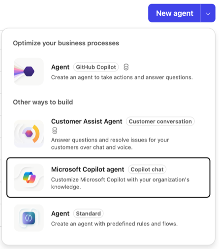

# Copilot Studio 系列 03：四种 Harness 对比与选型

> [!IMPORTANT]
> 资料截至 2026-10-27。harness 的渠道支持、计费、能否被程序调用都在 Preview 期快速变化；文中"运行在哪"的部分区分了官方确认、可观察到的事实和推断。

[系列 02](Copilot-Studio系列02：Connector与连接.md) 讲的是 agent 怎么接外部系统；本篇讲 agent 自己跑在什么上面。这看似是实现细节，实际上决定了一个 agent **能不能被应用调用**。

## 结论先行

- **harness 是夹在"你配置的 agent"和"模型"之间的运行时**：什么时候调模型、塞哪些上下文、怎么解释返回、调哪个工具，都由它决定。模型负责推理，harness 负责组织推理。
- **Standard** 按你写的 topics 和分支走，可预测；**GitHub Copilot** 给目标后自己拆步骤，带 Bash 容器和文件系统；**Copilot Chat** 只是给 M365 Copilot Chat 挂企业知识；第四种 **Customer Conversation**（预览）面向外部客户，同一个 agent 接网站聊天和电话，答不了转人工。
- **门户 New agent 下拉菜单的四个入口正好对应四种 harness**；直接点 New agent 按钮建出的是 GitHub Copilot harness，Standard 藏在 "Other ways to build" 的最后一项。
- 两个必须记住的事实：**新建 agent 默认是 GitHub Copilot harness**；**harness 创建后不能互转**。
- 选型按**任务的重量**：短、能写清、要快要稳 → Standard；长、多步、多产出 → GitHub Copilot。简单任务用重 harness 会"想太多"。
- **从浏览器里的 managed app 同步调用，四种 harness 都不行**（2026-10-28 实测）。Standard 经 Copilot Studio Connector 调不了（`ExecuteCopilotAsyncV2` 是回调式，适合 Power Automate）；发布到 Microsoft 365 Copilot 后经 Work IQ `copilot_chat` 传 `agentId` 也不行——`agentId` 被忽略，回答来自 M365 Copilot 本体，Copilot Chat agent 同样如此。要从应用里用 agent，只能经 workflow 异步中转。GitHub Copilot harness 的定位是"用户直接对话的助手"和"后台 workflow 的执行者"。

---

## 一、定义在同一处，执行在三套服务里

这张图从上往下读：**所有 agent 的定义都存在环境的 Dataverse 里**（Standard agent 的调用路径里带着 `dataverse-backed`），但 harness 把执行分到了三套完全不同的服务——这就是它们不能互转、调用方式也不同的根源。

**Standard → 经典运行时。** 前身 Power Virtual Agents，属于 agent 所在的 Power Platform 环境。Connector 调用路径是 `/powervirtualagents/dataverse-backed/authenticated/bots/{agent}/proactivecopilot/executeAsyncV2`（官方在 GitHub 讨论中确认）。它按 topics、触发条件、分支走，编排可在经典与生成式之间配置，渠道最全。

**GitHub Copilot → Agentic Runtime。** 官方确认它 "runs on a different runtime"。社区对 Connector swagger 的分析发现，那里只有一个内部的"续接对话"路径 `/copilotstudio/agenticruntime/.../conversations/{id}/continue`，返回的是 `text/event-stream` 流。它会自己拆步骤、选工具、失败重试，原生读写 Word / Excel / PowerPoint / PDF，支持 Skills 和 Memory。新版 agent 在 Copilot Studio 链接里的类型标识是 `cliagent`，和"基于 GitHub Copilot CLI / SDK"的说法一致。

**Copilot Chat → M365 Copilot 编排器。** Copilot Studio 只编写配置（指令、知识、动作），执行者是 M365 Copilot 自己，仅限内部使用。

> [!NOTE]
> **GitHub Copilot harness 不是 GitHub Copilot 服务。** 它只是共享底层技术和 SDK 组件，数据不发给 GitHub Copilot 服务，Copilot Studio 原有的合规承诺不变。

### 1.1 计费差异

- **Standard**：沿用原有 Copilot Studio 许可模式；有 M365 Copilot 许可的内部用户使用时可豁免 Credits（以租户计费设置为准）。
- **GitHub Copilot**：**全程按 Copilot Credits**——构建、测试、评测、运行都计费，M365 Copilot 许可**不豁免**。
- **Copilot Chat**：包含在 M365 Copilot 许可内，或按量。

费用规则在 Preview 期变化很快，动手前到 Microsoft 365 admin center → Copilot → Cost management 看租户的实际策略。

### 1.2 第四种 harness 与门户里的入口

> [!NOTE]
> 本文最初按三种写。2026-10 的官方文档（Agents overview、Customer Conversation harness overview）已经列出**四种**，第四种是 **Customer Conversation harness**（预览）。上图只画了面向内部的三种。

Agents 页 **New agent** 按钮右侧有个下拉箭头，展开后的菜单分两组：

| 菜单项（标签） | harness | 计费 | 能否经 Copilot Studio Connector 调用 |
|---|---|---|---|
| **Agent**（GitHub Copilot），"Optimize your business processes"下唯一一项，也是 New agent 按钮的默认动作 | GitHub Copilot | 菜单上有硬币图标：构建、测试、运行都按 Copilot Credits | ❌ |
| **Customer Assist Agent**（Customer conversation） | Customer Conversation（预览） | 有硬币图标：Copilot Credits | ❌（推断，未实测）：面向网站聊天和电话渠道，网站聊天要 iframe 或 Direct Line，都被 managed app 的 CSP 挡住 |
| **Microsoft Copilot agent**（Copilot chat），点击后在新标签页打开 | Copilot Chat | 包含在 M365 Copilot 许可内 | ❌（运行在 Copilot Chat 里；经 Work IQ `agentId` 也实测无效） |
| **Agent**（Standard），"Other ways to build"下最后一项 | Standard | 列表里写着 "Included with your Microsoft 365 Copilot license at no additional credit cost"，Credit usage 显示 N/A | ⚠️ Power Automate 可以；浏览器里的 managed app 不行（动作要求回调地址）。发布到 M365 Copilot 后经 Work IQ `agentId` 也 ❌（被忽略，2026-10-28 复测更正） |

**菜单上的小硬币图标就是"按 Credits 计费"的提示**；已有的 agent 用的是哪种 harness，看 Agents 列表的 **Powered by** 列，鼠标悬停会显示计费说明。首页的 Agent / Workflow / App 三张卡片也都标着 GitHub Copilot，要建 Standard，在首页点 **Other ways to build**，或者用上面的下拉菜单。

**Customer Conversation 是不是"语音 harness"？** 不是专门的语音 harness，但它是唯一原生面向语音的：描述是 "Answer questions and resolve issues for your customers over chat and voice"，同一个 agent 既能挂到网站上聊天，也能分配电话号码接听来电，指令里可以分别写 Speech 和 Chat 两种模态的要求。架构上是一个主 agent 加若干专门的子 agent，每个子 agent 有自己的升级路径，答不了就转人工，像联络中心的不同队列；可调工具、知识、MCP，支持 skills 和 memory。它的定位是**面向外部客户的服务**，发布对象是网站和电话号码，不是给员工做内部助手的。列表里叫 "Voice Assistant" 之类名字的旧 agent，harness 仍要看 Powered by 列——名字只是名字。

---

## 二、按任务的"重量"选

官方的判断原则就是图里那条从轻到重的光谱：任务长度、执行路径能否提前写清、上下文是有边界还是大文件大数据、对可预测性的要求、延迟与费用的承受度。前五项是"倾向"，最后一项是硬约束——**要被应用程序化调用，只能选 Standard**。

图下方三张卡片是官方特别强调的：

1. **简单任务用 GitHub Copilot harness 会"想太多"**：多余推理、更长延迟、更多 Credits，结果却不更好。
2. **能用的 Standard agent 不必迁移。** 迁移等于重新架构：先定义任务、边界、评估标准，再把 topics / flows / 变量映射到 instructions、skills、tools、workflows、memory。
3. **组合用法**：GitHub Copilot harness 的 agent 定时在后台做重活（整理数据、建表、打标签），Standard agent 在前台高并发回答用户。这正好对上 [系列 04](Copilot-Studio系列04：Agent、Workflow与App的协作.md) 的"共享数据"模式。

### 2.1 一个判断示例

需求是在企业内部应用里加"基于知识库文章回答问题、带引用"的问答面板。逐项对照：一问一答、知识源有边界——Standard；希望"只根据文章答，答不出就说没有"——Standard；要从 managed app 里调——**只能 Standard**；希望费用可控——Standard 或 Copilot Chat；不需要生成文件和长任务。结论是 Standard。

GitHub Copilot harness 留给真正的重活，比如定时扫描知识库里过时的论断、生成一份周报文档——那时它通过 workflow 跑在后台，结果写进数据表，和应用解耦。

---

## 三、能从哪里调用它

> [!CAUTION]
> **Standard 也不能经 Copilot Studio Connector 从 managed app 调用**（2026-10-28 实测）：草稿 agent 被重定向到门户页面、被 CORS 拦截；已发布 agent 的 `ExecuteCopilotAsyncV2` 要求必填的回调地址 `notificationUrl`，不传返回 400——这是给 Power Automate 设计的 webhook 式等待。曾以为可以发布到 Microsoft 365 Copilot 后经 Work IQ `copilot_chat` 传 `agentId` 调用，复测证明 `agentId` 被忽略，回答来自 M365 Copilot 本体。从浏览器里的 managed app，四种 harness 都没有同步调用的路；要用 agent，只能经 workflow 异步中转。判定方法见 [Copilot Studio 系列 07](Copilot-Studio系列07：如何确认是Agent在回答.md)，详见 [Copilot Studio 系列 06](Copilot-Studio系列06：Standard-Agent的配置与发布.md) 与 [Copilot Managed Runtime 系列 10](../Copilot-Managed-Runtime/Copilot-Managed-Runtime系列10：调用Copilot-Studio-Agent为何走不通.md)。

### 3.1 为什么 GitHub Copilot harness 接不上 Connector

官方在 PowerAppsCodeApps 仓库确认这是已知限制、暂无时间表；Power Automate 文档也写明连接器不能调用这类 agent，调用只会拿到空的或占位的回复。这不是"SDK 少一个函数"，而是三层同时被堵：

1. **Connector 层**——没有公开的"在 Agentic Runtime 上发起一轮"的操作；
2. **协议层**——Agentic Runtime 只回流式，而 Connector 不能把流交给调用方、单次请求约 120 秒超时；
3. **应用层**——managed app 又不能绕过 Connector 直接连。

社区有自建自定义连接器调用 Agentic Runtime 的做法，但只解决了第一层。

**Copilot Chat agent 的 ❌ 也只指"不能经 Copilot Studio Connector 调用"。** 它是挂在 M365 Copilot Chat 里的声明式 agent，由 M365 Copilot 的编排器执行，不在 Copilot Studio 运行时里。程序进入 M365 Copilot 只有 Graph Copilot Chat API 一个入口，而 Work IQ Copilot MCP 的 `copilot_chat` 工具包装的正是它；这个工具有一个可选参数 `agentId`（"Agent ID for the Microsoft Copilot conversation"），按描述可以把问题交给指定的 Copilot Chat agent：应用 → Work IQ Connector → `copilot_chat`（带 agentId）→ Graph Chat API → 该 agent。2026-10-28 实测：**`agentId` 不生效**。Standard agent 和专门新建的一个 Copilot Chat agent 都试了，短 titleId 和 M365 Copilot 网页里的完整 id 都试了：调用都成功、`agentId` 原样回显，但回答与不传时无法区分，agent 指令规定的输出特征只在 M365 Copilot 网页里直接用 agent 时出现，见 [Copilot Studio 系列 07](Copilot-Studio系列07：如何确认是Agent在回答.md)。不带 agentId 的同一条链路见 [Copilot Managed Runtime 系列 09](../Copilot-Managed-Runtime/Copilot-Managed-Runtime系列09：本地检索加Work-IQ的问答.md)。完整链路分析见 [Copilot Managed Runtime 系列 05](../Copilot-Managed-Runtime/Copilot-Managed-Runtime系列05：在应用里调用AI的几条路.md)。

### 3.2 GitHub Copilot harness 的发布渠道

官方 "Available channels for agents (GitHub Copilot)"（2026-10-16 更新）：

| 渠道 | 状态 | 说明 |
|---|---|---|
| Microsoft Copilot | ✅ | 出现在 M365 Copilot 的 agent 列表里——**主战场** |
| Microsoft Teams | ✅ | 在 Teams 里聊天 |
| Demo website | ✅ | 测试和演示用的现成网页 |
| Web app | ✅ | iframe 嵌入自己的网页（嵌入代码只在 "No authentication" 时提供） |
| MCP client / A2A client | Preview | 暴露成远程 MCP server 或 A2A 服务，只在 early release 环境 |
| workflow 的 agent 节点 | ✅ | 后台自动化里调用 |
| SharePoint、Direct Line、WhatsApp、Slack、联络中心、Email 等 | ❌ 暂不可用 | Standard 大多支持 |

设计意图很清楚：**它是"用户直接对话的助手"和"后台 workflow 的执行者"，不是"给别的应用当 API 调的后端"**。被程序调用的口子（MCP、A2A）还在 Preview。

---

## 四、GitHub Copilot harness 的沙箱：已知与未知

官方给出的描述有三句："runs each task in a secure sandbox governed by Copilot Studio"；"A **Bash container** provides access to tools and libraries that aren't available in the standard harness"，并有容器内文件系统；和 GitHub Copilot "shares underlying technology and **SDK components**"。

"共享 SDK 组件"是理解它的钥匙。公开的 GitHub Copilot SDK 把 agent 循环做成可嵌入的运行时，支持四种执行方式：

- **本地直接执行**——工具调用直接在本机跑；
- **每会话一个完整容器**——一个 session 独占一个容器；
- **MXC 沙箱**（Microsoft eXecution Container）——把声明式策略翻译成各 OS 的原生隔离（Windows ProcessContainer、macOS Seatbelt、Linux bubblewrap），控制文件、网络、进程访问；不是 VM，也不是容器镜像；
- **远程 / 云端**——托管的临时 Linux 沙箱，按 CPU 秒、内存 GiB 秒计费。

> [!WARNING]
> **Copilot Studio 用的是哪一种、是否每任务独占容器、多久回收、能否访问外网——官方没有公开，也没有可信的公开资料。** 执行发生在服务端，浏览器抓不到。这里只能把已知和未知的边界说清，不能猜一个答案。

一个**相邻但不同**的系统有详细的第三方研究：BeyondTrust 对 Standard harness 里 code interpreter（写 Python 并执行）的安全分析。它运行在 Azure 上的 Windows Server 容器里，"沙箱"是同一个 Python 进程内的限制而不是独立进程或 VM，研究者判断是多租户共享的预热容器池。它说明了这一代产品实现"沙箱"的一种方式，但**不能套到 GitHub Copilot harness 上**：一个是 Windows + 进程内限制，一个明确是 Linux 系 Bash 容器。

还有一条旁证：managed app 宿主播放器的脚本里有 Cowork 客户端，后端是一组 `mcs...runtime` 命名的网关，接口包括 conversations、messages、tasks、skills、scheduled-prompts、tool-approval，返回事件流并支持断线续传。`mcs` 是 Microsoft Copilot Studio 的常用缩写，这些特征也和 GitHub Copilot harness 一致。**推断**（未证实）：两者可能共用同一代 agentic 运行时基础设施。

---

## 参考资料

- [Harnesses in Copilot Studio](https://learn.microsoft.com/en-us/microsoft-copilot-studio/harnesses-overview)
- [Compare Copilot Studio agent harnesses](https://learn.microsoft.com/en-us/microsoft-copilot-studio/guidance/choose-harness)
- [Agents powered by the GitHub Copilot Harness overview](https://learn.microsoft.com/en-us/microsoft-copilot-studio/agents-experience/overview)
- [Available channels for agents (GitHub Copilot)](https://learn.microsoft.com/en-us/microsoft-copilot-studio/agents-experience/publication-channels-overview)
- [Call Copilot Studio agents from Power Automate](https://learn.microsoft.com/en-us/power-automate/call-copilot-studio-agent)
- [ExecuteCopilotAsyncV2 does not support GitHub Copilot harness agents（官方答复）](https://github.com/microsoft/PowerAppsCodeApps/discussions/434)
- [Connect a code app to Copilot Studio](https://learn.microsoft.com/en-us/power-apps/developer/code-apps/how-to/connect-to-copilot-studio)
- [GitHub Copilot SDK in-process runtime](https://docs.github.com/en/copilot/how-tos/copilot-sdk/setup/in-process-runtime)
- [Microsoft Execution Containers](https://blogs.windows.com/windowsdeveloper/2026/10/07/microsoft-execution-containers-policy-driven-containment-for-ai-agents)
- [BeyondTrust：Copilot Studio code interpreter 沙箱研究](https://www.beyondtrust.com/blog/entry/copilot-studio-sandbox-escape)
- [Copilot Studio Agent Runtime 自定义连接器](https://troystaylor.com/power%20platform/custom%20connectors/mcp/2026-09-14-copilot-studio-agent-runtime-connector.html)
- [Customer Conversation harness overview](https://learn.microsoft.com/en-us/microsoft-copilot-studio/agents-experience/overview-customer-conversation)
- [What's new in Copilot Studio, August 2026](https://www.microsoft.com/en-us/copilot/blog/copilot-studio/new-and-improved-github-copilot-harness-agent-skills-and-richer-context)

相关文章：

- [Copilot Studio 系列 06：Standard Agent 的配置与发布](Copilot-Studio系列06：Standard-Agent的配置与发布.md)
- [Agent Harness 五平台对比](../../Notes/AI/agent/Agent-Harness五平台对比.md)
- [Agent = Model + Harness](../../Notes/tool/Agent=Model+Harness.md)
- [Foundry Agent 三种形态对比与选型](../Foundary-Agent/Foundry-Agent三种形态对比与选型.md)
