# Copilot Studio 系列 04：Agent、Workflow 与 App 的协作

> [!IMPORTANT]
> 资料截至 2026-10-27。文中区分〔官方〕（Microsoft Learn、官方博客与演示）、〔实测〕（抓包与 `ms connector list-actions`）和〔第三方〕（社区演示）。

Copilot Studio 里 agent 能调 agent，workflow 能编排 agent——那 app 怎么和它们互动？[系列 03](Copilot-Studio系列03：四种Harness对比与选型.md) 已经说明 app 调不了 GitHub Copilot harness 的 agent，本篇给出绕开这个限制、也是官方主推的做法。

## 结论先行

- **app 和 agent、workflow 之间最主要的协作方式不是"互相调用"，而是"共享同一份数据"。** 后台把结果写进 Dataverse（或 SharePoint），app 读出来让人决定，决定写回再触发下一步。
- 这样做**绕开了所有 harness 限制**，异步不怕慢，每一步都可审计。
- **浏览器里的 app 同步调不到 Copilot Studio agent**（2026-10-28 实测）：Copilot Studio Connector 的动作是回调式的，Work IQ 的 `agentId` 被忽略。app 能同步调用的只有 M365 Copilot 本体（Work IQ）和模型部署（Azure OpenAI）；要用 agent，走"共享数据"模式经 workflow 中转。
- **没有"app 按钮直接触发 workflow"的官方方式**，现实做法是 app 改一行数据、workflow 的行触发器启动。
- 设计的关键是表里的**状态列**——它是三方之间的契约。

---

## 一、三者各自擅长什么

- **Agent** 是会推理的 AI 助手：理解自然语言、处理例外、做判断。由用户对话或事件驱动，状态在对话上下文和记忆里。
- **Workflow** 是确定的多步自动化：触发器 + 动作，按固定路径执行，可靠、可重复、可审计。由事件、定时、手动或 agent 调用驱动。
- **App** 是有界面的网页应用（跑在 Copilot Managed Runtime）：给人一个**专门的屏幕**去浏览、筛选、对比、审批、录入。只由用户点击驱动。

官方的说法〔官方〕：一个入职方案可以"用 app 给经理和员工一个结构化界面，用 workflow 执行可重复的入职步骤，用 agent 回答问题、处理例外"。

它们之间的同步调用关系是这样的：agent 能调 agent（connected agents）和 workflow（触发器 "When an agent calls the flow"）；workflow 能用 agent 节点调 agent，用 Copilot 节点调 M365 Copilot（Copilot Chat、Cowork 任务、Researcher / Analyst、Agent Builder agent）；app 能经 Connector 调 Standard agent 或 M365 Copilot。**反过来没有任何东西能调用 app。**

---

## 二、模式 A：共享数据

### 2.1 官方演示：多供应商投标评审

这是 Microsoft Mechanics 2026-09 的演示〔官方〕，按图里的编号走一遍：供应商邮件到达，触发 workflow（①）；workflow 分类投标，依次交给几个 GitHub Copilot harness 的 agent 分析（②）；最后一个 agent 汇总结论、给出推荐，"creates a record as a new row in Dataverse, our backend data source for the process"（③）；app 直接绑定这张表，采购团队按状态筛出需要人工审核的投标（④），在 "one shared view" 里对比、批准（⑤）；决定写回状态列（⑥）；行被修改，触发下一个 workflow（⑦）。

社区的另一个演示〔第三方〕结构相同：用 Copilot Studio 生成一个软件权限申请 app，绑定 Dataverse 的申请表和软件目录表，审批另建一个 workflow 完成。

### 2.2 为什么是主推方式

**绕开 harness 限制。** app 从不直接调用 agent，后台 agent 用 GitHub Copilot harness 也没关系——这正好解决了系列 03 里"Connector 调不了 GitHub Copilot harness"的问题。

**异步，不怕慢。** agent 跑几分钟、几十分钟都行，不受 Connector 约 120 秒超时约束；用户打开 app 时看到的是已经算好的结果。

**可审计、人在回路。** 每一步都是表里的一行，有时间、有状态、有负责人；app 是人做决定的地方，决定写回数据，workflow 按状态继续往下走。

**权限清楚。** app 读写数据用的是**当前用户自己的权限**〔官方〕；agent 和 workflow 用各自的连接身份。

> [!TIP]
> 设计这类系统时，先把**状态列**定下来（如 `待处理 / 待人工审核 / 已批准 / 已驳回`），再分别设计 workflow、agent、app。workflow 和 agent 只认状态推进，app 只按状态筛选和改状态——三方通过它解耦。

### 2.3 最小版本：连 workflow 都不需要

一个已上线的内部分析看板应用〔实测〕把这个模式缩到了最小：数据每周刷新一次、打包进应用；用户对异常值的"审核决定"和行动项的"状态 / 备注"写进 SharePoint 列表，所有打开应用的人共享。**数据是周更的，人对数据的判断是实时共享的**，下次刷新时数据脚本也能读到这些判断。详细拆解见 [Copilot Managed Runtime 系列 06](../Copilot-Managed-Runtime/Copilot-Managed-Runtime系列06：参考应用拆解与功能模式.md)。

> [!NOTE]
> **"共享"要放在 agent 和 workflow 都读得到的地方。** managed app 还有一个实验性的 App state，可以按用户或全员保存数据，走同源接口、不经 Connector、不受 DLP——做阅读进度这类"只给这个应用自己用"的数据很合适（[Copilot Managed Runtime 系列 08](../Copilot-Managed-Runtime/Copilot-Managed-Runtime系列08：用App-state保存用户数据.md)）。但它的数据**只属于这个应用**，agent 和 workflow 读不到，所以不能承担本节的协作模式；要协作，还是 Dataverse 或 SharePoint 列表。

---

## 三、模式 B：app 同步调用 agent

用户在 app 里提问、当场要答案时，共享数据太慢，需要直接调用。能走通的只有两条：

1. **Copilot Studio Connector `ExecuteCopilotAsyncV2` → Standard agent**〔官方文档的做法，managed app 实测不可用〕：动作要求回调地址 `notificationUrl`，适合 Power Automate，浏览器前端收不到回调。改为发布到 M365 Copilot 再走下一条的 `agentId`，复测证明 `agentId` 被忽略〔实测〕，见 [Copilot Managed Runtime 系列 10](../Copilot-Managed-Runtime/Copilot-Managed-Runtime系列10：调用Copilot-Studio-Agent为何走不通.md)。
2. **Work IQ Copilot MCP Connector → M365 Copilot**〔实测，已有应用在用〕：不用建 agent，以用户自己的身份调用；Work IQ API 单独按量计费。

走不通的：同一 Connector 调 GitHub Copilot harness agent（官方确认的已知限制）；iframe 嵌入 agent 网页聊天（宿主 CSP `frame-src 'self'` 禁止〔实测〕）。宿主里还有一条实验性的 `cowork/streamPrompt` 流式通道，默认关闭、SDK 未封装。

每条路的完整链路、代码形状和取舍，见 [Copilot Managed Runtime 系列 05](../Copilot-Managed-Runtime/Copilot-Managed-Runtime系列05：在应用里调用AI的几条路.md)。

---

## 四、模式 C：app 触发 workflow

**没有找到官方文档描述"app 里的按钮直接调用一个 Copilot Studio workflow"的方式。** workflow 的触发器只有手动、定时、事件（含数据变化）、被 agent 调用四类〔官方〕。现实做法有两种：

1. **改数据触发（推荐）**：app 新增或修改 Dataverse 的一行，workflow 的"行新增 / 修改"触发器启动——本质就是模式 A 的回路。
2. **经 agent 中转**：app 调一个 Standard agent，agent 把 workflow 当工具调用，受模式 B 的全部限制。

---

## 五、按场景选

- **审批、工单、评审** → 模式 A：异步、可审计、人在回路。
- **报表、看板、洞察** → 模式 A，或者干脆构建期预计算：结果可以提前算好。
- **定期分析、生成报告文件** → 模式 A：GitHub Copilot harness agent 定时跑，结果写表，文件放 SharePoint，重活不受超时和 harness 调用限制。
- **当场问答** → 模式 B：Work IQ 直调 M365 Copilot，或 Azure OpenAI 直调模型；Copilot Studio agent 从浏览器里同步调不到，需要它时退回模式 A，接受半分钟以上的等待。
- **术语解释** → 静态数据为主，必要时模式 B。

一个具体组合是**每周知识体检**：GitHub Copilot harness 的 agent 定时读知识库里标为过时的论断，逐条判断是否仍成立，结果写进 Dataverse 表；app 的建议卡片页读这张表展示，用户点"确认 / 驳回"写回。"后台 AI 判断 + 前台人工确认 + 以用户身份读写企业数据"——这类能力是公开静态站点做不到的。

---

## 参考资料

- 〔官方〕[What is Microsoft Copilot Studio](https://learn.microsoft.com/en-us/microsoft-copilot-studio/fundamentals-what-is-copilot-studio)
- 〔官方〕[Apps overview (preview)](https://learn.microsoft.com/en-us/microsoft-copilot-studio/apps-experience/apps-overview)
- 〔官方〕[Workflows overview](https://learn.microsoft.com/en-us/microsoft-copilot-studio/workflows-experience/flows-overview)
- 〔官方〕[Build apps, workflows, and agents together](https://www.microsoft.com/en-us/copilot/blog/copilot-studio/new-and-improved-build-apps-extend-agents-and-transform-business-processes-in-microsoft-copilot-studio)
- 〔官方〕[Build Automated Agents, Workflows, and Apps - New in Copilot Studio](https://techcommunity.microsoft.com/blog/microsoftmechanicsblog/build-automated-agents-workflows-and-apps---new-in-copilot-studio/4562164)
- 〔官方〕[What's new in Copilot Studio](https://learn.microsoft.com/en-us/microsoft-copilot-studio/whats-new)
- 〔第三方〕[Microsoft Copilot Studio Can Build Apps Now!](https://www.youtube.com/watch?v=ClcdJt3U-SY)

相关文章：

- [Copilot Studio 系列 02：Connector 与连接](Copilot-Studio系列02：Connector与连接.md)
- [Copilot Managed Runtime 系列 04：SDK 与数据接入](../Copilot-Managed-Runtime/Copilot-Managed-Runtime系列04：SDK与数据接入.md)
