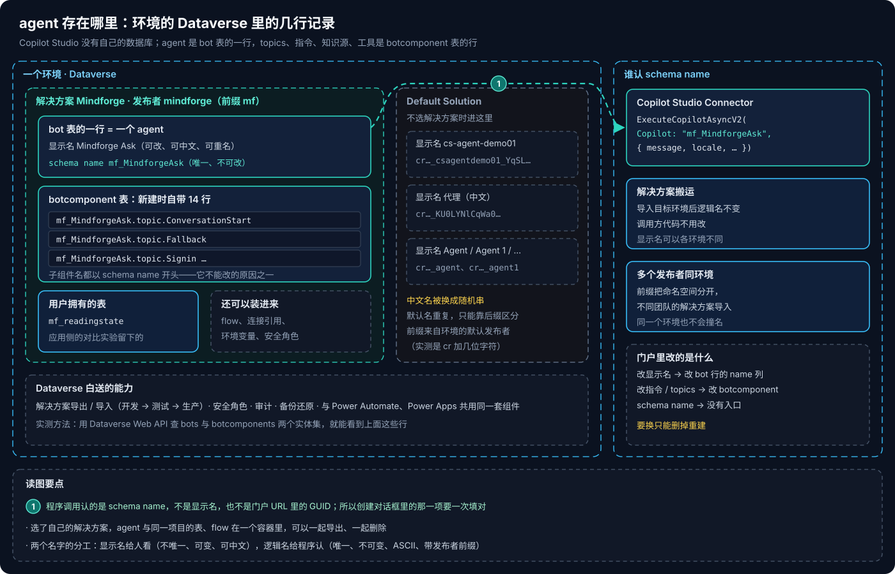
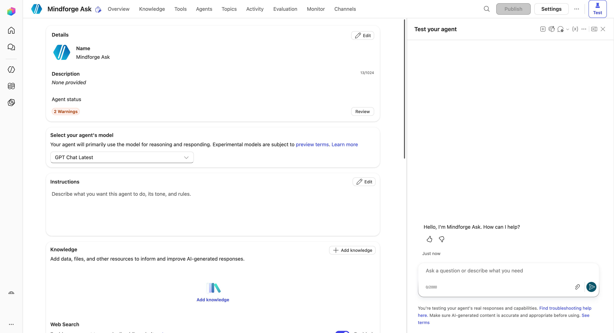
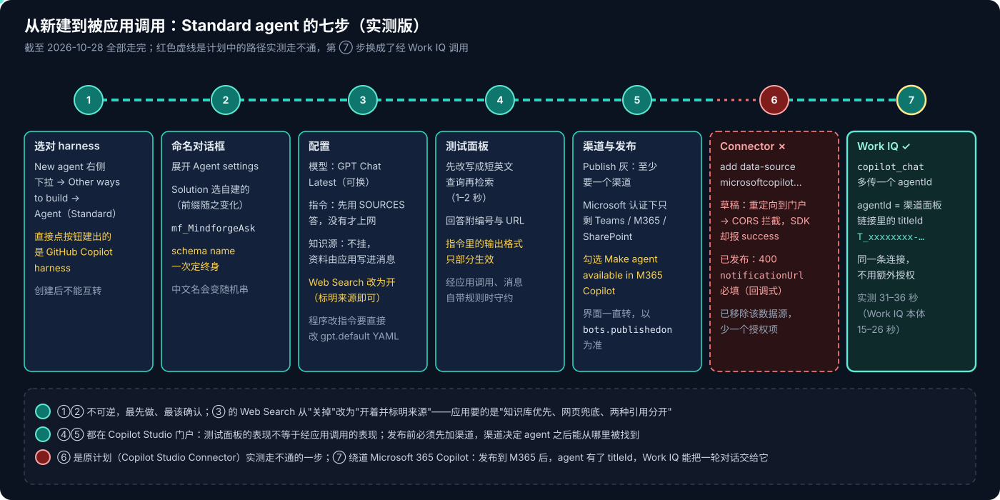

# Copilot Studio 系列 05：Agent 的存储与标识

> [!IMPORTANT]
> 资料截至 2026-10-27。本文的表结构观察来自在一个开发者环境里用 Dataverse Web API 查询 `bots` 与 `botcomponents` 的结果；门户界面与创建流程仍在 Preview 期快速变化。

[系列 03](Copilot-Studio系列03：四种Harness对比与选型.md) 讲 agent 跑在什么上面，本篇讲它**存在什么里面**。起因是一个很小的问题：新建 Standard agent 时，命名对话框里有个折叠起来的 "Agent settings (Optional)"，里面的 Solution 和 Schema name 要不要管？答案是要管，而且 Schema name 只有这一次机会。

## 结论先行

- **agent 存在环境的 Dataverse 里**：agent 是 `bot` 表的一行，topics、指令、知识源、工具是 `botcomponent` 表的行。这就是 [系列 01](Copilot-Studio系列01：产品全景与环境.md) 说的"共享地基"在存储上的样子。**例外是 Copilot Chat 声明式 agent**：它不在 `bot` 表里，门户地址带 `agentBackend=cosmos`（[系列 07](Copilot-Studio系列07：如何确认是Agent在回答.md)）。
- **所以解决方案、安全角色、审计、备份、导出导入都是现成的**，和 Power Apps、Power Automate 的组件同一套机制。
- **Solution** 决定 agent 装进哪个容器、名字带哪个发布者前缀。选自建的解决方案，agent 能和同项目的表、flow 一起导出或删除；不选就进 Default Solution。
- **Schema name 是 agent 唯一、不可变的逻辑名**，形如 `<前缀>_<名字>`。Copilot Studio Connector `ExecuteCopilotAsyncV2` 的 `Copilot` 参数认的就是它，解决方案导入也靠它。**创建后不能改**，要换只能重建。发布到 M365 Copilot 后 agent 还会有另一个标识 titleId，M365 Copilot 和 Teams 认它（[系列 06](Copilot-Studio系列06：Standard-Agent的配置与发布.md)）。
- 显示名给人看（可重复、可改、可中文），逻辑名给程序认（唯一、不可变、ASCII、带前缀）。中文显示名会让逻辑名变成随机串。

---

## 一、agent 是 Dataverse 里的几行记录

图的左半边是一个环境的 Dataverse。在这个环境里用 Web API 查 `bots` 和 `botcomponents`，能看到：

- **自建解决方案里的 agent**：显示名 Mindforge Ask，schema name `mf_MindforgeAsk`。新建时就自带 14 个组件，名字都以 schema name 开头，比如 `mf_MindforgeAsk.topic.ConversationStart`、`.topic.Fallback`、`.topic.Signin`——即使是 Standard harness 的"空白"agent，也有一组系统 topics。
- **Default Solution 里的 agent**：显示名是 cs-agent-demo01、"代理"、Agent、Agent 1……对应的逻辑名带的是环境默认发布者的前缀（`cr` 加几位字符），后面跟名字或者一串随机字符。**中文显示名"代理"被换成了随机串**；默认名 Agent 重复了好几次，只能靠逻辑名的后缀区分。

同一个解决方案里还有一张用户拥有的表，是应用侧做阅读进度对比实验时建的（[Copilot Managed Runtime 系列 08](../Copilot-Managed-Runtime/Copilot-Managed-Runtime系列08：用App-state保存用户数据.md)）。表、agent、将来的 flow 都在一个容器里，这正是解决方案的用途。

**为什么这样设计。** Copilot Studio 不自带数据库，把 agent 当成 Dataverse 组件，就直接继承了 Power Platform 现成的 ALM 体系：解决方案导出 / 导入（开发 → 测试 → 生产）、安全角色、审计、备份还原、与 Power Automate 共用连接引用和环境变量。代价是 agent 的命名也要守 Dataverse 的规矩。

---

## 二、创建对话框里的三项

在 Agents 页点 New agent 右侧的下拉箭头，选 **Agent（Standard）**（入口位置见 [系列 03](Copilot-Studio系列03：四种Harness对比与选型.md)），弹出 "Name your agent"。展开 **Agent settings (Optional)** 有三项：

| 项 | 是什么 | 建议 |
|---|---|---|
| Language | agent 的主语言，决定内置 topics 和语言理解用哪种语言 | 保持 English (United States)；回答语言交给指令里的"按提问语言作答" |
| **Solution** | Power Platform 的解决方案：装组件的容器，整体导出导入，就是在环境之间搬运的单位。每个解决方案属于一个**发布者**，发布者决定组件名的前缀 | 选项目自己的解决方案。不选就进 Default Solution，以后再想和别的组件一起搬就麻烦了 |
| **Schema name** | agent 在 `bot` 表里的唯一逻辑名，自动拼成 `<前缀>_<名字>`。**创建后不能改**；显示名随时可改 | 用简洁的 ASCII 名字，确认前缀正确再点创建 |

两个容易忽略的联动：

1. **切换 Solution 时，schema name 的前缀会跟着变。** 先选 Solution，再看 schema name。
2. **名字里有中文时，schema name 会被换成随机串。** 想让逻辑名有意义，就先用英文名创建，之后再把显示名改成中文。

> [!WARNING]
> **schema name 是 Connector 调用与解决方案搬运的契约。** 经 Copilot Studio Connector 调用时写的是 `ExecuteCopilotAsyncV2("mf_MindforgeAsk", { message })`（Power Automate 里可用；managed app 里这个动作走不通，见 [系列 06](Copilot-Studio系列06：Standard-Agent的配置与发布.md)）。删掉重建 agent 会换掉逻辑名（或者你得在新环境里重新起同一个名字），所有调用方都要跟着改。门户 URL 里的 GUID 和显示名都不是这个参数。

### 2.1 为什么 schema name 不能改

三条原因叠在一起：子组件的名字都以它开头（改一个要改十几行）；解决方案导入另一个环境时，靠逻辑名判断"这是同一个组件的新版本"还是"一个新组件"；调用方（Connector、flow、其他 agent）都用它来定位。显示名没有这些负担，所以可以随便改。

前缀的意义也在这里：不同团队、不同发布者的解决方案导入同一个环境时，`mf_` 和 `contoso_` 不会撞名。

---

## 三、建好之后的 Overview 页

创建后进入 Overview。上面一排是 Overview、Knowledge、Tools、Agents、Topics、Activity、Evaluation、Monitor、Channels；右上角 Publish、Settings、Test。几处和"被应用调用"直接相关：

- **Select your agent's model**：Standard harness 也能选模型，默认是一个持续更新的聊天模型；实验性模型受预览条款约束。
- **Instructions** 默认为空，Agent status 因此显示警告。要写清三件事：只根据知识源回答；用什么语言回答；找不到就明确说"知识库里没有"。
- **Knowledge**：先用上传文件走通（可控、可复现），再换公开网站对比回答质量和新鲜度。
- **Web Search 默认开着**，往下滚才看得到。agent 自己挂知识源时要关掉，连同通用知识一起——否则无法判断回答到底来自哪里；资料由应用写进消息时，可以开着当兜底，要求回答标明来源（[系列 06](Copilot-Studio系列06：Standard-Agent的配置与发布.md) 就是这样配的）。

---

## 四、从新建到被应用调用

这个 agent 的用途是给 managed app 的问答页做第二种后端，和已经上线的 Work IQ 方案对比（[Copilot Managed Runtime 系列 09](../Copilot-Managed-Runtime/Copilot-Managed-Runtime系列09：本地检索加Work-IQ的问答.md)）。截至 2026-10-28 七步都已走完，和原计划有两处不同，而且最后一步的结论在复测后被推翻：

- **①② 不可逆**——harness 创建后不能互转，schema name 创建后不能改。所以它们最先做、最该确认。
- **③ 的 Web Search 从"关掉"改成了"开着"**：资料由应用检索后写进消息，agent 不挂知识源；资料里没有答案时上网兜底，并在回答开头声明来自公开网络。
- **④⑤ 在门户里**：测试面板的表现不等于真实调用；发布前必须先加渠道，并勾选"在 Microsoft 365 Copilot 中可用"。详见 [系列 06](Copilot-Studio系列06：Standard-Agent的配置与发布.md)。
- **⑥ 原计划的 Copilot Studio Connector 走不通**：草稿被重定向到门户、被 CORS 拦截；已发布后 `ExecuteCopilotAsyncV2` 要求回调地址。**⑦ 改走 Work IQ**：同一个 `copilot_chat` 工具传 `agentId`（填 titleId 而不是 schema name），调用成功、格式也对，但复测证明 `agentId` 被忽略，回答来自 M365 Copilot 本体。agent 本身没问题，在 M365 Copilot、Teams 里直接用时指令生效；它只是不能被浏览器里的应用同步调用。判定方法见 [系列 07](Copilot-Studio系列07：如何确认是Agent在回答.md)，过程见 [Copilot Managed Runtime 系列 10](../Copilot-Managed-Runtime/Copilot-Managed-Runtime系列10：调用Copilot-Studio-Agent为何走不通.md)。

分享仍然要在两边各做一次：应用分享给使用者，agent 也要对他们可见（分享或经管理员批准），否则问答会失败。

---

## 参考资料

- [Harnesses in Copilot Studio](https://learn.microsoft.com/en-us/microsoft-copilot-studio/harnesses-overview)
- [Solutions overview（Power Platform ALM）](https://learn.microsoft.com/en-us/power-platform/alm/solution-concepts-alm)
- [Create and manage custom solutions（Copilot Studio）](https://learn.microsoft.com/en-us/microsoft-copilot-studio/authoring-solutions-overview)
- [Export and import agents using solutions](https://learn.microsoft.com/en-us/microsoft-copilot-studio/authoring-solutions-import-export)
- [Microsoft Copilot Studio connector reference](https://learn.microsoft.com/en-us/connectors/microsoftcopilotstudio/)
- [Dataverse Web API overview](https://learn.microsoft.com/en-us/power-apps/developer/data-platform/webapi/overview)

相关文章：

- [Copilot Studio 系列 01：产品全景与环境](Copilot-Studio系列01：产品全景与环境.md)
- [Copilot Studio 系列 03：四种 Harness 对比与选型](Copilot-Studio系列03：四种Harness对比与选型.md)
- [Copilot Studio 系列 06：Standard Agent 的配置与发布](Copilot-Studio系列06：Standard-Agent的配置与发布.md)
- [Copilot Managed Runtime 系列 05：在应用里调用 AI 的几条路](../Copilot-Managed-Runtime/Copilot-Managed-Runtime系列05：在应用里调用AI的几条路.md)
