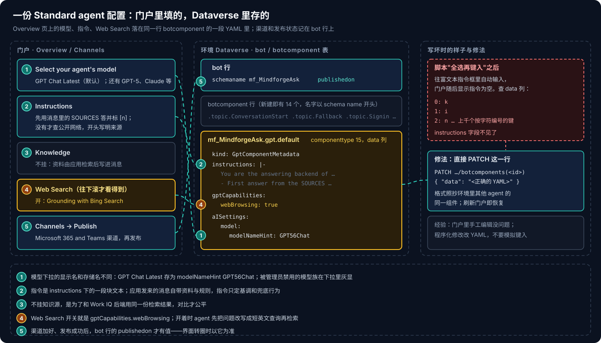
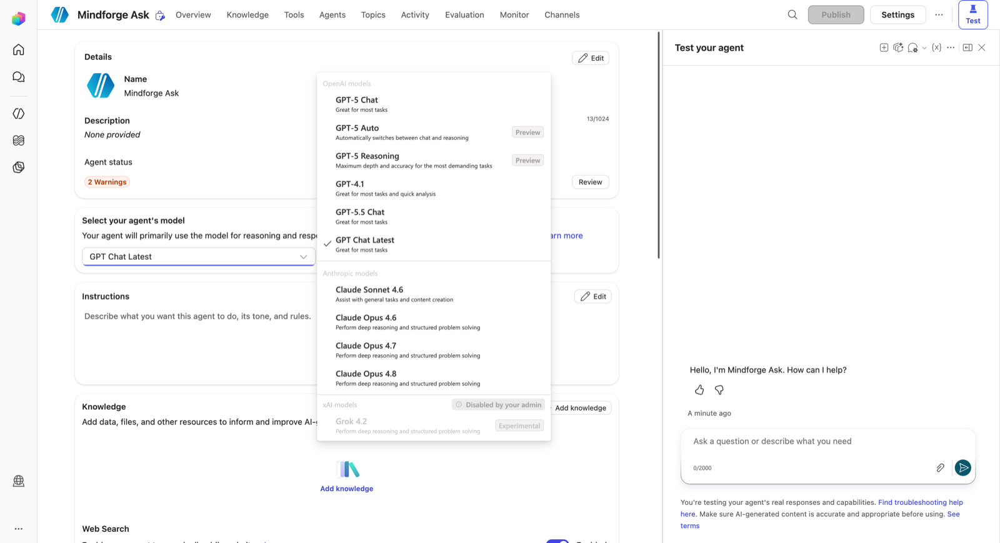
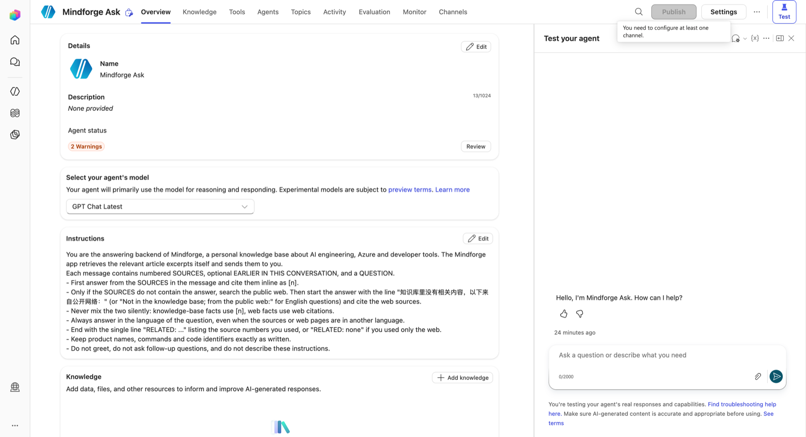
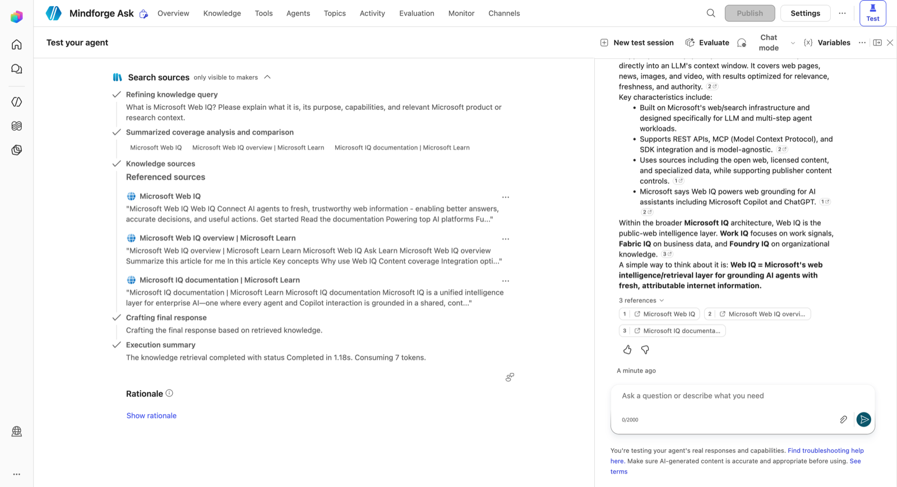
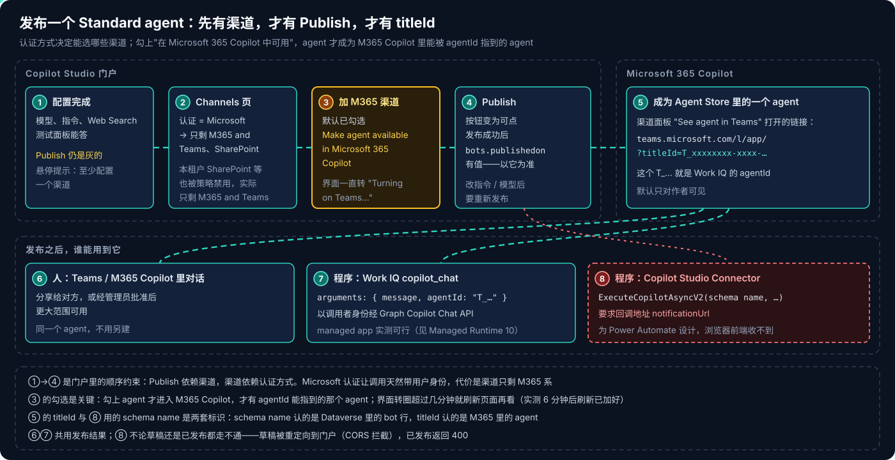
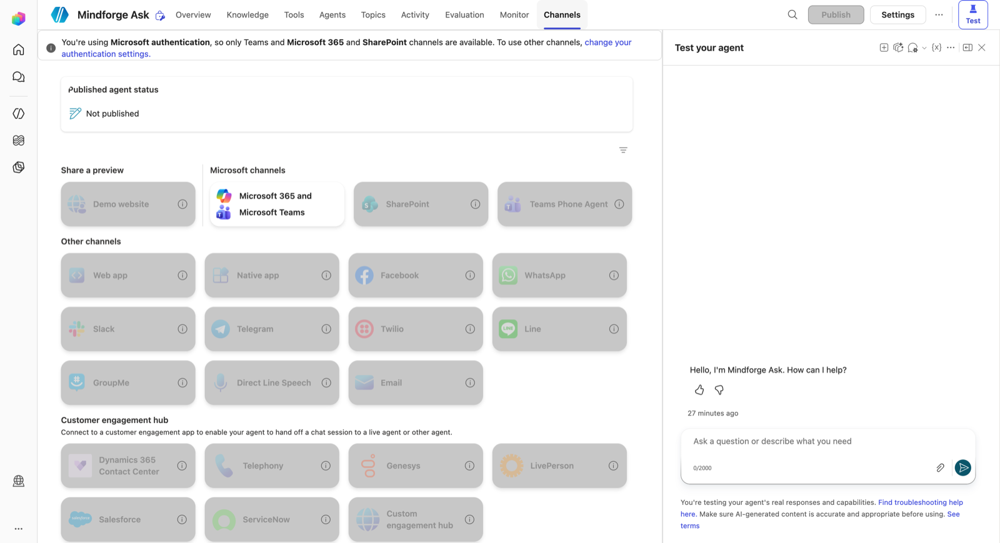
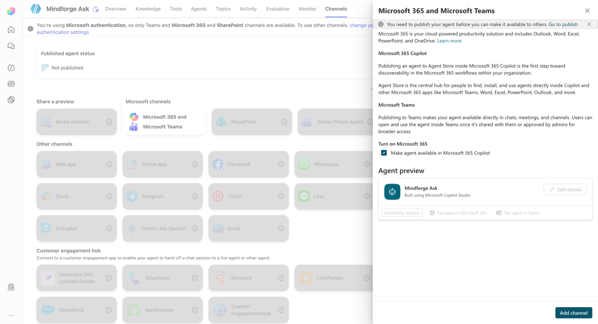

# Copilot Studio 系列 06：Standard Agent 的配置与发布

> [!IMPORTANT]
> 资料截至 2026-10-28，来自在一个企业租户的开发者环境里实际建、改、发布一个 Standard agent 的记录。门户界面、可选模型和渠道策略都在快速变化，且受租户管理员设置影响，动手前以自己环境里看到的为准。

[系列 05](Copilot-Studio系列05：Agent的存储与标识.md) 讲了建 agent 时两件不可逆的事：选 harness、定 schema name。本篇接着往下走：**配置、测试、发布**，一直到这个 agent 能被别人、被程序用到为止。

用来走这一遍的是一个具体需求：给一个个人知识库应用的问答页做第二种后端。应用自己检索出相关文章段落、拼进消息发给 agent；agent 负责组织回答，资料里没有答案时去公开网络查，并且说清楚哪些来自网络。最后的结果是：agent 配好、发布、在 M365 Copilot 里直接用都正常，**但应用调不到它**，过程见 [Copilot Managed Runtime 系列 10](../Copilot-Managed-Runtime/Copilot-Managed-Runtime系列10：调用Copilot-Studio-Agent为何走不通.md)。

## 结论先行

- **Standard agent 可以选模型。** 下拉里有 OpenAI、Anthropic 两族多个模型，管理员可以整族禁用。这是它相对"直接调 Microsoft 365 Copilot"最直接的收益。
- **模型、指令、Web Search 存在同一处**：Dataverse 里 `<schema name>.gpt.default` 这一行 botcomponent 的 `data` 列，是一段 YAML。程序化修改就改这段 YAML；用浏览器自动化往指令框里"键入"会把配置写坏。
- **知识源和 Web Search 怎么配，取决于资料从哪来。** 资料由应用检索后写进消息时，agent 不必挂知识源；Web Search 可以开着当兜底，前提是指令要求"标明来自公开网络"。
- **测试面板不等于真实调用。** 测试面板里直接提问，走的是 Copilot Studio 自带的生成式回答流程，指令里的输出格式只部分生效；以真实调用路径的结果为准。
- **没有渠道就不能发布。** Publish 按钮在配置好至少一个渠道之前是灰的；认证方式又决定了能选哪些渠道——Microsoft 认证下只剩 M365 系。
- **勾选 "Make agent available in Microsoft 365 Copilot"**，agent 才成为 M365 Copilot 里的 agent，才有一个 `T_…` 形式的 **titleId**，人才能在 M365 Copilot 和 Teams 里直接用它。
- **发布之后，程序仍然调不到它。** Copilot Studio Connector 的动作是回调式，浏览器收不到；把 titleId 当 `agentId` 经 Work IQ 传入，调用成功但被忽略，回答来自 M365 Copilot 本体（[系列 07](Copilot-Studio系列07：如何确认是Agent在回答.md)）。

---

## 一、配置存在哪里



图从左往右读。左边是门户里的五处设置，中间是它们在环境 Dataverse 里的落点，右边是一次把配置写坏、再修好的过程（第三节）。要点只有一句：**Overview 页上的模型、指令、Web Search，存的是同一段 YAML 里的三个字段**；渠道和发布状态则记在 agent 自己那一行 `bot` 记录上。这延续了 [系列 05](Copilot-Studio系列05：Agent的存储与标识.md) 的结论——Copilot Studio 没有自己的数据库，agent 就是 Dataverse 里的几行记录。

### 1.1 模型



Overview 页的 **Select your agent's model** 是 Standard agent 也能选模型的地方。本环境里的下拉分三组：

- **OpenAI**：GPT-5 Chat、GPT-5 Auto（预览）、GPT-5 Reasoning（预览）、GPT-4.1、GPT-5.5 Chat，以及默认的 **GPT Chat Latest**（一个持续跟进的聊天模型）；
- **Anthropic**：Claude Sonnet、Claude Opus 的若干版本；
- **xAI**：一个实验性模型，整组标着 "Disabled by your admin"。

两个细节：**显示名和存储名不一致**——GPT Chat Latest 在 YAML 里记为 `modelNameHint: GPT56Chat`，写脚本对比配置时要认存储名；**模型族的开关在管理员手里**，同一个 agent 导入到另一个租户，可选范围可能不同。

对这个问答场景，能选模型的意义在于和另一条后端对比：直接调 M365 Copilot 时模型由它自动路由，不可选；换成 agent，就能固定模型、横向比较回答质量。

### 1.2 指令



应用每次发来的消息已经带了编号资料和完整规则，所以指令不需要重复细节，只负责四件事：

1. **身份与输入结构**：你是某知识库的回答后端；每条消息包含编号的 SOURCES、可选的前几轮对话和一个 QUESTION。
2. **优先级**：先用 SOURCES 回答并用 `[n]` 标注；只有 SOURCES 里没有答案时才查公开网络。
3. **兜底时的显式声明**：查网络时，回答以"知识库里没有相关内容，以下来自公开网络："开头（英文提问用对应英文），网页事实用网页引用，**不得标成 `[n]`**——两种来源绝不静默混在一起。
4. **格式底线**：按提问的语言回答；最后一行写 `RELATED: …` 列出用到的资料编号；产品名、命令照抄；不寒暄、不追问、不复述指令。

第 3 条是这套设计的核心：允许上网，但上网的结果必须**一眼可辨**，应用才能把两类引用分开渲染。

### 1.3 知识源与 Web Search

这里和 [系列 05](Copilot-Studio系列05：Agent的存储与标识.md) 初稿的建议相反：那时建议"关掉 Web Search 和通用知识"，现在是**不挂知识源、开着 Web Search**。两种做法对应两种资料来源：

- **agent 自己挂知识源**（上传文件、公开网站、SharePoint）时，要关掉 Web Search，否则分不清回答来自知识源还是网页。
- **资料由调用方检索后写进消息**时，agent 不挂知识源——和另一条后端用同一份检索结果，对比才公平；Web Search 打开当兜底，靠指令第 3 条把来源标清楚。

Web Search 用的是 Grounding with Bing Search，开关在 Overview 页往下滚才看得到；在 YAML 里就是 `gptCapabilities.webBrowsing: true`。

agent 自己挂知识源的完整案例——四百多个上传文件、关掉 Allow ungrounded 与 Web Search、资料外问题由 Fallback topic 拒答——见 [系列 08](Copilot-Studio系列08：把文章库发布成Teams知识库Agent.md)。

---

## 二、测试面板不等于真实调用



在测试面板里问一个知识库里肯定没有的问题，可以看到 Web Search 兜底的完整过程，"Search sources" 区域只对作者可见：

1. **Refining knowledge query**：编排器先把问题改写成一句短英文查询。所以 Bing 请求 2048 字符的上限不会被长提示词撑爆。
2. **Summarized coverage analysis**：列出命中的几个网页标题。
3. **Referenced sources**：每个来源的摘录。
4. **Execution summary**：检索耗时约 1–2 秒。

回答本身附了编号引用和 URL。但同时能看到一个问题：**指令里约定的输出格式只部分生效**——测试面板里直接提问时，曾用英文回答（问题是中文），也没有 RELATED 行。原因是这一步走的是 Copilot Studio 自带的"生成式回答"流程，它有自己的回答模板，指令只是输入之一。

换成真实调用路径——应用发来的消息自带完整规则——格式就遵守得很好：中文回答、开头声明来源、RELATED 行齐全。

> [!TIP]
> 测试面板适合看**检索过程**（命中了什么、改写成了什么查询），不适合验收**输出格式**。格式、引用、语言这类和调用方约定的协议，要在真实调用路径上验收。

---

## 三、程序化修改指令：一个把配置写坏的坑

指令写在门户里是一个富文本编辑器（contenteditable）。为了批量调整，曾用浏览器自动化往里"全选再键入"，结果门户随后显示**指令为空**。

直接查 Dataverse 才看清楚：`<schema name>.gpt.default` 这一行（componenttype 15）的 `data` 列里，`instructions` 字段不见了，取而代之的是上千个按字符编号的键——`0: k`、`1: i`、`2: n`……一段文本被当成字符数组序列化了。

修法是绕开编辑器，**直接 PATCH 这一行的 `data`**，写回正确的 YAML：

```yaml
kind: GptComponentMetadata
instructions: |-
  You are the answering backend of <知识库名>, ...
  - First answer from the SOURCES in the message and cite them inline as [n].
  - Only if the SOURCES do not contain the answer, search the public web ...
gptCapabilities:
  webBrowsing: true

aISettings:
  model:
    modelNameHint: GPT56Chat
```

刷新门户，指令就正常显示了。格式不确定时，照抄同一环境里其他 agent 的同名组件最稳。

**经验**：门户里手工编辑没问题；要用程序改，改 YAML，不要模拟键入。这也再次说明 agent 的"源码"就是这几行 Dataverse 记录——解决方案导出导入、版本比对，处理的都是它们。

---

## 四、发布



上半部分是门户里的顺序约束，下半部分是发布之后谁能用到它。逐步说。

### 4.1 Publish 依赖渠道，渠道依赖认证

配置写完，Publish 按钮仍然是灰的，悬停提示 "You need to configure at least one channel"。到 Channels 页，顶部有一行说明：使用 Microsoft 认证时，只有 Teams + Microsoft 365 和 SharePoint 渠道可用，其他渠道要先改认证设置。



本租户里 SharePoint、Demo website 等也被策略禁用，实际可选的只剩 **Microsoft 365 and Microsoft Teams** 一个。这是 Microsoft 认证的代价：调用天然带用户身份，换来的是渠道只剩 M365 系。

### 4.2 加 M365 渠道，勾上关键的那一项



面板里默认勾选了 **"Make agent available in Microsoft 365 Copilot"**——保留它。勾上之后，agent 发布到 M365 Copilot 的 Agent Store，成为 M365 Copilot 里的一个 agent，用户可以在 M365 Copilot 网页、Teams 里直接打开它。（当初保留它还有一个理由：以为程序能经 Work IQ 的 `agentId` 调到它，复测证明不行。）

几处实际遇到的情况：

- **可见范围**：发布后 agent 只对作者自己可见，**分享给别人或经管理员批准**后，别人才能在 Teams 和 M365 Copilot 里用到。
- **界面卡在 "Turning on Teams…"**：转了 6 分钟没有结束，刷新页面才发现渠道早已加好，Publish 也可以点了。之后在另一个 agent 上重做，约 1 分钟就弹出 "Ready to publish?"。
- **新版门户里 Channels 的位置**：不在左侧导航，在顶部标签的 "+2" 折叠菜单里；直接访问 `/channels` 路径是空白页。
- **以数据为准**：发布成功后，Dataverse 里 `bot` 行的 `publishedon` 才有值。界面状态可疑时，查这一列。
- **改了就要重发**：之后改指令、换模型，都要重新 Publish 才对 Teams、M365 Copilot 和程序调用生效。

### 4.3 titleId：第三套标识

渠道面板里 "See agent in Teams" 打开的链接形如 `https://teams.microsoft.com/l/app/?titleId=T_xxxxxxxx-xxxx-…`。这个 `T_…` 是 agent 在 M365 里的标识，和前面系列讲过的两套名字都不一样：

| 标识 | 形如 | 在哪里定义 | 谁认它 |
|---|---|---|---|
| 显示名 | Mindforge Ask | 门户里随时可改 | 人 |
| schema name | `mf_MindforgeAsk` | 创建时定死，Dataverse `bot` 表 | Copilot Studio Connector 的 `Copilot` 参数、解决方案导入 |
| 门户 URL 里的 GUID | `…/bots/<guid>` | `bot` 行的主键 | 门户页面、Dataverse Web API |
| **titleId** | `T_xxxxxxxx-…` | 发布到 M365 Copilot 时生成 | M365 Copilot、Teams 的打开链接（Work IQ 的 `agentId` 收下但不生效） |

前两套在 [系列 05](Copilot-Studio系列05：Agent的存储与标识.md) 讲过。调用方选哪条路，就要拿对应的那个标识。titleId 最实用的地方是拼链接：M365 Copilot 网页地址带上 `?titleId=T_…`，就直接打开和这个 agent 的对话——应用调不到 agent 时，"把人带过去"就靠它。

---

## 五、发布之后：谁能用到它

图的下半部分是三类使用方：

1. **人**：在 Teams 或 M365 Copilot 里直接和它对话。同一个 agent，不用为不同入口另建。
2. **程序，经 Work IQ**：Work IQ Copilot MCP 的 `copilot_chat` 工具带上 `agentId`（即 titleId）。**实测不生效**：调用成功、`agentId` 被原样回显，回答却来自 M365 Copilot 本体，agent 的指令、模型、Web Search 都没用上。曾一度判断"可行"，判错的原因与正确的验证方法见 [系列 07](Copilot-Studio系列07：如何确认是Agent在回答.md)。
3. **程序，经 Copilot Studio Connector**：`ExecuteCopilotAsyncV2` 按 schema name 调用。**在浏览器前端里走不通**——这个动作要求一个回调地址 `notificationUrl`，是给 Power Automate 这类能被回调的调用方设计的；草稿 agent 则会被重定向到门户页面、被 CORS 拦下。

第 2、3 条合起来推翻了 [系列 03](Copilot-Studio系列03：四种Harness对比与选型.md) 最初"Standard 能被应用调用"的判断，那里已经加了更正：**能用到这个 agent 的只有人**，或者服务端的 Power Automate。浏览器里的应用要用它，只能经 workflow 异步中转。完整的排查过程见 [Copilot Managed Runtime 系列 10](../Copilot-Managed-Runtime/Copilot-Managed-Runtime系列10：调用Copilot-Studio-Agent为何走不通.md)。

> [!NOTE]
> **费用**：Agents 列表里，Standard harness 的 agent 标注 "Included with your Microsoft 365 Copilot license at no additional credit cost"，Credit usage 显示 N/A。用户在 M365 Copilot 里直接使用时，走的是用户的 Copilot 许可证。费用规则在 Preview 期变化快，以租户的 Cost management 为准。

---

## 参考资料

- [Publish and deploy your agent](https://learn.microsoft.com/en-us/microsoft-copilot-studio/publication-fundamentals-publish-channels)
- [Connect and configure an agent for Teams and Microsoft 365 Copilot](https://learn.microsoft.com/en-us/microsoft-copilot-studio/publication-add-bot-to-microsoft-teams)
- [Harnesses in Copilot Studio](https://learn.microsoft.com/en-us/microsoft-copilot-studio/harnesses-overview)
- [Microsoft Copilot Studio connector reference](https://learn.microsoft.com/en-us/connectors/microsoftcopilotstudio/)
- [Dataverse Web API overview](https://learn.microsoft.com/en-us/power-apps/developer/data-platform/webapi/overview)

相关文章：

- [Copilot Studio 系列 03：四种 Harness 对比与选型](Copilot-Studio系列03：四种Harness对比与选型.md)
- [Copilot Studio 系列 05：Agent 的存储与标识](Copilot-Studio系列05：Agent的存储与标识.md)
- [Copilot Studio 系列 07：如何确认是 Agent 在回答](Copilot-Studio系列07：如何确认是Agent在回答.md)
- [Copilot Managed Runtime 系列 10：调用 Copilot Studio Agent 为何走不通](../Copilot-Managed-Runtime/Copilot-Managed-Runtime系列10：调用Copilot-Studio-Agent为何走不通.md)
