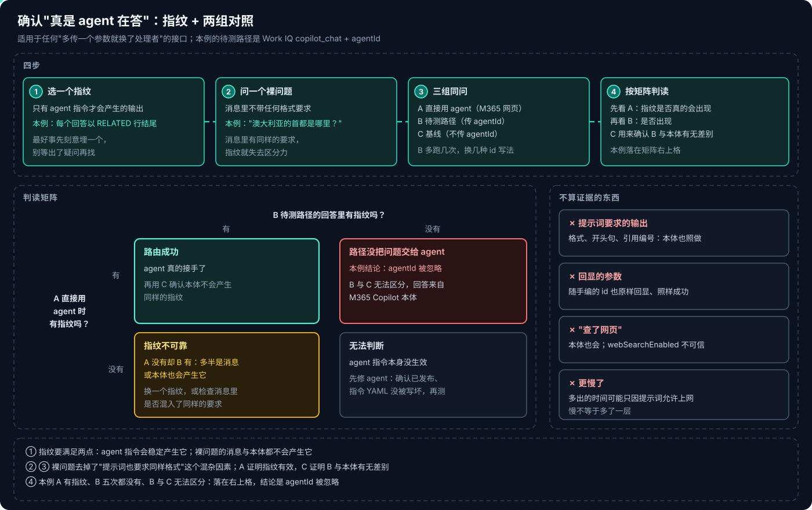
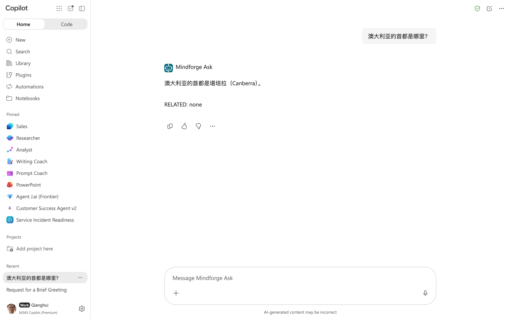
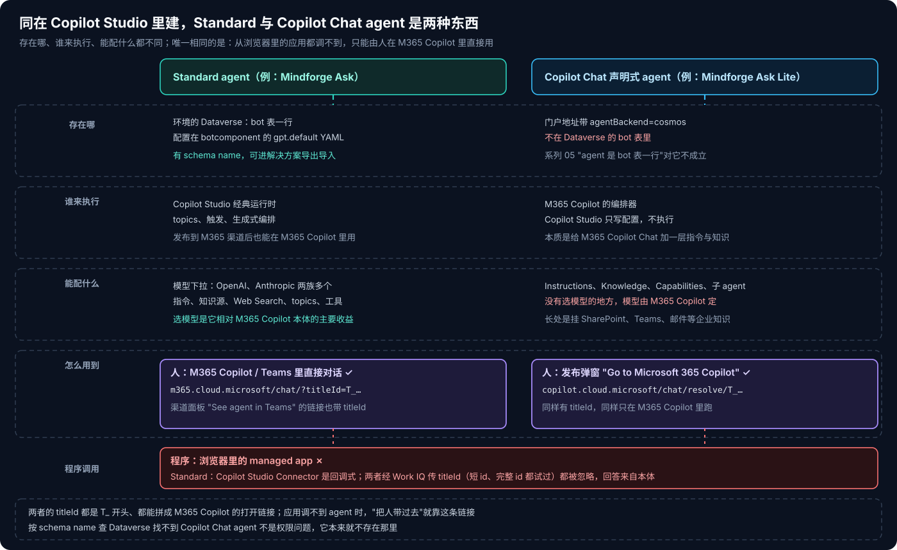
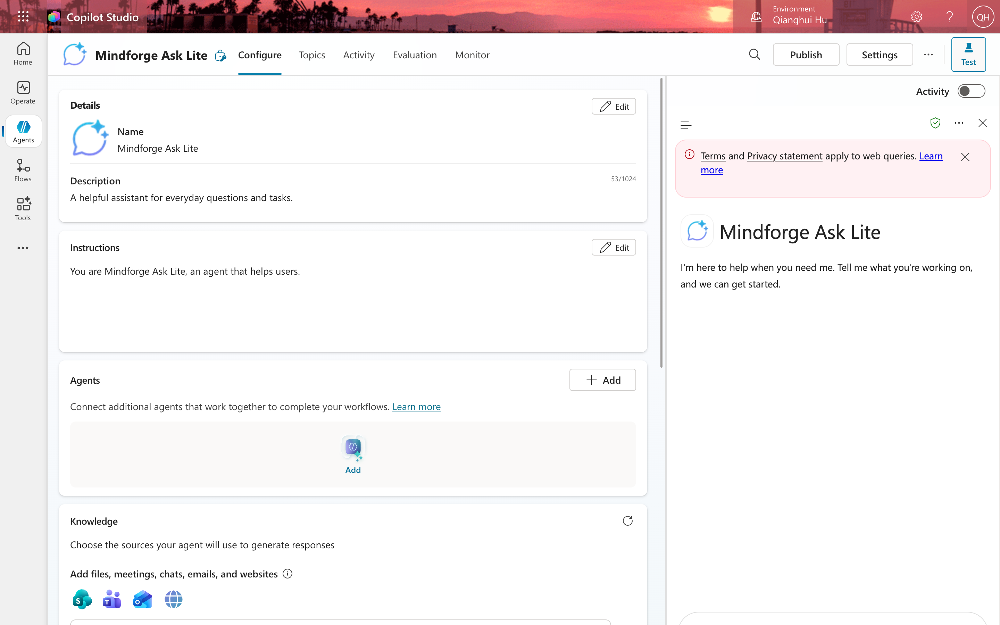

# Copilot Studio 系列 07：如何确认是 Agent 在回答

> [!IMPORTANT]
> 资料截至 2026-10-28，来自在一个企业租户里对两个 agent 的对照实验。Work IQ Copilot MCP Connector 是 Preview，`agentId` 的行为以后可能改变；本篇的结论会过时，但验证方法不会。

[系列 06](Copilot-Studio系列06：Standard-Agent的配置与发布.md) 把一个 Standard agent 配好、发布到了 Microsoft 365 Copilot。接下来想让一个 managed app 经 Work IQ 的 `copilot_chat` 传 `agentId` 调它，[Copilot Managed Runtime 系列 10](../Copilot-Managed-Runtime/Copilot-Managed-Runtime系列10：调用Copilot-Studio-Agent为何走不通.md) 记了完整过程：调用成功、格式正确，一度判为"可行"并上线，复测才发现 agent 从未接手。

那篇讲的是"这条路走不通"。本篇讲两件更通用的事：**怎么判断回答真是来自某个 agent**；以及为了做对照实验新建的 **Copilot Chat 声明式 agent**，和 Standard agent 到底有什么不同。

## 结论先行

- **调用成功、格式正确、回显了参数，三样都不能证明 agent 接手了。** 格式是你自己的提示词要求的，M365 Copilot 本体也会照做；Work IQ 对任意 `agentId` 都原样回显，随手编的也一样。
- **判断方法是"指纹 + 两组对照"。** 选一个只有 agent 指令才会产生的输出作指纹；问一个不带任何格式要求的裸问题；分别在"直接用 agent""待测路径""不传 agentId"三处问，按矩阵判读。
- **本例的结果**：直接在 M365 Copilot 里用 agent，回答以指令规定的 `RELATED` 行结尾；经 Work IQ 传 `agentId` 五次，一次都没有，与不传时无法区分。结论：`agentId` 被忽略。
- **最好在建 agent 时就埋一个指纹**，而不是等出了疑问再去找。一条"每个回答以某行结尾"的规则成本几乎为零。
- **Copilot Chat 声明式 agent 不是"轻量版 Standard"。** 它不在 Dataverse 的 `bot` 表里，门户地址带 `agentBackend=cosmos`，由 M365 Copilot 的编排器执行，配置页里没有选模型的地方。
- **两类 agent 都只能由人直接用**：都有 `T_…` 形式的 titleId，拼进 M365 Copilot 的网址就能打开对话；浏览器里的应用调不到它们。

---

## 一、一次误判是怎么发生的

agent「Mindforge Ask」的指令大意是：只依据消息里的 SOURCES 作答并用 `[n]` 标注；SOURCES 没有答案时才查公开网络，并以"知识库里没有相关内容，以下来自公开网络："开头；最后一行写 `RELATED:`。

应用发给 Work IQ 的提示词里，**也写了这几条规则**——这本来是为了让两种后端用同一套引用协议，对比才公平。于是经 Work IQ 传 `agentId` 时看到的一切都"对"：

- 资料外的问题，回答以那句开头句起首，引用了公开网页；
- `[n]` 和 `RELATED` 行都在；
- 返回的外层 JSON 多了一个 `agentId` 字段，值就是传进去的那个；
- 耗时 31–36 秒，比不传 `agentId` 时慢一截，像是多了一层 agent 编排。

四条看起来互相印证，其实每一条都另有解释：开头句和格式是提示词要求的；本体不传 `agentId` 时同样会查网页；回显对任意值都成立；变慢可能只因为提示词允许上网。**没有一条是"只有 agent 才会产生"的。**

---

## 二、方法：指纹 + 两组对照

### 2.1 选一个指纹

指纹要同时满足两点：**agent 指令会稳定产生它**；**消息本身和 M365 Copilot 本体都不会产生它**。

本例用的是 agent 指令里"每个回答以 `RELATED` 行结尾"这条。平时应用的提示词里也有同样的要求，所以它没有区分力；但只要换成一个不带任何格式要求的问题，提示词里就没有这条规则了——还出现 `RELATED` 行，就只能是 agent 指令在起作用。

> [!TIP]
> 指纹最好在建 agent 时就刻意埋进去，比如要求每个回答以一个固定标记结尾，或者对某个特定暗号问题给出固定回答。等到怀疑路由有问题时再去找"只有 agent 才会做的事"，往往会发现指令里的每一条都和提示词重复了。

### 2.2 问一个裸问题，分三处问

裸问题选的是"澳大利亚的首都是哪里？"——常识题，任何一方都能答对，区别只会出现在格式上。

| 组 | 调用方式 | 作用 |
|---|---|---|
| A | M365 Copilot 网页里直接打开 agent | 证明指纹确实会出现：agent 指令本身生效 |
| B | Work IQ + `agentId`（待测路径） | 要回答的问题：经这条路，agent 有没有接手 |
| C | Work IQ，不传 `agentId` | 基线：B 与 M365 Copilot 本体有没有差别 |

> [!WARNING]
> **裸问题要确认不在 agent 的资料里。** 这道题后来被写进了记录本次实验的文章；当这批文章又成为另一个知识库 agent 的知识源时，它引用这篇答出了堪培拉——按知识库答，不算违规，但这道题从此不能再当"资料外的问题"用。给挂了知识源的 agent 选拒答题前，先在知识文件里搜一遍（[系列 08](Copilot-Studio系列08：把文章库发布成Teams知识库Agent.md) 第五节）。

B 不要只跑一次。本例 B 跑了五次，换了两种 id 写法：渠道面板链接里的短 titleId，以及 M365 Copilot 网页里这个 agent 的完整 id（titleId 后面再接一段 id）。

### 2.3 结果

- **A**："澳大利亚的首都是堪培拉（Canberra）。"一句话，下一行 **`RELATED: none`**。
- **B**（五次）：加粗、带 emoji、补一句"很多人会误以为是悉尼…"，**都没有 `RELATED` 行**。
- **C**：与 B 无法区分。

A 有指纹、B 没有、B 与 C 一样：落在判读矩阵右上格，**路径没有把问题交给 agent**。

另外两格也值得记住：A 没有指纹而 B 有，说明指纹不可靠，多半是消息或本体也会产生它；A、B 都没有，说明 agent 指令本身没生效（没发布、指令被写坏，[系列 06](Copilot-Studio系列06：Standard-Agent的配置与发布.md) 第二节就遇到过一次），这时什么都判断不了，要先修 agent。

### 2.4 还有一组对照：换一个 agent

为了排除"这个 agent 有问题"或"Standard 不行、声明式行"的可能，又专门建了一个 **Copilot Chat 声明式 agent**「Mindforge Ask Lite」，用同样的方法测：直接用时指令生效，经 Work IQ 传它的 titleId，结果与不传时无法区分。两类 agent 的结论一致。

> [!CAUTION]
> 这套方法不只适用于 agent。任何"多传一个参数就换了处理者"的接口——指定模型、指定租户、指定版本、指定路由——都该这样验：**找只有目标处理者才会产生的特征，用"不经过它""直接用它"两组对照把结论夹住**。接口返回成功、回显了参数，只说明它收下了参数，不说明它用了。

---

## 三、Copilot Chat 声明式 agent 是什么

在 Copilot Studio 的 New agent 下拉菜单里选 **Microsoft Copilot agent**（Copilot chat），会在新标签页打开一个不一样的编辑器（[系列 03](Copilot-Studio系列03：四种Harness对比与选型.md) 的菜单对照）。建出来的东西和 Standard agent 差别很大。

### 3.1 它不在 Dataverse 的 bot 表里

[系列 05](Copilot-Studio系列05：Agent的存储与标识.md) 讲过：Copilot Studio 没有自己的数据库，agent 是环境 Dataverse 里 `bot` 表的一行。**这一条对 Copilot Chat agent 不成立。** 它的门户地址里带着 `agentBackend=cosmos`，在 `bot` 表里查不到它。

实际影响有两点：

- **按 schema name 去 Dataverse 找它会扑空**，这不是权限问题，它本来就不存在那里；
- 解决方案、发布者前缀、导出导入这套 ALM 机制，**是否覆盖它要另行确认**，不能按 Standard 的经验推断。

### 3.2 由 M365 Copilot 执行，不能选模型

配置页只有几块：Details（名称、描述）、Instructions、Agents（连接子 agent）、Knowledge（SharePoint、Teams、Outlook、网站等）、Capabilities。**没有选模型的地方**——它是挂在 M365 Copilot Chat 上的声明式 agent，由 M365 Copilot 的编排器执行，模型也由 M365 Copilot 决定。Copilot Studio 在这里只负责写配置。

所以它的长处是**给 M365 Copilot 挂企业知识**：SharePoint 文档库、Teams 消息、邮件，这些是 M365 Copilot 本来就能以用户身份访问的东西。对资料在 GitHub、由应用检索后写进提示词的场景，它的价值不大。

### 3.3 发布之后去哪里用

发布后弹窗里有一个 **Go to Microsoft 365 Copilot**，跳到形如 `copilot.cloud.microsoft/chat/resolve/<titleId>` 的地址。它同样有一个 `T_…` 开头的 titleId。

Standard agent 发布到 M365 渠道后也一样：M365 Copilot 网页地址带上 `?titleId=T_…`，就直接打开和它的对话。**应用调不到 agent 时，"把人带过去"就靠这条链接**——在应用里放一个"在 Copilot 里继续问"的按钮，比硬做一条调不通的程序路径实际得多。

### 3.4 两类 agent 对照

| | Standard agent | Copilot Chat 声明式 agent |
|---|---|---|
| 存在哪 | Dataverse `bot` 表一行，配置在 botcomponent 的 YAML | 不在 `bot` 表，门户地址带 `agentBackend=cosmos` |
| 谁执行 | Copilot Studio 经典运行时 | M365 Copilot 编排器 |
| 选模型 | 可以，OpenAI、Anthropic 两族多个 | 不可以，由 M365 Copilot 决定 |
| 擅长 | 规则化流程、topics、可控的回答格式 | 给 M365 Copilot 挂企业知识 |
| 人怎么用 | 发布到 M365 渠道后，M365 Copilot / Teams 里直接用 | 发布后在 M365 Copilot 里直接用 |
| 浏览器里的应用调用 | 不行：Connector 回调式；Work IQ `agentId` 被忽略 | 不行：Work IQ `agentId` 被忽略 |
| 服务端调用 | Power Automate 经 Copilot Studio Connector | 能否在 workflow 里被指定，未查证 |

---

## 四、对前几篇的影响

- **[系列 03](Copilot-Studio系列03：四种Harness对比与选型.md)**："能从应用里调用的只有 Standard"改为"从浏览器里的 managed app，四种 harness 都同步调不到"，已更正。
- **[系列 05](Copilot-Studio系列05：Agent的存储与标识.md)**："agent 是 Dataverse `bot` 表的一行"只对 Standard 等由 Copilot Studio 运行时执行的 agent 成立；Copilot Chat agent 是例外。
- **[系列 06](Copilot-Studio系列06：Standard-Agent的配置与发布.md)**：titleId 不是"程序调用它的 agentId"，而是"人打开它的链接参数"，已更正。
- **[系列 04](Copilot-Studio系列04：Agent、Workflow与App的协作.md)**：app 同步调用 agent 的模式 B 里，Copilot Studio agent 这一支不成立；要用 agent，退回模式 A 经 workflow 中转。

---

## 参考资料

- [Harnesses in Copilot Studio](https://learn.microsoft.com/en-us/microsoft-copilot-studio/harnesses-overview)
- [Declarative agents for Microsoft 365 Copilot](https://learn.microsoft.com/en-us/microsoft-365-copilot/extensibility/overview-declarative-agent)
- [Connect and configure an agent for Teams and Microsoft 365 Copilot](https://learn.microsoft.com/en-us/microsoft-copilot-studio/publication-add-bot-to-microsoft-teams)

相关文章：

- [Copilot Studio 系列 03：四种 Harness 对比与选型](Copilot-Studio系列03：四种Harness对比与选型.md)
- [Copilot Studio 系列 05：Agent 的存储与标识](Copilot-Studio系列05：Agent的存储与标识.md)
- [Copilot Studio 系列 06：Standard Agent 的配置与发布](Copilot-Studio系列06：Standard-Agent的配置与发布.md)
- [Copilot Managed Runtime 系列 10：调用 Copilot Studio Agent 为何走不通](../Copilot-Managed-Runtime/Copilot-Managed-Runtime系列10：调用Copilot-Studio-Agent为何走不通.md)
- [Copilot Managed Runtime 系列 12：方案回顾与 Connector 接入清单](../Copilot-Managed-Runtime/Copilot-Managed-Runtime系列12：方案回顾与Connector接入清单.md)
