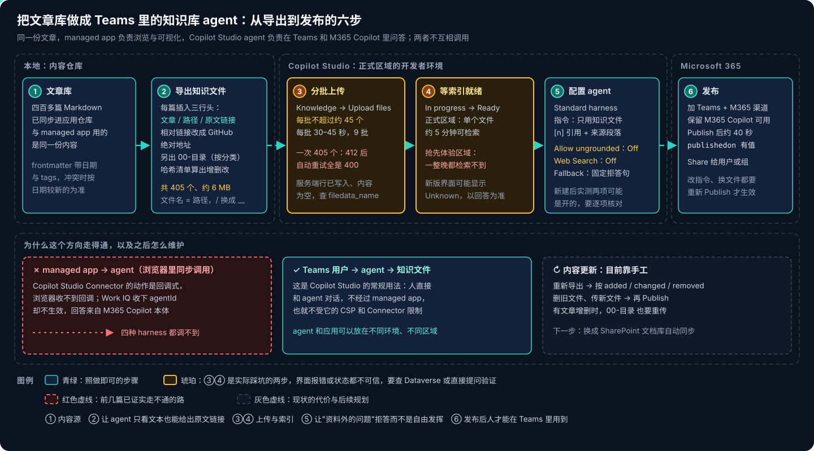
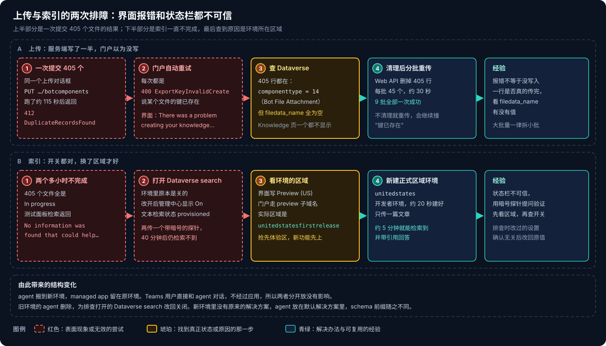
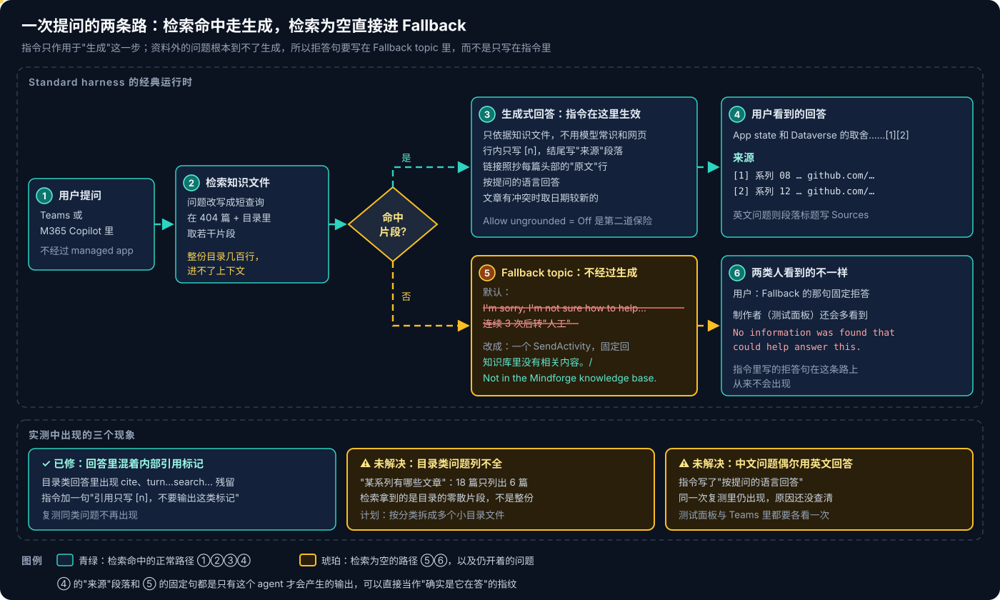

# Copilot Studio 系列 08：把文章库发布成 Teams 知识库 Agent

> [!IMPORTANT]
> 资料截至 2026-10-29，来自把一个个人知识库的全部文章做成 Copilot Studio agent、发布到 Teams 的完整记录。上传限制、索引速度和门户界面都在变化，区域差异尤其可能随时间消失，动手前以自己环境里的实测为准。

[系列 06](Copilot-Studio系列06：Standard-Agent的配置与发布.md) 和 [系列 07](Copilot-Studio系列07：如何确认是Agent在回答.md) 的结论是：浏览器里的 managed app 调不到 Copilot Studio agent。本篇换一个方向：**不让应用调 agent，让 Teams 里的人直接问 agent**，agent 的资料就是应用展示的那批文章。

这是 Copilot Studio 最常规的用法，难点不在"能不能"，而在几处文档没写的细节：知识文件怎么准备才能给出原文链接、四百个文件怎么传上去、索引为什么一直不完成、资料外的问题为什么不按指令拒答。

## 结论先行

- **方向反过来就走得通。** 用户 → agent → 知识文件，不经过 managed app，也就不受它的 CSP 和 Connector 限制。agent 和应用甚至可以放在不同环境、不同区域。
- **知识文件要自带出处。** 每篇在 frontmatter 后插入"文章 / 路径 / 原文"三行，相对链接改成 GitHub 绝对地址——agent 只看得到文本。原文链接只能放 GitHub，因为宿主不把地址里的 hash 传给应用，应用链接打不开具体文章（[Copilot Managed Runtime 系列 13](../Copilot-Managed-Runtime/Copilot-Managed-Runtime系列13：静态内容缓存与深链限制.md)）。
- **一次上传 405 个文件会失败，而且失败得很隐蔽。** 服务端已经写下 405 行，但都没有文件内容，门户的自动重试全部报"已存在"。清掉这些行、每批约 45 个重传，9 批都一次成功。
- **环境区域会影响文件索引。** 在抢先体验区域（`unitedstatesfirstrelease`）的环境里，文件一整晚都是 In progress；换到正式区域，单篇约 5 分钟可检索。打开 Dataverse search 不是解法。
- **资料外的问题不走生成。** 检索为空时直接进 Fallback topic，指令里写的拒答句根本不会出现。拒答句要写进 Fallback topic。
- **拒答测试题要先在知识库里搜一遍。** 系列 07 用过的"澳大利亚的首都"已经写进文章里了，agent 按知识库答出堪培拉，这不算违规。

---

## 一、方向反过来就走得通



图的上半部分是六步流水线，下半部分说明它和前几篇的关系。左下角那条红线是 [Copilot Managed Runtime 系列 10](../Copilot-Managed-Runtime/Copilot-Managed-Runtime系列10：调用Copilot-Studio-Agent为何走不通.md) 证实走不通的路：应用在浏览器里同步调用 agent，Copilot Studio Connector 是回调式、Work IQ 忽略 `agentId`，四种 harness 都调不到。中间那条是本篇的路：人在 Teams 里直接和 agent 对话。

同一批文章于是有了两个出口，分工按"谁擅长什么"划分：

| 功能 | managed app | Teams agent |
|---|---|---|
| 按问题找文章、摘要、跨文章对比 | ✅ 问答页（本地检索 + Azure OpenAI） | ✅ 回答带引用 |
| 打开原文 | ✅ 应用内阅读 | ✅ 给 GitHub 链接 |
| "有哪些文章" | ✅ 目录树 | ⚠️ 按目录文件用文字列出，长目录列不全 |
| 阅读进度、收藏 | ✅ App state | ❌ 读不到 App state |
| 图谱、洞察、演进等可视化 | ✅ | ❌ |
| 使用场景 | 打开应用专门读 | 在聊天里顺手问一句 |

**新建一个 agent，而不复用之前的「Mindforge Ask」。** 后者的指令是给"应用把检索结果写进消息"那种调用设计的，还开着 Web Search 兜底；这里的资料由 agent 自己检索，要求恰好相反：只许用知识文件。

---

## 二、导出知识文件

知识源先用最简单的 **Upload files**。准备工作由一个导出脚本完成，每次从文章仓库同步后运行一次，产出 405 个文件、约 6 MB：

1. **每篇文章一个 `.md` 文件，文件名是仓库路径**，`/` 换成 `__`。没有沿用应用里按哈希命名的文件，是为了让引用里一眼看出是哪篇。
2. **frontmatter 之后插入三行头**：

   ```markdown
   > 文章：Copilot Managed Runtime 系列 08：用 App state 保存用户数据
   > 路径：Azure/Copilot-Managed-Runtime/Copilot-Managed-Runtime系列08：用App-state保存用户数据.md
   > 原文：https://github.com/<owner>/<repo>/blob/main/Azure/Copilot-Managed-Runtime/…
   ```

   frontmatter 保持在最前，日期和 tags 跟着文章走，指令里"冲突时取日期较新的"才有依据。
3. **正文里的相对链接和图片改成 GitHub 绝对地址。** agent 只看得到文本，`../asset/x.svg` 这种路径对它毫无意义，原样留着还可能被它"补全"成错误的网址。
4. **另出一份 `00-目录.md`**：按顶层分类列出全部文章，每篇带链接，专门用来回答"有哪些文章"。
5. **记一份哈希清单。** 再次导出时打印 added / changed / removed，手工重传时只动这些文件。

> [!NOTE]
> **为什么原文链接不指向应用。** 本来想优先链到应用内的文章页，地址形如 `…/apps/<app>/#/doc/<路径>`。实测打开的总是首页：宿主给应用建的 iframe 地址里没有外层的 hash 和查询串，SDK 的 `getContext()` 也只给 appId、environmentId、sessionId，应用无从得知要打开哪篇。改应用代码也没用，所以只放 GitHub 链接。细节见 [Copilot Managed Runtime 系列 13](../Copilot-Managed-Runtime/Copilot-Managed-Runtime系列13：静态内容缓存与深链限制.md)。

---

## 三、建 agent 与配置

### 3.1 选对 harness

Agents → **New agent** 右侧下拉 → **Agent（Standard）**。直接点 New agent 按钮建出的是 GitHub Copilot harness（[系列 03](Copilot-Studio系列03：四种Harness对比与选型.md)），一问一答的知识库用它会"想太多"，更慢，也全程按 Credits 计费。

### 3.2 两个开关：只许用知识文件

Settings → Knowledge 里有两项必须关：

- **Allow ungrounded responses → Off**（存储里是 `aISettings.useModelKnowledge: false`）。开着时，资料外的问题会用模型自身的知识回答。
- **Use information from the Web → Off**（`gptCapabilities.webBrowsing: false`）。

两项都开着，就分不清一个回答到底来自文章还是模型常识——这正是 [系列 07](Copilot-Studio系列07：如何确认是Agent在回答.md) 那次误判的根源。

> [!WARNING]
> 不要假设默认值。门户里新建时 Web 开关显示 Off，但在另一个环境里新建的 agent，配置里两项实测都是 **开**（`webBrowsing: true`、`useModelKnowledge: true`）。建完后到 Dataverse 里核对一遍。

### 3.3 指令：围绕"出处"写

指令的核心是让每个回答都能追溯到具体文章。摘录要点：

```text
Your only source is the uploaded Mindforge knowledge files. Each article file starts with
three header lines: 文章 (title), 路径 (repository path) and 原文 (GitHub link).

- Answer only from the knowledge files. Do not use general knowledge or the web.
- If the knowledge files do not contain the answer, say so in one line ...
- Cite inline as [1], [2], and only in that form. Never output internal citation markers.
  End every answer with a "来源" section (or "Sources" in English): "[n] <title> <link>".
- Copy links exactly from the 原文 header line or from 00-目录.md.
- For "which articles are there about X", answer from 00-目录.md, grouped by category.
- When articles disagree, prefer the one with the later date.
- Answer in the language of the question.
```

几条的用意：**"只从原文行抄链接"** 防止模型凭印象拼网址；**"不输出内部标记"** 是实测后补的（第五节）；**"来源"段落** 同时是一个指纹——只有这份指令才会产生它。

### 3.4 配置以仓库为准，经 Web API 写入

[系列 06](Copilot-Studio系列06：Standard-Agent的配置与发布.md) 遇到过：用浏览器自动化往指令编辑器里粘贴，YAML 会被写成上百个按字符编号的键（`0: k`、`1: i`……），模型字段也变成 `{}`。这次又遇到了一次。

所以这次干脆不经过门户编辑器：**指令、topic 和两个开关都放在仓库里**，由一个脚本经 Dataverse Web API 写入——

- 指令写进 `<schema>.gpt.default` 这一行的 `data`（同时写 `webBrowsing: false`）；
- `bots.configuration` 里的 `aISettings.useModelKnowledge` 设为 `false`；
- 仓库里的 topic YAML 覆盖同名 topic；
- 已经一致的项打印 `unchanged`，先加 `--dry-run` 看会改什么。

写完要 **Publish** 才到 Teams。这样 agent 的配置也有了版本历史，和代码一起评审。

agent 跑通之后，又把它从应用仓库里**拆成了一个独立仓库**，内容只有四样：

- 一份 agent 描述文件：所在环境、Dataverse 地址、bot id、schema name、模型的存储名；
- 指令文本；
- 要覆盖的 topic YAML（目前只有 Fallback）；
- 两个脚本：写入配置、导出知识文件。

拆开的理由是两者的生命周期不同：应用按功能迭代、部署到 Managed Runtime；agent 按内容更新、发布到 Teams，环境和区域也不同。导出脚本随之改成直接读文章仓库，不再经过应用的同步步骤；用同一个文章版本对比，拆分前后导出的 405 个文件哈希全部一致。仓库成为 agent 的唯一来源后，**门户编辑器只用来看、不用来改**，否则下次运行脚本时会被覆盖。

---

## 四、上传与索引的两个坑



### 4.1 一次传 405 个：服务端写了一半

图的上半部分。把 405 个文件放在一个上传对话框里提交，`PUT …/botcomponents` 跑了约 115 秒后返回 **412 `DuplicateRecordsFound`**；门户随即自动重试，每次都是 **400 `ExportKeyInvalidCreate`**，说某个文件的键已存在。界面只显示一句 "There was a problem creating your knowledge source."。

查 Dataverse 才看清：第一次请求其实在服务端写完了，405 行 `componenttype = 14`（Bot File Attachment）都在，但 **`filedata_name` 全为空**——行建了，文件内容没写进去，Knowledge 页因此一个都不显示。之后的重试撞上这些空行，自然全是"已存在"。

处理办法：用 Web API 删掉这 405 行，再按**每批 45 个**重传，每批约 30 秒，9 批都一次成功。判断一行是否真的传完，看 `filedata_name` 有没有值。

还有一个小问题：**显示名截断到 100 个字符**。4 个文件名超长被截短，其中两篇同系列的论文笔记截断后同名。内容不受影响，只是引用里分不清；导出脚本以后可以主动缩短这类文件名。

### 4.2 索引一整晚不完成：原因是区域

图的下半部分。上传成功后两个多小时，405 个文件全是 In progress，测试面板检索返回 "No information was found that could help answer this."。

先怀疑 Dataverse search：这个环境里它原本是关的。改开之后，管理中心显示 On，文本检索状态是 provisioned。再传一个只含一句暗号的小文件做探针，40 分钟后仍是 In progress，问暗号也检索不到。所以**光开 Dataverse search 不够**。

接着看环境本身。界面写着 Preview (United States)，门户走 `copilotstudio.preview.microsoft.com`，查到实际区域是 **`unitedstatesfirstrelease`**——抢先体验区，新功能先在这里上线。于是新建一个正式区域 `unitedstates` 的开发者环境（BAP API 约 20 秒建好），只传一篇文章，**约 5 分钟就能检索到并带引用回答**。同一个文件在旧环境里放了一整晚都检索不到。

结论和后续：

- **agent 搬到新环境，managed app 留在原环境。** Teams 用户直接和 agent 对话，不经过应用，分开放没有影响——这本身就是第一节"两个出口"的好处。
- **为排查打开的 Dataverse search 改回关闭**，旧环境的 agent 删除。排查时改过的设置，确认无关后改回原值。
- **新环境里没有原来的解决方案**，agent 放在默认解决方案里，schema 前缀从 `mf_` 变成了 `new_`。schema name 创建后不能改（[系列 05](Copilot-Studio系列05：Agent的存储与标识.md)），所以先以测试名建好、确认能检索后只改显示名。
- **新版门户的状态栏会显示 Unknown**，但实际能检索到。以测试面板里的回答为准，不以状态为准。

> [!TIP]
> 文件类知识源迟迟不 Ready 时，先查环境区域（Power Platform 管理中心的环境详情，或 BAP API 返回的 `location`），再去翻各种开关。抢先体验区适合试新功能，不适合放要给别人用的 agent。

---

## 五、一次提问的两条路



图的上半部分是 Standard harness 处理一次提问的两条分支：

- **检索命中**（①②③④）：片段交给生成式回答，指令在这一步生效，回答带 `[n]` 和"来源"段落。
- **检索为空**（①②⑤⑥）：**不走生成，直接进 Fallback topic**。默认的 Fallback 回 "I'm sorry, I'm not sure how to help with that…"，连续三次后还会转"人工"。指令里写的"知识库里没有相关内容。"在这条路上从来不会出现。

所以拒答要分两处写：**指令**管"检索到了但不相关"的情况，**Fallback topic** 管"什么都没检索到"的情况。改后的 Fallback 只有一个动作：

```yaml
kind: AdaptiveDialog
beginDialog:
  kind: OnUnknownIntent
  id: main
  actions:
    - kind: SendActivity
      id: sendMessage_notInKb
      activity: 知识库里没有相关内容。/ Not in the Mindforge knowledge base.
```

转人工的分支一并去掉——这个 agent 背后没有人工。

### 5.1 测试题怎么选

按 [系列 07](Copilot-Studio系列07：如何确认是Agent在回答.md) 的方法，测试题要能区分"agent 按指令答"和"模型自由发挥"，看的是只有这份指令才会产生的行为，而不是回答是否通顺：

| 问题 | 应该看到 | 实测（正式区域环境） |
|---|---|---|
| App state 和 Dataverse 怎么选？ | 引用相关文章，"来源"段落带 GitHub 链接 | ✅ 引用 MR 08、12 |
| Prompt Cache 两代框架有什么区别？ | 引用该系列 01 | ✅ |
| Azure 下有哪些文章？ | 按目录列出带链接的标题 | ⚠️ 列出 48 篇，但混着 `cite…turn…search…` 残留标记，输出要几分钟 |
| 埃菲尔铁塔有多高？ | 拒答，不能答出高度 | ✅ 没有编造，但回的是默认 Fallback 句 |
| What is Voice Live? | 英文回答，段落标题是 Sources | ✅ |

> [!CAUTION]
> **拒答题要先在知识文件里搜一遍。** 最初用的拒答题是"澳大利亚的首都是哪里？"，agent 引用一篇文章答出了堪培拉。看似违规，其实那篇文章正是系列 07 的对照实验记录，题目和答案都写在里面——agent 是在按知识库答。文章库会不断收录自己的实验，昨天的"资料外问题"今天可能就在资料里。换题前先 `grep` 一遍导出目录。

### 5.2 修正与仍开着的问题

改了 Fallback topic、在指令里加了"引用只写 [n]"之后重新 Publish，复测：

- **拒答**：埃菲尔铁塔回的就是固定拒答句。✅
- **残留标记**：问"Voice Live 系列有哪些文章？"，不再出现 `cite…` 一类标记。✅
- **目录类问题列不全**：Voice Live 系列共 18 篇，只列出 6 篇，而且没有按目录文件回答。原因是检索拿到的只是目录的零散片段，几百行的整份目录进不了上下文。下一步让导出脚本按分类再出小目录文件。⚠️
- **语言**：同一次复测里，中文问题用了英文回答，原因还没查清。⚠️

门户顶部的 "1 Warning" 是 "No evaluation has been run on this agent"，不影响使用。

---

## 六、发布到 Teams

步骤和 [系列 06](Copilot-Studio系列06：Standard-Agent的配置与发布.md) 第四节相同：加 **Microsoft 365 and Microsoft Teams** 渠道、保留 "Make agent available in Microsoft 365 Copilot"、Publish、以 Dataverse `bots.publishedon` 有值为准、渠道面板里 **See agent in Teams** 打开自测，再 Share 给用户或组。这次多看到几处细节：

- **新版门户里 Channels 不在左侧导航**，在顶部标签的 "+2" 折叠菜单里；直接访问 `/channels` 路径是空白页。
- **加渠道比上次快**：Add channel 后约 1 分钟弹出 "Ready to publish?"，Publish 后约 40 秒 `publishedon` 就有值。上次在另一个 agent 上转了 6 分钟。
- **索引没完成也能发布**。发布后 agent 在 Teams 里能对话，但检索不到任何内容。所以发布前先在测试面板确认能检索。

费用方面，用户有 M365 Copilot 许可证时走许可证；没有许可证的用户，生成式回答消耗 Copilot Credits，具体以管理中心的 Cost management 为准。

---

## 七、更新内容与下一步

更新流程目前是手工的：

1. 同步文章、重新导出，脚本打印 added / changed / removed；
2. 在 Knowledge 里删掉 removed 和 changed 的旧文件，上传 added 和 changed 的新文件；
3. 有文章增删时，`00-目录.md` 也会变，一并重传；
4. **Publish**。

手工重传是这一阶段的代价。下一步换成 **SharePoint 文档库**：同步脚本或 Power Automate 把文章写进文档库，agent 挂文档库作知识源，内容自动保持最新，也就不再有"每批 45 个"的问题。

还没验证的几点：

- 上传文件数的上限：405 个全部接受，500 个的上限没有试。
- 405 个传完 10 分钟后抽测的 5 题都能检索到，但没有逐个确认每个文件。
- 引用卡片里显示的是文件名还是文章标题；如果是文件名，`__` 分隔的路径是否好认。
- 同名文章更新时，覆盖上传与"先删后传"有没有区别。

---

## 参考资料

- [Add knowledge to an agent](https://learn.microsoft.com/en-us/microsoft-copilot-studio/knowledge-copilot-studio)
- [Upload files as a knowledge source](https://learn.microsoft.com/en-us/microsoft-copilot-studio/knowledge-add-file-upload)
- [Configure the system fallback topic](https://learn.microsoft.com/en-us/microsoft-copilot-studio/authoring-system-fallback-topic)
- [Connect and configure an agent for Teams and Microsoft 365 Copilot](https://learn.microsoft.com/en-us/microsoft-copilot-studio/publication-add-bot-to-microsoft-teams)
- [Early release cycle environments](https://learn.microsoft.com/en-us/power-platform/admin/early-release)

相关文章：

- [Copilot Studio 系列 05：Agent 的存储与标识](Copilot-Studio系列05：Agent的存储与标识.md)
- [Copilot Studio 系列 06：Standard Agent 的配置与发布](Copilot-Studio系列06：Standard-Agent的配置与发布.md)
- [Copilot Studio 系列 07：如何确认是 Agent 在回答](Copilot-Studio系列07：如何确认是Agent在回答.md)
- [Copilot Managed Runtime 系列 10：调用 Copilot Studio Agent 为何走不通](../Copilot-Managed-Runtime/Copilot-Managed-Runtime系列10：调用Copilot-Studio-Agent为何走不通.md)
- [Copilot Managed Runtime 系列 13：静态内容缓存与深链限制](../Copilot-Managed-Runtime/Copilot-Managed-Runtime系列13：静态内容缓存与深链限制.md)
