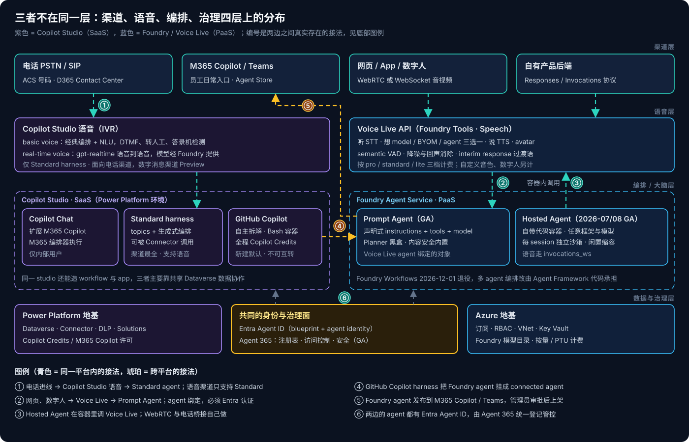
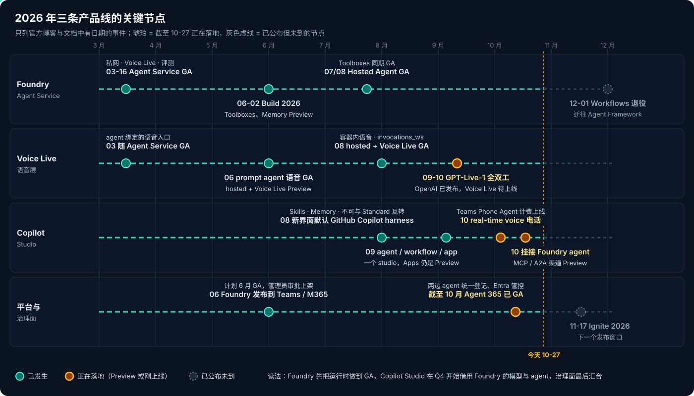
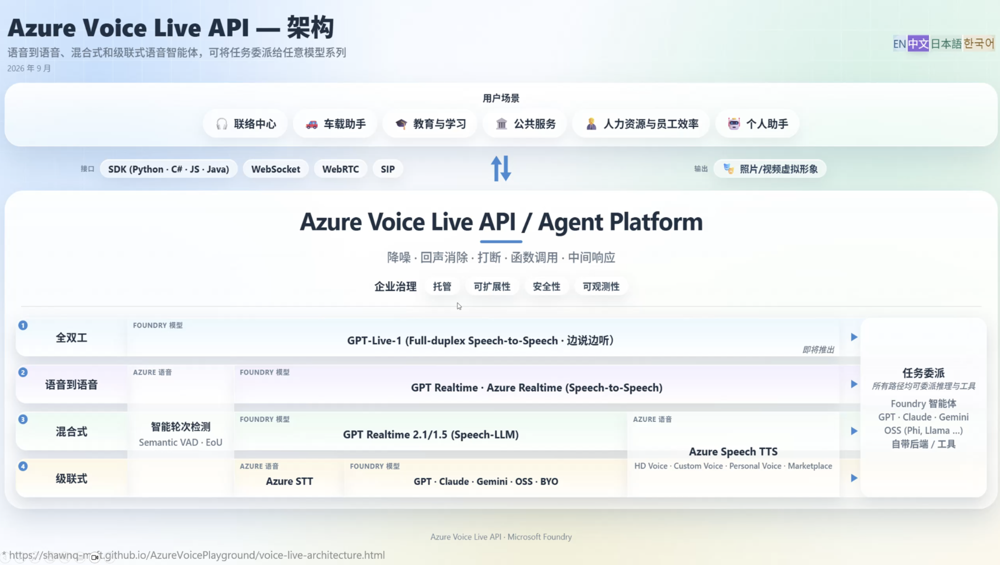
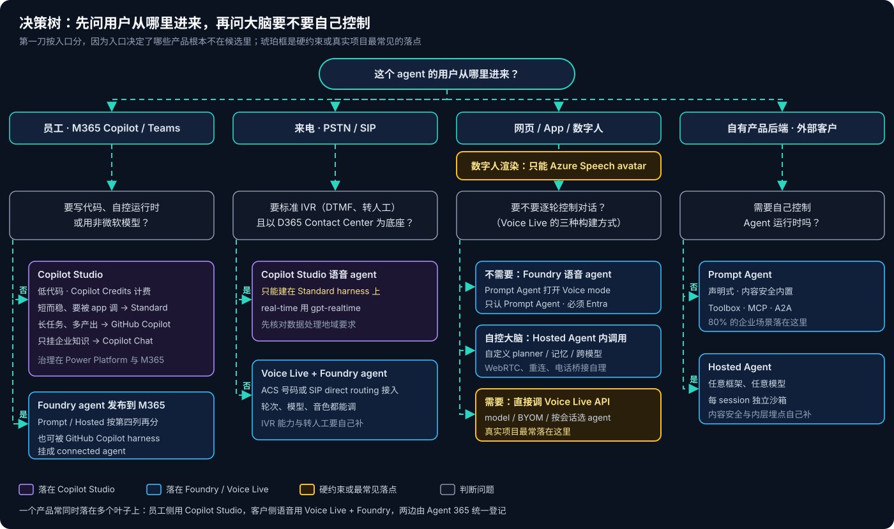

# Foundry Agent 与 Copilot Studio 的选型

> [!IMPORTANT]
> 资料截至 2026-10-27。Copilot Studio 的新界面、GitHub Copilot harness 的多数渠道、real-time voice 的数字消息渠道仍是 Preview；下一个大的发布窗口是 2026-11-17 的 Ignite。文中的事实都标了出处，"判断"类的内容单独标出。

这篇是三个系列的交汇点，各自的细节分别在 [Copilot Studio 系列](Copilot-Studio/Copilot-Studio系列01：产品全景与环境.md)、[Foundry Agent 三种形态对比与选型](Foundary-Agent/Foundry-Agent三种形态对比与选型.md) 和 [Voice Live 系列](VoiceLive/Voice-Live系列00：导读.md) 里。主角是 Foundry Agent 和 Copilot Studio 这两个 agent 平台；Voice Live 不是第三个平台，而是语音需求出现时两边都要面对的那一层，所以放在一起讲。这里只回答一个问题：一个需求进来，该落在哪一个上，哪些选择其实没得选。

## 结论先行

- **两者不在同一层，不是二选一。** Copilot Studio 是盖在 Power Platform 上的 **SaaS 构建产品**，Foundry Agent Service 是 Azure 上的 **agent 运行时（PaaS）**；Voice Live 是能接在两者前面的**语音层**。真实的问题是"每一层用谁"。
- **第一刀按用户入口分。** 员工在 M365 Copilot / Teams 里用 → 先看 Copilot Studio；打电话进来 → Copilot Studio 语音或 Voice Live；网页、App、数字人 → 语音与形象走 Azure Speech（Voice Live 或实时 avatar API），大脑仍可以是任意一边；自有产品的后端、外部客户 → Foundry。
- **语音 agent 有三种构建方式**：Foundry 语音 agent（Prompt Agent 打开 Voice mode）、Hosted Agent + Voice Live、直接调 Voice Live API。真实项目多数要逐轮控制，最终落在直接调 API。
- **第二刀看大脑要不要自己控制。** 不需要 → Copilot Studio 的 harness 或 Foundry Prompt Agent；需要自定义 planner、长期记忆、非微软模型 → Foundry Hosted Agent。
- **硬约束集中在三处接缝上**：Copilot Studio 只有 Standard harness 能被 app 程序化调用、能做语音；Voice Live 的 agent 绑定只认 Prompt Agent；Copilot Studio 没有内置数字人，数字人的渲染只能来自 Azure Speech avatar。其余大多是可以任选、只有 trade-off 的地带。
- **2026 年的方向是汇合**：Foundry 先把运行时做到 GA（Hosted Agent 已于 7–8 月 GA），Copilot Studio 在 Q4 开始借用 Foundry 的模型与 agent，治理面汇到 Entra Agent ID 和 Agent 365。选型越来越像"分层组合"，而不是平台站队。

---

## 一、两个平台加一层语音

从上往下读这张图：

**渠道层**是用户实际进来的地方。四类入口对三者的支持程度很不一样：M365 Copilot / Teams 两边都能发布；电话 Copilot Studio 有成套的 IVR 能力，Voice Live 经 ACS Call Automation（ACS 号码或 SIP direct routing）或第三方音频连接器接入；网页和数字人的语音与形象只有 Azure Speech 能提供；自有产品后端调用是 Foundry 的主场。

**语音层**有两个，容易混。Copilot Studio 自己的语音能力面向电话 IVR，分 basic voice（经典编排 + NLU）和 real-time voice（语音到语音的 gpt-realtime，模型经 Foundry 提供），两者都只建在 Standard harness 上。Voice Live 则是一条独立的语音流水线，"听、想、说、avatar"一体，大脑有 model、BYOM、agent 三种接法（见 [Voice Live 系列 14](VoiceLive/Voice-Live系列14：模型接入的三条路径.md)）。

**编排层**是"大脑和流程"在哪里跑。Copilot Studio 这一侧的关键概念是 **harness**——Standard、GitHub Copilot、Copilot Chat，加上面向外部客户的 Customer Conversation 共四种，跑在不同的服务里、不能互转（[Copilot Studio 系列 03](Copilot-Studio/Copilot-Studio系列03：四种Harness对比与选型.md)）。Foundry 这一侧的关键概念是 **agent 类型**——Prompt Agent（Foundry 替你运行）和 Hosted Agent（你写代码，Foundry 替你托管）。

**治理层**两边各有地基：Power Platform 的环境、Dataverse、Connector、DLP，对应 Azure 的订阅、RBAC、VNet、Key Vault。中间是两边共用的 **Entra Agent ID** 和 **Agent 365**——这是 2026 年两边真正开始汇合的地方。

> [!NOTE]
> "Copilot Studio 的 GitHub Copilot harness"和"Foundry Hosted Agent 里跑 GitHub Copilot SDK"是两件事。前者是 Copilot Studio 托管的一种运行时，你只配置不写代码；后者是你自己用 SDK 写 agent、打包成容器交给 Foundry 托管。它们共享底层技术，但归属、计费、治理完全不同。

---

## 二、技术差异

| 维度 | Copilot Studio | Foundry Agent Service | Voice Live |
|---|---|---|---|
| **产品形态** | SaaS 构建产品，agent、workflow、app 在一个 studio | PaaS agent 运行时，Prompt / Hosted 两类 | 语音 API（Foundry Tools · Speech），单 WebSocket 流水线 |
| **谁来构建** | 业务制作者、fusion team，自然语言 + 低代码 | 专业开发者，SDK / REST / 容器 | 专业开发者，SDK / WebSocket / WebRTC |
| **运行时** | 按 harness 分三套：经典运行时、Agentic Runtime、M365 Copilot 编排器 | Prompt：托管黑盒；Hosted：每 session 独立沙箱 | 托管的 STT / TTS / VAD / avatar，大脑三选一 |
| **模型** | 平台提供，按 harness 与功能选 | Prompt：Foundry 模型；Hosted：任意模型（第三方风险自负） | 原生清单按 region 开通；BYOM 接自己的部署 |
| **语音** | 电话 IVR：basic / real-time，仅 Standard | 本身不处理语音，靠 Voice Live | 就是语音层，支持数字人 |
| **渠道** | M365 Copilot、Teams、网页嵌入、电话；Standard 渠道最全 | Responses / Invocations 协议；可发布到 M365 Copilot / Teams | 浏览器、App；电话经 ACS / SIP 接入 |
| **数据与连接** | Dataverse、1000+ Connector、Power Automate | Toolbox（MCP、AI Search、Web Search 等）、A2A、自带代码 | 会话内 function calling，或交给 agent |
| **治理** | Power Platform 环境与 DLP + M365 admin center | Azure RBAC、私网、Entra agent identity；Prompt 内置内容安全 | 跟随所在 Foundry 资源；agent 模式必须 Entra |
| **计费** | Copilot Credits（Standard 对 M365 Copilot 内部用户可豁免，GitHub Copilot harness 不豁免） | Azure 按量：token；Hosted 另计 session 算力 | 按模型分 pro / standard / lite 三档；自定义音色、数字人另计 |
| **ALM** | Solutions 导出导入，连接引用；managed app 源码在 Git | Git + IaC，agent 版本化 | 会话配置在代码里 |
| **成熟度** | 新界面与 GitHub Copilot harness 多数能力 Preview | Prompt GA（2026-03），Hosted GA（2026-07/08） | 随 Agent Service 于 2026-03 GA；hosted + Voice Live 2026-08 GA |

表里最值得记住的是三条：

1. **Copilot Studio 的差异在 harness 之间，不在产品之间。** 同一个 studio 里，Standard 能被程序调用、能做语音、渠道全，但不会自己拆任务；GitHub Copilot harness 会自主拆解、有 Bash 容器，但不能被 Connector 调、多数渠道还没开、全程按 Credits 计费。选 Copilot Studio 之后还要再选一次 harness，而且选了就改不了。
2. **Foundry 的差异在"运行时归谁"。** Prompt Agent 用省心换控制权，内容安全、审计、成本追踪开箱即用；Hosted Agent 把 planner、记忆、模型全交给你，治理的内容层和内层可观测性要自己补。身份层两者同源，都是 Entra Agent ID。
3. **Voice Live 不是 agent 平台。** 它只负责"听"和"说"做得好——semantic VAD、降噪回声消除、数字人、过渡语——"想"这一步可以交给 Foundry agent，也可以只挂一个模型。所以它和另外两者是**组合关系**，不是竞争关系。

---

## 三、Roadmap

图上只放了官方博客和文档里有日期的节点。按时间顺序读，能看到三条线：

**Foundry 先把运行时做完。** 3 月 Agent Service GA（带私网、Voice Live 与评测）；6 月 Build 上 Toolboxes、Memory 进 Preview，发布到 Teams / M365 Copilot 计划当月 GA；7–8 月 Hosted Agent、Voice Live 集成、Toolboxes 一起 GA。同时 Workflows 定于 **2026-12-01 退役**，多 agent 编排下沉到 Agent Framework 代码——托管的可视化编排这条路，Foundry 不走了。

**Copilot Studio 往"重 harness + 一个 studio"走。** 8 月新界面默认 GitHub Copilot harness；9 月 agent、workflow、app 合进一个 studio（Apps 仍是 Preview）；10 月 real-time voice agent 可以发布到电话渠道，Teams Phone Agent 可以嵌入 Copilot Studio 的自定义语音 agent 并开始按 Credits 计费，GitHub Copilot harness 可以把 Foundry agent 挂成 connected agent，MCP / A2A 渠道进 Preview。

**治理面最后汇合。** Foundry agent 能发布进 M365 Copilot 的 Agent Store，Copilot Studio 能调用 Foundry agent，两边的 agent 都有 Entra Agent ID，由 Agent 365 统一登记、做访问控制。

> [!TIP]
> **判断（非官方表述）**：Copilot Studio 当前最大的结构性缺口是 **Standard 和 GitHub Copilot harness 的能力断层**——语音、程序化调用、多数渠道都还停在 Standard，而新建默认已经是 GitHub Copilot harness。11 月 Ignite 值得盯的是这道断层会不会缩小；Voice Live 这边值得盯的是全双工的 GPT-Live-1 何时上线，它会吃掉一整层轮次控制（见 [Voice Live 系列 04](VoiceLive/Voice-Live系列04：GPT-Live-1对数字人方案的影响.md)）。

---

## 四、面向的客户人群

**Copilot Studio 面向"已经活在 M365 里的企业"。** 典型买方是业务部门和 M365 / Power Platform 管理员，构建者是业务制作者或 fusion team，预算来自 M365 Copilot 许可和 Copilot Credits。场景是员工效率、内部审批与流程自动化、基于企业知识的问答；联络中心已经用 Dynamics 365 Contact Center 的客服团队，也天然落在这里。它最大的价值是**交付速度和现成的连接与治理**——1000+ Connector、DLP、环境隔离都是现成的。

**Foundry 面向"要把 AI 做进自己产品的团队"。** 典型买方是 ISV、产品研发团队、企业的 AI 平台团队，构建者是专业开发者，预算来自 Azure 订阅。场景是面向外部客户的应用、需要私网和 IaC 的生产系统、多模型路由、自定义 planner 或长期记忆。它最大的价值是**控制权和工程化**——版本、评测、tracing、私网、任意框架。

**Voice Live 面向"需要语音前端的任何人"。** 联络中心 ISV、数字人场景（展厅、培训、教育、面试）、App 内语音助手、车载与硬件。它最在意的是延迟和打断体验，买方通常已经在用 Foundry 或至少有 Azure 订阅。

> [!NOTE]
> 大企业里三者常常同时存在，分属不同团队：IT 用 Copilot Studio 做员工助手，产品线用 Foundry 做客户侧 agent，客服或数字人项目用 Voice Live 做前端。这时选型的重点不是"统一到一个平台"，而是**接缝处走哪条官方支持的路**——也就是下一节的硬约束。

---

## 五、必须遵循的硬约束

这些约束没有"换个配置就能绕过"的余地，选型前逐条核对。

| 约束 | 违反时的后果 | 出处 |
|---|---|---|
| managed app 要**同步调用** Copilot Studio agent，只能用 Standard harness（`ExecuteCopilotAsyncV2`） | 调 GitHub Copilot harness agent 只拿到空或占位回复，官方确认是已知限制 | [CS 03](Copilot-Studio/Copilot-Studio系列03：四种Harness对比与选型.md) |
| Copilot Studio 的语音能力（basic / real-time）**只在 Standard harness** 上 | GitHub Copilot harness 的 agent 无法接电话渠道 | Copilot Studio voice 文档 |
| harness **创建后不能互转**，新建默认是 GitHub Copilot harness | 选错只能重建；要 Standard 得从 New agent 下拉菜单的 "Other ways to build" 里选 | [CS 03](Copilot-Studio/Copilot-Studio系列03：四种Harness对比与选型.md) |
| GitHub Copilot harness 暂不支持 SharePoint、Direct Line、WhatsApp、联络中心等渠道 | 这些渠道只能用 Standard | GitHub Copilot harness 渠道文档 |
| Copilot Studio 挂 Foundry agent：主 agent 必须是 GitHub Copilot harness；Foundry agent 要开启 Activity 协议与 `BotServiceRbac`；只支持新版 portal 的 agent | 旧版 portal 的 agent 返回 `404 - Version not found` | Add a Foundry agent as a connected agent |
| Voice Live 的 **agent 绑定只认 Prompt Agent**，必须 Entra 认证，session `instructions` 不可用 | 指向 Hosted Agent 属未定义行为；用 key 认证连不上 | [Foundry 三形态 六](Foundary-Agent/Foundry-Agent三种形态对比与选型.md) |
| **数字人的渲染**只能来自 Azure Speech avatar（Voice Live 内置，或独立的实时 avatar API） | Copilot Studio 没有内置数字人，语音能力只面向电话；要数字人必须自建前端（见 6.6） | Text to speech avatar 文档、[Voice Live 系列 05](VoiceLive/Voice-Live系列05：两类数字人头像.md) |
| Hosted Agent 的语音走 `invocations_ws`：平台没有托管 WebRTC、TURN、PSTN，单连接约 30 分钟回收 | 这些都要客户端和容器自己实现 | [Foundry 三形态 六](Foundary-Agent/Foundry-Agent三种形态对比与选型.md) |
| Foundry **Workflows 2026-12-01 退役** | 不得新建生产依赖，存量迁往 Agent Framework | Foundry workflow 文档 |
| 关闭公网的 Foundry project **不能从 portal 发布**到 M365 Copilot / Teams | 只能走 REST API 并开启按来源 IP 过滤的公网 Activity 路由 | Publish agents to Microsoft Copilot and Teams |
| managed app 只服务**内部 Entra 用户** | 外部或匿名用户要用 Power Pages、网页嵌入或 Foundry 自建前端 | [CS 01](Copilot-Studio/Copilot-Studio系列01：产品全景与环境.md) |

还有一条不是"不能用"、但对部分客户是一票否决的约束：

> [!WARNING]
> **数据处理地域。** Copilot Studio real-time voice 用的 gpt-realtime 托管在北美，Global Standard 部署时**可能在 AI 资源所在地域之外处理数据**（gpt-realtime-mini 则在澳大利亚）；GPT-5-Chat（Preview）在美、欧、英、澳支持地域内处理。对数据驻留要求严格的客户，这一条要先过合规。Voice Live 侧则有 datazone、regional 变体的模型可选，原生清单也按 region 开通（[Voice Live 系列 14](VoiceLive/Voice-Live系列14：模型接入的三条路径.md)）。

---

## 六、可以任选的场景与 trade-off

硬约束之外，下面五类场景两边都走得通，取舍在成本、控制权和谁来维护。

### 6.1 员工内部的知识问答助手

两条路：Copilot Studio（Standard 或 Copilot Chat harness），或 Foundry Prompt Agent 发布到 M365 Copilot / Teams。

- **选 Copilot Studio 得到**：业务团队自己就能建和改；Connector、DLP、环境现成；有 M365 Copilot 许可的内部用户用 Standard agent 可以豁免 Credits（以租户计费设置为准）。**付出**：运行时是黑盒，Preview 期菜单和计费变化快；ALM 走 Solutions，和工程团队的 Git 流程是两套。
- **选 Foundry 得到**：按 token 计费、成本透明；Git、IaC、评测、tracing 一整套；可以开私网。**付出**：需要开发者；发布要 M365 管理员审批；企业系统的连接要自己用 MCP 或代码接，没有现成的 Connector 目录。

**一句话判断**：谁来长期维护就选谁的平台——业务团队维护选 Copilot Studio，平台团队维护选 Foundry。

### 6.2 长任务、多步骤的后台自动化

两条路：Copilot Studio 的 GitHub Copilot harness + workflow，或 Foundry Hosted Agent。

- **选 GitHub Copilot harness 得到**：不写代码就有自主拆解任务、Bash 容器、原生读写 Office 文件；结果写进 Dataverse，app 读出来让人审核，是 [Copilot Studio 系列 04](Copilot-Studio/Copilot-Studio系列04：Agent、Workflow与App的协作.md) 的"共享数据"模式。**付出**：构建、测试、运行全程按 Credits 计费且 M365 许可不豁免；沙箱细节没有公开；不能被 Connector 调用。
- **选 Hosted Agent 得到**：任意框架、任意模型；每 session 一个 VM 级隔离沙箱，有持久文件系统；OTel 链路进 App Insights。**付出**：按 session 活跃时长计算力，每轮之后的闲置保温也计费；内容安全要自己调 Content Safety；没有 warm pool，冷启动要自己实测。

**一句话判断**：任务要碰 M365 里的文件与数据、产出给员工看 → GitHub Copilot harness；任务是产品的一部分、要换模型或要可复现的工程链路 → Hosted Agent。

### 6.3 电话客服

两条路：Copilot Studio real-time voice agent（+ Dynamics 365 Contact Center），或 Voice Live + Foundry agent + ACS Call Automation。

- **选 Copilot Studio 得到**：DTMF、转人工、答录机检测、把上下文变量交给坐席，都是现成的 topic 与设置；同一份 real-time agent 配置可以复用到数字消息渠道（Preview）。**付出**：只能 Standard harness；和 D365 Contact Center 绑得紧；能调的轮次参数主要是语音灵敏度和静音检测；要先过 gpt-realtime 的数据地域。
- **选 Voice Live 得到**：semantic VAD、降噪与回声消除、自定义音色；模型按三档计费，也可以 BYOM；轮次控制可以深入调；官方有 Call Center Voice Agent Accelerator 模板起步。**付出**：IVR 菜单、转人工、通话录音要基于 ACS Call Automation 自己写；轮次控制本身是一门工程（[Voice Live 系列 06](VoiceLive/Voice-Live系列06：轮次控制的五道关卡.md) 到 [08](VoiceLive/Voice-Live系列08：应答门控.md) 记的都是这里的坑）。

**一句话判断**：已经有 D365 Contact Center、要的是标准 IVR → Copilot Studio；要自定义对话体验、模型或数据驻留 → Voice Live。

### 6.4 Voice Live 语音 agent 的三种构建方式

Voice Live 自己就是一个构建入口——官方培训架构图把它画成"Voice Live API / Agent Platform"，接口有 SDK、WebSocket、WebRTC、SIP，所有路线都能把推理和工具委派出去，交给 Foundry 智能体或自带的后端。落到构建方式上有三种，托管程度从高到低：

图下半部分是"听、想、说"的四条路线（全双工、语音到语音、混合式、级联式），右侧"任务委派"说明不论走哪条路线，推理与工具都可以交出去——交给 Foundry 智能体，就是下面的第 1、2 种；交给自带的后端或直接挂模型，就是第 3 种。路线细节见 [Voice Live 系列 04](VoiceLive/Voice-Live系列04：GPT-Live-1对数字人方案的影响.md)。

1. **Foundry 语音 agent（托管最多）。** 在新版 Foundry portal 里建好 Prompt Agent，打开 **Voice mode** 开关，右侧直接配语言、音色、数字人和音频增强；配置存在 agent 的 metadata（`microsoft.voice-live.configuration`）里，也可以用 `azd` 的 `azure.yaml`（`kind: voice`）以代码方式声明。**得到**：几乎零代码，prompt、工具、知识、语音配置都跟着 agent 版本走，2026-06 起 GA。**付出**：大脑在 agent 侧，每一轮说什么由 agent 决定，会话的 `instructions` 不可用；架构上是级联，拿不到 realtime 直通。
2. **Hosted Agent + Voice Live（自控大脑、托管容器）。** 自己的代码在容器里调 Voice Live，对外暴露 `invocations_ws`，2026-08 GA。**得到**：planner、记忆、模型全部自控。**付出**：WebRTC、重连、电话桥接都要自己做，单连接约 30 分钟回收。
3. **直接调 Voice Live API（自建，控制力最高）。** 自己的后端建会话，按会话选 `model=`、BYOM 或 agent 绑定。**得到**：每一轮都可以介入——是否让模型回复、逐字朗读脚本、外部 judge 决定等待还是追问、WebRTC 失败降级为 WebSocket、弱网时关画面留声音。**付出**：prompt 与工具散在会话代码里，轮次控制本身成了一门工程（[Voice Live 系列 06](VoiceLive/Voice-Live系列06：轮次控制的五道关卡.md) 到 [09](VoiceLive/Voice-Live系列09：脚本朗读的机制化.md)）。

> [!IMPORTANT]
> **真实客户项目大多落在第 3 种。** 托管的 Foundry 语音 agent 适合"一个能对话的 agent 加上声音"；一旦业务要求控制每一轮——什么时候开口、说哪句原文、何时打断、网络差时怎么降级——就需要会话在自己手里。一个数字人面试案例很典型：候选人面试的会话全部走 model 模式，Voice Live 只当"一张嘴"，题目来自外部题源或题库，追问与否由会话之外的 judge 决定；Foundry agent 只在编辑器的 Playground 里用来调指令（[Voice Live 系列 14 的 5.3 节](VoiceLive/Voice-Live系列14：模型接入的三条路径.md#53-一个产品里两种模式并存是常态)）。

所以一个产品里多种方式并存是常态：自由对话的会话可以挂 agent，脚本化、强控制的会话只挂模型。

### 6.5 Foundry 内部：Prompt 还是 Hosted

[Foundry Agent 三种形态对比与选型](Foundary-Agent/Foundry-Agent三种形态对比与选型.md) 的 80/20 规则仍然成立：官方工具够用、不需要自定义 planner、治理是刚需 → Prompt Agent；出现长期记忆、显式状态机、复杂多 agent、审批节点、跨模型路由、自定义 planner 任一信号 → Hosted Agent。变化只有一处：Hosted Agent 已经 GA，"成熟度"不再是压在 Prompt 一侧的砝码。

### 6.6 Copilot Studio 能不能做数字人

**不能内置，但能当大脑。** Copilot Studio 的渠道里没有数字人，它的语音能力也只面向电话 IVR。数字人（照片级 avatar 的实时视频加口型）是 Azure Speech 的能力，有两个入口：Voice Live 会话里的 avatar，以及 Speech SDK 的实时 avatar API（WebRTC 推流）。

所以"Copilot Studio 数字人"的现实做法是**自建一个网页前端，把三段拼起来**：

1. **听**：前端用 Speech SDK 做语音转写；
2. **想**：把文本发给 Copilot Studio agent——Standard harness 走 Direct Line，或用 M365 Agents SDK 的 Copilot Studio 客户端（需要 Entra 应用注册与 `CopilotStudio.Copilots.Invoke` 委托权限；CAT 团队博客称同一客户端已能调两种 harness，Preview，未实测）；
3. **说**：拿到回复文本后交给实时 avatar 合成语音和口型。

这条路**能做，但要清楚代价**：

- **延迟最高。** 三段各自一跳，中间没有 semantic VAD、打断、过渡语这些 Voice Live 内置的轮次能力，都要前端自己写；Copilot Studio 的回复是整段返回，avatar 要等完整文本才能开口。
- **接不进 Voice Live 的 agent 绑定。** Voice Live 只能绑定 Foundry Prompt Agent，没有"绑定 Copilot Studio agent"的参数；硬要接只能在 model 模式里用 function calling 转调 Copilot Studio，等于让一个模型再去问另一个 agent，延迟和一致性都更差。
- **身份要多想一步。** 面向外部访客的数字人通常匿名，而 Agents SDK 客户端走用户的 Entra 登录；匿名场景要用 Direct Line 的 secret / token 方式，并且只适用于 Standard harness。

**一句话判断**：已经有一个成熟的 Copilot Studio agent（知识、topics、Connector 都配好了），只是想给它加一张脸做展示 → 自建前端 + Speech avatar 可以接受；数字人本身就是产品、对延迟和打断体验敏感 → Voice Live + Foundry Prompt Agent，这正是 [Voice Live 系列](VoiceLive/Voice-Live系列00：导读.md) 走的路。

---

## 七、决策树

按图从上往下走：

1. **先问用户从哪里进来。** 入口决定了哪些产品根本不在候选里——网页、数字人入口下 Copilot Studio 只能当大脑、不能当语音前端；自有产品后端基本排除 Copilot Studio 的语音和 app。
2. **再问大脑要不要自己控制。** 员工入口下，不写代码、不自控运行时就停在 Copilot Studio，再按任务重量选 harness；要自控就去 Foundry，再发布回 M365。
3. **电话入口单独看底座。** 有 D365 Contact Center、要标准 IVR → Copilot Studio 语音 agent；否则 Voice Live + Foundry + ACS。
4. **语音和数字人入口的前端固定是 Azure Speech**，主路是 Voice Live，剩下的问题是要多少控制权：托管的 Foundry 语音 agent、Hosted Agent，还是直接调 Voice Live API（6.4）。需要逐轮控制的客户项目，多数落在最后一种；已有 Copilot Studio agent 想加一张脸，走 6.6 的自建前端。
5. **自有产品后端固定是 Foundry**，剩下的问题只是 Prompt 还是 Hosted。

决策树的每一片叶子都可以和别的叶子组合。最常见的组合有三种：

- **员工 + 客户双侧**：员工助手用 Copilot Studio，客户侧语音用 Voice Live + Foundry Prompt Agent；两边的 agent 都在 Agent 365 里登记。
- **重活下沉**：Copilot Studio 的 GitHub Copilot harness 做编排，把需要自定义运行时的那一步交给 Foundry agent（connected agent），结果写回 Dataverse。
- **同一个 agent 两个入口**：一个 Foundry Prompt Agent 既发布到 Teams 给员工打字用，又被 Voice Live 绑定给网页语音用——prompt 和工具只维护一份。

---

## 八、前期决策清单

和客户第一次沟通时，先问下面这几个问题。前三个决定"走哪个平台"，后面几个决定"平台内选哪条路"和"有没有一票否决项"。

| 问题 | 回答 → 指向 |
|---|---|
| 1. 最终用户是谁、从哪里进来？ | 员工在 M365 / Teams → Copilot Studio 优先；来电 → 第 2、6 题再分；网页、App、数字人 → Voice Live；自有产品、外部客户 → Foundry |
| 2. 谁来建、谁来长期维护？ | 业务团队 / fusion team → Copilot Studio；专业开发、平台团队 → Foundry + Voice Live |
| 3. 已经有哪些许可和底座？ | M365 Copilot 许可、D365 Contact Center → Copilot Studio 成本与集成更顺；只有 Azure 订阅 → Foundry |
| 4. 需要逐轮控制对话吗？（何时开口、逐字朗读、外部判定、打断策略） | 需要 → 直接调 Voice Live API；不需要 → Foundry 语音 agent 或 Copilot Studio real-time voice |
| 5. 大脑需要自定义吗？（非微软模型、长期记忆、自定义 planner、多 agent） | 需要 → Hosted Agent，或 Voice Live BYOM；不需要 → Prompt Agent 或 Copilot Studio |
| 6. 要不要数字人？ | 要 → Azure Speech avatar，主路是 Voice Live；只是给已有 Copilot Studio agent 加一张脸 → 自建前端（6.6） |
| 7. 有没有数据驻留、私网要求？ | 严格驻留 → 核对 gpt-realtime 处理地域，优先 Voice Live 的 datazone / regional 模型；私网 → Foundry 发布到 M365 要走 REST |
| 8. 用户是内部还是外部、是否匿名？ | 外部或匿名 → 不能用 managed app；Copilot Studio 用 Standard 的网页 / Direct Line 渠道，或 Foundry 自建前端 |
| 9. 是否要被其他应用程序化调用？ | 从 managed app 调 → 只能 Copilot Studio Standard；从自有后端调 → Foundry 的 Responses / Invocations |
| 10. 计费偏好？ | 可接受按 Credits 包年包量 → Copilot Studio；要按量、可拆到项目成本 → Foundry 与 Voice Live 的 Azure 计费 |

> [!TIP]
> 第 4 题最容易被低估。客户在 POC 阶段通常觉得"托管的语音 agent 够用"，进入真实业务后才发现需要控制每一轮——脚本必须一字不差、某些回合不能让模型自由发挥、网络差要自动降级。如果答案是"可能需要"，前期就按直接调 Voice Live API 设计会话层，比后期从托管 agent 迁出来便宜得多。

---

## 九、待验

- **GitHub Copilot harness 的语音与程序化调用**：是否会补上，Ignite 后复核。
- **GPT-Live-1 进 Voice Live 的时间与方式**：全双工会话下轮次控制、数字人口型怎么配合（[Voice Live 系列 15](VoiceLive/Voice-Live系列15：realtime模型与数字人.md) 的待测清单）。
- **Copilot Studio 挂 Foundry agent 的身份链路**：connection 用调用者的 Entra 登录，跨租户、服务账号场景是否可行。
- **Voice Live agent 绑定对 Hosted Agent 的支持**：目前未定义，GA 后有无变化。
- **同一场景的成本对比**：Copilot Credits、Foundry token + session 算力、Voice Live 三档，需要用真实流量算一次。

---

## 参考资料

- [What is Microsoft Copilot Studio](https://learn.microsoft.com/en-us/microsoft-copilot-studio/fundamentals-what-is-copilot-studio)
- [Harnesses in Copilot Studio](https://learn.microsoft.com/en-us/microsoft-copilot-studio/harnesses-overview)
- [Use interactive voice response in your agents](https://learn.microsoft.com/en-us/microsoft-copilot-studio/voice-overview)
- [Real-time agents overview](https://learn.microsoft.com/en-us/microsoft-copilot-studio/voice-realtime-voice-agents)
- [Integrate a voice-enabled agent with Dynamics 365 Contact Center](https://learn.microsoft.com/en-us/microsoft-copilot-studio/voice-get-started)
- [Add a Foundry agent as a connected agent (GitHub Copilot)](https://learn.microsoft.com/en-us/microsoft-copilot-studio/agents-experience/add-agent-foundry)
- [What's new in Copilot Studio](https://learn.microsoft.com/en-us/microsoft-copilot-studio/whats-new)
- [Microsoft Copilot Credits Guide（October 2026）](https://cdn-dynmedia-1.microsoft.com/is/content/microsoftcorp/microsoft/bade/documents/products-and-services/en-us/ai/CopilotCreditsGuide.pdf)
- [Foundry Agent Service is GA: private networking, Voice Live, and enterprise-grade evaluations](https://devblogs.microsoft.com/foundry/foundry-agent-service-ga)
- [Build and run agents at scale with Microsoft Foundry at Build 2026](https://devblogs.microsoft.com/foundry/agent-service-build2026)
- [What's new in Microsoft Foundry: July and August 2026](https://devblogs.microsoft.com/foundry/whats-new-in-microsoft-foundry-july-august-2026)
- [Publish agents to Microsoft Copilot and Microsoft Teams](https://learn.microsoft.com/en-us/azure/foundry/agents/how-to/publish-copilot)
- [Voice Live API Overview](https://learn.microsoft.com/en-us/azure/ai-services/speech-service/voice-live)
- [Public preview: Voice-native agents in Microsoft Foundry](https://techcommunity.microsoft.com/blog/azure-ai-foundry-blog/public-preview-voice-native-agents-in-microsoft-foundry/4502756)
- [Configure a voice agent](https://learn.microsoft.com/en-us/azure/foundry/agents/how-to/configure-voice-agent)
- [Quickstart: Voice Live with Foundry Agent Service](https://learn.microsoft.com/en-us/azure/ai-services/speech-service/voice-live-agents-quickstart)
- [Call Center Voice Agent Accelerator](https://learn.microsoft.com/en-us/azure/ai-services/speech-service/voice-live-telephony)
- [Azure Speech at Build 2026: Powering Voice Agents with Real-Time and Life-like Experiences](https://techcommunity.microsoft.com/blog/azure-ai-foundry-blog/azure-speech-at-build-2026-powering-voice-agents-with-real-time-and-life-like-ex/4524638)
- [What is Text to speech avatar?](https://learn.microsoft.com/en-us/azure/ai-services/speech-service/text-to-speech-avatar/what-is-text-to-speech-avatar)
- [Microsoft Agent 365: The control plane for AI agents](https://www.microsoft.com/en-us/microsoft-365/blog/2025/11/18/microsoft-agent-365-the-control-plane-for-ai-agents)

相关文章：

- [Copilot Studio 系列 03：四种 Harness 对比与选型](Copilot-Studio/Copilot-Studio系列03：四种Harness对比与选型.md)
- [Copilot Studio 系列 04：Agent、Workflow 与 App 的协作](Copilot-Studio/Copilot-Studio系列04：Agent、Workflow与App的协作.md)
- [Copilot Managed Runtime 系列 05：在应用里调用 AI 的几条路](Copilot-Managed-Runtime/Copilot-Managed-Runtime系列05：在应用里调用AI的几条路.md)
- [Foundry Agent 三种形态对比与选型](Foundary-Agent/Foundry-Agent三种形态对比与选型.md)
- [Entra Agent ID 的双层身份模型](Foundary-Agent/Entra-Agent-ID的双层身份模型.md)
- [Voice Live 系列 02：解耦 Agent Service 后的架构演进](VoiceLive/Voice-Live系列02：解耦Agent-Service后的架构演进.md)
- [Voice Live 系列 14：模型接入的三条路径](VoiceLive/Voice-Live系列14：模型接入的三条路径.md)
