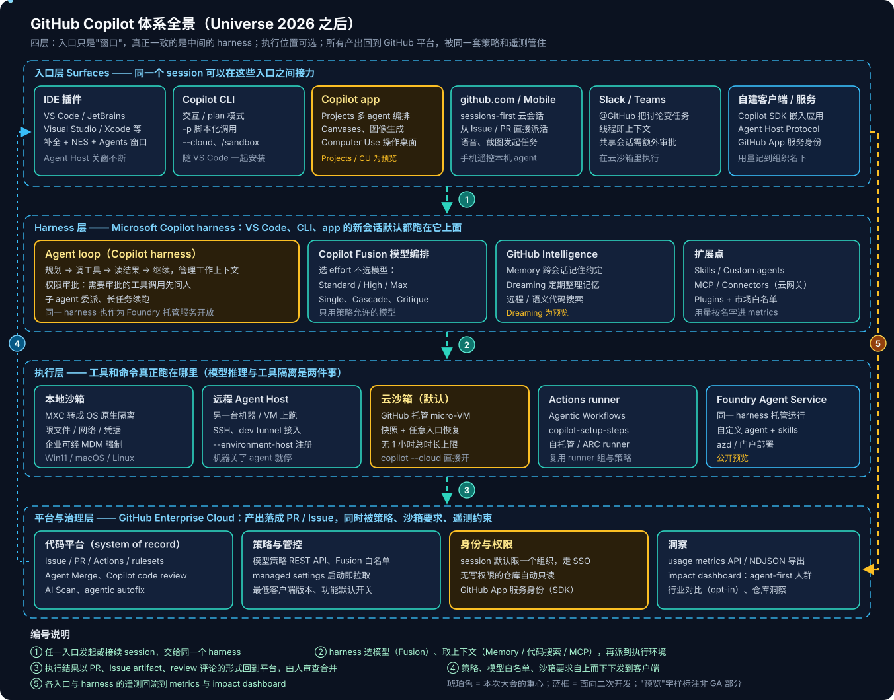
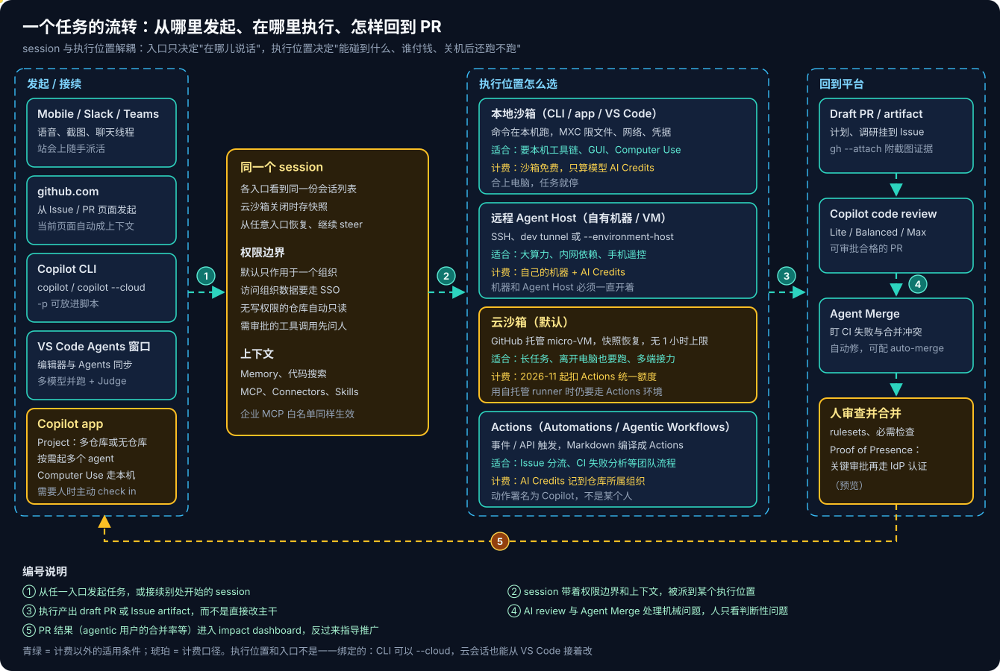
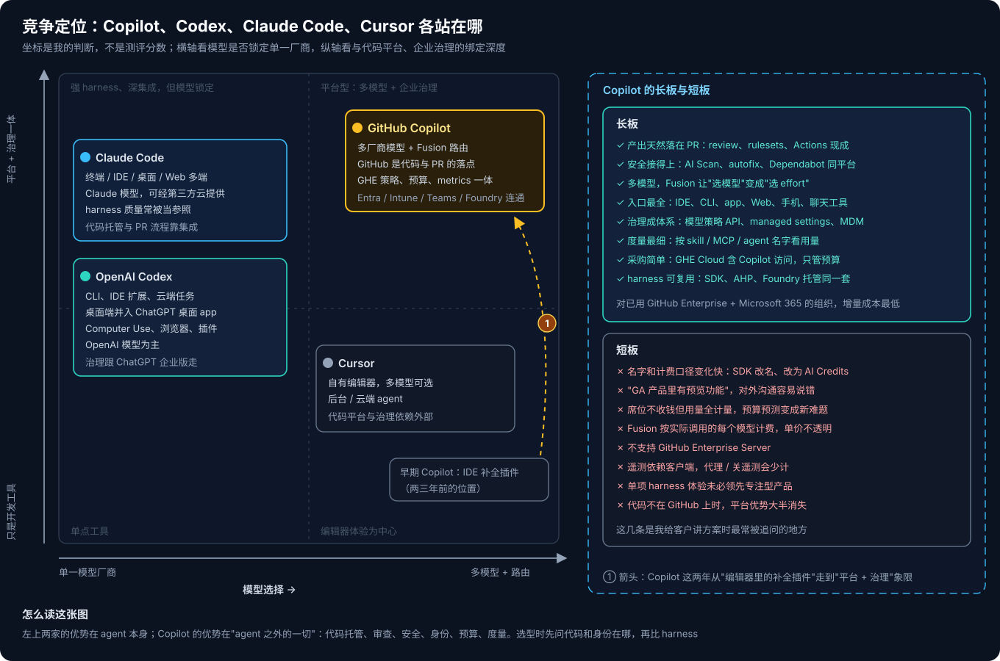

# GitHub Copilot 系列 01：产品全景与竞争格局

> [!IMPORTANT]
> 本文按 2026-11 初的公开资料整理。GitHub Universe 2026（10 月 28–29 日）发布了六十多项更新，其中不少是**公开预览**，名称和行为也还在调整，用之前以 [GitHub Changelog](https://github.blog/changelog/) 和官方文档为准。

最近在整理 GitHub Copilot 的客户材料，Universe 2026 正好把整个产品重新摆了一遍。翻完大会的 changelog，我最大的感受是：再把 Copilot 当成"VS Code 里的一个插件"去讲，已经讲不清楚了。它现在是一套有分层的系统——好几个入口共用同一个 agent harness，工具可以在本机、自己的机器、GitHub 云沙箱或 Actions 里执行，产出统一回到 PR，再被 GitHub Enterprise 的策略和度量管住。

这篇先把全景理清楚，后面的系列文章再逐块展开。



## 底座：GitHub Enterprise 与云端执行

理解 Copilot 要从最下面一层开始，因为这次变化最大的恰恰是执行底座：agent 不再只跑在开发者的编辑器里。

### 云沙箱：agent 的默认执行环境

[新的 Copilot 云端体验](https://github.blog/changelog/2026-10-28-work-from-anywhere-with-a-new-connected-copilot-cloud-experience)把原来分开的 Copilot Chat 和 coding agent 合成了一个 **sessions-first** 的体验。每个 session 默认跑在 **cloud sandbox** 里——GitHub 托管的隔离 micro-VM，启动快，关闭时存快照，之后可以从任何入口恢复，也没有一小时总运行时长的限制。

有两个例外要注意：用了自托管 runner 或 `copilot-setup-steps.yml` 的仓库，session 仍然要用 Actions 作为执行环境；想用自己的机器或 VM，可以用 `copilot --environment-host` 把它注册成一个执行环境。

### 团队级自动化：Automations 与 Agentic Workflows

个人 session 之外，Copilot 还有两条面向团队的自动化路线：

- **[Copilot Automations](https://github.blog/changelog/2026-10-28-build-shared-workflows-for-your-team-with-copilot-automations)**：把触发条件、提示词、模型和工具组合成重复执行的工作，比如 Issue 一开就尝试复现、PR 标记 ready 时自动截图、监控报警时自动排查。共享 automation 对仓库的读权限用户可见、写权限用户可编辑；用量归属仓库所属组织而不是创建人；在 GitHub 上的动作署名为 Copilot，不挂在某个人的身份下。
- **[GitHub Agentic Workflows](https://github.blog/changelog/2026-10-28-github-agentic-workflows-generally-available)**：GitHub Next 的开源项目，用自然语言 Markdown 描述 Issue 分流、CI 失败分析、文档更新这类推理型任务，编译成标准 Actions YAML。它跑在你现有的 runner 组和策略下，可以用 Copilot，也可以换别的 coding agent。安全设计做得比较完整：默认只读权限、沙箱容器、Agent Workflow Firewall、safe outputs 校验、独立的威胁检测 job。

两者的分界我是这样理解的：Automations 是产品化的功能，在 Copilot 设置里配置；Agentic Workflows 是"代码化"的，进仓库、走 PR 评审、能用自托管 runner，适合对执行环境有要求的团队。

## 五个入口：同一个 session，换个窗口而已

上面的底座决定了"在哪执行、能碰到什么"，入口只决定"在哪说话"。这次最重要的一点是 **session continuity**：手机上发起的任务，可以在 github.com 上接着看，在 Copilot app 或 VS Code 里继续改，所有入口看到的是同一份会话列表。



### Copilot app：桌面上的 agent 指挥台

[GitHub Copilot app](https://github.blog/changelog/2026-10-28-github-copilot-app-universe-releases) 是这次的重头戏，直接对标 Codex 的桌面形态。它的核心概念是 **Project**：一个目标可以跨多个仓库，也可以完全不碰仓库（比如一份发布计划）。你描述目标，加上下文（仓库、设计稿、Slack 线程、会议纪要），选好模型和工具，Copilot 按需起多个 agent 并行干活，需要人决策时再来问你，最后把 PR 之类的结果交给你审。

app 里还有几样值得注意的能力：

- **Computer Use**：在 macOS 和 Windows 上读取桌面应用内容、点按钮、输入文字、跨应用操作，覆盖那些没有 API、CLI 或 MCP 的老系统。每个应用第一次被控制前都要用户批准，组织可以用 managed settings 整体禁用。这和我之前写的 [Codex 里的 Computer Use](../../Notes/tool/codex/Codex-Desktop系列04：Computer-Use藏身之处.md) 是同一类能力，执行路径的差异可以参考 [Computer Use 三条执行路径对比](../../Notes/AI/computer-use/Computer-Use与Browser-Use系列九：三条执行路径对比.md)。
- **Canvases**：在 app 里运行、由对话驱动的小型交互应用，比如 Security 扩展提供的安全审查 canvas，能在一个界面里看告警、解释、修复、复查。
- **Connectors**：外部服务（初期有 Work IQ、Figma，VS Code 侧还有 Slack、Notion、Microsoft Learn）连一次，认证由 GitHub 保存，通过云端 MCP 网关在各个 Copilot 入口复用，不用在本机装 MCP server。

> [!WARNING]
> Copilot app 本身标的是 GA，但 Projects、Computer Use、Security 扩展、Connectors、图像生成都还是**公开预览**。"产品 GA"不代表"里面的功能都 GA"，对客户承诺时要逐项核对。

### Copilot CLI：终端里的完整 agent

[Copilot CLI](https://docs.github.com/en/copilot/concepts/agents/copilot-cli/about-copilot-cli) 支持 Linux、macOS 和 Windows（PowerShell 或 WSL），有两种用法：

- **交互式**：输入 `copilot` 进入会话，`Shift+Tab` 在执行模式和 plan 模式间切换。plan 模式会先问清范围、出计划再动代码。
- **程序化**：`copilot -p "..."` 执行一次就退出，可以放进脚本和流水线，配合 `--allow-tool` 精确放行工具。

和执行位置相关的几个开关：`/sandbox enable` 打开本地沙箱；`copilot --cloud` 直接在云沙箱里开 session，之后可以从手机或网页接着 steer；`/computer on` 打开 Computer Use。CLI 还能发现和使用本地模型。现在 CLI 也跟着 VS Code 安装器一起分发，不用单独装。

```bash
# 只允许 git 相关的 shell 命令，跑完即退出
copilot -p "Show me this week's commits and summarize them" --allow-tool='shell(git)'

# 在 GitHub 云沙箱里开一个可跨端接力的 session
copilot --cloud
```

> [!CAUTION]
> `--allow-all-tools` 意味着 Copilot 拥有和你一样的文件与命令权限，执行前不会再问。自动化场景优先用 `--allow-tool` 白名单加本地沙箱。

### IDE 插件：从补全到 Agents 窗口

IDE 是 Copilot 的起点，现在覆盖 VS Code、JetBrains、Visual Studio、Xcode、Eclipse 等。VS Code 的变化最大（[VS Code Universe releases](https://github.blog/changelog/2026-10-28-github-copilot-in-vs-code-universe-releases)）：

- **Agents 窗口 + Agent Host**：Agent Host 把 Copilot session 从具体的 VS Code 窗口里剥离出来，关掉项目窗口 agent 还在后台跑；配合 Remote SSH 和 dev tunnel，agent 可以跑在另一台机器上；运行 `code agent host --github-environment` 后还能用 GitHub Mobile 遥控。
- **模型并跑对比**：在 Agents 窗口里让多个模型或 harness 并行做同一个任务，再让一个 Judge 模型推荐方案，或用 Synthesize 合并几个方案（预览）。
- **Customization Marketplace**：skills、MCP server、plugins 在一个地方浏览和管理。管理员可以用策略要求或禁止某个 plugin、限制只能从批准的市场安装；仓库里的 `.github/copilot/settings.json` 能设默认 plugin，但那只是默认值，不是强制。

JetBrains 这次补上了 Fusion、本地沙箱和 NES。IDE 侧有个容易忽略的变化：**VS Code 的新 session 默认改用基于 Microsoft Copilot SDK 的 Copilot harness**。这件事的影响后面讲 SDK 和度量时会再出现——不是基于 SDK 的 IDE 集成，在 metrics 里就拿不到按名字统计的 skill、MCP 用量。

### github.com、Mobile、Slack 与 Teams

这几个入口的共同点是"不用打开开发环境就能派活"。github.com 上打开 Copilot 时当前的 PR、文件或仓库自动成为上下文；GitHub Mobile 可以用语音或截图描述任务；在 Slack 和 Teams 里 @GitHub 就能把一段讨论变成 Issue 或代码修改，线程本身就是上下文，执行发生在云沙箱里。Teams 侧要求有写权限才能改代码，从共享会话里发起的 PR 还要额外审批。

### 五个入口怎么分工

| 入口 | 主要使用者 | 默认执行位置 | 最适合 |
|---|---|---|---|
| IDE 插件 | 开发者 | 本机（可选本地沙箱 / 远程 Agent Host） | 边写边改、补全、需要看代码的交互 |
| Copilot CLI | 开发者、平台工程 | 本机或 `--cloud` | 终端工作流、脚本化、无界面环境 |
| Copilot app | 开发者、技术负责人、产品与设计 | 云沙箱为主，Computer Use 在本机 | 跨仓库的大任务、多 agent、非代码工作 |
| github.com / Mobile | 所有 GitHub 用户 | 云沙箱 | 从 Issue / PR 直接派活、离开电脑时跟进 |
| Slack / Teams | 整个团队 | 云沙箱 | 把讨论直接变成任务和 PR |

## Harness 层：Copilot harness、Fusion 与 GitHub Intelligence

入口再多，真正决定 agent 表现的是中间那层。

**Copilot harness** 是 agent loop 本身：规划、调工具、读结果、管理上下文、委派子 agent、在需要时请求审批。这次 GitHub 把 VS Code、CLI 和 app 统一到了同一个 harness 上，所以三处的 agent 行为终于一致了。我在 [Copilot Studio 的四种 Harness](../Copilot-Studio/Copilot-Studio系列03：四种Harness对比与选型.md) 和 [Claude Code 的 Harness 分层](../../Notes/AI/Claude-Code/Claude-Code系列07：Harness分层架构.md) 里讨论过 harness 为什么比模型本身更影响体验，这里是同一个道理。

**[Copilot Fusion](https://github.blog/changelog/2026-10-28-route-and-orchestrate-models-with-github-copilot-fusion)** 解决的是"选哪个模型"。用户不再挑具体模型，而是选 effort：

- **Standard**：日常编码，优先用通用模型。
- **High**：更难的任务、更深的推理。
- **Max**：最高质量，优先用最强模型。

Fusion 内部按任务选择三种工作方式：单模型直接做（Single）；便宜模型先出稿，质量检查不过再升级到强模型（Cascade）；一个模型出稿、另一个模型挑错、原模型修改（Critique）。管理员能看到 Fusion 从哪些模型里挑，可以单独把某个模型排除出 Fusion 而不影响用户手选，也可以用 managed settings 把某个 effort 档设成默认。

按 GitHub 自己公布的数据，Fusion Max 在 Artificial Analysis Coding Agent Index 上得 60 分，距离 Claude Code + Opus 5.5 Max 两分以内，每个任务的 token 约为一半，耗时少约 40%。这是厂商自测，参考即可；但"简单步骤用小模型、难点再升级"这个方向本身没什么争议。代价是调试变难：同一个提示，这次和下次可能走了不同的模型组合。

**[GitHub Intelligence](https://github.blog/changelog/2026-10-28-github-intelligence-puts-your-code-context-and-history-to-work)** 是上下文层：Memory（GA）跨会话、跨入口记住个人偏好和仓库约定；Dreaming（预览）定期回顾 session 来整理记忆，对仓库里已提交的 skills 和 instructions 的修改会以 PR 形式提出；代码搜索不需要本地 clone 就能跨仓库查找，包括按"代码做了什么"来找的语义搜索。

## 二次开发：从定制到嵌入，再到托管

想在 Copilot 之上做自己的东西，我把它分成三层，投入和自由度依次递增：

1. **定制 Copilot 本身**：写 skills、custom agents、接 MCP server 或 Connectors、做 plugin 并放进企业白名单市场。这一层不写宿主程序，改的是 Copilot 的行为。
2. **把 Copilot 嵌进自己的程序**：用 Copilot SDK 在自己的应用或服务里调用同一个 harness。Universe 前一天发布的 [服务器到服务器认证](https://github.blog/changelog/2026-10-27-github-copilot-supports-server-to-server-authentication) 让这件事真正可用于后台服务：给 GitHub App 授予只读的 Copilot Requests 组织权限，装到组织上，把短期的 installation token 交给 SDK，就能不依赖任何登录用户调用 Copilot，用量记到组织名下，组织的模型策略同样生效，用量报表里用 `app_client_id` 区分是哪个 app。另外 VS Code 开放了 **Agent Host Protocol**，可以写自己的客户端接入 Agent Host，和 VS Code 共享同一个实时 session，有 TypeScript、Rust、Go、Kotlin、Swift 的客户端库。
3. **用托管的 harness 做自己的 agent**：[GitHub Copilot SDK 正在改名为 Microsoft Copilot SDK](https://github.blog/changelog/2026-10-28-github-copilot-sdk-is-becoming-microsoft-copilot-sdk)，对应的 harness 也成了微软跨产品共用的 agent 底座，并以 [Microsoft Copilot harness in Foundry](https://devblogs.microsoft.com/foundry/microsoft-copilot-harness-in-foundry/)（公开预览）的形式开放：在 Foundry Agent Service 里声明式地定义 agent，Microsoft 运行 agent loop 和沙箱，你提供 skills、工具和指令。部署可以用 azd，agent 定义和代码一起放进版本库。

第三层的定义方式长这样（摘自 Foundry 的示例，`harness.type` 指定用 Copilot harness）：

```yaml
research-brief:
  host: azure.ai.agent
  kind: prompt
  harness:
    type: microsoft_copilot_preview
  model: ${MODEL_DEPLOYMENT_NAME}
  skills:
    - research-brief-skill
  tools:
    - type: web_search
    - type: code_interpreter
```

这条线值得单独留意：同一个 harness 既是 GitHub Copilot 的引擎，也能拿来跑与编码无关的业务 agent。这和我在 [Agent 基础设施系列 04](../../Notes/AI/agent/agent-framework/Agent基础设施系列04：Framework层与三层串联.md) 里讲的"选 framework 还是选 harness"直接相关——微软的答案是把 harness 做成可复用的产品。

> [!NOTE]
> SDK 改名是分阶段的，过渡期内包名、命名空间和部分文档仍然叫 GitHub Copilot SDK，现有用户暂时不用改代码。

## 治理与洞察：企业真正关心的部分

对企业客户，这一层往往比功能本身更能决定能不能推开。

**策略管控**这次补了好几块：

- [模型策略 REST API](https://github.blog/changelog/2026-10-19-copilot-model-policy-api-for-enterprise-orgs-and-teams) 可以在企业、组织、团队、agent 应用各级读写模型策略，适合接进自己的配置管理。
- managed settings 改为**客户端启动时拉取最新策略**，不再依赖缓存，还能要求最低客户端版本。
- 本地沙箱策略可以通过 Intune 等 MDM 下发，开发者无法削弱。
- 尚未配置的 GA 功能默认继承"开启"，管理员可以改成默认关闭——这一点要提醒客户去检查，否则新功能上线就自动对所有人可用。
- 云端访问由"Copilot in the cloud"这一条策略控制；session 默认只作用于一个组织，访问组织数据要走 SSO，对没有写权限的仓库自动只读。

**度量洞察**现在有一整套：

- [Copilot usage metrics](https://docs.github.com/en/copilot/concepts/copilot-usage-metrics/copilot-metrics) API 和 NDJSON 导出，提供企业、组织、仓库、用户级的明细。
- 用量 dashboard 看 28 天趋势；code generation dashboard 看代码是人写的还是 agent 写的。
- **impact dashboard** 把用户分成 agent-first、multi-agent 等人群，对比 agentic 用户和非 agentic 用户的 PR 合并率；新加的 [行业对比](https://github.blog/changelog/2026-10-22-industry-comparisons-in-the-copilot-impact-dashboard) 可以按公司规模和行业与同类企业比较，需要主动 opt-in。
- [usage metrics 现在按名字显示](https://github.blog/changelog/2026-10-22-custom-skills-agents-and-mcp-servers-in-usage-metrics-api)企业自建的 skills、custom agents、MCP server、slash command 和 plugin，不再归到 other。推一个内部 skill 之后有没有人用，终于能看到了。

> [!TIP]
> 这些数字有两个天然的盲区：明细依赖客户端遥测，关了遥测或代理拦截时会少计；github.com 和 GitHub Mobile 上的 Chat 不在 usage metrics 里。impact dashboard 显示的"agentic 用户合并率更高"是相关性，不能直接当成 Copilot 带来的生产力提升，给管理层汇报时最好配上开发者反馈和 PR 周期等其他证据。

安全产品线也在往 agent 方向走：[AI Scan for repositories](https://github.blog/changelog/2026-10-28-ai-scan-for-repositories-in-public-preview)（预览）让 agent 扫描整个仓库的存量漏洞，包括 CodeQL 覆盖不到的语言；[Agentic autofix](https://github.blog/changelog/2026-10-15-agentic-autofix-for-code-scanning-alerts-general-availability)（GA）把代码扫描告警指派给 Copilot，它改代码、重跑 CodeQL 确认告警关闭，再开 draft PR，一次最多处理 25 条告警。代码扫描、依赖告警、修复 PR 都在同一个平台上，这是其他 coding agent 很难补齐的一块。

## 竞争格局

把 Copilot 放到同类产品里看，差异会更清楚。



| 维度 | GitHub Copilot | OpenAI Codex | Claude Code | Cursor |
|---|---|---|---|---|
| 入口 | IDE 插件、CLI、Copilot app、Web、Mobile、Slack/Teams | CLI、IDE 扩展、云端任务；桌面端已并入 ChatGPT 桌面 app | 终端、IDE、桌面 app、Web | 自有编辑器为主，另有后台 agent |
| 模型 | 多厂商 + Fusion 路由 | OpenAI 模型为主 | Claude 模型，可经第三方云提供 | 多模型可选 |
| 执行位置 | 本地沙箱、远程 Agent Host、云沙箱、Actions | 本机沙箱、OpenAI 云端 | 本机、Anthropic 云端（Web） | 本机、云端 agent |
| 代码平台 | GitHub 自身 | 集成 GitHub 等 | 集成 GitHub 等 | 集成 GitHub 等 |
| 企业治理 | GHE 策略、模型策略 API、MDM、usage metrics | 跟随 ChatGPT 企业版 | managed settings、云厂商账号体系 | 团队版管理后台 |

我的判断是这样的：

**Codex 和 Claude Code 的强项在 agent 本身**。两家都是模型厂商自己做 harness，模型和 harness 一起调，单项 agent 体验常常是行业参照——GitHub 自己发布 Fusion 成绩时，拿来对比的也是 Claude Code。Codex 这次的变化是桌面端并入 ChatGPT 桌面 app，在 ChatGPT 和 Codex 之间切换，往"通用工作台"走；这和 Copilot app 把 Projects 扩展到无仓库工作，是同一个方向。

**Copilot 的强项在 agent 之外的一切**：代码托管、PR 评审、Actions、安全扫描、身份、度量都在同一个平台上。别家的 agent 写完代码要"推到 GitHub 开 PR"，Copilot 的 agent 本来就在 PR 里。对已经用 GitHub Enterprise、Entra 和 Intune 的组织，身份、设备策略和审计都不用另起一套。

**Cursor 的位置在编辑器体验**。它的用户粘性来自 IDE 本身，代码平台和企业治理依赖外部。

所以给客户做选型时，我会先问两个问题：代码在哪里托管？身份和设备管理用什么？如果答案是 GitHub 和 Entra / Intune，Copilot 基本是默认选项，剩下的是哪些团队先用、执行位置怎么选。如果代码不在 GitHub 上，Copilot 的平台优势会少掉一大半，这时候就要回到 agent 本身的能力上去比。

几个短板也要讲清楚：

- **变化太快**。SDK 刚改名，Chat 和 coding agent 合进了 Copilot in the cloud，VS Code 的默认 harness 也换了一代。客户手里半年前的材料很多已经不对了。
- **执行位置多，排查也多一层**。同一个 session 可能在本地沙箱、远程 Agent Host、云沙箱之间切换，出问题时先要弄清它当时跑在哪、受哪套沙箱策略约束。
- **预览功能多**。Projects、Computer Use、Connectors、AI Scan for repositories、Dreaming、Foundry 里的 harness 都是预览，生产承诺要谨慎。
- **覆盖有缺口**。GitHub Enterprise Server 用不了 Copilot；不基于 SDK 的 IDE 集成在 metrics 里拿不到细粒度数据。

## 怎么学这套东西

六十多条公告不用逐条看。我自己是按这个顺序过的：先用这张全景图把四层分清楚，搞明白每个新名词属于哪一层；然后在一个测试仓库里走一遍完整流程——开 Issue、派给 Copilot、在云沙箱里跑、看它开的 PR、过 code review、合并，再到 usage metrics 里找到这次活动；最后再看治理：模型策略、managed settings、沙箱策略和 MCP 白名单。

走完这一遍，"Copilot 是什么"就不再是一份功能清单，而是能回答"先让哪些团队用、数据和权限怎么控、在哪执行、怎么看效果"的一套方案。后面的系列文章会按这几块分别展开。
