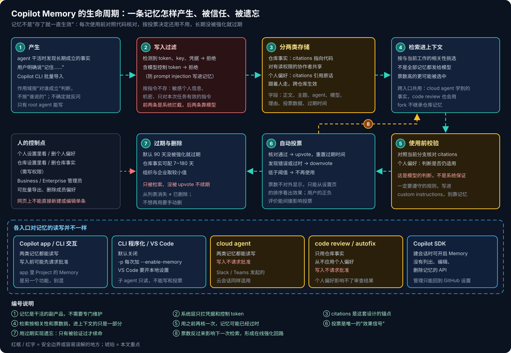
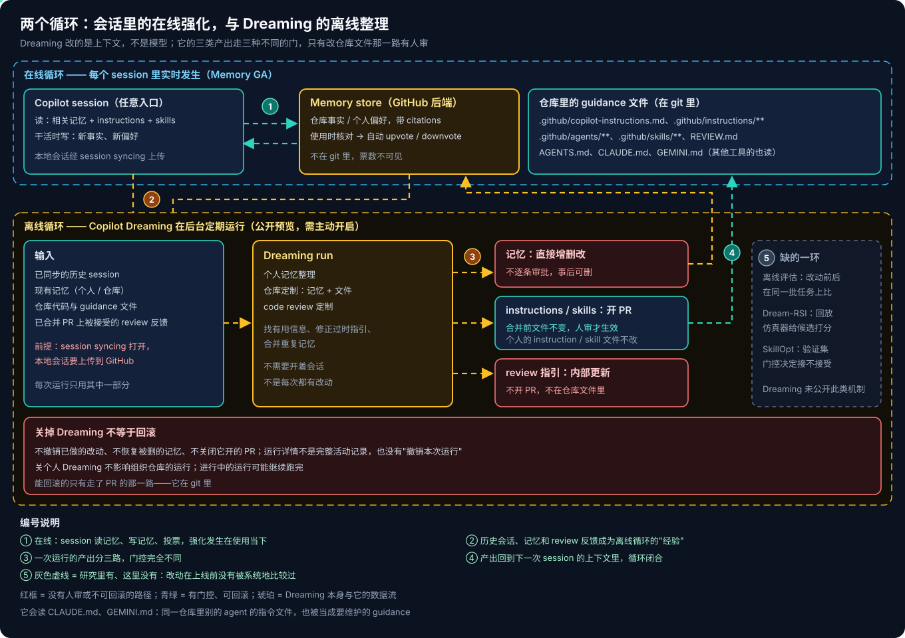
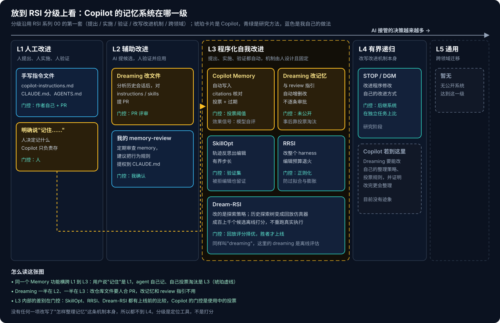

# GitHub Copilot 系列 02：Memory、Dreaming 与自我改进

> [!NOTE]
> Copilot Memory 已 GA，Copilot Dreaming 是**公开预览**，行为会变。本文按 2026-11 初的 [GitHub intelligence 发布说明](https://github.blog/changelog/2026-10-28-github-intelligence-puts-your-code-context-and-history-to-work)、[About GitHub Copilot Memory](https://docs.github.com/en/copilot/concepts/agents/copilot-memory) 和 [About GitHub Copilot Dreaming](https://docs.github.com/en/copilot/concepts/prompting-and-context/copilot-dreaming) 整理。

[系列 01](GitHub-Copilot系列01：产品全景与竞争格局.md) 里，GitHub Intelligence 只占了全景图上的一个格子：Memory、Dreaming、跨仓库代码搜索。真读下去，Memory 和 Dreaming 恰好是我最近在 RSI 系列里琢磨的那件事——agent 把经验变成对自身的持久修改——第一次以默认功能的形式出现在一个大规模产品里。

所以这篇换个角度：先把两者的机制讲清楚，再用 [RSI 系列 00](../../Notes/AI/Recursive-Self-Improvement/RSI系列00：递归自我改进总览.md) 里的那几个问题去拆它——改的是什么、凭什么改、改动存在哪里、下一轮继承什么、用什么能证明它变好了。

代码搜索属于"找上下文"而不是"学经验"，这里不展开。

## Memory：会话里的在线强化

### 两类记忆，按"对谁成立"划分

Copilot 存两种记忆：

- **仓库事实**（repository-level facts）：关于代码库的事实，比如"单测用 Vitest"、"支付模块不能直接调 Stripe，必须走 BillingGateway"、构建和测试命令。它属于某一个仓库，对有读权限的协作者共享，只有有写权限的人工作时才会产生。
- **个人偏好**（user-level preferences）：你自己的工作方式，比如"改代码前先解释"、"PR 描述以 TL;DR 开头"。它跟着人走，跨仓库生效。

这两类的区别是 **citations 指向哪里**：仓库事实的 citations 指向支撑它的代码位置，个人偏好的 citations 可能直接引用你说过的原话。分类的依据是"这条对谁成立"而不是"谁说的"——任何人在这个仓库里都该知道的，就是仓库事实；只反映你个人习惯的，就是个人偏好。意图不清楚时，Copilot 会反问作用域，而不是自己猜。

有几个边界值得记住：仓库事实不在组织内各仓库间共享，fork 也不会带走记忆；code review 和 agentic autofix **只用仓库事实、从不应用个人偏好**，所以你的个人习惯影响不了别人 PR 的审查结果。

### 一条记忆的完整生命周期

**产生**。记忆是干活的副产品：agent 在工作中发现"值得长期保留"的事实就存下来；你明确说"记住……"会大概率被记下，并把你的原话当 citation；也可以用 Copilot CLI 批量导入。网页设置里不能直接新建或编辑单条记忆，只能看和删。

**写入过滤**。这里分两层，我觉得这个区分很重要：

- **系统强制拦截**：检测到 token、key、凭据的记忆直接拒绝；含已知模型控制 token 的记忆也会被拒，用来防 prompt injection 把恶意指令"写进记忆"长期驻留。
- **靠模型自觉**：敏感个人信息、机密、只对当前任务有效的临时指令，是"被指示不要存"，没有系统保证。

**存储**。每条记忆除了正文，还带主题、产生它的 agent 和模型、存储理由、类型、投票数据、过期时间。投票数据和过期时间只在内部使用，网页上看不到。

**检索与校验**。不是所有记忆都发给模型，而是按与当前工作的相关性挑，票数高的更容易入选。挑中之后，Copilot 被要求**先对照当前分支核对 citations**，判断这条事实是否还成立。

> [!IMPORTANT]
> 官方文档原话的意思是：核对 citations 是 Copilot 做的判断，不是系统强制的保证，所以**存下来的事实不能当作一定会被遵守的规则**；需要稳定执行的，用 custom instructions。这和我在 Claude Code 上踩过的坑是同一个结论，后面会对比。

**投票**。核对通过就 upvote，发现错误或过时就 downvote；票数决定下一次被检索的概率，低于阈值后不再使用，闲置一段时间后删除。投票全部由 Copilot 自动完成，你在会话里对某条记忆的正面或负面评价会间接影响它。

**过期**。默认 90 天没被强化就过期，仓库事实可以由组织或企业配置为 7~180 天（两级都配时取较小值）。关键细节是：**只有 upvote 会重置过期时间，单纯被检索不会**。也就是说，一条记忆要"续命"，必须在某次使用中被重新验证过。

把这几步连起来看，Memory 其实是一个**在线强化回路**：使用 → 核对 → 投票 → 影响下一次检索。遗忘靠过期实现，信任靠投票积累。GitHub 公布的数据是：公开预览期间用到记忆的 CLI 会话里，93% 更贴合开发者偏好，42% 的工作流更高效——这是厂商对自家会话的复盘，没有公布对照组设计，参考即可。

### 各入口的读写并不对称

同一套记忆，不同入口的权限差别不小：

- Copilot app 和 CLI 交互会话两类都能读写，写入前**可能**请求你批准。
- **cloud agent 和 code review 写入不请求批准**——包括从 Slack、Teams 发起的云会话。
- CLI 程序化模式默认关闭，每次运行要加 `--enable-memory`；VS Code 默认也是关的，要开本地设置。
- CLI 里只有 root agent 能调用 `store_memory` 和 `vote_memory`，子 agent 只有 `read_memories`，能读不能改。
- Copilot SDK 可以在创建或恢复会话时开启 Memory，但**没有列出、编辑、删除记忆的 API**，管理只能回到 GitHub 设置。

"子 agent 只读"这个设计我很认同：多 agent 并行时，如果每个子 agent 都能写记忆、投票，记忆库会被局部视角污染；把写权限收到协调者手里，等于给记忆加了一道单写者约束。这和我在知识库里坚持的 Single-Writer 原则是一回事。

## Dreaming：后台的离线整理

Memory 本身已经能在会话中学习，Dreaming 做的是另一件事：**不开会话的时候，在后台回顾历史，整理上下文**。它改的是上下文，不是模型权重。

### 三类 dream

| 类型 | 读什么 | 产出 | 怎么生效 |
|---|---|---|---|
| 个人记忆整理 | 你的历史会话、个人记忆 | 更新后的个人记忆 | 直接改，不逐条审批；不碰个人的 instruction / skill 文件 |
| 仓库定制 | 仓库相关会话、代码、记忆、guidance 文件 | 更新的仓库记忆 + 对 instructions / skills 的修改建议 | 记忆直接改；文件改动开 PR，合并前不生效 |
| code review 定制 | 已合并 PR 上被接受的 review 反馈、当前代码 | 给 Copilot code review 的内部指引 | 内部更新，不开 PR，不落在仓库文件里 |

仓库定制会读的文件范围很有意思：除了 `.github/copilot-instructions.md`、`.github/instructions/**`、`.github/agents/**`、`.github/skills/**`、`REVIEW.md`，还包括 **`AGENTS.md`、`CLAUDE.md`、`GEMINI.md`**。也就是说，同一个仓库里给 Codex、Claude Code、Gemini 写的指令文件，Dreaming 也会当作需要维护的 guidance 一并审视。多工具并存的仓库，要意识到这几份文件可能收到 Copilot 提的 PR。

### 前提与边界

Dreaming 默认关闭，要主动开启：个人在 Copilot 设置里开个人整理、在仓库设置里开仓库 dream；组织和企业由管理员通过 Copilot 策略开启，企业可以把决定权下放给组织。

它有一个容易被忽略的技术前提：**session syncing**。个人整理和仓库定制都要求本地会话被同步到 GitHub 账号——CLI 和 app 默认开启同步，但如果组织策略里"Store local sessions in the Cloud"没有至少设为 View from cloud，会话就只留在本地，Dreaming 也就没有素材。反过来说，打开 Dreaming 就意味着本地 CLI 和 app 的会话内容会上传到 GitHub，合规评审时要把这一点单独拎出来。初期预览还要求策略允许某个特定模型，不支持带数据驻留的 GHE Cloud，code review 定制暂不支持自托管 runner。

> [!WARNING]
> **关掉 Dreaming 不等于回滚**。它不会撤销已做的改动、恢复被删除的记忆、关闭已开的 PR；运行详情不是完整的活动记录，也没有"撤销本次运行"。个人 Dreaming 关掉，不影响组织仓库上的运行，进行中的运行可能继续跑完。真正可回滚的只有走了 PR 的那一路，因为它在 git 里。

## 放进 RSI 框架里看

### 改的是什么：只在 harness 的上下文层

RSI 系列 00 把 agent 系统写成 $S_t = (M_t, H_t, D_t, T_t)$：模型、harness、数据系统、训练系统。Memory 和 Dreaming 改动的全部在 $H$ 里，而且只是 $H$ 中的**上下文那一层**——记忆、instructions、skills、review 指引。它们不改模型，不改工具和控制流，也不改训练数据。

按 RSI 00 区分的"三种变好"：

- Memory 属于第二种——**后续任务做得更好**。一条在 A 会话里发现的事实，B 会话直接用上，经验跨任务留存。
- Dreaming 仍然是第二种，只是把"在会话里顺手学"换成了"离线集中回顾"。
- 第三种——**更善于找到改进方法**——没有出现。整理记忆的策略、投票规则、过期机制、三类 dream 的分工都是 GitHub 设计好的，运行中不会被修改。

### 落在哪一级：横跨 L1 到 L3

按"提出、实施、验证是否自动，能否改写改进机制"来定位，同一个功能会落在不同级别：

- 你说"记住……"，人决定记什么，Copilot 只负责存——**L1**。
- Dreaming 对 instructions 和 skills 开 PR，AI 提候选、人审并合并——**L2**。
- Memory 自己发现、自己写入、自己用 citations 核对、自己投票淘汰；Dreaming 直接改记忆和 review 指引——**L3**，机制固定的程序化自我改进。

没有一项到 L4。要到 L4，Dreaming 得能修改自己的整理策略或投票规则，并且能证明改完之后"更会整理"了。

### 和研究方法的分界：门控在哪里

同在 L3，Copilot 和研究里的方法差别最大的地方是**门控**——一个改动凭什么被接受。

| 方法 | 改什么 | 学习信号 | 接受门控 | 改动存在哪 |
|---|---|---|---|---|
| Copilot Memory | 记忆条目 | 会话中的发现与用户陈述 | 使用时核对 citations + 投票阈值 + 过期 | GitHub 后端，不在 git |
| Copilot Dreaming | 记忆、instructions、skills、review 指引 | 历史会话、被接受的 review 反馈 | 记忆与 review 指引：未公开；文件：PR 人审 | 后端 + 仓库文件 |
| [SkillOpt](../../paper/2026-07-01-SkillOpt.md) | skill 文档 | 成功与失败轨迹 | 有界编辑 + 验证集门控，被拒编辑也留作负面证据 | skill 文件 |
| RRSI | 整个 harness | benchmark 分数 | 编辑预算退火、噪声筛查、成本拒绝、剪枝 | harness 代码与配置 |
| [Dream-RSI](../../paper/2026-09-22-Dream-RSI.md) | 探索策略 | 历史探索树 | 回放仿真器离线打分，胜者才上线 | 策略代码 |

研究方法的共同点是：**改动上线之前，先在同一批任务上和旧版本比过**。SkillOpt 有验证集，RRSI 有正则化后的选择，Dream-RSI 把已发生的探索变成可重放的仿真器，候选在上线前就能打分。

Copilot 的门控是**使用中的投票**：先上线，在后续会话里被核对，对了加票、错了减票。这是工程上很务实的选择——没有固定的任务集，也没有可回放的环境，只能把线上使用本身当作评估。代价是 RSI 00 里那五个问题有好几个答不上来。

### 同叫 dreaming，意思不一样

Dream-RSI 和 Copilot Dreaming 撞了名字，正好可以对照：

- **共同点**：都在离线阶段复用已经发生过的经验，都不改模型权重，都不需要用户在线。
- **Dream-RSI 的 dreaming 是评估**：把探索历史整理成回放仿真器，成百上千个候选策略在里面跑一遍、打分择优，"做梦"是为了**不花真实执行成本地比较候选**。
- **Copilot 的 dreaming 是整理**：回顾会话、合并重复、修正过时、提炼 review 规律，"做梦"是为了**把经验压缩成更好的上下文**。它产出改动，但不在梦里评估改动。

一句话说，Dream-RSI 在梦里挑，Copilot 在梦里写。

### 用五个问题检验一下

RSI 00 里判断自我改进主张的五个问题，放到 Copilot 上：

1. **反馈是真的吗？** 这是 Copilot 做得最好的一点。citations 把记忆锚定在代码上，核对的是"代码里现在是不是这样"，比让模型凭印象自评可靠得多；code review 定制只学**已合并 PR 上被接受**的反馈，也是在用结果过滤信号。但 citations 核对仍是模型判断；文档还特别提醒，仓库事实可能来自**被关闭未合并的 PR**，过时事实不一定都能被识别出来。
2. **会不会只是偶然得分高？** 投票在多次使用中累积，天然带一点"重复验证"的味道，比一次性打分稳。但票数不可见，阈值也不公开，外部没法判断。
3. **验证集有没有参与学习？** 没有独立的验证集，线上使用既是学习信号也是评估信号。
4. **收益来自能力还是更多计算？** 93% 和 42% 这两个数衡量的是"偏好贴合"和"工作流效率"，没有公布对照组，也没有和"不开记忆、但上下文写得更完整"的情况比过。
5. **新规则有没有损害旧能力？** 走 PR 的文件改动可以靠 review 和 git 回退；直接改的记忆和 review 指引没有回归检查，Dreaming 关掉也不回滚。这是我最在意的一块。

## 和 Claude Code、我自己的记忆治理对照

我在 [Claude Code 系列 05：六层记忆体系](../../Notes/AI/Claude-Code/Claude-Code系列05：六层记忆体系.md) 和 [Harness 实践：从 Memory 失效到记忆治理](../../Notes/AI/Claude-Code/Harness实践：从Memory失效到记忆治理.md) 里记过一次教训：一条写在 auto memory 里的行为规则被模型忽略了，原因是 memory 被系统以"可能相关、酌情参考"的语气注入，而 CLAUDE.md 是"必须遵守"。结论是**记忆适合存背景知识，不适合存行为规则**，行为规则要提权到 CLAUDE.md 或 rules。

Copilot 的文档给出了几乎一样的结论：存储的事实是模型判断后才使用的，要稳定执行的用 custom instructions。两家从不同方向走到了同一个分层：**会过时、可被核对的事实放记忆；必须遵守的规则放进 git 里的指令文件**。

更有意思的是 Dreaming 的仓库定制：它分析历史会话后对 instructions 和 skills 开 PR，本质上就是把"记忆提权到指令文件"这件事自动化了。我自己是用一个 memory-review skill 定期审查记忆、手动决定哪些提权——相当于手工版的 Dreaming，只不过门控是我本人。

| 维度 | Copilot Memory + Dreaming | Claude Code auto memory | 我的记忆治理（memory-review + 提权） |
|---|---|---|---|
| 存储位置 | GitHub 后端 | 本机文件 | 本机文件 + 进 git 的规则文件 |
| 作用域 | 仓库事实团队共享，个人偏好跨仓库 | 按项目，个人 | 按项目，个人 |
| 写入者 | agent 自动 + 用户明示 | agent 自动 + 用户明示 | agent 写，人审 |
| 有效性校验 | citations 核对 + 投票 | 无系统校验 | 定期人工审查 |
| 遗忘 | 90 天未强化即过期 | 无自动过期 | 审查时删除 |
| 提权到规则 | Dreaming 开 PR | 手动 | 手动，有固定流程 |
| 可审计 | 票数与内部字段不可见，无 diff | 文件可读，可 diff | 全部在 git，可 diff |

各自的取舍很清楚：Copilot 胜在**团队共享和自动遗忘**——仓库事实对所有协作者生效，过期机制让记忆不会无限堆积，这是单机工具做不到的；个人方案胜在**可见和可回滚**——每条记忆都是能读、能 diff、能 revert 的文件。

## 我的判断

**做得好的地方**：Copilot 把 RSI 研究里几件"知道该做但很少做全"的事做成了默认——用 citations 把记忆锚到代码上，用投票和过期实现遗忘，用 PR 给文件改动加人工门控，写入时拦截凭据和注入 token，子 agent 只读。尤其是**仓库级共享记忆**，让一个人踩过的坑在整个团队的 agent 里生效，这是个人工具很难有的。

**我会小心的地方**：

- **没有上线前的比较**。改动的有效性全靠线上投票，没有 SkillOpt 式的验证门控，也没有 Dream-RSI 式的回放评估。
- **不走 PR 的两路不可审计**。直接改的记忆和 review 指引，看不到票数、看不到 diff，关掉也不回滚。
- **素材要上云**。Dreaming 依赖 session syncing，本地会话会上传到 GitHub。

所以我的用法是：**必须遵守的规则写进 instructions 和 skills**，让它们留在 git 里、走 review；**会变的事实交给 Memory**，让投票和过期去管；Dreaming 先在少量仓库开，把它开的 PR 当作 skill 的代码评审来看。如果想往 RSI 的方向再走一步，可以用系列 01 里讲的 Agentic Workflows 在合并 Dreaming 的 PR 之前，对一组固定任务跑一遍回归，比较改动前后的表现——这就是给 Copilot 补上它缺的那道"上线前比较"的门。
