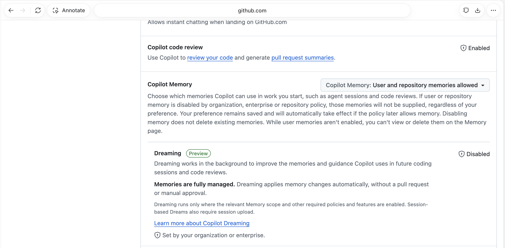
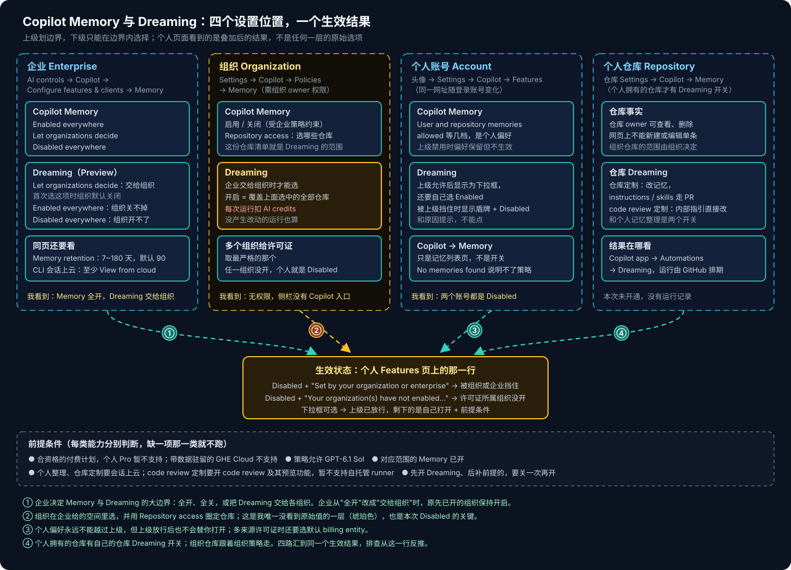
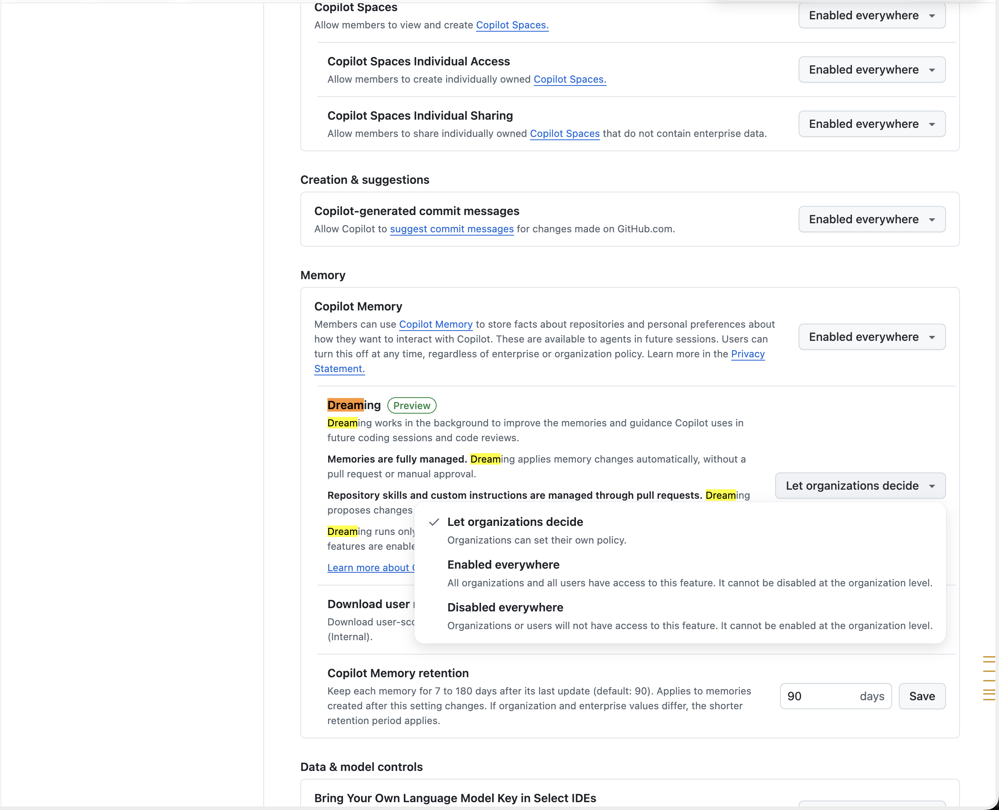
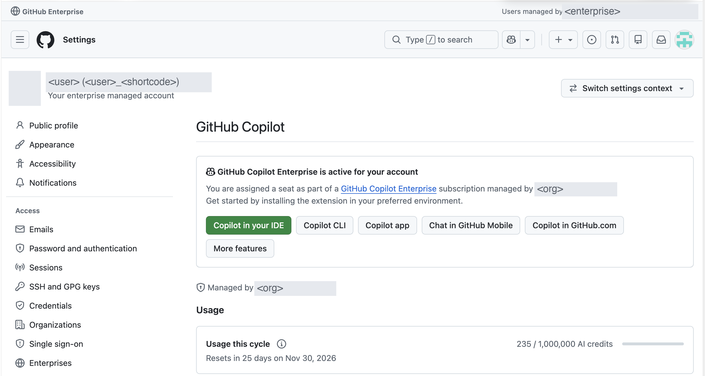
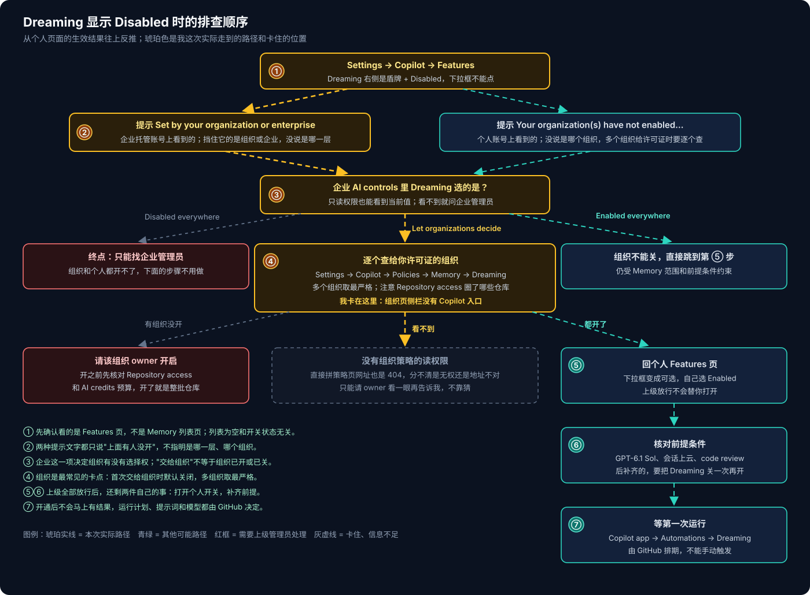

# GitHub Copilot 系列 03：Memory 与 Dreaming 的分层配置

> [!NOTE]
> Copilot Dreaming 是**公开预览**，设置项名称、前提条件和费用都可能变。本文按 2026-11-06 的 GitHub 界面和 [Managing Copilot Memory for your personal account](https://docs.github.com/en/copilot/how-tos/use-copilot-agents/copilot-memory/manage-for-yourself)、[Managing Copilot Memory for an enterprise, organization, or repository](https://docs.github.com/en/copilot/how-tos/use-copilot-agents/copilot-memory/manage-as-administrator)、[About GitHub Copilot Dreaming](https://docs.github.com/en/copilot/concepts/prompting-and-context/copilot-dreaming) 整理。

[系列 02](GitHub-Copilot系列02：Memory、Dreaming与自我改进.md) 讲了 Memory 和 Dreaming 的机制。写完之后我想真的打开 Dreaming 试一下，照着文档 "Enabling Copilot Dreaming for your personal account" 那一节去找开关，结果手上两个账号——一个普通个人账号、一个企业托管账号（EMU）——Dreaming 都是灰的，显示 Disabled，点不动。

问题不在个人设置上。Memory 和 Dreaming 的开关分在企业、组织、个人账号、个人仓库四个位置，个人页面上看到的只是四层叠加后的结果。下面按层把每个位置在哪、能选什么、我看到了什么记下来，最后给一个从 Disabled 往上反推的排查顺序。

## 先找对页面：Features，不是 Memory

个人 Copilot 设置左侧有两个容易混的入口：

- **Copilot → Memory**：已保存记忆的列表页，只能看和删。我两个账号上都是 `No memories found`。这句话的意思是"没有可显示的记忆"，可能是还没产生，也可能是当前无权管理，**它说明不了 Memory 或 Dreaming 开没开**。
- **Copilot → Features**：真正的开关页。往下翻到 Copilot Memory，Dreaming 就挂在它下面。

这张图是企业托管账号的 Features 页，有三处值得看：

- **Copilot Memory 是一个下拉框**，当前偏好是 `User and repository memories allowed`。说明文字写得很明白：如果组织、企业或仓库策略禁用了某类记忆，不管你偏好是什么都不会提供；偏好会保留，等策略放开后自动生效。
- **Dreaming 右侧是盾牌图标 + Disabled**，不是下拉框。盾牌的意思是"这一项由上级管着"，你在这里改不了。
- 最下面一行 `Set by your organization or enterprise`，告诉你是上级挡住了——但不告诉你是组织还是企业、是哪个组织。

普通个人账号上，同一行提示变成 `Your organization(s) have not enabled use of this feature.`。这个账号的 Copilot Business 许可证来自一个组织，提示同样没说是哪一个。

## 四个设置位置

### 企业：决定组织有没有选择权

路径是 Enterprise → **AI controls → Copilot → Configure features & clients**，往下翻到 **Memory** 这一组。我这个账号没有企业管理权限，页面是只读的，但当前值都看得到。

这个企业的配置是：

- **Copilot Memory：`Enabled everywhere`**。企业层面 Memory 是全开的。
- **Dreaming：`Let organizations decide`**（打勾的那一项）。下拉菜单里另外两项是备选，不是当前值。三个选项的含义菜单里写得很直白：
  - `Let organizations decide`——各组织自己定；
  - `Enabled everywhere`——所有组织和用户都能用，组织层面关不掉；
  - `Disabled everywhere`——组织和用户都用不了，组织层面开不了。
- **Copilot Memory retention：90 天**。可设 7~180 天，只对改设置之后新产生的记忆生效；组织和企业都设了时取较短的。这里管的是仓库事实的保留期，个人偏好仍按默认的 90 天。

"Let organizations decide" 最容易被误读成"差不多算开了"。它只表示**组织有选择权**，不代表任何一个组织已经选了开。文档还有两个细节：企业**第一次**选这一项时，组织的 Dreaming 默认是关的；但如果企业之前是 `Enabled everywhere`、后来改成交给组织，原先已经开着的组织会保持开启。所以看到这一项，只能说明下一步要去查组织，不能推断组织的状态。

同一个 Features & clients 页面里，还有一项和 Dreaming 直接相关：**Copilot CLI → Store local sessions in the Cloud**。个人记忆整理和仓库定制都要读历史会话，这一项至少要允许 `View from cloud`，否则会话只留在本地，Dreaming 没有素材。这个企业设的是 `View and control from cloud`，满足要求。

### 组织：圈定仓库，承担费用

路径是组织 **Settings → Copilot → Policies**，在 Memory 部分有两样东西：

- **Copilot Memory 和它的 Repository access**——组织给哪些仓库开 Memory。
- **Dreaming**——只有企业选了 "Let organizations decide" 时，组织这里才能选。

这一层有两点要先想清楚。

**开组织 Dreaming，范围就是 Repository access 里选中的全部仓库**，不是"给某个人开"。组织 owner 打开它之前，应该先回头看一眼 Memory 圈了哪些仓库。

**每次运行都扣 AI credits**，包括什么都没改的运行、处理不活跃仓库的运行。仓库圈得越多，后台运行越多。用量提醒只是提醒，不会拦住用量。

还有一条规则解释了我个人账号上那句 `Your organization(s)`：**同一个用户从多个组织拿到 Copilot 许可证时，取最严格的设置**——只要有一个组织没开，这项功能就不会用。从多个企业或组织拿到许可证的人，还要在账号设置里选一个**默认 billing entity**，它决定生成的个人偏好记忆归哪个账号管理。

这一层也是我卡住的地方。企业托管账号能打开组织的 Settings，但侧栏里只有 Actions、Hosted compute networking 等几项，没有 Copilot；按文档路径直接拼策略页网址，返回 404。404 单独分不清是没权限还是地址不对，总之**我读不到组织 Dreaming 的原始选项**。

### 个人账号：越不过上级，也不会被自动打开

路径是头像 → **Settings → Copilot → Features**。同一个网址会随登录账号变化，所以先看页面顶部是哪个账号、计划是什么、由谁管理。

这张图里能读出三件事：这是 `Your enterprise managed account`；Copilot Enterprise 席位由某个组织分配，下面一行 `Managed by` 也是它——这就是组织那一层要查的对象；Usage 一栏是 AI credits 的本周期用量，Dreaming 的运行也会算进来。

个人这一层的规则只有两条，但两个方向都成立：

- **个人偏好永远越不过上级**。Memory 选 `User and repository memories allowed`，上级禁用了照样不生效；Dreaming 被挡住时连下拉框都没有。
- **上级放行也不会替你打开**。企业、组织都开了之后，个人页面的 Dreaming 会变成可选的下拉框，还得自己选 Enabled。

### 个人仓库：自己的仓库有单独的开关

个人拥有的仓库，在仓库 **Settings → Copilot → Memory** 里能查看和删除仓库事实，也有仓库自己的 Dreaming 开关，控制仓库定制和 code review 定制。它和个人账号上的"个人记忆整理"是两个开关，开了一个不代表开了另一个。组织下的仓库不走这里，范围由组织的 Repository access 决定。

## 三类能力，各有各的前提

Dreaming 的一个开关下面其实是三类能力，每类的前提不一样。文档说得很明确：每个设置只会启用"在它的范围内前提已满足"的那些能力，不能单独开关某一类。

| 能力 | Memory 要求 | Dreaming 由谁开 | 会话上云 | 其他前提 |
|---|---|---|---|---|
| 个人记忆整理 | 个人 Memory 已开 | 上级允许 + 个人自己开 | 需要 | 策略允许 GPT-6.1 Sol |
| 仓库定制 | 仓库级 Memory 已开 | 组织策略，或个人仓库设置 | 需要 | 策略允许 GPT-6.1 Sol |
| code review 定制 | 仓库级 Memory 已开 | 组织策略，或个人仓库设置 | 不需要 | 开 Copilot code review 及其预览功能；策略允许 GPT-6.1 Sol；暂不支持自托管 runner |

另外所有能力都要求合资格的付费计划：初期预览不支持个人 Copilot Pro，也不支持带数据驻留的 GitHub Enterprise Cloud。

> [!TIP]
> **先开了 Dreaming、后补齐前提的，要把对应范围的 Dreaming 关一次再开**。文档原话的意思是：只补齐前提不会激活新增的能力。比如组织先开了 Dreaming，后来才打开 code review 预览功能，code review 定制不会自己跑起来。

## 从 Disabled 往上反推

把四层串起来，排查顺序就是从个人页面的生效结果往上找：

1. **确认看的是 Features 页**。Memory 列表为空和开关无关。
2. **读 Disabled 下面的那行提示**。两种写法都只说明"上面有人没开"，具体是谁要接着查。
3. **看企业 AI controls 里 Dreaming 的当前值**。`Disabled everywhere` 就到头了，只能找企业管理员；`Enabled everywhere` 可以跳过组织；`Let organizations decide` 往下查组织。
4. **逐个查给你许可证的组织**。多组织取最严格，一个没开就不行。没有读权限时，请组织 owner 看一眼 Settings → Copilot → Policies → Memory，把 Dreaming 和 Repository access 的值告诉你。
5. **上级都放行后，回个人 Features 页自己打开**。
6. **核对上一节的前提**，后补齐的关一次再开。
7. **等第一次运行**。结果在 Copilot app 的 **Automations → Dreaming** 里看。运行由 GitHub 排期，打开后不一定马上有记录，刷新列表也不等于触发；运行计划、提示词和模型都不能自己改。

我这次的两个账号停在第 4 步：企业交给了组织，组织页面我读不到，个人页面一律 Disabled。企业托管账号要找分配席位的那个组织的 owner；普通个人账号的许可证来自另一个组织，要单独去问——两个账号的结论不能互相套用。

## 开之前要想清楚的事

等组织那边放行之前，我先把开启后会发生什么过了一遍。这些在系列 02 里讲过机制，这里只从"要不要开、开多大"的角度再看：

- **范围**：组织一开就是 Repository access 里的全部仓库。我更愿意先在 Memory 里只圈少量仓库，再开 Dreaming。
- **费用**：按运行次数扣 AI credits，空跑也算。开之前先看一眼 Usage 的额度和预算设置。
- **数据**：个人整理和仓库定制依赖会话上云，本地 CLI 和 app 的会话内容会同步到 GitHub。合规评审要单独过这一条。关掉同步不会删除已经同步的会话。
- **改动怎么生效**：记忆直接改，不逐条审批；对 instructions 和 skills 文件的修改走 PR；code review 的内部指引直接更新。
- **回滚**：

> [!WARNING]
> **关掉 Dreaming 不会撤销已经做的改动**：不恢复被删的记忆，不关闭已开的 PR，正在跑的运行可能继续跑完。能回滚的只有走 PR、合进 git 的那部分文件改动。

所以我打算的开法是：先在一两个自己的仓库上开仓库 Dreaming，把它开的 PR 当普通代码评审来看；个人记忆整理等组织放行后再开；组织级的开关，等看过几轮运行结果、心里有数了，再建议组织 owner 按仓库清单逐步放开。
