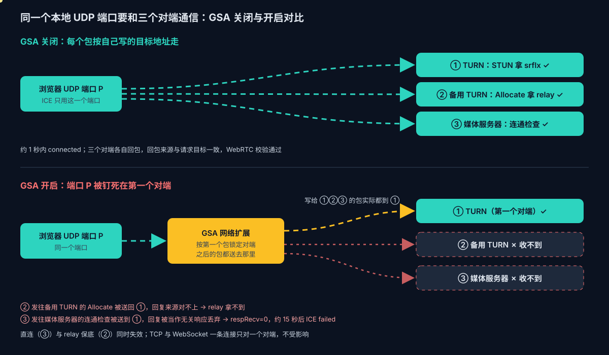
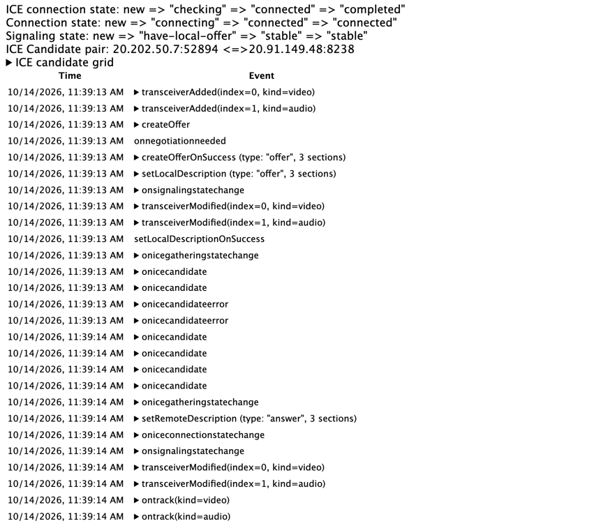

# Voice Live 系列 17：Global Secure Access 下数字人的网络问题解析

> 系列导读与主题地图见[系列 00](Voice-Live系列00：导读.md)。传输层概念见[系列 16](Voice-Live系列16：传输层概念对齐.md)，直连优先、relay 保底的拓扑见[系列 10](Voice-Live系列10：ICE、STUN与TURN.md)。GSA 产品本身的设计、UDP 限制与部署建议见产品页 [Global Secure Access：微软 SSE 的设计与实时媒体问题](../../product/Global-Secure-Access：微软SSE的设计与实时媒体问题.md)。

**标注约定**：**（实测）** 本文在同一台开启 GSA 的 macOS 设备上复现过；**（文档）** 有公开文档；**（推断）** 由现象推出，未证实。



## 一、结论先行

1. **现象**：数字人没有画面也没有声音；候选人说话能被转写，模型的文字回复也正常。服务端约 40 秒后收到 Voice Live 的 `webrtc_connection_invalid`（不是限流），然后关流、重连，循环往复。关闭 GSA 后立即恢复。
2. **根因（实测）**：GSA 在 macOS 上**把每个本地 UDP 端口钉死在它第一次通信的对端**。之后从同一个端口发往任何地址的包，都被送到这个对端，回包也显示来自它。效果等同于"发给 A 之后，再发给 B、C 的包都变成发给 A"。
3. **为什么 WebRTC 必挂**：ICE 用**一个端口**同时和三个对端通信：TURN 服务器（STUN 拿 srflx、Allocate）、TURN 用 `300 Try-Alternate` 重定向的备用服务器（拿 relay）、数字人媒体服务器（连通检查）。钉死之后只有第一个对端能通，**直连与 relay 保底同时失效**。
4. **为什么 WebSocket 不受影响**：TCP 一条连接只对一个对端，本来就是"一对一"。所以转写、文字、信令都正常，坏的只有 WebRTC 那一路。
5. **应用侧绕不开**：后端把 ICE 域名解析成 IP 再下发无效，钉死与地址是否合成无关；强制 `iceTransportPolicy: "relay"` 也无效，绕不开 TURN 的 300 重定向。
6. **能用的兜底（实测）**：avatar 的 `output_protocol` 设为 `websocket`，数字人音视频合成一路分片 MP4，经 WS 的 `response.video.delta` 下发，整条链路没有 ICE，在 GSA 下可用。代价是 TCP 队头阻塞、约多 30% 流量、前端改用 MSE 播放。
7. **两条前端改进**：WebRTC 建连失败要降级到"新建会话并改 websocket 下发"；ICE 断开后的恢复也必须新建会话，因为 `session.avatar.connect` 每个会话只接受一次，在原会话上重发会被拒（`WebRTC connection is in connected state`），这个提示**不代表 ICE 连上了**。
8. **排查方法**：在 GSA 下，"每个目标单独开 socket"的系统层测试全部正常，会误判为网络没问题；要用"同一个 socket 依次发往多个目标"的对照，才能暴露钉死。

## 二、现象：转写正常，数字人无画无声

数字人会话有两条通道（[系列 12 第四节](Voice-Live系列12：数字人弱网表现.md#四通道结构与关画面保声音的两条路)）：

| 通道 | 承载 | 传输 | GSA 下 |
|---|---|---|---|
| Voice Live WebSocket | 麦克风上行、转写、VAD、文字、信令（含 SDP 交换） | TCP 443 | 正常 |
| avatar WebRTC | 数字人画面和说话声音两条 RTP 轨 | UDP（经 TURN 或直连） | 失败 |

avatar 模式下，Azure 不在 WS 上下发 `response.audio.delta`，声音走 WebRTC 音轨（[系列 03 第六节](Voice-Live系列03：数字人出场延迟优化.md)）。所以 WebRTC 一失败，就是"听得见我、看不见也听不见它"。

服务端遥测的规律是：

| 时间 | 事件 |
|---|---|
| T+0 | 会话建立 |
| T+23 到 40 秒 | `voice.azure_error`，`code=webrtc_connection_invalid`，`avatar_rate_limited=False` |
| 随后 | WS 关闭，`close_reason=azure_stream_ended`，前端重连 |

后端、数据库、身份认证都正常，问题只在浏览器到 Azure 的 WebRTC 这一段。

## 三、流量全过程：同一个端口、三个对端

下面用一次复现里的地址（脱敏）走一遍。浏览器 ICE 只用一个本地端口 `P`。

| 角色 | 地址 |
|---|---|
| TURN 服务器（Azure 下发的 `turn:relay.communication.microsoft.com:3478`） | 真实 `20.202.x.x`；GSA 开启时 DNS 返回合成地址 `6.6.x.x` |
| 备用 TURN（300 重定向目标） | `20.202.y.y` |
| 数字人媒体服务器（answer 里的 srflx 候选） | `135.116.x.x` |
| GSA 云端出口 | `20.236.x.x` |

### 3.1 正常情况（GSA 关闭）

每个包按自己写的目标地址出网卡，经企业 NAT 到达目标；NAT 为每个对端各维护一条映射。

```text
① STUN    P → 20.202.x.x:3478   Binding Request
          20.202.x.x:3478 → P   Binding Success（你的公网地址是 …）      ✓ srflx
② TURN    P → 20.202.x.x:3478   Allocate
          20.202.x.x:3478 → P   300 Try-Alternate（请改连 20.202.y.y）
③ TURN    P → 20.202.y.y:3478   Allocate
          20.202.y.y:3478 → P   Allocate Success（中继地址 …）            ✓ relay
④ 信令     WS 上交换 offer / answer，拿到媒体服务器候选 135.116.x.x
⑤ ICE     P → 135.116.x.x       Binding（带 ICE 用户名和完整性校验）
          135.116.x.x → P       Binding Success                          ✓ connected → DTLS → RTP
```

Chrome 对每个回包核对两件事：事务 ID 对得上，**回包来自请求发往的那个地址**。三个对端各自回包，校验都能通过，大约 1 秒建连。

下面是 GSA 关闭时一次成功建连的 webrtc-internals：状态依次为 `checking → connected → completed`，`ontrack` 与 `setRemoteDescription(answer)` 都在约 1 秒内完成。候选对的本端地址 `20.202.x.x` 是 TURN 分配的 relay 地址，说明这次企业网下是 relay 接住的。



### 3.2 GSA 开启后

GSA 是装在 macOS 里的网络扩展（文档）。Chrome 的 UDP 包不再直接上网卡，而是先交给 GSA，GSA 再经自己的隧道送到 GSA 云端，由云端发往目标（隧道细节为推断，云端出口 `20.236.x.x` 出现在 srflx 里是实测）。

```text
⓪ DNS     relay.communication.microsoft.com → 6.6.x.x（GSA 合成地址）
① STUN    Chrome 写：P → 6.6.x.x:3478
          GSA 记下"端口 P ↔ 第一个对端"           ← 钉死发生在这里
          经隧道 → GSA 云端（20.236.x.x）→ 真实 TURN
          回包被交给 Chrome：来源 6.6.x.x:3478                           ✓ srflx = 20.236.x.x
② TURN    Allocate → 300 Try-Alternate（请改连 20.202.y.y）               ✓
③ TURN    Chrome 写：P → 20.202.y.y:3478 Allocate
          实际送到：第一个对端（原 TURN）
          回包来源 6.6.x.x，不是 20.202.y.y → Chrome 丢弃；重发 5 次都一样   ✗ 没有 relay
④ 信令     WS 正常
⑤ ICE     Chrome 写：P → 135.116.x.x Binding
          实际送到：第一个对端（TURN），TURN 当普通 STUN 回复
          回包来源 6.6.x.x → Chrome 当作无关响应丢弃                         ✗ respRecv=0
          约 15 秒后 ice=failed，DTLS 从未开始，一个 RTP 包都没有
```

结果：直连（⑤）和 relay 保底（③）在同一个原因上一起断掉，Voice Live 等不到浏览器连上，报 `webrtc_connection_invalid`。

复现时每秒打印的候选对统计（节选）：

```text
[4.8s]  ice=checking
  pair host → srflx:135.116.x.x  state=in-progress reqSent=8   respRecv=0
  pair host → host:10.240.x.x    state=in-progress reqSent=9   respRecv=0
[17.9s] ice=checking
  pair host → srflx:135.116.x.x  state=in-progress reqSent=113 respRecv=0
[18.9s] ice=disconnected conn=failed
  transport dtls=new ice=failed selected=-
```

候选里只有 host 和 srflx（`20.236.x.x`），**没有 relay**；远端的 host 候选是媒体服务器的私网地址 `10.240.x.x`，本来就不可达。

### 3.3 决定性对照：同一个 socket 依次发往多个目标

为什么说是"钉死"，而不是"某些地址被拦截"？下面这个对照把它和其他解释区分开：

| 方式 | 结果（实测） |
|---|---|
| A：每个目标用新 socket | 各自从各自的地址回包；发往一个没有服务的 IP 超时 |
| B：同一个 socket，先发合成地址 `6.6.x.x` | 之后发往 `20.202.x.x`、无服务的 IP、谷歌公共 STUN，**回包全部来自 `6.6.x.x`** |
| C：同一个 socket，先发真实 IP `20.202.x.x` | 之后所有回包都来自 `20.202.x.x` |

B 组里，发往"没有服务的 IP"的包也收到了回复。这说明包被**转发给了第一个对端**，而不只是回包地址被改写。C 组说明第一个对端是合成地址还是真实地址都一样会被钉死。

测试脚本（Python，GSA 开启时运行）：

```python
import socket, os, struct

def stun_req():
    return struct.pack("!HHI", 1, 0, 0x2112A442) + os.urandom(12)

def probe(sock, ip, port):
    try:
        sock.sendto(stun_req(), (ip, port))
        _, src = sock.recvfrom(2048)
        return "reply from %s:%d" % src
    except Exception as e:
        return "FAIL " + type(e).__name__

targets = [("20.202.x.x", 3478), ("192.0.2.10", 3478), ("74.125.250.129", 19302)]
first = socket.getaddrinfo("relay.communication.microsoft.com", 3478,
                           socket.AF_INET, socket.SOCK_DGRAM)[0][4][0]

shared = socket.socket(socket.AF_INET, socket.SOCK_DGRAM); shared.settimeout(2.5)
for ip, port in [(first, 3478)] + targets:          # 同一个 socket
    print("shared ", ip, probe(shared, ip, port))
for ip, port in [(first, 3478)] + targets:          # 每个目标一个新 socket
    s = socket.socket(socket.AF_INET, socket.SOCK_DGRAM); s.settimeout(2.5)
    print("fresh  ", ip, probe(s, ip, port)); s.close()
```

GSA 关闭时两组结果一致；GSA 开启时 `shared` 组所有回复都来自第一个目标，就能确认钉死。

**GSA 为什么会这样（客户端日志实测）**：macOS 的透明代理把应用的一个 UDP socket 作为一条"流"交给 GSA 扩展。日志显示，扩展用第一个数据报的目标建流（`start flow with remoteEndpoint 6.6.x.x:3478`）、匹配策略（本例中继命中的是 `channelName: Private`，即 Private Access 通道）、只做一次转发决定，然后自己创建一个 UDP socket 并 `connect` 到这个目标（`async udp connect to 6.6.x.x:3478, tunnel: utun5`）。同一个应用 socket 随后发往备用 TURN 和媒体服务器的数据报，日志里没有任何新的流决定，直接从这个已 connect 的 socket 发出。bypass 的 UDP 流也一样由扩展建 socket 并 connect（走 `en0`），所以钉死与是否进隧道无关。日志位置：`/Library/Logs/Microsoft/globalsecureaccessclient/`；托盘 → Troubleshooting → Advanced Diagnostics 的 Traffic 页可以实时看到每条流的 Channel。产品层面的分析见 [Global Secure Access：微软 SSE 的设计与实时媒体问题](../../product/Global-Secure-Access：微软SSE的设计与实时媒体问题.md)。

## 四、为什么应用侧绕不开

| 方案 | 结论 | 原因 |
|---|---|---|
| 后端把 `ice_servers.urls` 的域名解析成 IP 再下发 | ❌ 无效 | 钉死与地址是否合成无关（3.3 C 组） |
| 前端强制 `iceTransportPolicy: "relay"` | ❌ 无效 | Azure TURN 会先 `300 Try-Alternate` 到另一个 IP，重定向后的请求同样被钉死 |
| 加 TURN over TCP / TLS | 不可行 | 凭据由 Azure 下发，客户端不能自行加 TURN 地址（[系列 12](Voice-Live系列12：数字人弱网表现.md) 第一节第 6 条） |
| 自建不做重定向的 TURN over TLS 443 | 待验 | TCP 只对一个对端，媒体全经中继也只有一个对端，理论上能绕开；见[系列 11](Voice-Live系列11：自建TURN中继.md) 第六节 |
| avatar 改 `output_protocol: websocket` | ✅ 实测可用 | 没有 ICE，只有一条 TCP 连接（第六节） |
| IT 让 ACS 中继与 Azure 媒体 UDP 完全不经过 GSA 扩展，或关闭 GSA | ✅ 有效 | 流量不经扩展，socket 恢复一对多；注意 GSA 自己的 bypass 仍由扩展代发、仍会钉死，见下文 |

这和系列 10 说的"relay 是企业网的保底"并不矛盾，只是揭示了保底的一个隐含前提：**浏览器的同一个 UDP 端口能分别到达多个对端**。常见的企业网问题是"出向 UDP 到媒体服务器被防火墙挡住"，TURN 可达，保底能接住；这次是端口语义被改了，保底依赖的那个前提不成立。

## 五、Chrome 侧怎么验证

### 5.1 webrtc-internals：成功时好用，失败时可能是空的

成功时直接看顶部三行状态和 ICE Candidate pair（3.1 的截图）。失败时有两个坑：

- 前端在多次恢复失败后会关闭 PeerConnection，**关闭的 PC 会从 webrtc-internals 上消失**，导出的 dump 里 `PeerConnections` 为空，只剩 getUserMedia 的记录。要在失败**之前**导出，或者改用 5.2 的钩子。
- getUserMedia 标签页只能说明麦克风采集正常，看不出连接状态，要点开带页面地址的那个标签页。

### 5.2 getStats 钩子：每秒打印候选对统计

在 Console 里粘贴，然后在页面内重新发起语音会话（不要刷新）：

```js
(() => {
  const Orig = window.RTCPeerConnection; let n = 0;
  window.RTCPeerConnection = function (...args) {
    const pc = new Orig(...args), id = ++n, t0 = performance.now();
    const timer = setInterval(async () => {
      if (pc.connectionState === 'closed') return clearInterval(timer);
      const s = await pc.getStats(), by = {}; s.forEach(r => by[r.id] = r);
      const rows = [];
      s.forEach(r => {
        if (r.type === 'candidate-pair' && (r.requestsSent || r.requestsReceived)) {
          const l = by[r.localCandidateId], m = by[r.remoteCandidateId];
          rows.push(`${l?.candidateType}:${l?.address} -> ${m?.candidateType}:${m?.address}:${m?.port} ` +
            `state=${r.state} reqSent=${r.requestsSent} respRecv=${r.responsesReceived} reqRecv=${r.requestsReceived}`);
        }
        if (r.type === 'inbound-rtp') rows.push(`inbound ${r.kind} bytes=${r.bytesReceived} frames=${r.framesDecoded ?? '-'}`);
      });
      console.log(`[pcdiag#${id} +${((performance.now() - t0) / 1000).toFixed(1)}s ice=${pc.iceConnectionState}]\n` + rows.join('\n'));
    }, 1000);
    return pc;
  };
  window.RTCPeerConnection.prototype = Orig.prototype;
  console.log('[pcdiag] installed');
})();
```

读法：`reqSent` 一直涨、`respRecv=0`，说明连通检查没有收到被认可的回复；有没有 relay 候选、有没有 `inbound` 字节，决定是"一条路都没有"还是"有路但不通"。

### 5.3 Chrome 的 WebRTC verbose 日志

用下面的参数启动 Chrome，日志输出到 stderr：

```bash
--enable-logging=stderr --v=0 \
--vmodule=*p2p*=2,*stun*=2,*port*=1,*turn*=2,*connection*=1
```

三类关键行：

| 日志 | 含义 |
|---|---|
| `Failed to resolve address for … errorcode: -105`，以及 webrtc-internals 上的 `701 STUN host lookup received error` | **只出现在 IPv6 端口上时是噪声**：GSA 不处理 IPv6，AAAA 返回 IPv4 映射地址 `::ffff:6.6.x.x`，IPv6 socket 用不了；不影响 IPv4 |
| `Received TURN allocate error response … code=300` 之后 `Redirecting from TURN server … to TURN server [20.202.y.y]`，接着多次 `TURN allocate request sent` 却没有成功 | relay 失败在重定向这一步 |
| `Ignoring STUN binding response message on shared socket`，或者 `Received non-STUN packet from unknown address` | 回包来自"不该来的地址"，被丢弃；这是端口钉死或地址改写的直接痕迹 |

另一个坑：`--log-net-log` 抓到的 net-log 里**看不到 WebRTC 的 STUN/TURN 解析**，它走 P2P socket manager，不经过普通网页请求的 HostResolver 事件流。

### 5.4 不依赖业务账号的完整复现

用 Entra token 直连 Voice Live 开一个带 avatar 的会话，就能在任意机器上复现，不需要业务系统的账号：Python 负责 WS 信令，Playwright 起的 Chrome 负责 WebRTC。

```python
# 骨架：WS 信令在 Python，WebRTC 在 Playwright 的页面里
URL = "wss://<resource>.services.ai.azure.com/voice-live/realtime?api-version=<version>&model=<model>"
token = az("account get-access-token --resource https://cognitiveservices.azure.com")
ws.send({"type": "session.update", "session": {
    "modalities": ["text", "audio"],
    "voice": {"name": "en-US-AvaNeural", "type": "azure-standard"},
    "avatar": {"character": "lisa", "style": "casual-sitting"}}})
ice = recv("session.updated")["session"]["avatar"]["ice_servers"]
offer = page.evaluate(CREATE_PC_AND_OFFER, ice)        # 返回 btoa(JSON.stringify({type, sdp}))
ws.send({"type": "session.avatar.connect", "client_sdp": offer})
answer = json.loads(b64decode(recv("session.avatar.connecting")["server_sdp"]))["sdp"]
page.evaluate("sdp => __pc.setRemoteDescription({type: 'answer', sdp})", answer)
loop: page.evaluate(GET_STATS)                          # 同 5.2 的候选对统计
```

要点：`client_sdp` 和 `server_sdp` 都是 base64 编码的 `{type, sdp}` JSON；python.org 版 Python 访问 Azure 端点时，如果报 `CERTIFICATE_VERIFY_FAILED`，先用 `openssl s_client` 看签发者，是正常的微软 CA 就说明只是缺 CA 库，用 certifi 即可，不是 TLS 被替换。

### 5.5 确认是谁在接管流量

| 检查 | 命令 | 本例所见 |
|---|---|---|
| 网络扩展 | `systemextensionsctl list` | `com.microsoft.globalsecureaccess.tunnel` 处于 activated enabled |
| 路由 | `netstat -rn -f inet` | 第二条默认路由走 `utunN`，`6.6/16` 指向它 |
| DNS | `scutil --dns`、`dscacheutil -q host -a name <域名>` | GSA 的 scoped resolver；所有域名解析为 `6.6.x.x` |
| 出口 | srflx 候选地址 | `20.236.x.x`（GSA 云端）而不是企业出口 |

注意，机器上同时运行着别的 VPN 客户端进程（但没有连接）时，不能只看进程列表判断隧道属于谁，要以系统扩展和 resolver 为准。

## 六、绕开 ICE：数字人改走 WebSocket 下发

avatar 的 `output_protocol` 字段可选 `webrtc`（默认）或 `websocket`（[系列 16 第二节](Voice-Live系列16：传输层概念对齐.md)），此前在[系列 12 的 6.1](Voice-Live系列12：数字人弱网表现.md#61-服务端-avatar-可调项复核没有接收端缓冲参数但有三个未验证的字段) 一直是待验项。本次在 GSA 开启的同一台机器上实测：

```json
{"type": "session.update", "session": {
  "modalities": ["text", "audio"],
  "voice": {"name": "en-US-AvaNeural", "type": "azure-standard"},
  "avatar": {"character": "lisa", "style": "casual-sitting", "output_protocol": "websocket"}}}
```

| 项目 | 实测 |
|---|---|
| `session.updated` 回显 | `ice_servers: null`，`output_protocol: "websocket"` |
| 下行事件 | `response.video.delta`，`codec: "h264"`；25 秒内 302 条、约 8.7 MB JSON |
| `delta` 内容 | base64 编码的**分片 MP4**（开头为 `ftyp iso5`），可直接拼接 |
| 视频 | h264 1920×1080 25 fps，约 2.16 Mbps |
| 音频 | AAC 16 kHz 单声道约 17 kbps，**和视频在同一个 MP4 里**；没有单独的 `response.audio.delta` |
| 实时性 | 拼接后时长 24.2 秒，与经过的时间一致；首个分片在会话建立后约 0.9 秒到达 |
| 画面 | 解码正常 |


代价与待测：
- **流量**：base64 加 JSON 包装后，原始约 6.7 MB 变成约 8.7 MB，多约 30%；1080p 在线路上约 2.8 Mbps。可配合较小的分辨率或码率。
- **弱网**：走 TCP，丢包时有队头阻塞，没有 WebRTC 的抖动缓冲、NACK、FEC 和发送端码率自适应；弱网表现需要按系列 12 的方法重测。
- **前端**：播放改用 MSE（`MediaSource` + `SourceBuffer` 追加 fMP4 分片），不再用 RTCPeerConnection；声音也从这一路出来，现有的 WebRTC 音轨链路要改。
- **未测**：端到端延迟、打断时能否及时停止已缓冲的分片。

## 七、应对与两条前端改进

**网络侧（根治）**：请 IT 在 GSA 的转发策略中，对 ACS/Teams 媒体中继（`relay.communication.microsoft.com`、`*.relay.skype.com`、`20.202.0.0/16` 的 UDP 3478 到 3481）以及 Azure 数字人媒体服务器的 UDP 做 bypass。只是"不分配合成 DNS"还不够；客户端日志显示，GSA 判为 bypass 的 UDP 流也是由扩展自己建 socket 并 connect 到首个目标后发出，照样会钉死。所以在 GSA 策略里配 bypass 不一定解决问题，需要让这些流不被扩展截获，或者向 GSA 反馈修复。这个行为也值得用 3.3 的脚本反馈给 GSA 团队。

**用户侧（临时）**：暂时关闭 GSA，或换网络。

**前端改进一：降级到 WebSocket 下发。** 先走 WebRTC；ICE 在若干秒内没有进入 `connected`，或者候选对持续 `respRecv=0`，就**新建会话**并把 avatar 改为 `output_protocol: websocket`。大多数用户仍然用效果更好的 WebRTC，企业安全客户端下的用户也能看到数字人。不能在原会话上改，原因见下一条。

**前端改进二：ICE 断开后的恢复必须新建会话。** [系列 12 第四节](Voice-Live系列12：数字人弱网表现.md#四通道结构与关画面保声音的两条路)已经记录 `session.avatar.connect` 每个会话只接受一次。本例进一步确认：**ICE 从未连通时，再发一次同样被拒**，Azure 回 `WebRTC connection is in connected state`。这句话的意思是"本会话已经 connect 过"，不是"ICE 连上了"，不要据此判断连接状态。一个在原会话上重建 PC、重发 offer 的恢复逻辑，3 次尝试会全部被拒；每次重建会话还会消耗数字人新建限流配额（每分钟 3 次，[系列 13](Voice-Live系列13：数字人配额与限流.md)），恢复会被进一步推迟。

**诊断提示**：检测到 ICE 停在 `checking` 且 `respRecv=0`、或者拿不到 relay 候选时，提示用户"网络安全客户端可能阻止了音视频连接"，并直接走降级，不要静默等 40 秒。

## 八、排查清单

| 现象 | 看哪里 | 判定 |
|---|---|---|
| 转写有、数字人无画无声 | 服务端 `webrtc_connection_invalid` | WebRTC 没连上，不是 TTS 或模型问题 |
| 约 40 秒断开、反复重连 | WS `close_reason=azure_stream_ended` | Azure 等浏览器连通超时 |
| 恢复时报 `connected state` | 前端日志 | 在原会话上重发了 `session.avatar.connect`，恢复逻辑要改成新建会话 |
| webrtc-internals 没有 PC 标签页、dump 为空 | — | PC 已被关闭，用 5.2 的钩子重抓 |
| 只有 IPv6 的 701 / -105 | verbose 日志 | 噪声，看 IPv4 |
| `reqSent` 涨、`respRecv=0`，无 relay | getStats | 回包没到或被丢弃，查 5.3 的三类日志 |
| 系统层 STUN 都通 | 3.3 对照 | 每目标一个 socket 的测试会误判，改用同一 socket 多目标 |
| utun 隧道、`6.6.x.x`、srflx 为 `20.236.x.x` | 5.5 | GSA 接管 |
| 恢复后 candidate pair 本端是 `20.202.x.x` | ICE candidate grid | 走 relay 接住的 |

## 九、待验

- [ ] WebSocket 下发数字人在系列 12 各档弱网下的表现，以及首帧延迟、端到端延迟、打断时的停止速度。
- [ ] 自建不做重定向的 TURN over TLS 443，在 GSA 下能否建连（[系列 11](Voice-Live系列11：自建TURN中继.md) 第六节）。
- [ ] GSA 端口钉死是否有空闲超时，以及 Windows 版客户端是否有同样行为。
- [ ] 用 `tcpdump` 在 GSA 开启时确认发往媒体服务器的检查包不出现在物理网卡上（目前"包进了隧道"是推断）。
- [ ] Safari、Edge 在 GSA 下是否同样失败（预期相同，因为钉死发生在系统扩展层）。
- [ ] 把 5.4 的复现脚本整理成客户网络基线工具，补进系列 12 第 7.6 节的探针。

## 附录：排查过程中的两个中间结论

正文是最终结论，下面两条是排查过程中先后得出、后来被推翻的解释，记录下来是因为它们各自对应一个容易误读的现象：

- **"Chrome WebRTC 解析不了 TURN 域名"**：依据是 webrtc-internals 上的 `701 STUN host lookup received error`。实际上 701 只出现在 IPv6 端口上，是 GSA 不处理 IPv6 带来的噪声（5.3）；IPv4 解析一直是成功的。
- **"回包源地址与合成 IP 不一致"**：GSA 某一次开启时，发往合成地址的 STUN 回包来源是真实 IP，被 WebRTC 丢弃。这是端口钉死在另一种 GSA 转发状态下的表现，它只能解释那一次的现象，解释不了 relay 失败和连通检查失败；3.3 的同一 socket 对照才把机制定位清楚。

两次误判的共同原因，是系统层测试每个目标都用新 socket，天然绕开了钉死。

## 参考

- 产品介绍：[Global Secure Access：微软 SSE 的设计与实时媒体问题](../../product/Global-Secure-Access：微软SSE的设计与实时媒体问题.md)
- [Global Secure Access traffic forwarding profiles — Microsoft Learn](https://learn.microsoft.com/en-us/entra/global-secure-access/concept-traffic-forwarding)
- [Known Limitations for Global Secure Access — Microsoft Learn](https://learn.microsoft.com/en-us/entra/global-secure-access/reference-current-known-limitations)
- [Tunnel Vision: Breaking Microsoft Global Secure Access — Part 1](https://ar0x.com/posts/what-is-gsa)（合成 IP 与流量接管机制）
- [RFC 8656: Traversal Using Relays around NAT (TURN)](https://www.rfc-editor.org/rfc/rfc8656)（300 Try-Alternate）
- [RFC 8445: Interactive Connectivity Establishment (ICE)](https://www.rfc-editor.org/rfc/rfc8445)
- 系列相关篇：[系列 10](Voice-Live系列10：ICE、STUN与TURN.md)（拓扑）、[系列 11](Voice-Live系列11：自建TURN中继.md)（自建 TURN）、[系列 12](Voice-Live系列12：数字人弱网表现.md)（弱网与通道结构）、[系列 13](Voice-Live系列13：数字人配额与限流.md)（限流）、[系列 16](Voice-Live系列16：传输层概念对齐.md)（传输层概念与 webrtc-internals）
