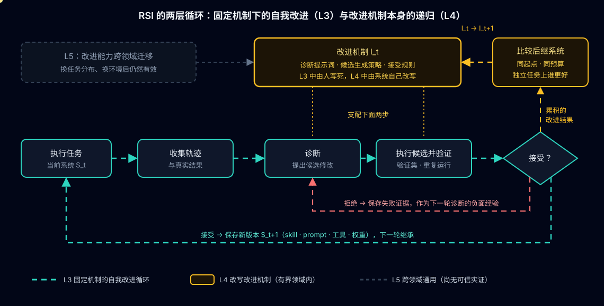

# RSI 系列 00：递归自我改进总览

> RSI 是 **Recursive Self-Improvement**（递归自我改进）：系统把经验和反馈变成对自身的持久修改，并且这些修改会影响**之后的改进怎么产生、怎么评估、怎么被选中**。本篇是系列的总览页，目标不是罗列"自进化 agent"项目，而是建立一套判断框架——以后看到 RRSI、SkillOpt 或任何新的 self-improving 论文，都能说清楚它**改的是什么、凭什么改、改动存在哪里、下一轮继承什么、用什么实验能推翻它的提升主张**。
>
> 学习主线：**改进对象 → 改进闭环 → 递归机制 → 有效性验证 → 工程应用**。五级定义用来定位，不单独充当理论体系。

---

## 一、三种"变好"：先分清楚改进发生在哪一层

用一个只读的数据分析 agent 举例：读取文件、查询数据库、计算指标、生成报告。

**第一种：当前任务做得更好。** 它发现 SQL 有问题，修正后重新执行，得到正确报告。如果任务结束后这条经验没有进入后续运行，这是**任务内修正**。它有价值，但不能说明系统发生了持续学习。

**第二种：后续任务做得更好。** 它从多次失败中提炼出一条规则——"关联表之前先检查键的唯一性，避免重复计数"——经过验证后写进 skill，下一次任务继续使用。这里改进的是 agent 的**持久状态**，即使模型权重完全不变，系统也获得了持续收益。

**第三种：以后更善于找到改进方法。** 原来的优化器只会从失败日志里追加规则，系统后来发现这样会让规则越积越冗余，于是把优化策略本身改成：

- 同时比较成功和失败轨迹
- 优先找共同的失败机制
- 每次只修改少量规则
- 用新任务检验规则能否迁移
- 记录被否决的方案，避免反复尝试

如果这套新策略被保留下来、实际支配后续的优化轮次，递归就发生在**改进机制**上。这比重复执行同一个优化循环强一个层级。

[The Last AI Built by Humans](https://arxiv.org/abs/2609.11873) 明确区分了两类证据：**结构证据**（机制确实被修改、并被下一轮使用）和**效果证据**（修改后的机制在可比预算下产生了更强的后继系统）。两者需要分别验证，有前者不等于有后者。

## 二、把 agent 看成可学习的系统

用一个简化的状态表达式：

$$
S_t = (M_t,\ H_t,\ D_t,\ T_t)
$$

| 对象 | 具体包含什么 | 可以怎样改进 |
|---|---|---|
| $M$ 模型 | 权重、adapter | 微调、强化学习、蒸馏 |
| $H$ harness | prompt、skill、工具、流程、记忆、上下文管理 | 改操作策略、工具接口、工作流 |
| $D$ 数据系统 | 任务、轨迹、训练样本、课程、数据筛选 | 生成更有用的练习、修正数据分布 |
| $T$ 训练系统 | 训练配方、loss、采样、超参、训练基础设施 | 改善"经验变成模型能力"的过程 |

再引入改进机制 $I_t$：

$$
S_{t+1} = I_t(S_t,\ \text{经验与反馈})
$$

如果 $I_t$ 一直由人写好且保持不变，系统可以持续优化，但只是在一个**固定机制**里学习。更进一步的递归是：

$$
I_{t+1} = \text{根据已有改进结果对 } I_t \text{ 做出的持久修改}
$$

然后用 $I_{t+1}$ 去产生后续系统。[The Path to Recursive Self-Improving Agents](https://self-improving-agent.com/) 这篇综述就是把模型、harness、数据系统、trainer 和改进机制放在同一框架里分析的（$H$ 的定义与 [Agent = Model + Harness](../../tool/Agent=Model+Harness.md) 一致）。

这个框架直接推出两个判断：

- **权重更新不是 agent 自我改进的唯一途径。** 可执行工具、skill、工作流和记忆都能承载学习结果。
- **权重更新也不自动意味着递归。** 一直按人定的配方训练，改进机制本身可能从未变化。

所以读论文时先问"学习结果保存在哪里"，再问"它有没有改进自己的学习方法"。

## 三、两套五级定义：编号含义不同，别混用

近期至少有两套五级体系，它们是研究框架，不是统一的行业标准。

**第一套**：阿里团队的综述 [The Path to Recursive Self-Improving Agents](https://self-improving-agent.com/)（[GitHub 文献库](https://github.com/D2I-ai/awesome-recursive-self-improving-agents)），按"能不能自己提出、实施、验证，能不能改写改进机制，能不能跨领域"划分：

| 等级 | 名称 | 自主提出 | 自主实施 | 自主验证 | 改进改进机制 | 领域通用 |
|---|---|---|---|---|---|---|
| L1 | 人工改进 | | | | | |
| L2 | 辅助改进：AI 给诊断和候选，人验证并应用 | ✓ | | | | |
| L3 | 程序化自我改进：机制固定 | ✓ | ✓ | ✓ | | |
| L4 | 有界递归自我改进：限定领域内改写自身机制 | ✓ | ✓ | ✓ | ✓ | |
| L5 | 通用递归自我改进：改进能力跨领域迁移 | ✓ | ✓ | ✓ | ✓ | ✓ |

综述的关键句是：区分点不在 agent 能不能"建议"一个改进，而在它能不能**提出、应用、验证，并最终修订改进机制本身**。

**第二套**：[The Last AI Built by Humans](https://arxiv.org/abs/2609.11873) 按"AI 接管了改进生命周期里的哪些决策"划分，五级依次是：改进执行自主（improvement-execution）、改进策略自主（improvement-strategy）、经验获取自主（experience-acquisition）、环境适应自主（environment-adaptation）、递归元改进（recursive meta-improvement）。它把可被更新的对象列得很宽：权重、prompt、代码、记忆、skill、任务分布，以及改进机制本身。

**怎么用**：先用第一套区分"辅助改进 / 固定循环的自我改进 / 改进机制的递归"；再用第二套检查系统在整个生命周期里控制了哪些决策（谁选策略、谁决定练什么、谁适应部署环境）。**不要因为某个项目被称作 L4 就跳过对它具体循环的分析。**

## 四、APO、SkillOpt、RRSI：放进同一张地图

三者都在冻结模型之外做文本空间或 harness 空间的优化，但优化对象和关注点不同：

| 方法 | 主要优化对象 | 怎样提出改进 | 最值得学的部分 |
|---|---|---|---|
| 微软 APO（ProTeGi） | prompt | 从错误样本生成自然语言批评（textual gradient），据此生成候选 prompt，用 beam search + bandit 选择 | 把 prompt 修改变成有反馈的优化过程 |
| 微软 SkillOpt | 自然语言 skill 文档 | 从成功和失败轨迹反思，提出有预算的增删改，通过验证门控决定是否接受；被否决的编辑也作为负面证据 | skill 的训练纪律：有界步长、版本选择、失败更新管理 |
| Google RRSI | 更广的 agent harness（prompt、控制流、工具、记忆、上下文管理） | 迭代修改组件，同时**约束候选的提出和选择** | 防止优化追逐噪声、拟合 benchmark、无限累积复杂度 |

**APO**：textual gradient 是用自然语言描述 prompt 的问题、再引导语义修改，不是对文本做数值微分。原论文 [Automatic Prompt Optimization with "Gradient Descent" and Beam Search](https://arxiv.org/abs/2305.03495)；机制拆解见 [Agent Lightning 算法深解：APO](../agent-lightning/Agent-Lightning算法深解：APO.md)，实操见 [Agent Lightning 系列 01：用 APO 做 Prompt Tuning](../agent-lightning/Agent-Lightning系列01：用APO做Prompt-Tuning.md)。

**SkillOpt**：把 skill 当作冻结模型之外的可训练状态，把权重空间 SGD 的纪律（有界学习率、拒绝记忆、动量、validation 门控）搬进文本空间。论文 [SkillOpt: A Systematic Controllable Text-Space Optimizer for Agent Skills](https://arxiv.org/abs/2605.23904)，精读见 [论文阅读：SkillOpt](../../../paper/2026-07-01-SkillOpt.md)，系列见 [SkillOpt 系列 01：源码篇](../SkillOpt/SkillOpt系列01：源码篇.md) 起的四篇；两者联用的账怎么算见 [SkillOpt 系列 04：APO 与 SkillOpt 联合展望](../SkillOpt/SkillOpt系列04：APO与SkillOpt联合展望.md)。

**RRSI**：[RRSI: Regularized Recursive Self-Improvement of Agent Harnesses](https://arxiv.org/abs/2609.24972)（Google Cloud AI Research 等，[代码](https://github.com/google-research/rrsi)）的核心问题是：**优化集上的提升能不能带到陌生任务？** 它把过拟合拆成三种耦合行为——编码 benchmark 特定模式、追逐评估噪声、累积不改善底层机制的复杂度——并借用经典正则化思路在搜索过程中约束：

- 编辑预算随轮次退火，控制每轮改动规模
- 保留搜索历史，用于归因和引导探索
- 筛查 benchmark 特定的修改
- 拒绝被噪声抬高或成本过高的改进
- 剪掉没有贡献的组件

论文报告在演化集上最高提升 14.1 分、五个分布外 benchmark 上最高 4.7 分，且产出的 harness 比无正则的演化少用约 30% policy token。

**我的判断**：这三者都适合用来学习"如何建立可靠的改进循环"。按第一套分级，它们的主体大多落在 L3——改进机制（反思提示词、编辑规则、接受门控）由人设计。是否达到更强意义的递归，要检查运行时是否**持久修改了改进机制**，并验证这种修改的后续效果。方法名里带 self-improvement 或 meta update，不能代替这个检查。

## 五、四条延伸研究路线

不必一次读几十篇。每条路线先读一篇代表作，弄懂它**新增了什么**。

| 路线 | 代表工作 | 阅读时抓住的问题 |
|---|---|---|
| 从轨迹学习策略 | [GEPA](https://arxiv.org/abs/2507.19457) | 怎样从完整轨迹诊断问题，并组合不同候选的长处？ |
| 主动获取学习经验 | [Voyager](https://arxiv.org/abs/2305.16291) | 谁决定下一步练什么？可执行技能怎样积累、检索、复用？ |
| 把自生成经验写进权重 | [STaR](https://arxiv.org/abs/2203.14465)、[SEAL](https://arxiv.org/abs/2506.10943) | 样本怎样生成和筛选？怎样衡量一次模型更新的实际收益？ |
| 修改代码与改进程序 | [Darwin Gödel Machine](https://arxiv.org/abs/2505.22954)、[STOP](https://arxiv.org/abs/2310.02304) | 被修改的是执行任务的代码，还是生成和选择后继系统的程序？ |

- **Voyager** 把自动课程、可执行 skill 库和环境反馈结合起来，用来理解"自己选择练习"和"自己积累技能"的关系。
- **STaR** 生成推理样本、筛选后微调、循环往复；**SEAL** 更进一步，学习生成自身适应所需的数据和更新指令——改进对象从 $M$ 延伸到了 $D$ 和 $T$。
- **STOP** 让改进程序改进自己，是"改进机制递归"最直接的早期样本；**DGM** 在 coding agent 上做开放式的自我代码修改与存档演化。
- 另外值得看 [AlphaEvolve](https://deepmind.google/discover/blog/alphaevolve-a-gemini-powered-coding-agent-for-designing-advanced-algorithms/) 如何组合代码生成、自动评估和进化搜索。但要分清：**AI 改进了一个算法，和 AI 改进了自己的改进能力，是两个不同的证据问题。**

用探索历史做离线回放来降低探索成本的另一种思路，见 [论文初读：Dream-RSI](../../../paper/2026-09-22-Dream-RSI.md)。

## 六、判断 RSI 主张的五个问题

第二节的图画出了闭环，但闭环本身不证明有效。至少要追问五件事：

1. **反馈是真的吗？** 报告写得流畅不代表计算正确，命令执行成功不代表业务任务完成。能用数据对账、测试、约束检查验证的部分，应尽量用这些信号（evaluator 怎样设计见 [Evaluator 概念全景](../evaluation/Evaluator概念全景.md)）。
2. **候选是否只是偶然得分高？** 随机性会制造"最佳版本"。关键比较需要重复运行并报告波动——这正是 [SkillOpt 系列 04](../SkillOpt/SkillOpt系列04：APO与SkillOpt联合展望.md) 里 σ 与门控分辨率要算的东西。
3. **验证集是否已经参与了学习？** 优化器反复依据同一验证集接受修改，这个集合就间接参与了搜索。最后必须有未用于选择候选的测试集，最好再加分布外任务。
4. **收益来自能力还是更多计算？** 多调几次模型、多搜几个候选也能提高成功率。比较时要报告调用数、token、时延，以及优化阶段的总成本（成本口径见 [FinOps 系列 02：数据飞轮与 RSI](../../FinOps/FinOps系列02：数据飞轮与RSI.md)）。
5. **新规则有没有损害旧能力？** 在一个失败场景上修好，不代表总体变好，需要覆盖已有能力的回归任务。

到了递归层面，还要再加一个比较：**改进后的优化器与原优化器，在相同起点、相同预算、独立任务上，谁能产生更好的后继系统？** 这才是在测试"更善于改进"，而不只是"某个最终版本分数更高"。

## 七、一个能解释结果的教学实验

选只读的数据分析 agent 作为实验对象：给定数据和问题，完成查询、计算、证据引用与解释。它能同时暴露 prompt、工具使用、流程和验证问题，且部分结果可以客观核验。这是教学实验，不是论文级验证方案。

**准备**：

- 约 60 个任务，按任务模板或数据来源切成优化集、验证集、最终测试集；避免同一题型只换数字就跨集合分布
- 固定模型版本、工具、运行限制和起始 skill
- 先记录基线的正确率、错误类型、调用量和时延
- 保存每轮的候选差异、修改理由、接受结果及成本

**三组实验依次做**：

| 实验 | 操作 | 观察什么 |
|---|---|---|
| A：固定系统 + 手工修改 | 基线运行，再由人修改一次 skill | 人的直觉修改是否改善整体表现？ |
| B：自动 skill 优化 | 从轨迹生成小幅修改，通过验证接受 | 能否持续改善？失败的修改有什么共同点？ |
| C：约束优化过程 | 在 B 上加入历史证据、噪声检查、成本规则 | 优化集、测试集、成本三者之间出现什么变化？ |

C 借鉴的是 RRSI 的原则；没有按其代码和配置运行，就只能称作"借鉴 RRSI 的实验"，不能说复现了 RRSI。

做完这三组，才进入第四组：让优化器修改自身的一小部分（例如诊断提示词或候选生成策略），再与固定优化器比较。此时要保持最终评估和业务约束独立，避免系统通过改变计分方式制造提升。

最有教育意义的结果很可能是：**优化集越来越好，陌生任务没有改善，skill 越来越长，成本越来越高。** 亲眼看到这一幕，才会理解为什么 RSI 需要的不只是反思和自动修改。

## 八、对 agent 与模型工作的三个方向判断

以下是有条件的判断，不是定论。

**第一，同时设计"执行路径"和"改进路径"。** 执行路径负责交付当前任务；改进路径负责把轨迹转成经过验证的持久更新。日志只有能关联到任务结果、修改版本和成本时，才容易成为学习资源——这是从一开始就要做进 trace 结构里的，事后补很难。

**第二，先检验外部能力层，再决定是否训练权重。** 失败如果来自步骤遗漏、工具理解、上下文组织或验证习惯，skill 和 harness 是优先测试的对象；如果信息充分、流程合理的情况下仍有稳定的领域能力缺口，再比较更强模型、微调和蒸馏。这个顺序是工程建议，不是"外部 skill 必然优于训练"的结论。它和 [Prompt 优化成熟度阶梯](../../../wiki/methods/prompt-optimization-maturity-ladder.md) 的 L0→L2 是同一个方向。

**第三，价值越来越多来自"怎样挑选改进"，而不是"怎样生成改进"。** 候选生成越来越便宜之后，决定系统能否真正积累能力的是：如何判断一个改动值得接受、如何保留负面经验、如何发现瓶颈已经从 prompt 转移到数据或模型、如何衡量单位预算的提升。RRSI 的正则化和 SkillOpt 的门控，本质上都在这一侧下功夫。

## 九、系列路线图

按五个专题推进，每篇的"学懂"标准写在右列：

| 篇目     | 主题             | 验收标准                               |
| ------ | -------------- | ---------------------------------- |
| 00（本篇） | 概念与形式化         | 能画出系统状态、改进机制和人控制的边界                |
| 01（待写） | APO 与 SkillOpt | 能从一条轨迹解释为什么提出某个编辑、为什么接受或拒绝         |
| 02（待写） | RRSI 与评估       | 能设计一个识别过拟合、噪声和成本增长的实验              |
| 03（待写） | 经验与模型学习        | 理解 Voyager、STaR、SEAL 如何改变学习信号和持久状态 |
| 04（待写） | 递归与迁移          | 用 STOP、DGM 检查改进机制是否真的被改变，以及变化是否有效  |

整个系列的总验收：**拿到一个新项目，能准确说明它改什么、凭什么改、改动存在哪里、下一轮继承什么，以及用什么实验推翻它的提升主张。** 达到这个标准，再讨论 RSI 对产品架构和长期研究方向的意义，会更扎实。

## 关联阅读

- [FinOps 系列 02：数据飞轮与 RSI](../../FinOps/FinOps系列02：数据飞轮与RSI.md) —— 数据飞轮与 RSI 的三层嵌套循环
- [论文初读：Dream-RSI](../../../paper/2026-09-22-Dream-RSI.md) —— 用探索历史做 replay simulator
- [SkillOpt 系列 04：APO 与 SkillOpt 联合展望](../SkillOpt/SkillOpt系列04：APO与SkillOpt联合展望.md) —— 先算账再开跑的三个数
- [Agent Lightning 算法深解：APO](../agent-lightning/Agent-Lightning算法深解：APO.md) —— textual gradient 与 beam search
- [Agent = Model + Harness](../../tool/Agent=Model+Harness.md) —— harness 的定义
- [Continually Self-Improving AI](../../../wiki/concepts/continual-self-improving-ai.md) —— wiki 概念页
